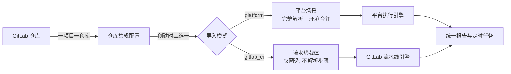

# 软件测试平台——GitLab 集成需求规格说明书

**文档版本**：V1.0
**日期**：2026-10-11
**状态**：起草中

---

## 1. 引言

### 1.1 编写目的

定义接口测试业务域与 GitLab 代码仓库集成的需求边界：如何将托管在 GitLab 上的 Maven 接口自动化工程导入为平台测试场景，以及导入后如何以双引擎方式执行与归集结果。本文是该能力的唯一需求来源，供后续概要设计、详细设计与验收对照使用。

### 1.2 范围

覆盖：

1. **仓库集成配置**：项目级 GitLab 仓库配置的创建、维护与连通性校验；
2. **工程导入与解析**（F1）：测试类扫描、用例解析、模块归属、环境合并、增量导入；
3. **双引擎执行**：场景按来源与导入模式路由到平台执行引擎或 GitLab 流水线引擎，含单场景执行、批量执行与定时任务混合执行；
4. **结果归集**：流水线状态与用例级结果回收、双引擎套件报告聚合。

不覆盖：Mock 服务、接口定义导入（cURL / Swagger）、快速调试等既有能力不因本功能变更。

### 1.3 与基线的关系

- 《接口测试总览》《测试场景》《定时任务》《环境管理》等既有分册描述的平台原生能力保持不变，本分册只新增「导入场景」与「流水线引擎」两条并行路径；
- 既有 cURL / Swagger 导入链路的记录与映射机制不被本功能复用，二者互不干扰；
- 测试场景的字段模型、报告结构、任务执行范围等以既有分册为准，本分册只描述其中因导入而新增的语义。

### 1.4 定义与缩写

| 术语 | 定义 |
| ---- | ---- |
| 双引擎 | 同一平台内并存的两种场景执行方式：平台执行引擎（Ryze）与 GitLab 流水线引擎 |
| 导入模式 | 仓库创建时二选一的导入方式，决定该仓库下场景的导入深度与可选执行引擎 |
| `platform` 模式 | 导入为平台场景：完整解析步骤与用例、合并环境声明，场景可由平台引擎执行 |
| `gitlab_ci` 模式 | 流水线调度载体：只建圈选载体不解析步骤，场景仅由流水线引擎执行 |
| 测试类 | 位于测试源码目录下的 Java 类，其方法同时标注 `@Test` 与 `@RyzeTest` 才计为有效用例 |
| 步骤模板 | 测试类引用的 YAML 文件，描述请求、断言与提取等编排内容 |
| 外部执行批次 | 一次 CI 引擎触发在平台侧的执行载体，一条流水线对应一个批次 |
| 幂等闸门 | 导入前对目标分支提交的比对，用于跳过无实质变更的重复导入 |
| 写一次封印 | 环境配置首次导入后即由平台接管，仓库侧后续变更不再回同步 |

## 2. 总体描述

### 2.1 业务场景

接口自动化工程以 Maven + TestNG + Ryze 形式托管在 GitLab，用例代码与步骤 YAML 由测试开发维护在仓库中。平台侧需要把这类工程**纳入统一的场景管理、定时调度与报告体系**，同时不强迫团队迁移既有代码组织方式。

### 2.2 核心概念模型

### 2.3 关键约束

| 编号 | 约束 |
| ---- | ---- |
| K1 | 一个项目只允许绑定一个仓库，多仓库不支持 |
| K2 | 导入模式创建后不可修改，也不提供「强制重导入」绕过 |
| K3 | 导入不复用既有接口导入的记录与映射机制 |
| K4 | 解析失败不创建场景，只在导入结果中列出明细 |
| K5 | CI 引擎场景在仓库不可达时无降级路径，跳过并留痕 |
| K6 | 环境首次导入后由平台接管，仓库侧变更不再回同步 |

## 3. 功能需求

### 3.1 仓库集成配置（F1.1）

**功能描述**

在项目设置中维护本项目与 GitLab 仓库的绑定关系与接入参数，作为导入与执行的前置条件。

**功能点**

1. 查看当前项目的仓库配置（一项目一仓库，列表退化为单卡片）；
2. 创建仓库配置：展示名、GitLab 实例地址、项目路径、默认分支、导入模式、访问令牌、测试源码目录、资源目录、环境声明文件路径；
3. 修改配置：除导入模式外的字段均可改，令牌只写不读；
4. 删除配置：逻辑删除，其下已导入场景保留但标记为来源已移除；
5. 连通性测试：校验实例可达、令牌有效且具备所需权限、默认分支存在。

**业务规则**

| 编号 | 规则 |
| ---- | ---- |
| BR-1.1 | 项目与仓库一对一，重复绑定同一项目路径返回冲突错误 |
| BR-1.2 | 导入模式取值二选一（`platform` / `gitlab_ci`），创建后任何入口均不接受修改 |
| BR-1.3 | 访问令牌加密存储，任何查询接口不回显明文 |
| BR-1.4 | 删除配置后，其下导入场景仍可查看与编辑，但不可再由流水线引擎执行 |
| BR-1.5 | 连通性测试失败时给出可区分的原因：实例不可达 / 令牌无效 / 分支不存在 |

### 3.2 工程导入与解析（F1.2）

**功能描述**

将仓库中的测试工程扫描为平台可识别的测试模块与测试场景，支持预览后确认导入与后续增量同步。

**功能点**

1. 扫描预览：拉取默认分支，扫描测试类，给出将新建 / 更新 / 解析失败的清单与汇总，不落库；
2. 执行导入：按预览清单创建或更新模块与场景，回写导入时间、提交号与汇总；
3. 导入进度：展示阶段与计数；
4. 解析失败清单：按类、方法、原因列出，可导出；
5. 增量再导入：仓库有新提交时重复导入只做增量合并。

**业务规则**

| 编号 | 规则 |
| ---- | ---- |
| BR-1.6 | 有效用例的判定为方法**同时**标注 `@Test` 与 `@RyzeTest`；位于块注释内的一律不计 |
| BR-1.7 | 每个测试类对应一个测试模块：模块名取类简单名，归属标识取类全限定名，首层平铺不按包建树 |
| BR-1.8 | 同一测试类重复导入只更新既有模块；已存在同名但无归属标识的模块则回填归属标识后复用，不新建 |
| BR-1.9 | `platform` 模式必须解析步骤模板与 YAML 并结构化为平台步骤；引用缺失或 YAML 不合法的**不创建场景**，计入解析失败明细 |
| BR-1.10 | `gitlab_ci` 模式不读取步骤模板与 YAML，步骤结构恒为空，用例标识与名称仅取自 `@Test` 的 `description` 属性 |
| BR-1.11 | 导入幂等：同场景重复导入不产生重复数据，稳定按归属标识合并 |
| BR-1.12 | 解析失败的场景不创建；已创建场景在后续导入中因源码解析失败而保留原状，其状态标记为「源码已退化」 |
| BR-1.13 | 目标分支提交与上次导入一致、且上次无遗留真实错误时，导入被跳过并给出提示；预览阶段同样执行该判断 |
| BR-1.14 | 导入不加全局锁，同一仓库并发导入请求由后续请求读到最新结果，不做排队 |
| BR-1.15 | 导入全程失败不留半成品：任一阶段异常回滚本次写入，只保留错误记录 |

### 3.3 环境与数据源合并（F1.3）

**功能描述**

`platform` 模式导入时，将仓库声明的环境与数据源配置并入本项目环境，供导入场景执行时使用。

**功能点**

1. 读取仓库环境声明文件，提取 HTTP 配置与数据源条目；
2. 并入本项目默认环境；若项目尚无默认环境则新建一个作为默认环境；
3. 场景在自身未指定环境时，回填为该默认环境。

**业务规则**

| 编号 | 规则 |
| ---- | ---- |
| BR-1.16 | 项目已有默认环境时**合并写入**：按引用名覆盖同类条目，保留用户自行添加的其他条目 |
| BR-1.17 | 项目无默认环境时新建，默认环境名称取仓库展示名 |
| BR-1.18 | 首次写入后由平台接管该环境，仓库侧后续环境变更不再回同步，也不提供差异对比与强制覆盖 |
| BR-1.19 | 场景仅在自身环境为空时回填，不覆盖用户已选择的环境 |
| BR-1.20 | `gitlab_ci` 模式不读取、不合并任何环境配置 |

### 3.4 双引擎执行（F1.4）

**功能描述**

场景可由平台执行引擎或 GitLab 流水线引擎执行，路由依据场景来源与所属仓库的导入模式自动判定，用户不直接选择引擎。

**功能点**

1. 单场景执行：按引擎自动路由，按钮文案随引擎变化（运行 / 流水线运行）；
2. 批量执行：按引擎自动分组，执行前展示路由预览（平台 N 条 / CI M 条、分几批、目标流水线）供确认；
3. CI 执行：向 GitLab 触发流水线并传入场景标识，场景数超出单次上限时自动分批；
4. 执行状态查询：平台组与流水线组进度合并展示，批次内全部结束方可判定整体完成。

**业务规则**

| 编号 | 规则 |
| ---- | ---- |
| BR-1.21 | 平台原生场景恒由平台引擎执行；`platform` 模式导入场景与平台原生场景同等对待 |
| BR-1.22 | `gitlab_ci` 模式导入场景恒由流水线引擎执行，不提供引擎切换入口，也不提供三选一下拉 |
| BR-1.23 | 一次任务恒定只触发一条流水线（场景数超限时按批拆分），不按仓库分组 |
| BR-1.24 | 流水线用例结果按方法标识匹配场景，回写为异步操作，不阻塞触发请求 |
| BR-1.25 | 仓库不可达时跳过该场景并在执行记录与报告中留痕，不提供手工补录、不自动改用平台引擎、不提供强制重导入 |
| BR-1.26 | 仓库被禁用时其下流水线场景不可执行，给出明确提示 |

### 3.5 定时任务混合执行（F1.5）

**功能描述**

定时任务按既有执行范围圈选场景后，自动拆分为平台组与流水线组分别执行并统一判定完成。

**功能点**

1. 触发时按引擎分组，两组并行推进；
2. 任务进度同时反映平台组与流水线组；
3. 全部结束后写入套件报告，报告内逐场景标注执行引擎。

**业务规则**

| 编号 | 规则 |
| ---- | ---- |
| BR-1.27 | 先按任务范围取全集，再按引擎分组；「未配置步骤」不是跳过流水线组的理由 |
| BR-1.28 | 任务完成判据为：平台组全部到达终态**且**批次内所有流水线到达终态 |
| BR-1.29 | 服务重启后，未结束的流水线组由系统重新接管继续轮询，不因进程退出而滞留为进行中 |
| BR-1.30 | 任务绑定的执行环境仍然权威，导入场景自身的环境不参与套件装配 |

### 3.6 结果归集与报告（F1.6）

**功能描述**

两种引擎的执行结果归集到同一套报告体系，支持混合套件报告与单场景报告。

**功能点**

1. 套件报告首写后可追加更新，平台组先写、流水线组后追加；
2. 报告内每个用例标注其执行引擎；
3. CI 引擎单场景执行同样产生场景级报告；
4. 用例标识与名称口径与平台执行一致。

**业务规则**

| 编号 | 规则 |
| ---- | ---- |
| BR-1.31 | 报告的执行方式字段维持平台常量，不新增取值；引擎信息按场景记录在结果数据集中 |
| BR-1.32 | 同一份套件报告允许两种引擎的用例并存 |
| BR-1.33 | 用例名称优先取测试方法的描述属性，缺失时回退到方法名 |
| BR-1.34 | 流水线整体失败但有用例级报告时以用例结果为准；完全无报告时批次内全部记为失败并附流水线链接 |

## 4. 非功能需求

| 编号 | 需求 |
| ---- | ---- |
| N1 | 导入为异步操作，单次导入千级用例不阻塞界面；预览与导入均给出阶段进度 |
| N2 | 导入与执行接口对令牌等凭据一律不回显 |
| N3 | 仓库地址、令牌、场景标识等用户可控内容不得拼接进命令行或脚本执行 |
| N4 | 批量执行圈选规模设上限，超限明确拒绝而非静默截断 |
| N5 | 导入失败可重入：修复问题后重复执行导入结果一致 |
| N6 | 双引擎混合场景下报告聚合延迟可接受（不早于最慢一侧结束），且不产生空洞报告 |

## 5. 数据需求

本功能新增**一张**数据实体（代码仓库配置），并对四个既有实体扩展导入与执行相关的描述性属性，其余实体不变更：

| 实体 | 变更 |
| ---- | ---- |
| 代码仓库配置 | **新增**：绑定项目、仓库标识、导入模式、导入状态摘要等 |
| 项目模块 | 扩展：源侧归属标识，用于导入场景的模块认领与去重 |
| 测试场景 | 扩展：来源类型、所属仓库、源侧标识与引用、源状态、解析状态与问题清单 |
| 执行记录 | 扩展：仓库、流水线编号与链接、批次序号、提交号、所属任务、用例汇总 |
| 环境 | 扩展：认领该环境的仓库标识，用于写一次封印判定 |

字段级定义、索引与迁移脚本见《GitLab 集成详细设计说明书》（`docs/04-detailed-design/05-api-testing/32-gitlab-integration-overview.md` 2、6.1）。

## 6. 附录：接入前置

接入方需满足以下前置条件，缺一将导致对应能力不可用：

| 前置项 | 适用范围 | 不满足的后果 |
| ---- | ---- | ---- |
| 测试工程为 Maven + TestNG + Ryze 结构 | 全部 | 扫描不到有效用例，导入结果为空 |
| 测试方法同时标注 `@Test` 与 `@RyzeTest` | 全部 | 该方法不计为用例 |
| 提供具备所需权限的访问令牌 | 全部 | 连通性测试失败，无法导入与执行 |
| 仓库根目录提供 CI 配置文件并按平台约定改造 | 仅 `gitlab_ci` 模式 | 流水线触发失败或无法回收用例结果 |
| 步骤模板与 YAML 存放于约定资源目录 | 仅 `platform` 模式 | 对应用例进入解析失败明细，不创建场景 |
| 环境声明文件存在于约定路径 | 仅 `platform` 模式 | 环境不合并，导入场景需手工指定环境 |

CI 配置改造约定（变量名、结果上报路径与阶段划分）在实施阶段于仓库侧约定文件中固化，本文不展开。

## 修改记录

| 版本 | 日期 | 说明 |
| ---- | ---- | ---- |
| V1.0 | 2026-10-11 | 初始版本：GitLab 集成需求 |

| 版本 | 日期 | 说明 |
| ---- | ---- | ---- |
| V1.0 | 2026-10-11 | 初始版本：GitLab 集成需求 |
