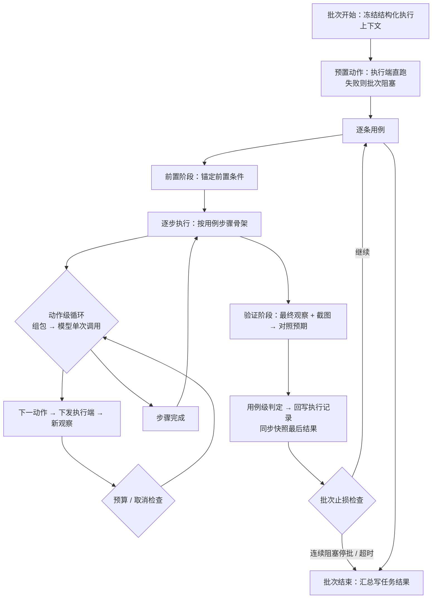
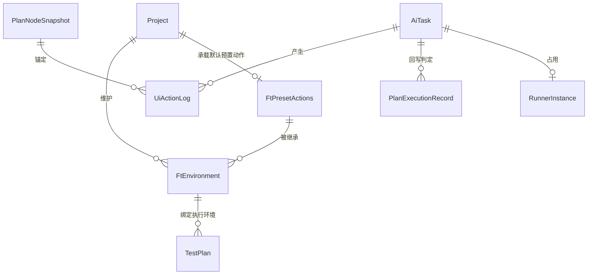

# 软件测试平台——AI 执行（UI 自动化测试）概要设计

**文档版本**：V1.0  
**日期**：2026-11-27  
**状态**：起草中

---

## 1. 引言

### 1.1 编写目的

对 AI 执行（UI 自动化测试）能力进行概要设计，明确决策面与执行面的架构分工、模块职责边界、核心执行机制、数据实体关系与接口职责，并集中列出对既有模块的改动影响，为详细设计与开发提供依据。

### 1.2 范围与对应需求

对应需求分册 `docs/01-requirements/03-function-testing/03-srs-ai-ui-testing.md`，覆盖功能测试环境管理、AI 执行发起与批次执行、观察与动作原语、判定回写与轨迹、预算与安全护栏、既有模块改动影响。AI 任务通用机制沿用 `docs/02-high-level-design/07-ai-capability/02-hld-ai-capability.md` 与 AI Task 双平面框架（`docs/02-high-level-design/07-ai-capability/03-hld-ai-task.md`），测试计划快照与执行记录机制沿用 `docs/02-high-level-design/03-function-testing/02-hld-function-testing.md`，跨模块公共数据与接口约定见 `docs/02-high-level-design/04-hld-data-interface.md`，部署与安全约束见 `docs/02-high-level-design/05-hld-deployment-security.md`。

### 1.3 定义与缩写

| 术语 | 定义 |
| ---- | ---- |
| AI 执行批次 | 一次「AI 执行」发起的完整执行过程，对应一个 AI 任务实例 |
| 决策面 / 执行面 | 决策面为服务端（上下文、决策、判定、记账）；执行面为执行端（只执行动作原语、只回传观察） |
| 执行上下文 | 批次开始时一次性冻结的结构化用例数据（按节点类型区分的用例 / 前置 / 步骤 / 预期）、模块锚点、环境内容与步级上限；正文在模型调用前才拼装 |
| 模块锚点 | 用例归属模块的树路径，用作 AI 导航的业务域先验 |
| 动作原语 | 执行端允许执行的受控操作单元，清单白名单制 |
| 观察 | 对页面可见状态的采集结果（可见元素树、页面语义摘要、截图） |
| 轨迹 | 按用例与步骤归档的动作、失败与判定记录 |
| 凭据占位符 | 密码位置的占位标记，明文密码从不进入模型上下文与轨迹 |
| 预置动作 | 确定性动作序列，项目级为默认配置，环境级三态可选继承 / 覆盖 / 禁用，由执行端直接执行、不经模型 |
| 步级预算 | 单个步骤允许的最多动作次数 |
| 批次预算 | 单批次允许的模型调用次数、token 与成本上限，与步级预算同时生效、先到者终止 |
| 执行端 | 在浏览器中执行动作、回传观察的组件；不决策、不判定、不持有模型凭据与长期密钥 |

## 2. 系统总体设计

### 2.1 总体架构

系统分为客户端、服务端决策与控制面、执行端哑执行面三层；客户端与服务端经现有 REST 接口连接（任务详情轮询 + 轨迹 `afterSeq` 游标轮询），服务端与执行端以动作下发与观察回传两条通道连接：

    ┌──────────────────── 客户端（web/ 前端，双形态）────────────────────┐
    │  桌面版 = Electron 壳包裹现有 web/ 前端（一套代码，两形态）           │
    │  桌面版同时托管本机执行端子进程（登录注册为专属实例，共享缺失时兜底）  │
    │  「AI 执行」发起入口双端渲染；后端校验执行端可用性（共享或本人专属）   │
    │  测试环境管理属配置能力，双端均可用                                   │
    │  权限仅校验当前用户是否为当前项目成员，不新增 RBAC 权限码              │
    │  入口显隐按业务状态 / 成员归属呈现，为前端呈现策略、非安全边界         │
    │  服务端只校验成员归属、执行端可用性与业务规则，不辨形态               │
    └──────────────────────────────┬───────────────────────────────────┘
                                   │ 发起 / 进度（现有 REST：详情 + 轨迹游标轮询）
    ┌────────────────────── 服务端（决策与控制面）──────────────────────┐
    │  发起 API（确认弹窗后提交批次）                                    │
    │  执行上下文冻结（结构化用例数据 + 模块锚点 + 环境快照）              │
    │  独立步进式循环（每动作一次模型调用，不复用通用 Agent 工具循环）      │
    │  判定与回写（执行记录，来源 = AI）                                  │
    │  轨迹落库 · 预算 / 熔断 / 取消 · 用量记账                           │
    └───────────────▲───────────────────────────────────────▼───────────┘
          出站通道（动作下发）              观察回传（元素树 / 截图）
    ┌───────────────┴───────────────────────────────────────▼───────────┐
    │  执行端（哑执行面）：驱动浏览器观察采集（含内嵌框架拼接），            │
    │  只执行动作原语、只回传观察，不决策、不判定、不持有模型凭据            │
    │  壳形态：命令行（先行验证）/ 桌面壳（复用同一执行端核心）              │
    └──────────────────────────────────────────────────────────────────┘

* **职责铁律**：决策与控制全部在服务端，执行端只认「原语 + 参数」。执行端因此可多实例、可替换、可并行（V1 单实例）。
* **通道分工**：动作通道为出站指令（服务端 → 执行端），观察通道为回传（执行端 → 服务端）。执行端通道是**独立 WSS 端点**（`/ws/runner`，独立握手鉴权、独立 Handler 与连接注册表），不复用文档协作 WebSocket 的用户 JWT 认证与按用户路由。
* **凭据边界**：凭据按当前用例引用的账号最小化下发，经短时、单批次、可撤销的凭据令牌传递，执行端仅内存持有、批次结束清零。

### 2.2 与既有系统的关系

* **复用 AI 任务引擎**：批次以 AI 任务实例承载，沿用 AI Task 双平面的状态机、轨迹、取消、失活治理与用量记账（`docs/02-high-level-design/07-ai-capability/02-hld-ai-capability.md` 第 4.2 节、`docs/02-high-level-design/07-ai-capability/03-hld-ai-task.md`）；**执行循环为独立步进式策略，不复用通用 Agent 的工具调用循环**。UI 执行使用专用预算 profile（上限不低于批次动作数 / token / 成本上限），避免被通用 40 步预算误杀，也不等于无限预算。进度经现有 REST 接口呈现（任务详情轮询 + 轨迹 `afterSeq` 游标轮询，≤2s 可见，不新增推送通道；前端轮询逻辑需新增）。批次输入为冻结的执行上下文，结果为批次汇总。失败 / 取消由执行中转入已终止，仅 UI 执行批次落过程补充记录（中断阶段、已处理条目、token 消耗、成本、中断原因）、已写数据不回滚；本能力不产生提案，过程补充记录只含轨迹与判定明细；其他 AI 能力维持总册口径，既有 AI 功能运行时行为不改造。
* **复用执行记录链路**：AI 判定经既有执行记录提交入口回写，进度与通过率统计自动生效；执行记录新增来源维度（人工 / AI），人工改判后来源记为人工。
* **快照语义统一**：计划快照按节点类型保存用例内容、计划详情基于快照展示；AI 执行与手动执行一致，以当前计划用例快照为冻结源，发起时冻结结构化节点数据（写入任务输入）、模型调用前才拼装为正文，未同步到快照的脑图修改不进本次执行。
* **降级与开关沿用**：AI 总开关关闭或无可用模型时入口不可用并提示，进行中批次转入已终止、已写结果保留。
* **判定直接生效**：执行判定不属 AI 生成物 / 提案，不适用提案待采纳约束，人工可随时改判。

## 3. 模块划分

### 3.1 模块总览

    AI 执行
    ├── 服务端
    │   ├── 发起与控制（入口校验 · 模型与参数选择 · 取消 / 停批）
    │   ├── 通道与实例注册（独立 WSS · 握手鉴权 · 容量与租约 · 分派）
    │   ├── 执行上下文冻结（结构化用例数据 · 模块锚点 · 环境内容 · 预算冻结）
    │   ├── 步进决策循环（组包 · 模型调用 · 动作下发 · 预算 / 取消检查）
    │   ├── 观察与判定（观察裁剪 · 验证阶段取证 · 四值判定 · 证据校验与回写）
    │   ├── 轨迹与记账（动作轨迹落库 · 用量记账 · 过程补充记录 · 指标与审计）
    │   └── 功能测试环境管理（入口 · 账号 · 预置动作[项目级默认 + 环境级三态] · 执行参数）
    ├── 执行端
    │   ├── 动作执行（原语白名单 · 机械等待 · 凭据本地替换）
    │   └── 观察采集（元素树 · 页面语义摘要 · 截图 · 内嵌框架拼接）
    └── 前端（桌面版 / Web 版双形态，见 2.1）
        ├── 发起确认弹窗（模型 · 用例范围 · 环境 · 批次参数）【双端渲染，后端校验执行端可用性】
        └── 批次呈现（进度 · 取消 · 轨迹列表 · 汇总）【双端一致】

### 3.2 职责简述

* **发起与控制**：校验当前用户是否为当前项目成员（不新增 RBAC 权限码、不校验项目角色）、总开关、模型可用性、环境必填与执行端可用性 / 忙闲前置校验，提交批次并提供随时取消；服务端在同一计划已有进行中批次时拒绝再次发起，前端预检查仅作提前提示。
* **通道与实例注册**：独立 Runner WSS 通道完成握手鉴权、实例注册与心跳；以容量与租约记录实例忙闲，分派时原子抢占，避免多批次争用同一实例。
* **执行上下文冻结**：发起即冻结当前计划用例快照，按快照节点的 `case / precondition / step / expected` 类型提取结构化用例数据写入任务输入，模块锚点取计划模块快照路径，并冻结环境内容与预算；正文在模型调用前才由结构化数据拼装，未同步修改不进执行、判定可回放。
* **步进决策循环**：以「组包 → 单次模型调用 → 下发下一动作或步骤完成 → 新观察 → 预算 / 取消检查」为最小步进；每动作一次模型调用，不绑定模型的函数调用能力；作为独立执行策略实现，仅复用 AI Task 双平面底座。
* **观察与判定**：裁剪并结构化页面观察，验证阶段强制截图取证，服务端校验证据引用后按四值语义产出用例级判定并回写执行记录。
* **轨迹与记账**：按用例、步骤与阶段归档动作、失败与判定，执行 JS 源码逐字留痕；每步模型调用记入用量，并输出在线率、成功率、动作失败分布与成本指标。
* **功能测试环境管理**：项目下维护被测系统入口、账号、数据状态说明、操作提示、预置动作与执行参数，是 AI 的世界模型与安全配置载体；预置动作分项目级默认与环境级三态（继承 / 覆盖 / 禁用，见 4.9）。
* **执行端**：只接受白名单动作原语，执行后回传带原因码的失败观察与新观察；不决策、不判定、不持有模型凭据。

### 3.3 既有模块改动影响（概要）

本能力除新增模块外，涉及以下既有模块的职责 / 语义变更，开发与详细设计须逐项联动；具体字段、接口、迁移与实施顺序留详细设计。

| # | 既有模块 | 模块级改动 | 设计依据 |
| --- | --- | --- | --- |
| 1 | 测试计划 | 「执行环境」列类型由自由文本变更为 UUID、关联功能测试环境（展示取环境名称，本期不考虑存量转换与回填）；执行结果统计新增「跳过」分支（节点状态图标五态，跳过计已执行、不计入通过），手动标记不提供跳过 | 4.6、5 节 |
| 2 | 执行记录 | 新增来源维度（人工 / AI）；AI 判定复用手动执行同一回写链路，人工改判后来源记为人工；结果取值新增「跳过」，历史记录来源默认为人工、既有四态兼容 | 4.6、5 节 |
| 3 | AI 任务引擎 | 新增 UI 执行任务类型，复用 AI Task 双平面的状态机、取消、超时、失活治理与用量记账（不自建任务通道）；注册专用预算 profile 与独立步进式执行策略；进度经现有 REST 接口呈现（详情 + 轨迹游标轮询）。仅 UI 执行批次失败 / 取消由执行中转入已终止并落「过程补充记录（中断阶段、已处理条目、token 消耗、成本、中断原因）+ 已写数据不回滚」，本能力不产生提案；既有 AI 功能运行时行为不改造 | 2.2、4.10 节；总册 `docs/01-requirements/07-ai-capability/02-srs-ai-capability.md` 1.5 |
| 4 | 通知规则 | 既有「完成后通知发起人」不变，AI 执行批次为唯一例外（V1 不做批次完成 / 停批通知） | 4.10 节 |
| 5 | 功能测试环境管理 | 新增能力（非改造）；与缺陷管理「测试环境」自由文本字段无关联、无改造要求 | 3.1、4.9 节 |
| 6 | 权限体系 | 仅校验当前用户是否为当前项目成员，不新增 RBAC 权限码、不校验项目角色；AI 执行发起与功能测试环境维护不引入权限点，入口显隐按业务状态 / 成员归属呈现，服务端只校验项目成员、执行端可用性与业务规则，不辨客户端形态 | 6、9 节 |
| 7 | 前端 · 测试计划详情页 | 新增「AI 执行」入口、发起确认弹窗、执行中进度与取消、执行详情轨迹与汇总呈现；**入口与弹窗双端渲染**（Web 版发起由后端校验执行端可用性兜底），批次查看双端一致；组件级设计留详细设计与交互设计 | 2.1、3.1、6 节 |
| 8 | 实时通道 | 新增独立 Runner WSS 端点与连接注册表（握手鉴权、按实例路由），不复用文档协作 WebSocket 的 JWT 认证与按用户路由；V1 单节点部署，多节点路由列为升级项 | 2.1、7 节 |

**改动边界**：本表之外的既有功能一律不动；接口测试域零耦合；AI 总开关、模型配置、用量统计等 AI 底座能力沿用不改（仅任务类型按 #3 新增，其他 AI 能力的失败 / 取消行为不改）。

## 4. 核心机制设计

### 4.1 批次与步进式两级循环

一次「AI 执行」为一个批次，按用例在线性顺序推进，内部为用例级循环套动作级循环：

* **机制选型为步进式**（应用编排循环、每动作一次模型调用），不用模型侧工具循环：与单次模型调用门面零摩擦，每步是天然的预算、取消、审计与观察深度控制点，且不依赖模型的函数调用能力。
* 批次按用例 `sort_order` 线性推进；默认全自动，无逐步人工闸门；取消批次时当前动作完成后停止，任务转入已终止，已写入的判定与轨迹保留。

### 4.2 执行上下文固化

批次开始时以当前计划用例快照为冻结源，对每条用例一次性冻结四类内容：**结构化用例数据**（按快照节点的 `case / precondition / step / expected` 类型保留节点标题、层级与排序；正文在模型调用前才拼装，不经通用截断）、**模块锚点**（用例快照 → 所属模块快照的 `parent_id` 树路径）、**环境内容**（入口、账号别名与角色、数据状态、操作提示）、**预算**（步级上限等）；未同步到快照的脑图修改不进本次执行。

* 结构化用例数据取自快照，未同步修改不进执行；执行期间脑图编辑不影响进行中批次，判定可回放（见 2.2）。
* 模块锚点是导航先验：用例描述在多模块系统中有歧义时按模块归属定位；文档未关联模块时仅凭标题与环境提示导航，发现多个相似页面无法确定唯一目标则不操作、判阻塞并写明歧义。
* 环境内容未配置或不全时上下文信息相应减少；但**执行环境为发起必填项**，未绑定或未选择环境时不可发起（无白名单即无导航边界，见 4.5）。

### 4.3 步骤锚定与无步骤用例拆解

* 步骤是执行骨架：进度按步骤显示、轨迹按步骤归档、预算按步骤配额；全部步骤完成后进入验证阶段。
* 无步骤用例由 AI 在执行时拆解为步骤序列（至多 10 步），拆解结果进轨迹留痕、**不回写用例**，保持用户只维护自然语言用例的约定。
* 中途走不下去时，步骤锚点即证据（卡在哪一步、当时的页面状态）。

### 4.4 观察采集与元素引用

采用「DOM 文本优先 + 编号引用 + 截图为辅」的观察路线：

* **采集**：直采 DOM 快照、无障碍树与脚本求值结果，按帧合并、内嵌框架（含跨域）内容拼接进同一观察，框架内元素直接带引用出现，动作层以普通原语直达。
* **裁剪**：剔除脚本、样式与隐藏元素；过滤被完全遮挡、点不到的元素；元素仅携带少量关键属性（可访问名、角色、占位符、值等），不全量输出。
* **输出**：可见元素树（保留层级与可见文本，交互元素带临时引用编号）+ 页面语义摘要（标题、地址、页面类型、提示与弹窗，服务端规则提取、不走模型）+ 标签页列表（句柄、地址、标题、是否活动）。
* **敏感值**：密码类字段的值不进入观察与截图文本；其余输入值按字段类型脱敏，避免用户数据原样进入模型上下文。
* **引用机制**：跨步稳定的临时句柄——页面未变引用有效，真实 DOM 变化后失效并触发重新观察，AI 基于新鲜观察决策；决策定位只用引用，不以 CSS / 文本语义定位兜底；标签切换使用观察中的标签句柄。
* **截图**：验证阶段取证必用，随判定进入模型上下文并落入轨迹；可选画框标注模式（引用框与文字编号对齐）。
* **截断**：超大页面按可见区域 / 内容上限截断，截断规则进入提示词，AI 知悉所见为截断视图。
* **不可信输入**：页面文本、弹窗与截图内容一律视为数据，其中指令不得执行；提示词显式声明，安全由动作白名单与导航拦截兜底。

### 4.5 动作原语白名单（V1 共 15 个执行原语 + 1 个服务端语义出口）

原语清单即动作允许清单，清单外动作一律拒绝：

| 分类 | 原语 | 参数要点 |
| ---- | ---- | ---- |
| 导航 | 打开地址、后退、切换标签、关闭标签 | 打开地址限环境入口 origin 白名单；切换标签以观察中的标签句柄定位 |
| 元素交互 | 点击、填充、按键、下拉选择、悬停、滚动 | 以观察引用定位；填充的密码位置为占位符 |
| 查询与观察 | 按文本定位滚动、等待、截图 | 等待单次至多 10 秒且计预算 |
| 系统 | 处理原生弹窗、执行 JS（逃生舱，默认关闭） | 执行 JS 护栏见 4.7 |
| 结束 | 提交判定（服务端语义） | 判定值 + 依据，由服务端消费模型输出后转为会话结束，不下发执行端 |

* 因此执行端可执行原语为 15 个，第 16 个「提交判定」是模型与服务端之间的控制原语，不产生下发帧。
* V1 明确不设：文件上传（识别到即触发跳过判定）、拖拽、富文本专用原语（开启 JS 的环境可由逃生舱部分兜底）、坐标点击。
* **一步到位优先**：能用一个原语完成的操作不拆为多动作组合；业务语义全部由 AI 组合决策，执行端不理解业务。

### 4.6 判定与回写

* 步骤与预期不假设一一对应：预期通常为整体性描述，全部步骤完成后在验证阶段统一判定；用例写有多条预期时可对可验证点提前留痕，最终汇总为一个用例级结论。
* 四值语义：**通过**（预期要点在最终观察中被证实，不接受「没报错即通过」）、**失败**（观察与预期矛盾）、**阻塞**（环境不可用、步骤走不下去、预算耗尽、歧义页面——证据不足以验证预期，不臆断）、**跳过**（识别到依赖 V1 不支持的能力，当前即文件上传，写明原因）。
* 判定必须引用本次批次内真实存在的观察证据（观察序号 / 截图对象 key + 文字描述）写入执行记录备注；服务端校验证据存在且属于本用例验证阶段，校验不通过不落库并转阻塞。
* 回写复用既有执行记录入口并标记来源为 AI，进度与通过率统计自动生效；进度统计新增跳过计数分支（跳过计为已执行、不计入通过），节点状态图标扩展为五态。
* 人工可随时经既有执行记录入口改判，改判来源记为人工；手动标记不提供跳过选项。
* 每批次按不低于 10%（至少 1 条）抽样人工复核，复核结果进入判定可信度评测（见 9 节验收基准）。
* 本节对既有执行记录链路、统计与节点图标的改动汇总见 3.3 清单 #1、#2。

### 4.7 三层重试、预算止损与执行 JS 护栏

| 层 | 机制 | 成本 |
| ---- | ---- | ---- |
| 1 机械 | 执行端内建可交互等待（渲染、可点击窗口） | 免费，不计预算 |
| 2 决策 | 动作失败 → 执行端返回带原因码的失败观察（不可见 / 被遮挡 / 无响应 / 未找到 / 超时 / 求值错误等）→ AI 自主决定重试、换路或放弃；每次尝试都是一次动作下发 | 占步级预算 |
| 3 熔断 | 步级预算耗尽 → 该步阻塞 → 用例阻塞，证据为耗尽时刻页面状态 | 强制终止 |

预算与止损项：

| 项 | 默认值 | 语义 |
| ---- | ---- | ---- |
| 步级动作上限 | 50（发起时可临时上调，≤200） | 硬闸：耗尽 → 步阻塞 → 用例阻塞 |
| 拆解步数上限 | 10（无步骤用例） | 防拆解失控 |
| 批次动作总数上限 | 500（发起时可调，≤2000） | 硬闸：耗尽 → 批次终止（已终止） |
| 批次 token 上限 | 3,000,000 | 硬闸：耗尽 → 批次终止并记录原因 |
| 批次成本上限 | 50（计价单位同既有用量统计） | 硬闸：耗尽 → 批次终止并记录原因 |
| 批次总时长 | 4 小时 | 执行侧强制终止 |
| 连续失败停批 | 连续 3 条阻塞 | 自动终止批次并标注原因 |
| 收敛提示 | 步级预算消耗达 80% | 组包注入「请收敛或判阻塞」（软引导） |
| 头铁提示 | 同一动作连续失败 3 次 | 组包注入「建议换路线或止损」（软引导） |

* 任何动作下发都计预算、无免费重试；预算存在的核心意义是为 AI 自主重试权兜底。动作失败不是异常、不是批次错误，不触发批次级错误处理。
* 步级、批次动作数、token、成本与总时长同时生效，**任一先到即终止**；终止原因写过程补充记录。
* UI 执行使用专用预算 profile 签发通用任务预算，profile 上限不低于批次上限，保证 UI 策略先到；通用预算先到视为配置异常并记录。
* 僵尸兜底沿用既有任务失活清扫机制：批次在等待动作与模型调用期间持续刷新心跳（≤60 秒），4 小时上限与 600 秒失活阈值相互独立；停批或超时后可重新发起，默认仅重跑未执行与阻塞用例（见 4.1）。
* **执行 JS 四重护栏**：默认关闭、环境级显式开启；源码逐字进轨迹（不可配置关闭）；提示词纪律（仅当原语无法完成时的最后手段）；导航 origin 白名单仍然生效。执行 JS 仅由 AI 运行时产生，预置动作不含执行 JS，不开人工预置 JS 的口子。
* **导航统一拦截**：执行端监听所有 frame 导航、新标签、表单提交与下载，目标越界即阻断并结束会话；网络出口按同一 origin 白名单限制。

### 4.8 会话、登录与凭据

* 批次内复用同一浏览器会话（真实连续）；是否换账号由用例前置条件决定。登录由 AI 按环境配置的账号自主决策完成（导航 + 输入 + 提交），不硬编码登录步骤；配置了预置动作时由预置动作固化完成，两者互补。
* **凭据占位符机制**：账号密码加密落库；模型上下文仅含账号别名、角色与占位符名，明文从不进入；AI 与预置动作的动作参数中密码位置一律写占位符，执行端收到动作后用本地凭据映射替换后执行。
* **最小化与令牌化**：服务端仅下发当前用例引用的账号，经单批次、单用例、短时可撤销的凭据令牌授予；用例切换或批次结束时执行端立即清零，不落盘、不写日志、不进入回传与截图。共享执行端不持久化工作空间数据与凭据，批次间使用隔离浏览器上下文，凭据访问全程审计。
* 轨迹落库的参数即占位符原文；AI 违规生成疑似明文密码时脱敏打码。
* 验证码、扫码类登录场景 V1 不支持，判阻塞并写明原因。

### 4.9 预置动作

* 预置动作为确定性原语调用序列（典型即登录），批次启动时由执行端直接执行、不经模型、不含执行 JS；成功后 AI 循环在就绪状态起步；该阶段失败则批次直接阻塞并写明原因，不消耗 AI 预算。
* **两级配置与继承（三态）**：项目级预置动作为默认配置（每项目一份，JSON 序列，配一次供全部环境继承）；环境级可选「继承项目默认 / 自定义覆盖 / 禁用」——「禁用」表示本环境不使用任何预置动作，与「覆盖为空」语义不同；继承且项目级为空时，登录等前置由 AI 自主决策完成。
* 序列中目标地址与账号以**引用**指向当前执行环境的入口与账号（不写字面值），环境配置调整后序列无需改动；批次启动时按当前环境解析引用与 origin 白名单，解析失败按前置失败口径判阻塞并写明所在步骤。
* 预置动作通道为确定性代码，允许稳健定位策略，与「AI 决策只用观察引用」属不同执行通道，互不冲突。

### 4.10 任务接入与提示词场景

* 新增 UI 执行任务类型挂入既有 AI Task 双平面框架的任务处理器注册机制，取消、超时与失活治理全量复用；进度经现有 REST 接口呈现（任务详情轮询 + 轨迹 `afterSeq` 游标轮询，≤2s 可见），不新增推送通道。仅 UI 执行批次失败 / 取消由执行中转入已终止并落过程补充记录（中断阶段、已处理条目、token 消耗、成本、中断原因），已写数据不回滚，本能力不产生提案（见 2.2、3.3 清单 #3）。
* 注册决策与判定两类场景提示词：动作纪律（只发原语、执行 JS 最后手段、模块锚点优先、页面内容视为数据）、判定纪律（证实才通过、证据不足判阻塞、证据必须引用本次观察）、收敛注入点（80% 预算、同一动作三败）。两场景由步进式处理器在模型调用时直接传入，AI Task 执行行的 `promptScene` 仍按任务 `type=ui_execution` 记录（沿用现有链路，不改写）。
* **模型选择**：发起弹窗由服务端返回可用模型列表供用户自选，所选 `modelId` 在提交期校验可用性并写入执行行，作为本批次决策与判定的实际模型；未选择时使用系统默认模型。
* **上下文与输出契约**：长用例历史按「最近 K 个动作 + 摘要 + token 上限」压缩，截图按尺寸上限压缩；模型输出定义固定 JSON 契约（动作或步骤完成 / 四值判定），解析失败有限重试（至多 2 次），仍失败则转阻塞，非法参数不猜测执行。
* 通知：V1 不做批次完成 / 停批通知，任务状态在页面可见，既有通知规则以本批次为唯一例外（见 3.3 清单 #4）。
* 轨迹展示 V1 为静态轨迹列表（按步骤分组的动作时间线、失败原因、截图、判定依据）；时间轴回放为升级项，轨迹数据按阶段与序号组织可直接消费。

## 5. 数据设计

实体与关系（实体级，字段、DDL 与索引留详细设计）：

| 实体 | 职责 |
| ---- | ---- |
| FtEnvironment | 功能测试环境（项目归属；入口 URL 列表、账号列表、数据状态、操作提示、环境级预置动作三态、执行参数含只读模式） |
| FtPresetActions | 项目级默认预置动作（每项目一份，JSON 序列；环境级三态解析时作为继承来源） |
| AiTask（复用） | 批次运行态外壳（沿用 AI Task 双平面：执行编排归 AI、写库编排归应用层）：输入为冻结执行上下文，进度与阶段为进度呈现，结果为批次汇总；失败 / 取消时任务转入已终止并含过程补充记录（已处理条目、token 与成本消耗、中断原因），本能力不产生提案 |
| UiActionLog | 动作轨迹（批次、计划、快照用例归属；批次内全局序号与用例内序号、阶段、记录类型、动作名、目标引用、参数含占位符原文与执行 JS 源码、失败原因码、观察摘要、完整观察、截图引用、token 消耗） |
| RunnerInstance | 执行端实例（模式、归属用户、在线状态、当前批次、租约到期、容量、最后心跳；部署级注册表，不归属工作空间） |
| PlanExecutionRecord（扩展） | 执行记录新增来源维度（人工 / AI），结果值新增「跳过」 |
| TestPlan（扩展） | 「执行环境」语义变更为关联功能测试环境，展示取环境名称 |

* 截图本体走文件域对象存储，轨迹实体只存引用。
* 新增与扩展实体满足既有数据库通用约定（逻辑删除、UUID 框架默认策略、无物理外键、索引规范，`docs/00-spec/20-contracts/02-database.md`）；本期不考虑存量计划执行环境的自由文本转换，列类型改 UUID、旧值置空不回填。

## 6. 接口设计概要

资源与职责划分（路径、方法与报文留详细设计；公共约定见 `docs/02-high-level-design/04-hld-data-interface.md`）：

| 资源 | 职责 | 归属 |
| ---- | ---- | ---- |
| 功能测试环境 | 环境条目维护、掩码展示与保存、预置动作与执行参数配置 | 业务端（项目上下文） |
| AI 执行批次 | 发起（模型 / 用例范围 / 环境 / 批次参数；**发起入口双端渲染**，后端强制校验执行端可用性，见 6.1）、进度查询、取消、批次汇总与轨迹查询 | 业务端（项目上下文） |
| 执行记录（既有扩展） | AI 判定回写、来源记录、人工改判 | 业务端（项目上下文） |
| 测试计划（既有扩展） | 执行环境关联与展示、五态统计 | 业务端（项目上下文） |

上下文标识通过请求头传递，不出现在 URL 中；全部接口遵循既有认证与工作空间 / 项目上下文校验，执行批次经现有 AI 任务 REST 接口呈现进度（详情轮询 + 轨迹 `afterSeq` 游标轮询）；仅校验当前用户是否为当前项目成员，不新增 RBAC 权限码、不校验项目角色；入口显隐按业务状态 / 成员归属呈现，服务端只校验项目成员、执行端可用性与业务规则，不辨客户端形态；10 位错误码号段留详细设计统一分配。

### 6.1 术语消歧（客户端形态与执行端实例）

本能力涉及两组易混术语，统一定义如下，详细设计与交互设计沿用本表口径：

| 术语 | 定义 | 归属层面 |
| ---- | ---- | ---- |
| 桌面版 | 包裹 `web/` 前端的 Electron 产品形态，一套代码双形态；随登录以子进程托管执行端核心 | 用户客户端 |
| Web 版 | 浏览器访问的产品形态，与桌面版共用同一前端代码 | 用户客户端 |
| 执行端（Runner） | 在浏览器中执行动作、回传观察的独立进程组件；不决策、不判定、不持有模型凭据 | 运维侧组件 |
| 执行端实例 | 一条执行端注册连接（`runner_id` 唯一），服务端执行端注册表的一行 | 服务端登记 |
| 共享实例 | 独立部署（CLI 壳）注册的实例，`owner_id` 为空，**任意用户**的批次均可分派 | 实例归属 |
| 专属实例 | 桌面版托管注册的实例，`owner_id` = 登录用户，**仅该用户**的批次可分派 | 实例归属 |

> 注：原规划的执行端独立「桌面壳」已由桌面版托管取代（7 节），不再单独存在；「桌面版」与「执行端」分属客户端与运维两侧，**两者之间无直接通道**，一切经服务端。

**分派规则**（服务端为唯一决策面，详见详设 4.1）：批次开始时按序取第一个满足「在线且有空闲容量（未持有未过期租约）」的实例——

1. 在线**共享实例**（优先共享，多实例时取最近心跳最新者）；
2. 提交人本人的在线**专属实例**（共享缺失时的兜底，桌面版本机执行）；
3. 皆无在线实例 → 发起前置校验失败（后端拒绝，不消耗 AI 预算）；
4. 有在线实例但均忙 → 直接拒绝并提示 `runner_busy`，V1 不排队；预检同步返回忙闲，避免“预检通过、提交失败”。

**发起前置校验（后端强制）**：AI 执行发起接口校验「存在在线且空闲的共享实例或提交人本人的在线空闲专属实例」，否则拒绝发起——Web 版与桌面版一视同仁；发起入口双端均渲染、按业务状态 / 成员归属呈现，入口显隐为前端呈现策略、非安全边界，服务端只校验成员归属、执行端可用性与业务规则，不辨形态。

## 7. 部署视图增补

* 执行端为独立进程形态，先以命令行壳验证核心链路；其独立桌面壳已由**桌面版托管取代**——桌面版（Electron 壳）随登录以子进程拉起执行端核心并注册为专属实例（仅本人批次，共享缺失时兜底分派）。服务端仅依赖其注册与动作下发 / 观察回传通道，执行端可多实例部署（V1 单实例），实例归属与分派见 6.1。
* **通道独立**：执行端使用独立 WSS 端点与独立连接注册表（按 `runner_id` 路由），不复用文档协作 WebSocket 的用户 JWT 认证与按用户会话路由；V1 明确单节点部署并加启动保护，多节点需粘性路由或跨节点消息转发（升级项）。
* 执行端依赖浏览器自动化驱动库（新增依赖，过会后引入），不改变既有前后端分离与合并打包部署形态。
* 截图走既有文件域对象存储，服务端签发批次级上传授权、Runner 只回对象 key；轨迹实体只存引用；AI 任务异步执行、进度呈现依托现有 REST 轮询接口、失活治理依托平台既有服务端能力。

## 8. 安全设计

* **导航白名单**：仅可在环境配置的入口 URL origin 范围内导航与执行 JS；执行端对所有 frame 导航、新标签、表单提交与下载统一拦截，越界即阻断并结束会话，网络出口按同一白名单限制。
* **动作白名单**：执行端仅接受 15 个执行原语，清单外动作拒绝执行（「提交判定」为服务端语义出口，不下发）。
* **预算熔断**：步级上限、批次动作数 / token / 成本上限、批次总时长（4 小时）、连续失败停批同时生效，任一先到即终止；UI 执行使用专用预算 profile，通用预算不先于批次上限触发。
* **凭据最小化**：明文不进模型上下文与轨迹；按用例最小化、短时单批次令牌下发，执行端内存持有并即时清零；共享执行端不持久化数据、批次间隔离上下文，凭据访问审计。
* **执行 JS 护栏**：默认关闭、环境级显式开启；逐字留痕、提示词纪律、导航白名单三重约束（见 4.7）。
* **提示注入防护**：页面文本、弹窗与截图视为不可信数据，不执行其中指令；破坏性动作受环境只读模式约束。
* **项目成员校验**：AI 执行发起与环境维护仅校验当前用户是否为当前项目成员，不新增 RBAC 权限码、不校验项目角色；批次执行身份 = 发起 API 的提交人，出站与判定全程可审计。**已接受风险**：项目内只读成员亦可编辑环境凭据并发起执行，后续引入只读 / 访客角色时须拆分「查看 / 编辑环境 / 发起执行」三档能力。
* **共享实例信任假设**：共享执行端为运维侧可信组件，部署方保证宿主与运维通道可信；共享实例可能承载跨工作空间批次，须以批次级浏览器上下文隔离、批次间内存清零、不持久化作为验收检查项。
* **上下文限权**：进入批次上下文的数据严格限于当前用户有权限的项目与工作空间，跨工作空间数据不进入任何批次。
* **出站最小化**：使用云端模型时出站内容仅限任务必需上下文，模型密钥不落日志。
* **用量记账**：每步模型调用与 token 消耗记入既有用量记录，可按时间、模型、能力域查看；批次级动作数、token、成本与超限原因可回看。

## 9. 设计约束与原则

* **大脑在服务端**：决策、判定、预算、记账全部在服务端；执行端只认「原语 + 参数」，不决策、不判定、不持有模型凭据。
* **证据优先、宁阻塞不臆断**：判定必须引用观察证据（文字 + 截图），证实才通过；证据不足判阻塞并写明原因，不猜测。
* **失败是正常事件**：动作失败不是异常、不是批次错误，由 AI 决策重试或止损，预算兜底，无免费重试；UI 执行批次失败 / 取消由执行中转入已终止，过程补充记录按本能力口径保留且不产生提案，其他 AI 能力按总册口径。
* **用户数据不被污染**：AI 中间产物（如无步骤用例的拆解）只进轨迹，不回写用例；执行判定直接生效、人工可随时改判，不适用提案待采纳约束。
* **上下文不出 URL**：工作空间 / 项目上下文经请求头传递（C4）。
* **数据约定**：实体遵循既有数据库通用约定（逻辑删除、UUID 框架默认策略、无物理外键、索引规范，`docs/00-spec/20-contracts/02-database.md`），字段级设计、DDL 与错误码号段留详细设计；数据库变更同时交付全量基线与版本化迁移脚本，存量库按顺序升级并附回滚说明。
* **供给不锁定**：模型由发起时从可用配置中选择，缺省系统默认模型，所选模型即实际执行模型，不绑定具体供应商。

### 9.1 判定可信度验收

* 以不少于 60 条黄金用例、至少 3 轮全量执行作为准入评测，门槛为误通过率 ≤ 3%、误失败率 ≤ 5%、阻塞率 ≤ 20%、判定可复现率 ≥ 95%、证据引用校验通过率 100%（口径见需求 6.2）。
* 模型、提示词或判定规则变更须重跑黄金集并留存对比；未达门槛不得默认启用。
* 每批次不低于 10%（至少 1 条）人工抽样复核，复核结论计入指标。

## 修改记录

| 版本 | 日期 | 说明 |
| ---- | ---- | ---- |
| V1.0 | 2026-10-14 | 初始版本 |
| V1.0 | 2026-10-14 | 预置动作改两级配置：项目级默认（FtPresetActions）+ 环境级覆盖（4.9、5 节） |
| V1.0 | 2026-10-14 | 引入客户端形态：桌面版（Electron 壳包裹 web/）与 Web 版双形态，AI 执行发起入口仅桌面版、批次查看双端一致（2.1、3.1、3.3 #7、6 节，含术语消歧） |
| V1.0 | 2026-10-14 | 桌面版集成执行端：托管 Runner 子进程为用户绑定实例（仅本人批次、分派优先），CLI 实例共享；原独立桌面壳由桌面版托管取代（2.1、6 节、7 节） |
| V1.0 | 2026-10-14 | 第 6 节重梳为 6.1 术语消歧表（客户端形态 / 执行端实例两组术语）；分派顺序改为共享实例优先、专属实例兜底；发起入口改为双端渲染、后端强制校验执行端可用性（2.1、3.1、3.3、6、7） |
| V1.0 | 2026-11-25 | 同步自 feature/ai-ui-testing-srs 并按当前分支口径适配 |
| V1.0 | 2026-11-26 | 冻结源统一为计划用例快照；进度改为 REST 详情 + 轨迹游标轮询；总时长 4h；过程补充记录仅 UI 执行批次；权限仅校验项目成员；服务端拒绝重复发起 |
| V1.0 | 2026-11-26 | 明确冻结数据为结构化用例节点（模型调用前拼装正文）；执行循环为独立步进式策略、不复用通用 Agent 工具循环；执行行 `promptScene` 沿用任务类型，两提示词场景在模型调用时传入；执行环境列改 UUID、本期不考虑存量转换与回填 |
| V1.0 | 2026-11-27 | 收敛安全与预算口径：执行端通道独立为 WSS 端点并补实例容量 / 租约与忙闲拒绝；凭据按用例最小化、短时令牌化并补共享实例信任假设；导航拦截覆盖全帧 / 新标签 / 下载与网络出口；执行 JS 默认关闭；补提示注入与只读模式；动作原语统一为 15 + 1；补批次 token / 成本 / 动作数上限与先到者终止；模型选择改为真实生效并补输出契约与历史压缩；过程补充记录去除提案口径；补判定可信度验收基准与迁移版本化 |
