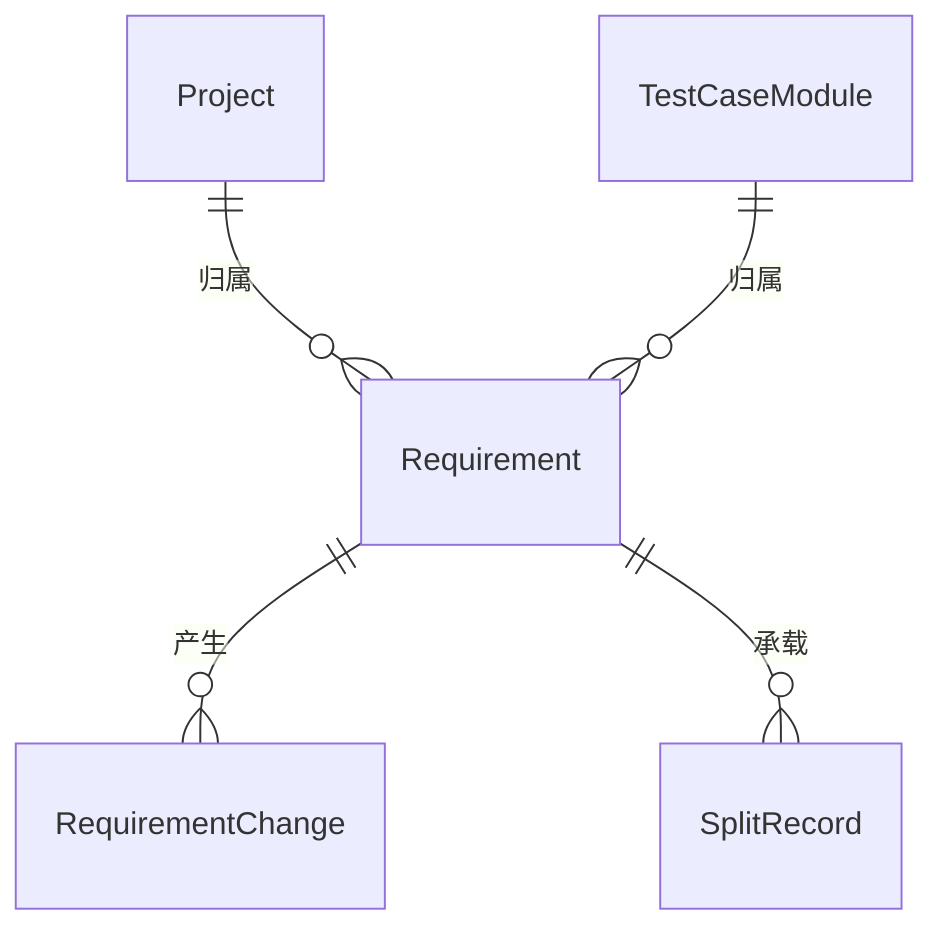

# 软件测试平台——需求管理概要设计

**文档版本**：V1.0  
**日期**：2026-10-01  
**状态**：起草中

---

## 1. 引言

### 1.1 编写目的

对需求管理（功能测试子模块）进行概要设计，明确模块划分、核心机制、数据实体关系与接口职责，为详细设计与开发提供依据。

### 1.2 范围与对应需求

对应需求分册 `docs/01-requirements/03-function-testing/03-srs-requirement-management.md`，覆盖需求模型与状态机、需求拆解与变更重新确认。需求拆解由 AI 能力模块供给，AI 底座机制见 `docs/02-high-level-design/07-ai-capability/02-hld-ai-capability.md`；跨模块公共数据与接口约定见 `docs/02-high-level-design/04-hld-data-interface.md`。

### 1.3 定义与缩写

| 术语 | 定义 |
| ---- | ---- |
| 需求条目 | 平台内业务需求的登记单位与追溯起点（沿用需求分册定义） |
| 拆解建议 | AI 按模块拆分产出的待采纳需求集合 |

## 2. 模块划分

### 2.1 模块位置

    功能测试模块
    ├── 测试用例管理 / 测试评审管理 / 测试计划管理（见 02-hld-function-testing）
    └── 需求管理（子模块）
        ├── 需求列表
        ├── 需求详情与编辑
        ├── 需求导入与拆解
        └── 变更与重新确认

### 2.2 职责简述

* **需求列表**：检索、筛选、确认与归档入口。
* **需求详情与编辑**：属性与内容维护、状态确认、变更记录查看。
* **需求导入与拆解**：大需求文档导入、AI 按模块拆分、建议采纳落库。
* **变更与重新确认**：维护「变更 → 重新确认」的状态流转闭环，变更期间不阻断下游编辑。

### 2.3 与相邻模块的关系

* **项目与模块树**：需求归属项目，拆解产出的模块归属对接项目模块树。
* **功能测试子模块**：需求列表经功能测试侧栏承载，详见 `docs/02-high-level-design/03-function-testing/02-hld-function-testing.md`。
* **AI 能力模块**：拆解经 AI Task 框架的任务资源供给，本模块不自建 AI 通道。
* **AI 生成链**：已确认需求是生成链的唯一输入，生成提案经采纳后回写模块与用例。

## 3. 核心机制设计

### 3.1 需求模型与状态机

单层需求条目，不设下级拆分单元；条目归属模块，是最小登记粒度。状态机：

    草稿 ──确认──> 已确认 <──重新确认── 已变更
      ↑               │                    ↑
      │               └──修改标题/描述/模块──┘
      └──────────── 取消归档 ────────────┐
                                         ↓
                     已归档（只读，二次确认进入）

编号在条目落库时按项目内序号分配，项目内唯一；状态流转不改变条目身份，归档条目的历史变更记录保留可查。

### 3.2 需求拆解流水线

需求拆解由文档导入单一入口承载，AI 在解析中判定模块边界并决定拆分粒度：

    提交文档 → AI 后台解析任务（按模块边界拆分为多条需求建议）→ 拆分建议（待采纳态）
        → 人工采纳（逐条 / 批量 / 修改后）→ 编号分配 + 落库 + 来源关联
        → 驳回（保留建议记录，不落库）

拆解复用 AI Task 框架的执行、提案采纳与审计机制；原始文件挂为来源附件，建议可回溯原文位置。

### 3.3 变更状态流转与重新确认

已确认需求的标题、描述或模块归属被修改时触发：需求状态转入「已变更」并写入变更记录，下游内容不被自动修改；需求重新确认后状态回到「已确认」。变更与重新确认只改变需求条目自身状态，变更期间不阻断下游编辑。

## 4. 数据设计

实体与关系（实体级，字段、DDL 与索引留详细设计）：

| 实体 | 职责 |
| ---- | ---- |
| Requirement | 需求条目，状态机载体与追溯起点 |
| RequirementChange | 需求变更记录（操作人、类型、前后摘要的时序记录） |
| SplitRecord | 拆解记录（来源文档、拆分建议与采纳结果） |

## 5. 接口设计概要

资源与职责划分（路径、方法与报文留详细设计）：

| 资源 | 职责 | 归属 |
| ---- | ---- | ---- |
| 需求条目 | 列表、详情、属性与内容维护、确认、归档与取消归档 | 业务端 |
| 导入与拆解任务 | 提交导入、查询执行与轨迹、采纳与驳回拆分建议 | 业务端 |

上下文标识通过请求头传递，不出现在 URL 中；全部接口遵循既有认证与工作空间 / 项目上下文校验。

## 6. 设计约束与原则

* 不提供需求删除，仅支持归档；编号项目内唯一。
* 拆解必须走 AI Task 框架的任务资源，禁止在本模块内重复实现 AI 调用与任务通道。
* 拆解建议一律为待采纳态，采纳前不落库；采纳后人工修改不被 AI 自动覆盖。
* 需求数据经项目归属到工作空间，遵循既有数据隔离与数据库通用约定（`docs/00-spec/20-contracts/02-database.md`）。

## 修改记录

| 版本 | 日期 | 说明 |
| ---- | ---- | ---- |
| V1.0 | 2026-10-01 | 初始版本 |
| V1.0 | 2026-10-15 | 下线条目内「AI 拆分」：3.2 拆解流水线收敛为文档导入单一入口，实体与接口概要同步收敛 |
| V1.0 | 2026-10-16 | 同步 AI Task 双平面口径（`docs/02-high-level-design/07-ai-capability/03-hld-ai-task.md`）：底座任务引擎改 AI Task 框架任务资源，拆解建议待确认态改待采纳态，复用机制措辞对齐 |
| V1.0 | 2026-10-16 | 提案采纳口径同步：拆解建议定义改待采纳需求集合、生成链回写改提案采纳，导入与拆解资源补执行与轨迹查询 |
| V1.0 | 2026-10-17 | 追溯矩阵需求整体取消：删除 3.4 追溯入口职责边界、术语「影响标记」、模块图与职责的追溯视图入口、TraceEdge 实体及影响分析 / 追溯视图接口资源，3.3 改写为变更状态流转与重新确认 |
| V1.0 | 2026-10-18 | 需求管理并入功能测试模块：2.1 模块位置改挂功能测试子模块，2.3 补功能测试承载关系，分册迁入功能测试模块目录 |
