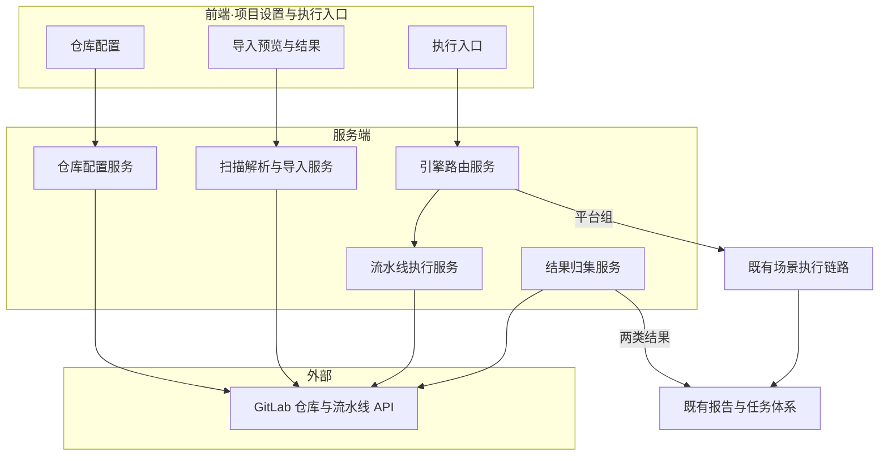
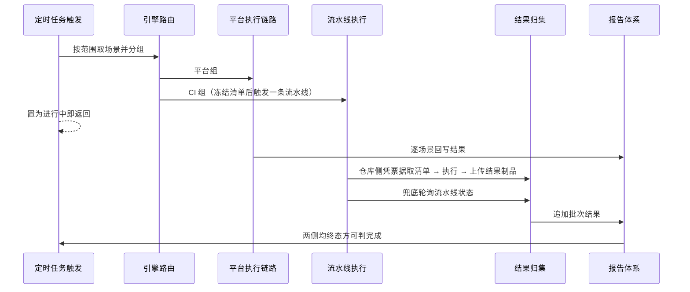
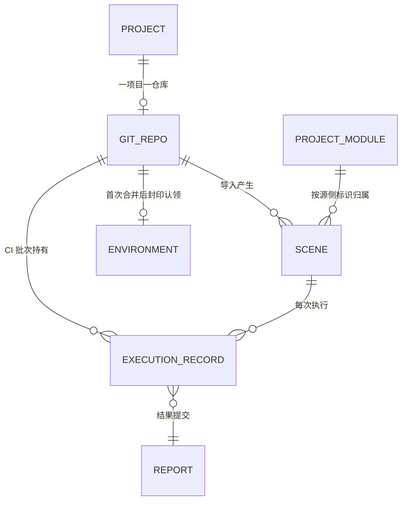

# 软件测试平台——GitLab 集成概要设计说明书

**文档版本**：V1.0
**日期**：2026-10-11
**状态**：起草中

---

## 1. 引言

### 1.1 编写目的

给出 GitLab 代码仓库集成的总体架构、模块职责边界与核心机制，衔接《GitLab 集成需求规格说明书》与《GitLab 集成详细设计说明书》，为详细设计提供稳定的设计骨架。

### 1.2 范围

覆盖仓库集成配置、工程导入解析、双引擎执行与结果归集四个能力，以及它们与既有测试场景、定时任务、环境管理、报告四个子系统的关系。

### 1.3 参考资料

- 《GitLab 集成需求规格说明书》（`docs/01-requirements/05-api-testing/11-api-srs-gitlab-integration.md`）
- 《GitLab 集成详细设计说明书》（`docs/04-detailed-design/05-api-testing/32-gitlab-integration-overview.md`）
- 《接口测试概要设计说明书》（`docs/02-high-level-design/05-api-testing/02-hld-api-overview.md`）

### 1.4 定义与缩写

沿用需求分册「定义与缩写」的定义（`docs/01-requirements/05-api-testing/11-api-srs-gitlab-integration.md` 1.4）。

## 2. 系统总体设计

### 2.1 定位与边界

GitLab 集成是接口测试业务域内的**横向扩展能力**：它不新建一套并行的测试体系，而是在既有「场景 → 执行 → 报告」主链路上并入两个新变量——**场景的来源**（平台原生 / 仓库导入）与**执行的引擎**（平台 / 流水线）。场景模型、报告结构、任务范围、权限体系均复用既有设计，本能力只负责生产场景、路由执行、回收结果。

### 2.2 总体架构

### 2.3 与既有子系统的关系

| 既有子系统 | 关系 |
| ---- | ---- |
| 测试场景 | 承接导入产物；场景新增来源属性，编辑与展示能力不变 |
| 项目模块 | 承接导入的模块归属；新增源侧归属标识，节点 CRUD 与排序不变 |
| 环境管理 | 承接 `platform` 模式的环境合并；环境数据结构新增来源标识 |
| 定时任务 | 执行范围与绑定环境原样复用；执行过程由单引擎改为可分组双引擎，并新增「GitLab 同步」任务类型承载源变更检测 |
| 测试报告 | 结构不变，结果数据集增加逐场景的引擎标注 |
| 接口导入（cURL / Swagger） | 完全解耦，记录与映射机制不共用 |

## 3. 模块划分

| 模块 | 职责 | 不负责 |
| ---- | ---- | ---- |
| 仓库配置管理 | 项目与仓库的一对一绑定、参数维护、连通性校验、凭据加密存取 | 解析、执行 |
| 扫描解析与导入 | 拉取源码、识别有效用例、构建模块归属、生成场景、合并环境、增量同步与幂等控制 | 执行、报告 |
| 引擎路由 | 依据场景来源与仓库导入模式判定执行引擎，任务触发时提供引擎分组判定 | 实际执行 |
| 流水线执行 | 触发流水线、批次管理、状态轮询、生命周期维护 | 平台侧执行 |
| 结果归集 | 下载流水线结果制品、映射到执行记录、向报告体系提交 | 报告渲染 |
| 定时任务编排扩展 | 在任务触发后插入引擎分组步骤，并扩展完成判据 | 任务调度本身 |

职责边界原则：**路由只判定不执行，执行只执行不归集，归集只归集不渲染**；导入服务是唯一写入场景来源属性的模块，其他模块只读。

## 4. 核心机制设计

### 4.1 导入解析流水线

导入是一条**分阶段、失败可归类**的流水线：拉取源码 → 识别测试类 → 词法剥离块注释 → 筛选成对注解方法 → 按导入模式分流 → 构建模块与场景 → 合并环境 → 回写导入状态与审计。

关键设计点：

- **失败分流**：解析失败（引用缺失、YAML 不合法）与真实错误（网络、权限、解析器异常）在导入汇总中**必须分开统计**。前者是可预期结果，仅列明细、不创建场景、不阻断重试；后者才决定幂等闸门是否放行下一次导入。
- **稳定键**：模块与场景在源侧各有唯一标识，重复导入按标识合并而非按名称匹配，保证结果幂等。
- **模块两层结构**：导入的模块树固定为包容器（包）与类模块（测试类）两层，包层级不逐级展开，兼顾来源可追溯与导航可用性。
- **模式分流**：`gitlab_ci` 模式在识别出方法后即停止，不读取步骤模板与环境声明，导入开销显著低于 `platform` 模式。
- **改名迁移**：同步时比对两次导入之间的变更文件清单识别文件级改名，经内容校验后迁移源侧归属标识，避免类重构在平台侧退化为「删旧建新」。校验是必需门槛——相似度提示存在误判，直接采信会把一类的数据错挂到另一类。

### 4.2 双引擎路由

路由是**纯判定逻辑**，输入为场景来源与所属仓库导入模式，输出为引擎类型，不产生副作用：

| 输入 | 输出引擎 |
| ---- | ---- |
| 平台原生场景 | 平台 |
| 导入场景 + 仓库为 `platform` 模式 | 平台 |
| 导入场景 + 仓库为 `gitlab_ci` 模式 | 流水线 |

由此，引擎**不是场景的可编辑属性**，而是派生属性，从根本上消除了用户误选引擎导致的执行失败。`platform` 模式导入的场景虽持有完整步骤，仍恒归平台引擎，不提供切向流水线的入口——其步骤已结构化为平台形态，回投仓库侧执行无对应通道也无收益。定时任务触发分组时按判定结果归组，全程不提供引擎选择控件。

### 4.3 幂等闸门与写一次封印

两道无状态的防重机制，互不依赖：

- **导入幂等闸门**（时间维度）：比较目标分支当前提交与上次导入提交，相同且无遗留真实错误时跳过导入。闸门位于解析之前，避免无意义的源码拉取；它不替代逐条合并，放行后仍按稳定键 upsert。
- **环境写一次封印**（状态维度）：环境配置首次导入写入后即打上仓库标识，此后该环境由平台接管，仓库侧变更不再回同步。封印消除了双向同步的冲突面，代价是仓库侧调整需在平台手工同步——此为有意取舍。

### 4.4 批次模型与完成判据

一次 CI 引擎触发在平台侧对应一个**外部执行批次**，批次与执行记录之间是一对多关系；批次由批次票据标识，持有流水线标识、提交号与触发时冻结的场景清单，用于取清单、状态轮询与结果映射。

控制面与数据面分离是批次模型的核心：控制面只传批次票据，其长度与场景数无关，因此一次任务恒定对应一条流水线，既不拆批也不按仓库分组；数据面由仓库侧把原生结果整目录上传为流水线制品，平台按批次下载解析。两侧互不承载对方的负载，也不需要对执行中的批次加锁——仓库侧读的是冻结清单，平台侧的并发编辑影响不到已在跑的批次。

**完成判据**采用「与」逻辑：平台组全部终态且批次内所有流水线终态。判定与轮询状态均落库，进程重启后可从库中恢复未完成批次继续回收，避免执行状态滞留；批次一经置终态，后续写入一律忽略，使主动回报与状态轮询两条通道并存时不丢结果也不被覆盖。

### 4.5 报告聚合形态

报告体系保持单一结构，通过**结果数据集内的逐场景引擎标注**承载混合信息：套件报告先由平台组首写，流水线回收后追加更新，两次写入共用同一批次关联；报告的执行方式维度不新增取值，避免影响既有报告筛选与统计口径。

## 5. 数据设计

实体与关系（字段级定义见详细设计 2）：

| 实体 | 变更类型 | 说明 |
| ---- | ---- | ---- |
| 代码仓库配置 | **新增** | 项目与仓库的一对一绑定、导入模式、凭据与导入状态摘要 |
| 项目模块 | 扩展 | 源侧归属标识，用于导入认领与去重 |
| 测试场景 | 扩展 | 来源类型、所属仓库、源侧标识与引用、源状态、解析状态与问题清单 |
| 执行记录 | 扩展 | 仓库、流水线标识与链接、批次票据、源侧引用、提交号、所属任务、用例汇总 |
| 环境 | 扩展 | 认领仓库标识，支撑写一次封印 |
| 报告 | 语义扩展 | 结果数据集增加逐场景引擎标注，结构不变 |
| 定时任务、任务执行、导入记录、导入映射、变更历史 | 语义扩展 | 定时任务新增「GitLab 同步」类型承载源变更检测；其余复用既有范围、状态、审计与导入链路能力 |

数据设计原则：新增仅一张表；扩展列一律可空或带默认值，保证存量数据无需回填；不引入物理外键，引用关系由应用层维护。

## 6. 接口设计概要

按资源划分三组接口，职责如下（具体路径与报文见详细设计 3）：

| 资源组 | 职责 | 使用方 |
| ---- | ---- | ---- |
| 仓库配置资源 | 配置的查询、创建、更新、删除与连通性测试 | 项目设置页 |
| 导入资源 | 扫描预览、执行导入、导入进度查询 | 导入页签 |
| 执行资源 | 单场景执行与执行状态查询 | 场景编辑页 |

概要约定：

- 所有接口沿用既有统一响应结构与权限点体系，不新增权限模型，仅按操作性质挂接到既有场景与环境权限点上；
- 上下文标识经请求头传递，不出现在路径中；
- 导入类接口为异步语义：提交后立即返回任务句柄，进度经查询接口获取；
- 凭据类字段只进不出，任何响应体不包含令牌内容。

## 7. 部署视图

服务端在既有部署单元内新增对 GitLab 的出站 HTTPS 访问能力，无需新增独立组件：

| 组件 | 变更 |
| ---- | ---- |
| 应用服务 | 新增 GitLab API 客户端与源码解析能力；需可达 GitLab 实例（含自建） |
| 定时轮询 | 在既有任务调度进程内扩展批次状态轮询，不新增独立调度器 |
| 数据库 | 新增一张表与若干扩展列，随版本迁移 |
| 前端 | 项目设置新增子模块，场景与执行入口扩展，场景展示适配（列表来源 / 源状态徽标、`gitlab_ci` 场景编排页只读形态） |

网络要求：应用服务到 GitLab 实例的 HTTPS 出站可达（拉取源码、触发流水线、下载结果制品）；GitLab 执行器到应用服务的 HTTPS 出站可达（凭批次票据取清单、回报执行完成），该方向由接入方在 CI 环境中放通，属于接入前置条件。状态回收仍以平台轮询为主，GitLab 不要求主动回调应用服务（不引入 webhook）。

## 8. 安全设计

| 面向 | 措施 |
| ---- | ---- |
| 凭据存储 | 令牌加密存储，查询接口不回显，日志与错误消息不打印明文 |
| 凭据使用 | 令牌仅用于对仓库的 API 调用，不下发前端、不写入报告 |
| 命令注入 | 仓库地址、分支、场景标识等外部输入不拼接进命令行或脚本参数 |
| 传输 | 与 GitLab 之间仅走 HTTPS，自建实例允许显式配置地址 |
| 权限 | 复用既有权限点，配置维护与执行操作分离，只读用户不可改配置、不可触发执行 |
| 数据边界 | 仅读取测试源码与资源目录，不遍历仓库全量文件 |

## 9. 设计约束与原则

| 编号 | 原则 |
| ---- | ---- |
| P1 | 一项目一仓库，配置不可迁移、导入模式不可变，以此换取模型简单性 |
| P2 | 引擎是派生属性而非可编辑属性，杜绝误选 |
| P3 | 导入幂等、可重入、失败可归类，不引入分布式锁 |
| P4 | 环境单向合并并封印，不做双向同步 |
| P5 | CI 执行无降级路径，失败留痕优于静默兜底 |
| P6 | 报告结构不改，仅扩展结果语义，保护既有统计口径 |
| P7 | 解析失败不产生脏数据，宁缺毋滥 |
| P8 | 源变更检测复用定时任务体系，不另建独立的同步配置或调度器 |
| P9 | 改名识别结果必须经内容校验才可采信，宁可退回删旧建新也不错挂数据 |

## 修改记录

| 版本 | 日期 | 说明 |
| ---- | ---- | ---- |
| V1.0 | 2026-10-11 | 初始版本：GitLab 集成概要设计 |
| V1.0 | 2026-10-11 | 模块机制改为两层结构，补充改名迁移与内容校验门槛；定时任务新增「GitLab 同步」类型；明确平台模式场景恒归平台引擎 |
| V1.0 | 2026-10-11 | 批次模型改为控制面（批次票据）与数据面（结果制品）分离，取消拆批；补充执行器到应用服务的出站可达要求 |
| V1.0 | 2026-10-11 | 删除批量执行与路由预览：执行资源收敛为单场景执行，引擎路由不再组装预览数据，批次仅为服务端内部机制 |
| V1.0 | 2026-10-11 | 前端组件变更登记场景展示适配：列表来源 / 源状态徽标、`gitlab_ci` 场景编排页只读形态 |
