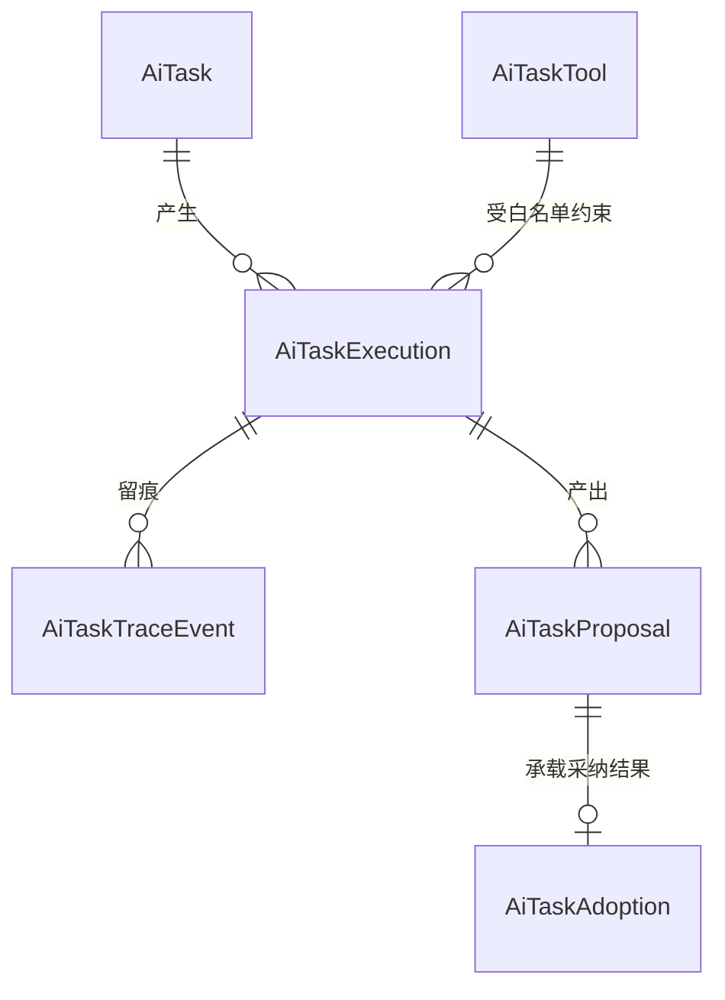

# 软件测试平台——AI Task 概要设计

**文档版本**：V1.0  
**日期**：2026-10-16  
**状态**：起草中

---

## 1. 引言

### 1.1 编写目的

对 AI Task（AI 任务）子模块进行顶层设计，明确双平面职责边界（执行平面归 AI 编排、采纳平面归应用层编排）、模块划分、核心机制、数据实体关系与接口职责，作为 AI Task 相关详细设计与交互设计的唯一上位依据。

### 1.2 范围与对应需求

对应需求分册 `docs/01-requirements/07-ai-capability/02-srs-ai-capability.md`。本设计将 AI Task 定位为**通用任务框架**：以「目标输入 → AI 自主编排执行 → 结构化提案 → 人工采纳 → 应用层落库」为统一骨架，首批场景为测试域（用例生成、评审辅助、缺陷分析等），框架本身不绑定任何业务域。

AI 能力模块的公共底座（模型通道等）见 `docs/02-high-level-design/07-ai-capability/02-hld-ai-capability.md`；本设计只覆盖任务框架本身。AI Task 既有相关文档中与本设计冲突的描述，以本设计为准，后续按本文修订。

### 1.3 定义与缩写

| 术语 | 定义 |
| ---- | ---- |
| AI Task（任务） | 一次面向明确目标的 AI 工作请求，任务框架的顶层对象 |
| Task Execution（执行） | 任务的一次运行实例；同一任务可多次执行，每次执行有独立轨迹与预算 |
| Agent 循环 | 执行期内由 AI 逐步决策「下一步做什么」的通用循环，应用层不预设流程 |
| 工具（Tool） | 应用层向 AI 暴露的受控能力单元，声明参数、权限与副作用级别 |
| 预算护栏 | 单次执行的硬性资源上限（步数、token、时长、成本） |
| 执行轨迹（轨迹） | 执行期内每次 AI 决策与工具结果的事件序列，审计的唯一事实源 |
| 提案（Proposal） | AI 执行的结构化产出（产物 + 证据链），存放于提案区，不属业务库 |
| 采纳（Adoption） | 用户对提案的确认动作；采纳后由应用层校验并事务落库到业务库 |

## 2. 系统总体设计与模块划分

### 2.1 设计总纲：双平面模型

AI Task 拆为两个平面，编排权按平面严格分离：

    ┌─────────────────────────── 执行平面（编排权归 AI）───────────────────────────┐
    │  目标输入 → Agent 循环（AI 规划/决策/调用工具/自评）→ 结构化提案              │
    │  工具默认只读；预算护栏硬性约束；全程轨迹留痕                                │
    └──────────────────────────────────────────┬───────────────────────────────────┘
                                               │ 提案（非业务库）
    ┌──────────────────────────────────────────▼───────────────────────────────────┐
    │  采纳平面（编排权归应用层）                                                   │
    │  提案展示 → 人工采纳（可编辑）/驳回 → 应用层校验 + 事务落库业务库           │
    └──────────────────────────────────────────────────────────────────────────────┘

* **执行平面**：编排智能全部交给 AI，应用层只提供工具、护栏与轨迹，不含业务流程代码。
* **采纳平面**：唯一的写编排点。业务数据落库只能经采纳动作由应用层完成，AI 无法绕过。

### 2.2 模块位置

    AI Task（通用任务框架）
    ├── 任务受理与上下文装配      ← 采纳平面入口（任务创建侧）
    ├── Agent 执行核              ← 执行平面驱动（通用循环，无业务逻辑）
    ├── 工具注册表                ← 执行平面能力边界
    ├── 执行轨迹                  ← 执行平面留痕与实时推送
    └── 提案与采纳                ← 采纳平面出口（唯一写编排点）

### 2.3 职责简述

* **任务受理与上下文装配**：接收任务目标，校验合法性，装配本次执行的上下文（空间 / 项目等作用域信息经请求头传递），签发工具白名单与预算。
* **Agent 执行核**：按通用循环驱动执行——AI 决策、调用工具、解读结果、判定完成或终止；核内没有任何针对具体任务形态的分支流程。
* **工具注册表**：集中登记可向 AI 暴露的工具，声明参数结构、所需权限点、作用域校验方式与副作用级别；新增 AI 能力 = 注册新工具，不改执行核。
* **执行轨迹**：将每次决策与工具结果记录为轨迹事件并实时推送；轨迹只增不改。
* **提案与采纳**：承接 AI 产出的结构化提案，提供采纳（支持人工编辑）与驳回；采纳后调用对应业务模块既有写入服务完成校验与事务落库，AI Task 自身不实现业务写逻辑。

### 2.4 与相邻模块的关系

* **AI 能力模块底座**：执行核经公共底座调用模型；本框架不自建模型通道。
* **各业务模块（首批测试域）**：业务模块是数据 schema 与落库服务的拥有者；提案采纳后的写入复用其既有服务，业务模块也可按需创建任务（如从需求文档发起用例生成）。
* **实时消息通道**：轨迹与任务状态推送复用平台既有 WebSocket 通道，本框架不另建推送通道。

## 3. 核心机制设计

### 3.1 Agent 循环（执行编排归 AI）

执行期采用通用循环，应用层不预设步骤、不解析计划：

    启动执行（装配上下文 + 工具白名单 + 预算）
      ↓
    ┌→ AI 决策：调用工具 / 产出结论 / 判定完成 ──判定完成──> 生成结构化提案 ──> 结束
    │        │
    │        └─需调用工具─> 应用层：参数校验 → 权限与作用域鉴权 → [副作用闸门] → 执行
    │                              │
    └──── 结果（含失败信息）回喂 ←─┘（失败时由 AI 自行决定重试、改道或放弃）
      循环受预算护栏约束，超限强制终止

* AI 在循环内自行规划与拆解；其计划以**可见的思考中间产物**形式随轨迹向用户展示，用户可中断执行或追加指令，但计划**不作为应用层的执行依据**，应用层不解析、不调度。
* 失败处理：工具失败信息如实回喂，由 AI 决定重试、改道或终止；应用层只在预算耗尽、不可恢复错误与用户终止时强制结束执行。

### 3.2 工具注册表与副作用分级

工具按副作用分级，分级决定执行路径：

| 副作用级别 | 含义 | 执行路径 |
| ---- | ---- | ---- |
| 只读（默认） | 仅查询与读取，无外部影响 | 循环内直接执行 |
| 确认型 | 有执行副作用（如触发测试执行、外呼通知） | 触发时挂起执行并推送人工确认，批准后续跑，拒绝则结果回喂 AI |
| 禁止 | 写业务库、出网等 | 不注册；业务写入只存在于采纳平面 |

* 工具注册时必须声明：参数结构、权限点、作用域校验方式、副作用级别。
* 每次任务创建时按任务类型签发工具白名单，AI 只能在白名单内选择工具。

### 3.3 预算护栏

单次执行的预算（最大步数、token、时长、成本）在任务创建时签发，执行中硬性执行：任一维度超限即强制终止执行并保留已有轨迹；预算不可在执行中调高。预算护栏与工具白名单共同构成 AI 的能力边界。

### 3.4 执行轨迹与实时推送

* 执行期内每次 AI 决策、工具调用（参数与结果摘要）、状态变化均落轨迹事件，随执行实时推送至前端。
* 轨迹只增不改，是审计、问题排查与执行过程回放的唯一事实源；轨迹与业务库物理隔离。
* 用户可经由前端查看轨迹、中止执行、在执行中追加指令（作为附加上下文回喂 AI）。

### 3.5 提案与采纳

    AI 产出结构化提案（产物 + 证据链）──> 提案区（待采纳态）
        ├── 采纳（可逐条/批量，支持人工编辑后采纳）──> 应用层校验 + 事务落库业务库
        └── 驳回 ──> 保留提案与轨迹记录，不落库

* 提案必须结构化并携带证据链（指向产生它的轨迹片段与来源资料），保证可回溯。
* 采纳是唯一写编排点：落库校验、编号分配、事务边界全部由应用层（复用各业务模块既有服务）完成。
* 采纳后的人工修改不被 AI 自动覆盖；同一执行的提案可被驳回后由用户修订再采纳。

### 3.6 任务生命周期

    草稿 ──启动──> 执行中 ──完成──> 待采纳 ──采纳/全部驳回──> 已结束
                      │  ↑
                      │  └─确认型工具批准后续跑
                      ├── 挂起（等待人工确认副作用）
                      └── 终止（用户中止 / 预算耗尽 / 不可恢复错误）──> 已终止

已终止执行保留轨迹；同一任务可再次启动新执行。

## 4. 数据设计

实体与关系（实体级，字段、DDL 与索引留详细设计）。命名约定：本框架全部实体收敛在 `ai_task_` 域内——类名统一以 `AiTask` 为域前缀（缩写按规范写作 `Ai`），表名统一以 `ai_task_` 为前缀；该域前缀为 AI Task 框架专用，其他模块不得复用：

| 实体（类名 / 表名） | 职责 |
| ---- | ---- |
| AiTask / `ai_task` | 任务本体：目标、上下文装配摘要、所属作用域、生命周期状态 |
| AiTaskExecution / `ai_task_execution` | 一次执行：工具白名单与预算快照、执行状态、终止原因 |
| AiTaskTraceEvent / `ai_task_trace_event` | 轨迹事件：决策、工具调用与结果摘要、状态变化的只增时序记录 |
| AiTaskProposal / `ai_task_proposal` | 提案：结构化产物与证据链，待采纳态载体（不属业务库） |
| AiTaskAdoption / `ai_task_adoption` | 采纳记录：采纳人、编辑后载荷摘要、落库结果与目标业务实体引用 |
| AiTaskTool / `ai_task_tool` | 工具注册项：参数结构、权限点、作用域校验方式、副作用级别 |

## 5. 接口设计概要

资源与职责划分（路径、方法与报文留详细设计）：

| 资源 | 职责 | 归属 |
| ---- | ---- | ---- |
| 任务 | 创建（目标 + 上下文）、列表、详情、再次执行 | 任务受理侧 |
| 执行 | 启动、状态查询、中止、轨迹事件流（WebSocket 实时 + 历史补读） | 执行平面 |
| 提案 | 列表、详情、采纳（携带编辑后载荷）、驳回 | 采纳平面 |

* 上下文标识（空间 / 项目等）通过请求头传递，不出现在 URL 中（C4）；全部接口遵循既有认证与作用域归属校验。
* 新增业务错误码在详细设计中集中定义 10 位号段（C3），避免与既有号段冲突。

## 6. 安全设计

* **能力边界**：AI 只能触达白名单内、已鉴权的只读工具；业务写入与出网在工具层禁止注册。
* **提示注入防护**：工具返回内容、任务输入中的文档与资料一律作为不可信数据处理，不得改变工具白名单与预算等控制面参数。
* **作用域隔离**：工具在执行时按任务装配的作用域信息做服务端归属校验，防止跨空间 / 项目越权读取。
* **预算防滥用**：预算硬闸门限制单任务资源消耗；任务创建频控在详细设计定义；权限点仅用于前端入口显隐，任务端点不做权限校验。
* **审计**：任务、执行、轨迹、提案、采纳全链路留痕，轨迹只增不改。
* **人工闸门**：确认型工具的副作用执行必须经人工批准；采纳是写业务库的唯一通道。

## 7. 设计约束与原则

* **编排权分离**：执行平面的编排权归 AI，采纳平面的编排权归应用层；应用层禁止在执行核内预设业务流程。
* **AI 不写业务库**：执行期工具默认只读；一切业务写入只能经采纳由应用层完成。
* **计划不作执行依据**：AI 的计划 / 步骤只是可见的思考产物，应用层不解析、不调度。
* **预算护栏为硬闸门**：预算超限必须终止，不存在例外通道。
* **框架通用性**：新增任务形态只能通过「注册工具 + 定义提案结构」实现，禁止为单一场景在执行核内加分支。
* **复用既有底座**：模型通道、实时消息通道、认证与上下文校验均复用平台既有机制，不重复建设。
* 数据库通用约定（逻辑删除、无物理外键、索引规范）见 `docs/00-spec/20-contracts/02-database.md`，在详细设计落地。

## 修改记录

| 版本 | 日期 | 说明 |
| ---- | ---- | ---- |
| V1.0 | 2026-10-16 | 初始版本：双平面模型、Agent 循环、工具注册表、预算护栏、轨迹与提案采纳机制 |
| V1.0 | 2026-10-16 | 实体命名收敛 `ai_task_` 域：AiTask / AiTaskExecution / AiTaskTraceEvent / AiTaskProposal / AiTaskAdoption / AiTaskTool |
| V1.0 | 2026-10-19 | 权限口径调整：2.1 采纳平面与 3.5 采纳编排移除「权限」环节（落库校验、编号分配、事务边界仍归应用层），6 安全设计权限点改为前端入口显隐口径（执行期工具鉴权与作用域隔离不变） |
