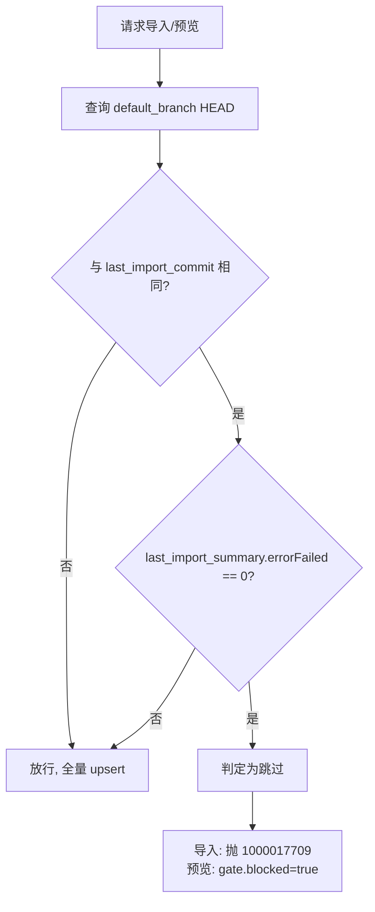
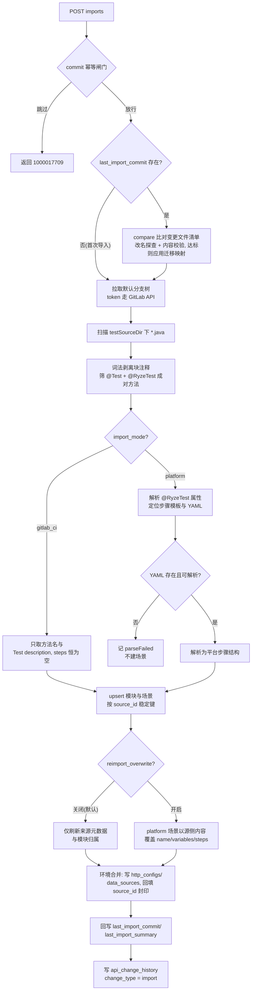
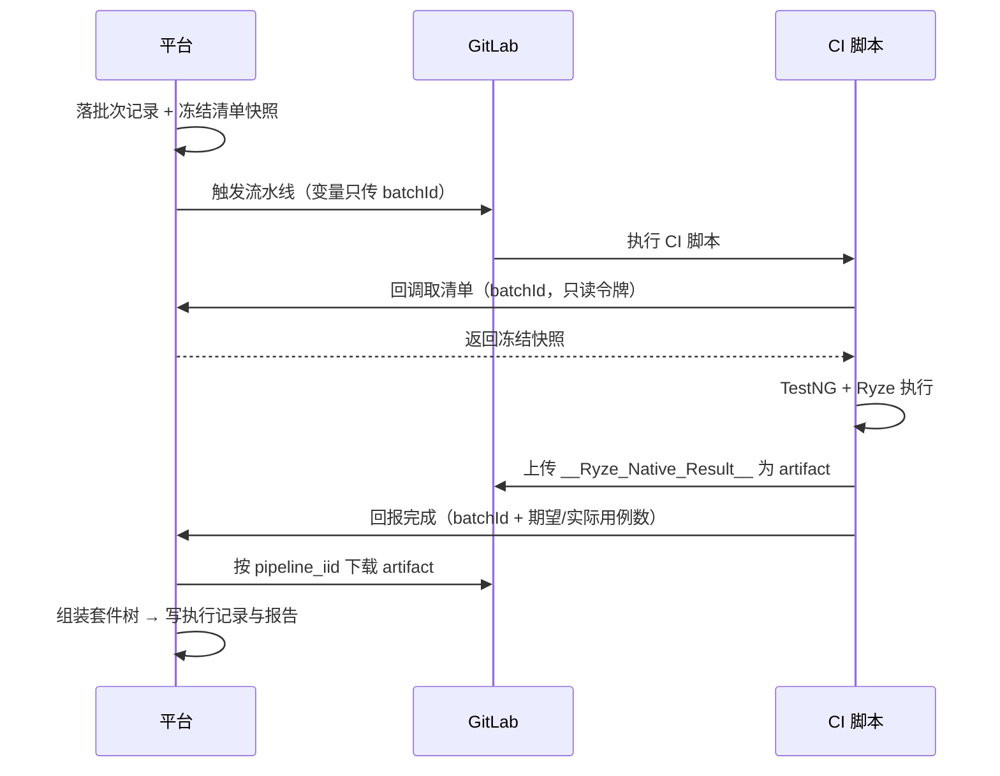
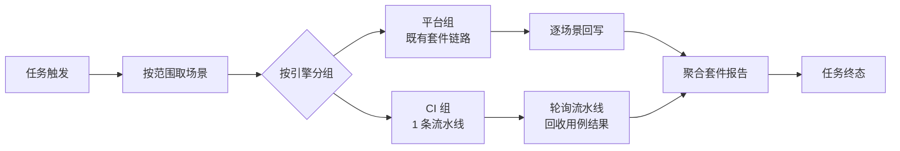

# 软件测试平台——GitLab 集成详细设计说明书

**文档版本**：V1.0
**日期**：2026-10-11
**状态**：起草中

---

## 1. 引言

### 1.1 编写目的

对接口测试业务域的 **GitLab 代码仓库集成** 进行详细设计，定义仓库配置、导入解析、双引擎执行与结果归集的数据结构、接口规范与业务逻辑，为开发实现提供完整依据。

### 1.2 范围

覆盖需求分册中的 GitLab 集成（`docs/01-requirements/05-api-testing/11-api-srs-gitlab-integration.md`）与概要设计对应模块（`docs/02-high-level-design/05-api-testing/11-hld-api-gitlab-integration.md`）：

- **仓库集成配置**：GitLab 实例、项目路径、令牌、导入模式的项目级配置；
- **项目导入与解析**：测试类扫描、用例解析、模块归属、环境合并、增量导入、源变更定时同步与改名迁移；
- **双引擎执行**：场景按来源与导入模式路由到平台 Ryze 引擎或 GitLab 流水线引擎，含定时任务混合执行；
- **结果归集**：流水线状态与用例级结果回收、双引擎套件报告聚合。

页面入口与权限口径见 1.4；测试场景模型见《测试场景详细设计说明书》（`docs/04-detailed-design/05-api-testing/12-test-scenario-overview.md`）；定时任务调度见《定时任务详细设计说明书》（`docs/04-detailed-design/05-api-testing/27-scheduled-task-scheduler.md`）。

### 1.3 参考资料

- 《GitLab 集成需求规格说明书》（`docs/01-requirements/05-api-testing/11-api-srs-gitlab-integration.md`）
- 《GitLab 集成概要设计说明书》（`docs/02-high-level-design/05-api-testing/11-hld-api-gitlab-integration.md`）
- 《API 测试基础设施详细设计说明书》（`docs/04-detailed-design/05-api-testing/02-api-testing-infra-overview.md`，2.2 错误码）
- 《测试场景详细设计说明书》（`docs/04-detailed-design/05-api-testing/12-test-scenario-overview.md`）
- 《项目模块详细设计说明书》（`docs/04-detailed-design/02-project-module.md`）
- 《环境管理详细设计说明书》（`docs/04-detailed-design/05-api-testing/17-environment-management-overview.md`）

### 1.4 页面入口与权限口径

- **壳路由与子模块**：`/workspace/projects/api-testing`（路由名 `ApiTesting`），GitLab 集成是壳页左侧侧边栏「项目设置」分组下的子模块（与环境管理同组），由侧边栏切换并以 `?tab=gitlab` 同步记录；刷新或外部改写 query 时按当前可见权限还原，tab 不可见时回落到首个可见子模块。
- **权限码**：仓库配置的查询与连通性测试按 `api-env:view`，配置创建 / 更新 / 删除按 `api-env:edit`；项目扫描与解析预览按 `api-scene:view`，执行导入按 `api-scene:edit`。
- **页面结构**：整页单面板（一项目一仓库，不设列表），含「基础配置」「导入」两个页签；页签栏常驻连通性状态徽标，导入页签顶部常驻上次导入信息。执行不在本页发生，由场景侧执行入口承载。

## 2. 数据设计

数据库字段使用 snake_case，接口 JSON 使用 camelCase。本域**仅新增 1 张表**，其余为扩展现表；扩展列的完整 DDL 分别落在各自所属的既有总览分册中，本节只登记扩展清单与新增表，避免重复定义。

### 2.1 数据库表设计

#### 2.1.1 代码仓库配置表（api_git_repo）【新增表】

项目级仓库集成配置。**一个项目绑定一个仓库**，`import_mode`、`repo_path`、`default_branch` 创建后不可修改，变更绑定仓库须删除后重建。

| 字段 | 类型 | 约束 | 说明 |
| ---- | ---- | ---- | ---- |
| id | UUID | PK | 主键 |
| project_id | UUID | NOT NULL | 归属项目（一项目一仓库） |
| name | VARCHAR(200) | NOT NULL | 仓库展示名（可改，非稳定键） |
| gitlab_base_url | VARCHAR(500) | NOT NULL | GitLab 实例地址（支持自建，不含结尾 `/`） |
| repo_path | VARCHAR(500) | NOT NULL | 项目路径（`group/subgroup/repo`），源侧稳定键；创建后不可改（违反返回 `1000017711`），同时作为 `api_environment.source_id` 的认领值 |
| default_branch | VARCHAR(200) | NOT NULL DEFAULT 'master' | 默认分支；创建后不可改（违反返回 `1000017711`） |
| import_mode | VARCHAR(20) | NOT NULL | 导入模式：`platform`（导入为平台场景，完整解析 + 环境合并）/ `gitlab_ci`（流水线调度，仅建圈选载体）。创建时必填，创建后不可改（违反返回 `1000017711`） |
| token_cipher | VARCHAR(500) | NOT NULL | 访问令牌密文（scope `api`，加密存储，不下发前端） |
| test_source_dir | VARCHAR(500) | NOT NULL DEFAULT 'src/test/java' | 测试源码目录 |
| resource_dir | VARCHAR(500) | NOT NULL DEFAULT 'src/test/resources' | 资源目录（YAML 所在根） |
| env_file_path | VARCHAR(500) | NOT NULL DEFAULT 'common/env/env.yaml' | 环境声明文件路径（相对 `resource_dir`，仅 `platform` 模式使用） |
| reimport_overwrite | BOOLEAN | NOT NULL DEFAULT FALSE | 重复导入是否以源侧内容覆盖平台侧场景内容（默认不覆盖）；仅 `platform` 模式生效，可创建后修改 |
| enabled | BOOLEAN | NOT NULL DEFAULT TRUE | 启用状态（禁用后其下场景 CI 引擎不可用） |
| last_import_at | TIMESTAMP | NULL | 上次导入时间 |
| last_import_commit | VARCHAR(64) | NULL | 上次导入时的分支 HEAD commit；同时是 commit 幂等闸门的比对基准（见 3.4） |
| last_import_summary | JSONB | NULL | 上次导入结果 `{created, updated, parseFailed, errorFailed, skipped}`；`parseFailed` 与 `errorFailed` 必须分开，闸门只看 `errorFailed` |
| head_commit | VARCHAR(64) | NULL | 源探查服务回写的默认分支最新提交（见 3.7）；与 `last_import_commit` 不一致即仓库「源有更新」 |
| head_checked_at | TIMESTAMP | NULL | 上次源探查时间 |
| head_probe_status | VARCHAR(20) | NULL | 源探查结果：`ok` / `unreachable`；`unreachable` 时保留上次 `head_commit` |
| created_by | UUID | NOT NULL | 创建人 |
| is_deleted | BOOLEAN | NOT NULL DEFAULT FALSE | 是否删除 |
| created_at | TIMESTAMP | NOT NULL DEFAULT CURRENT_TIMESTAMP | 创建时间 |
| updated_at | TIMESTAMP | NOT NULL DEFAULT CURRENT_TIMESTAMP | 更新时间 |

**索引**：

- `uk_api_git_repo_project` UNIQUE (project_id) WHERE is_deleted = FALSE
- `idx_api_git_repo_project` (project_id) WHERE is_deleted = FALSE

> 唯一约束保证一项目一仓库，同时覆盖按项目的查询路径，故 `project_id` 不再单建普通索引。合计 2 个索引，符合 C9。


### 2.2 既有表扩展清单

本域对既有表的扩展以「在所属总览分册原位加列」的方式落地，避免同一主题出现两处 DDL。下表登记扩展位置，字段级定义见对应文档。

| 表 | 扩展内容 | 定义位置 |
| ---- | ---- | ---- |
| `project_module` | +1 列 `source_id`（源侧映射标识：包容器存完整包名、类模块存测试类全限定名）、+1 唯一索引 `uk_pmod_source` | `docs/04-detailed-design/02-project-module.md` 2.1 |
| `api_scene` | +7 列 `source_type` / `repo_id` / `source_id` / `source_ref` / `source_status` / `parse_status` / `parse_issues`、+1 唯一索引 `uk_scene_source` | `docs/04-detailed-design/05-api-testing/12-test-scenario-overview.md` 2.1.2 |
| `api_execution_record` | +8 列 `repo_id` / `pipeline_iid` / `pipeline_url` / `batch_id` / `source_ref` / `commit_sha` / `scheduled_task_id` / `summary`、+1 索引 `idx_exec_batch` | `docs/04-detailed-design/05-api-testing/02-api-testing-infra-overview.md` 2.1.3 |
| `api_environment` | +1 列 `source_id`（认领该环境的仓库路径），不加索引 | `docs/04-detailed-design/05-api-testing/17-environment-management-overview.md` 2.1.1 |
| `api_report` | 不改结构，仅 `result` 数据集语义扩展（见 4.4） | `docs/04-detailed-design/05-api-testing/28-test-report-overview.md` 2.3 |

**不改动的既有表**：`api_scheduled_task`（执行范围与绑定环境原样复用，无执行引擎配置）、`api_scheduled_task_execution`（维持三态枚举）、`api_import_record` / `api_import_mapping`（继续只服务 cURL / Swagger 导入链路）、`api_change_history`（导入审计直接复用既有 `change_type = import`，不新增取值）。

### 2.3 错误码

GitLab 集成相关错误码号段 `1000017701`–`1000017712`（`API_GIT_*`）统一登记于《API 测试基础设施详细设计说明书》2.2（`docs/04-detailed-design/05-api-testing/02-api-testing-infra-overview.md`），本文不重复登记。常用码速查：

| 错误码 | 常量 | 触发时机 |
| ---- | ---- | ---- |
| 1000017701 | API_GIT_REPO_NOT_FOUND | 仓库配置不存在或不属于当前项目 |
| 1000017702 | API_GIT_REPO_CONNECT_FAILED | GitLab 不可达、令牌无效或缺 `api` scope |
| 1000017703 | API_GIT_REPO_PATH_CONFLICT | 同项目下 `repo_path` 已存在 |
| 1000017704 | API_GIT_PIPELINE_TRIGGER_FAILED | 流水线触发失败（GitLab 返回错误） |
| 1000017705 | API_GIT_PIPELINE_QUERY_FAILED | 流水线状态查询失败 |
| 1000017707 | API_GIT_SCENE_NOT_EXECUTABLE | 场景来源为导入且所属仓库被禁用或不可达 |
| 1000017708 | API_GIT_IMPORT_IN_PROGRESS | 同仓库存在进行中的导入 |
| 1000017709 | API_GIT_IMPORT_COMMIT_UP_TO_DATE | 目标分支 HEAD 与上次导入一致且无遗留错误，导入被幂等闸门跳过 |
| 1000017710 | API_GIT_REPO_UNREACHABLE | 执行阶段仓库不可达，无降级路径（见 4.3） |
| 1000017711 | API_GIT_REPO_IMMUTABLE_FIELD | 仓库 `repo_path` / `default_branch` / `import_mode` 创建后不可修改 |
| 1000017712 | API_GIT_REPO_TASK_BOUND | 仓库配置被启用中的 GitLab 同步任务引用，无法删除 |

## 3. 接口详细设计

**通用约定**：响应示例只展示 `data` 字段内容；上下文标识（`workspaceId` / `projectId`）通过请求头传递，不出现在 URL（C4）；仓库配置的 `tokenCipher` 永不出现在任何响应中。

### 3.1 仓库配置

| 路径 | 方法 | 说明 | 权限码 |
| ---- | ---- | ---- | ---- |
| `/api/project/git-repos` | GET | 查询当前项目仓库配置（一项目一仓库，无分页） | `api-env:view` |
| `/api/project/git-repos` | POST | 创建仓库配置，`importMode` 必填 | `api-env:edit` |
| `/api/project/git-repos/{repoId}` | PUT | 更新配置；`repoPath` / `defaultBranch` / `importMode` 不在请求体中接受，出现即返回 `1000017711`；变更绑定仓库须走 DELETE 后重建 | `api-env:edit` |
| `/api/project/git-repos/{repoId}` | DELETE | 逻辑删除；其下已导入场景保留但 `source_status` 置为 `repo_removed`。存在启用中的 `gitlab_sync` 定时任务时拒绝删除，返回 `1000017712` | `api-env:edit` |
| `/api/project/git-repos/connections/test` | POST | 连通性测试（GitLab 版本 + 目标分支可达性 + 令牌 scope 校验）。不依赖 `repoId`，保存前的空态亦可调用；body 字段缺省时回落已存配置（一项目一仓库按 `projectId` 取），不落库 | `api-env:view` |

**创建请求示例**

```json
{
  "name": "order-api-tests",
  "gitlabBaseUrl": "https://gitlab.example.com",
  "repoPath": "qa/order-api-tests",
  "defaultBranch": "master",
  "importMode": "platform",
  "token": "glpat-xxxxxxxx",
  "testSourceDir": "src/test/java",
  "resourceDir": "src/test/resources",
  "envFilePath": "common/env/env.yaml",
  "reimportOverwrite": false
}
```

**响应示例（`data`）**

```json
{
  "id": "3f6a1c9e-8a4c-4d3e-9a1b-0b2c4d5e6f70",
  "projectId": "7b1e2f30-1c2d-4e5f-8a9b-0c1d2e3f4a5b",
  "name": "order-api-tests",
  "gitlabBaseUrl": "https://gitlab.example.com",
  "repoPath": "qa/order-api-tests",
  "defaultBranch": "master",
  "importMode": "platform",
  "enabled": true,
  "testSourceDir": "src/test/java",
  "resourceDir": "src/test/resources",
  "envFilePath": "common/env/env.yaml",
  "reimportOverwrite": false,
  "lastImportAt": "2026-10-11T10:20:30+08:00",
  "lastImportCommit": "a1b2c3d4e5f6a7b8c9d0e1f2a3b4c5d6e7f8a9b0",
  "lastImportSummary": { "created": 193, "updated": 12, "parseFailed": 0, "errorFailed": 0, "skipped": 0 },
  "headCommit": "b7c8d9e0f1a2b3c4d5e6f7a8b9c0d1e2f3a4b5c6",
  "headCheckedAt": "2026-10-11T10:45:00+08:00",
  "headProbeStatus": "ok",
  "hasUpdates": true
}
```

`hasUpdates` 为服务端派生（`headCommit != lastImportCommit`，任一为 NULL 时为 `false`），前端不自行比对提交号。

**连通性测试请求示例**（空态保存前测试只传表单字段；已配置态可省略字段回落库值；响应仅在全部通过时返回）

```json
{
  "gitlabBaseUrl": "https://gitlab.example.com",
  "repoPath": "qa/order-api-tests",
  "defaultBranch": "master",
  "token": "glpat-xxxxxxxx"
}
```

**连通性测试响应示例（`data`）**

```json
{
  "reachable": true,
  "tokenValid": true,
  "branchExists": true,
  "version": "17.5.1",
  "resolvedBranch": "master"
}
```

**校验规则**

| 规则 | 错误码 |
| ---- | ---- |
| `repoPath` 非空且不含 `.git` 后缀与 `http(s)://` 前缀 | 1000017701 |
| 同项目下 `repoPath` 唯一 | 1000017703 |
| `importMode` 取值仅 `platform` / `gitlab_ci`；`repoPath` / `defaultBranch` / `importMode` 创建后无更新入口 | 1000017711 |
| `token` 非空；创建 / 更新 / 连通性测试一律以实测通过为准（实例可达、令牌有效且具 `api` scope、目标分支存在），任一不满足 | 1000017702；失败原因须可区分实例不可达 / 令牌无效 / 分支不存在 |

> `reimportOverwrite` 为布尔值，缺省 `false`（不覆盖），创建后可修改；`gitlab_ci` 模式下不生效（平台侧只读，无覆盖语义）。

### 3.2 导入与解析

| 路径 | 方法 | 说明 | 权限码 |
| ---- | ---- | ---- | ---- |
| `/api/project/git-repos/{repoId}/preview` | POST | 扫描预览：拉取目标分支、执行改名判定（干跑）与扫描，返回将创建 / 更新 / 解析失败的清单与汇总，不落库 | `api-scene:view` |
| `/api/project/git-repos/{repoId}/imports` | POST | 执行导入；先过 commit 幂等闸门（3.4），再做改名迁移判定（3.5），按预览清单 upsert | `api-scene:edit` |
| `/api/project/git-repos/{repoId}/imports/status` | GET | 查询当前仓库导入进度（阶段、已处理数、总量；`failed` 时含失败原因，`done` 时含结果汇总） | `api-scene:view` |

**预览响应示例（`data`，`platform` 模式）**

```json
{
  "repoId": "3f6a1c9e-8a4c-4d3e-9a1b-0b2c4d5e6f70",
  "branch": "master",
  "headCommit": "a1b2c3d4e5f6a7b8c9d0e1f2a3b4c5d6e7f8a9b0",
  "gate": { "blocked": false, "reason": null },
  "classes": 20,
  "effectiveCases": 193,
  "modules": { "containers": { "create": 2, "update": 0 }, "classes": { "create": 20, "update": 0, "backfill": 0 } },
  "scenes": { "create": 193, "update": 12, "parseFailed": 0, "errorFailed": 0 },
  "environment": { "action": "merge", "target": "默认环境", "httpConfigs": 4, "dataSources": 2 },
  "details": [
    { "type": "parseFailed", "sceneKey": "com.example.qa.order.test.OrderQueryTest#listByStatus", "reason": "步骤模板 src/test/resources/order/list/query_status.yaml 未找到" }
  ]
}
```

`gitlab_ci` 模式下 `effectiveCases` 仅来自 `@Test(description)`，`environment` 恒为 `{ "action": "skip" }`，`details` 中不出现 `parseFailed`（该模式不读 YAML）。

**进度响应示例（`data`）**

```json
{
  "stage": "parse",
  "processed": 96,
  "total": 193,
  "error": null,
  "summary": null
}
```

`stage` 取值：`idle`（未导入）→ `fetch`（拉取源码）→ `scan`（扫描测试类）→ `parse`（解析用例）→ `merge`（合并环境）→ `persist`（回写结果）→ `done`（完成）；任一阶段异常转 `failed`，`error` 为失败原因。`done` 时 `summary` 与仓库配置 `lastImportSummary` 同构：

```json
{
  "stage": "done",
  "processed": 193,
  "total": 193,
  "error": null,
  "summary": { "created": 193, "updated": 12, "parseFailed": 0, "errorFailed": 0, "skipped": 0 }
}
```

### 3.3 执行接口（CI 引擎）

| 路径 | 方法 | 说明 | 权限码 |
| ---- | ---- | ---- | ---- |
| `/api/project/api-scenes/{sceneId}/executions` | POST | 单场景执行；场景引擎为 `gitlab_ci` 时触发流水线并返回 `executionId`（语义与平台引擎一致，前端无感） | `api-scene:execute` |
| `/api/project/api-executions/{executionId}` | GET | 执行状态查询；CI 执行由服务端轮询 GitLab 后回写，前端只读 | `api-scene:view` |

**校验规则**：所属仓库被禁用 / 不可达的导入场景执行时返回 `1000017707`。

### 3.4 commit 幂等闸门

导入与预览共用同一判定（`platform` / `gitlab_ci` 两种模式同一口径），判定失败即拒绝进入解析阶段，不产生任何写操作：



- **导入（POST imports）**：跳过时同步抛 `1000017709`，不占用进行中闸门、不发起任何源码拉取。
- **预览（POST preview）**：跳过时不拉取源码树、不扫描，返回 `gate: { blocked: true, reason: ... }`，`classes` / `modules` / `scenes` / `details` 为空；上次导入汇总由前端从仓库配置响应的 `lastImportSummary` 取用。放行时 `gate.blocked = false` 并返回完整计数。
- `errorFailed` 取上次导入汇总（`last_import_summary`）的真实错误计数；解析失败（`parseFailed`）是预期内结果，不参与闸门。
- 首次导入（`last_import_commit` 为空）一律放行。

闸门不替代 upsert：放行后仍按稳定键（模块 `source_id`、场景 `source_id`）逐条合并，重复执行结果一致。`gitlab_ci` 模式不解析源码，但同样参与提交比对（新提交带来新用例），判定条件与 `platform` 完全一致。

### 3.5 导入流程（业务逻辑）



**场景内容合并策略**：稳定键命中既有场景时，`reimport_overwrite` 关闭（默认）仅刷新来源元数据（`source_ref` / `source_status` / `parse_status` / `parse_issues`）与模块归属，`name` / `variables` / `steps` 保持平台侧现状；开启时以源侧内容覆盖 `name` / `variables` / `steps`，来源元数据照常刷新。`gitlab_ci` 场景平台侧只读（BR-1.43），`name` / `description` 恒按源侧刷新，不受该配置影响。

**模块归属规则（固定深度 2：包容器 + 类模块）**：

- **第一层为包容器**：每个 Java 包对应一个包容器模块，`source_id` = 完整包名，`name` = 完整包名（不取末段，避免不同分支下同名子包冲突），`parent_id` = 项目场景根模块。包层级**不逐级展开**，多级包名仍只占一层，深度恒为 2。
- **第二层为类模块**：每个测试类对应一个类模块，`source_id` = 测试类全限定名，`name` = 类简单名，`parent_id` = 其所属包容器。
- **命中规则**：包容器按 `source_id = 包名` 命中；类模块以一次查询 `source_id = 全限定名 OR (parent_id = 所属包容器 AND name = 类简单名)` 命中。命中且 `source_id` 为空则回填后复用，否则直接复用——同父同名即同一类，不存在冲突分支。

```text
全部场景
├── com.example.qa.order.test                    ← 包容器（source_id = 包名）
│   ├── CardReplaceTest                         ← 类模块（source_id = 全限定名）
│   └── OrderQueryTest
└── com.example.qa.order.test.supervision
    └── SupervisionReportTest
```

**类改名与包改名迁移**：固定深度 2 后，测试类的全限定名同时决定类模块的 `source_id` 与父包容器，**改类名与改包名都会使全限定名变化**，二者均需额外探查；「同父同名」命中规则只用于无归属标识模块的首次认领与回填，不承担改名识别：

1. 导入与同步阶段调用 GitLab compare 接口取两次导入提交（`last_import_commit` → 本次 HEAD）之间的变更文件清单，文件对象的 `renamed_file` 标志用于识别文件级改名（Java 规范要求 public 类名与文件名一致，测试类改名必然表现为文件改名；包改名表现为整批文件路径迁移）；
2. **内容校验门槛**：`renamed_file` 是基于相似度的提示而非结论，仅当新旧文件的方法集合或步骤模板引用集合重合度达标（重合度 = |交集| / |并集| ≥ 0.5，两个集合任一达标即采信，集合为空不参与判定）时才采信，否则视为删旧建新——直接采信会把 A 类数据挂到 B 类上，属数据污染，比留陈旧条目严重；
3. 采信后将 `旧全限定名 → 新全限定名` 映射应用到类模块与场景的 `source_id`，并将其 `parent_id` 改指新包容器，平台侧编辑内容与关联关系随之保留；
4. **包容器改名**：类模块迁移完成后，若某包容器变为无子类模块的空壳，且其原属类模块全部迁移至同一新包容器，判为包改名，将旧包容器 `source_id` 迁移至新包容器（复用旧容器，不新建）；否则旧包容器标记陈旧、新包容器新建；
5. 非 public 测试类改名、跨目录重构导致相似度识别失败等无法探查的情形，一律按删旧建新处理，旧条目 `source_status` 标记 `repo_removed`，不自动清理；
6. **执行入口与降级**：预览与导入执行同一判定——预览为干跑（计数反映迁移后的归属，不产生写操作），导入在单事务内先应用迁移再按稳定键 upsert；compare 调用失败计 1 条真实错误明细后继续导入（本轮降级为删旧建新），重合度不达标、类名与文件名不一致等无法探查的情形静默退回删旧建新（BR-1.42），不计错误。

**环境合并规则**（仅 `platform` 模式，单事务）：`api_environment.source_id` 为 NULL 时，按 `refName` upsert `http_configs` 与 `data_sources` 中的导入项（保留用户自行添加的其他条目），随后回填 `source_id = repo_path` 完成封印；非 NULL 时跳过写入，此后平台侧为权威源，仓库侧环境变更不再回同步。项目无默认环境时新建（`name = 仓库展示名`，`is_default = true`）。场景仅在 `environment_id` 为 NULL 时回填。

### 3.6 源变更同步任务

源变更检测不做成独立功能，而是复用定时任务体系：新增任务类型 `gitlab_sync`（与既有 `scene_execute`、`import_swagger` 并列），由用户自行创建并配置 Cron，到点执行一次仓库同步。任务的 CRUD、启停、Cron 校验与立即执行沿用既有任务管理设计，仅在执行环节分流。

**执行流程**：

1. 置 `running`，读取仓库配置与 `last_import_commit`；
2. 目标分支 HEAD 与 `last_import_commit` 相同且 `errorFailed == 0` → 写 1 条 `success` 任务执行记录（`error_message` = 无变更说明），不进入解析；
3. 否则进入 3.5 的导入流程：流程内调用 compare 接口取变更文件清单，按 3.5 的改名迁移规则完成探查与内容校验；
4. 按稳定键 upsert 落库；
5. 回写 `last_import_commit` 与 `last_import_summary`，写 `api_change_history`；
6. 写 1 条任务执行记录（关联本次导入摘要：新增 / 更新 / 解析失败 / 真实错误数），任务状态置 `success` / `failed`。

**边界**：同步任务不产生报告、不写 `api_report`；同步与手动导入共用同一稳定键与幂等闸门，互不排队（G2 决策，靠 upsert 幂等保证）；仓库配置被禁用或不可达时任务直接置 `failed` 并留痕，不重试。

### 3.7 源探查服务

源探查与源变更同步解耦：探查只回答「仓库有没有新提交」（仓库级、只读），同步 / 导入才把变更落地到场景（SRS BR-1.35 / BR-1.45）。探查为平台内置定时作业——不新增用户入口、不落任务执行记录——在既有调度进程内以固定周期 30 分钟执行：

1. 取全部 `enabled = true` 且未删除的仓库，逐个调 GitLab `GET /projects/:id/repository/commits?ref=<default_branch>&per_page=1` 取默认分支 HEAD 提交；
2. 成功时回写 `head_commit` / `head_checked_at` / `head_probe_status = ok`；
3. 调用失败（仓库不可达、令牌失效等）时仅回写 `head_probe_status = unreachable` 与 `head_checked_at`，保留上次 `head_commit` 供展示；
4. 「源有更新」为派生值：`head_commit != last_import_commit`，**不落独立状态位**——同步 / 手动导入成功回写 `last_import_commit` 后标记自动消除，无需任何清理逻辑。

探查失败不重试（下周期自然重试）、不触发导入、不影响场景查看与执行；一项目一仓库，单次探查即一次轻量 GitLab 请求，对实例压力可忽略。前端展示口径（集成页徽标、场景列表提示条）以交互分册为准。

## 4. 执行与结果归集

### 4.1 引擎路由

场景执行引擎由**来源**与**仓库导入模式**共同决定，不接受用户三选一：

| 场景来源 | 仓库 `import_mode` | 执行引擎 | 按钮文案 |
| ---- | ---- | ---- | ---- |
| 平台原生 | — | `platform` | 运行 |
| 导入 | `platform` | `platform` | 运行 |
| 导入 | `gitlab_ci` | `gitlab_ci` | 流水线运行 |

**平台模式场景不路由到流水线**：`platform` 模式导入的场景虽持有完整步骤、可由平台引擎直接执行，但**不提供**切换到流水线引擎的入口——其步骤已结构化为平台形态，回投仓库侧执行等于要求平台把解析结果反写回工程，既无对应通道也无收益。引擎仍是派生属性，定时任务触发分组时这类场景恒归平台组。

引擎选择 UI 为**单按钮**：单场景执行入口为列表行内 [执行]（直接触发）与编辑页顶部 [运行]，按引擎显示文案（运行 / 流水线运行），不提供引擎下拉。

### 4.2 流水线执行机制

控制面与数据面分离：控制面靠流水线变量传批次票据，数据面靠 GitLab artifact 回传结果，两侧互不承载对方的负载。



1. **触发**：调用 GitLab `POST /projects/:id/pipeline`（`ref = default_branch`），流水线变量只传 `ROBOTEST_BATCH_ID`。**不再传场景标识串**——场景标识是类全限定名 + 方法名，实测单个约 90 字符，批量圈选时变量串必然超长；批次票据恒定 36 字符，因此一次任务恒定触发 **1 条流水线**，既不做分批也不做按仓库分组（一项目一仓库）。
2. **快照冻结**：触发前先将本批场景清单（场景 ID、`source_ref`、期望用例数）落库为不可变快照，**落库成功后才允许触发**。顺序是硬约束：宁可流水线起来后 CI 取不到清单（由 CI 侧重试），也不能流水线已跑起来而快照未落——后者会让 CI 拿到空清单、静默地一个用例都不跑，是最坏的失败形态。
3. **取清单**：CI 脚本持只读令牌回调平台，按 `batchId` 返回冻结快照。取清单接口**幂等**，同一 `batchId` 多次调用返回同一份；读的是快照而非平台实时数据，因此执行期间用户在平台上的增删改不影响正在跑的批次，也不需要对执行中的批次加锁。
4. **结果回收**：CI 将 Ryze 原生结果导出目录 `./__Ryze_Native_Result__` 作为 artifact 上传，平台按 `pipeline_iid` 下载后逐个解析信封（格式见 4.6），按 `testClass#testMethod` 匹配批次快照内的场景。信封的 `result` 是一棵 TestSuiteResult，平台将其组装为套件子树后走既有的 `RyzeResultAdapter` 渲染，**不为 CI 结果另写解析器**。
5. **终态去重**：CI 主动回报是主路径，平台轮询流水线状态（`created / running / success / failed / canceled`）是兜底——CI 崩溃、网络中断、任务被手动取消都会导致回报丢失。两通道写同一批执行记录，**批次一旦置终态，后续任何写入（重复回报、轮询补拉）一律忽略**，既不丢结果也不会被后到的写入覆盖。
6. **回写**：逐条回写执行记录与场景报告。**回写为异步**，不阻塞触发线程。服务重启后由扫描任务按 `api_execution_record` 的 `batch_id` / `pipeline_iid` 重建轮询。

### 4.3 不可达降级边界

CI 引擎场景在仓库不可达时**跳过并留痕**：执行记录状态置 `error`、`error_message` 记 `1000017710`，报告中该场景计为跳过。**不提供**手工补录步骤、不自动切换平台引擎、不提供强制重导入绕过——平台侧编辑需等仓库产生新 commit 才能被覆盖（G1 决策），`source_status = repo_unreachable` 仅供展示，不触发任何自动修复。

### 4.4 定时任务混合执行

任务的执行范围（`execution_scope` / `module_ids` / 绑定环境）沿用既有设计，不新增引擎配置项。触发后按**先分组、后过滤**的顺序处理：

1. 按任务范围取出场景全集；
2. 按 4.1 路由拆为平台组与 CI 组（`steps = []` **不是**跳过 CI 组的理由，仅是平台组的不可执行原因）；
3. 平台组沿用既有套件执行链路；
4. CI 组生成一个外部执行批次，冻结清单后触发 **1 条**流水线（批次票据作变量，不拆批、不按仓库分组——一项目一仓库）；
5. 任务状态转 `running` 后立即返回，平台组与流水线各自异步回写。

**完成判据**：平台组全部终态 **且** 批次内所有流水线达终态，任务方可从 `running` 转 `success` / `failed`。任一侧提前结束不影响另一侧继续回写；服务重启后由扫描任务按 `api_execution_record` 的 `batch_id` / `pipeline_iid` 重建轮询，规避既有 `running` 残留状态无法自愈的问题。



### 4.5 报告聚合

- `api_report.execution_mode` 保持常量 `platform`，不新增取值；**引擎信息按场景记录在 `result` 数据集的 `execEngine`**，同一份套件报告内允许 `platform` 与 `gitlab_ci` 混合。
- 套件报告维持「首写 + 追加更新」的二次更新形态：平台组先写入，流水线回收后追加 CI 组结果，二者共用 `external_id` = 任务 ID（或批次 ID）。
- CI 引擎单场景执行同样产出 `source = scene` 的场景级报告，报告结构与平台执行一致。
- 用例级结果字段（`externalId` = 方法名、`caseName` 优先取 `@Test(description)`、`status` 映射）与既有 `report_case` 数据集口径一致，仅 `execEngine` 为本域新增语义。

### 4.6 CI 改造约定与结果文件契约

本节是接入方在仓库侧必须满足的契约，属于接入前置条件，P0 阶段与接入方对齐后固化为模板文件。平台侧模板正本为 `ci-templates/gitlab/robotest-batch.gitlab-ci.yml`，接入方以该文件为起点改造（镜像地址、执行器 tag、Maven 命令按本仓实际情况调整），四步职责与变量名不得变更。

**框架依赖**：仓库 `ryze-testng` 版本须 ≥ 6.1.2。该版本起 `RyzeInvokedMethodListener` 在 `afterInvocation` 中将 TestNG 的类/方法标识与 Ryze 原生结果组装为信封落盘，并以 `类全限定名#方法名` 命名文件；此前版本导出物为裸 `Result` 树、以 YAML 的 `id`（多数未声明，退化为 `title`）命名，既无类方法标识也会因标题重复而互相覆盖，平台无法反查场景。

**导出文件契约**：

| 项 | 约定 |
| ---- | ---- |
| 输出目录 | `./__Ryze_Native_Result__`（工作目录下，由 Ryze 自动产出，无需 CI 脚本额外编码） |
| 文件命名 | `{类全限定名}#{方法名}.json` |
| 文件结构 | 信封 `{ testClass, testMethod, result }`，`result` 为 Ryze `TestSuiteResult` 树原样序列化 |
| 归属判定 | 平台按 `testClass + "#" + testMethod` 匹配批次快照内的 `source_ref`，不依赖文件内容中的其它字段 |

**CI 脚本必须做的事**：

1. 以只读令牌回调平台取本批场景清单（携带 `batchId`），失败时重试；
2. 按清单执行（TestNG 按方法过滤，未在清单中的方法不执行）；
3. 将 `./__Ryze_Native_Result__` 整目录作为 GitLab artifact 上传，**该步骤须在流水线终态前完成**；
4. 执行结束后回报平台完成状态与「期望用例数 / 实际用例数」。

**变量契约**：

| 变量 | 注入方 | 说明 |
| ---- | ---- | ---- |
| `ROBOTEST_BATCH_ID` | 平台触发流水线时注入（pipeline variable） | 批次票据，UUID，36 字符；CI 脚本据此取清单与回报，缺失时跳过平台批次逻辑 |
| `ROBOTEST_PLATFORM_URL` | 接入方在 GitLab CI/CD 变量中配置 | 平台服务地址（如 `https://robotest.example.com`），结尾不留 `/` |
| `ROBOTEST_CI_TOKEN` | 接入方在 GitLab CI/CD 变量中配置 | 平台签发的只读令牌，仅具取清单与回报两个端点的权限，须设为 Masked |

**CI 侧接口契约**（P6 实现，权限经 `ROBOTEST-CI-TOKEN` 请求头传递，不出现在 URL）：

| 路径 | 方法 | 说明 |
| ---- | ---- | ---- |
| `/api/ci/batches/{batchId}/manifest` | GET | 取冻结清单快照；幂等，同一 `batchId` 多次调用返回同一份；批次不存在返回 404 语义错误 |
| `/api/ci/batches/{batchId}/completion` | POST | 回报批次终态与用例计数；批次已置终态时忽略本次写入（终态去重） |

**取清单响应示例（`data`）**：

```json
{
  "batchId": "3f6a1c9e-8a4c-4d3e-9a1b-0b2c4d5e6f70",
  "ref": "master",
  "scenes": [
    {
      "sceneId": "7b1e2f30-1c2d-4e5f-8a9b-0c1d2e3f4a5b",
      "sourceRef": "com.example.qa.order.test.OrderQueryTest#listByStatus",
      "expectedCaseCount": 1
    }
  ],
  "expectedCases": 193
}
```

`sourceRef` 即类全限定名 `#` 方法名，CI 侧据此生成 TestNG 方法过滤条件；`expectedCases` 为快照期期望用例数总和，供执行结束后对账。

**回报请求示例（body）**：

```json
{
  "status": "success",
  "expectedCases": 193,
  "actualCases": 187,
  "pipelineUrl": "https://gitlab.example.com/qa/order-api-tests/-/pipelines/123456"
}
```

`status` 取值 `success` / `failed`；`actualCases` 为 `./__Ryze_Native_Result__` 下信封文件数；`pipelineUrl` 供失败时报告留痕。

**体积约束**：GitLab artifact 默认上限 5MB。响应体截断沿用平台既有规则（防止撑爆 JSONB），不因走 CI 通道而放宽；接入方实例若放宽 artifact 上限，须在 P0 约定中记录取值。

**对账与降级**：

- 平台比对批次快照的**期望用例数**与信封中的**实际用例数**，差值计入 `errorFailed`（如 YAML 缺失导致方法无法执行），**不得**计为执行失败——demo 实测 199 个方法对仅对应到约 15 个真实存在的 YAML，这类差异是常态而非故障。
- 信封缺失或无法解析时，降级读 GitLab 的 JUnit 测试报告摘要（仅有汇总数字、无步骤明细），仍无则整批按失败处理并附流水线链接，与 BR-1.34 口径一致。
- 版本差异（平台 Ryze 与仓库 Ryze 非同一版本）时，信封为新增结构、与 Ryze 内部 Result 字段无关，平台渲染器对 `result` 内缺失字段容错，不因缺字段整批失败。

## 5. 前端设计

页面结构、交互流程、状态分支与视觉要求以《GitLab 集成交互设计说明书》为准（`docs/05-interaction-design/05-api-testing/26-gitlab-ui-overview.md`），本文不重复定义。此处仅登记与服务端契约强绑定的三点：

1. 仓库配置查询接口为单条语义，前端不做分页与列表虚拟化；
2. 导入为异步提交，前端轮询导入进度接口，不使用长连接；
3. 场景列表与场景详情返回 `sourceType / repoId / sourceRef / sourceStatus`，`gitlab_ci` 场景详情额外返回用例信息（方法名与 `@Test` 的 description；场景与测试方法一一对应——`source_ref` 即单个方法「类全限定名#方法名」，恒为单条），供来源徽标、源状态徽标、仓库侧跳转与编排页只读形态渲染；仓库级源探查结果（`hasUpdates` 等）由仓库详情接口承载（见 5.1），场景接口不返回仓库级更新信息；展示形态以交互分册为准，服务端不校验展示逻辑。

## 6. 实施说明

### 6.1 迁移脚本

按 C5 执行：全部扩展列可空或带默认值，存量行不受影响；UUID 采用框架默认策略，无物理外键。

```sql
-- 1. 新增表 api_git_repo
CREATE TABLE api_git_repo (
    id                  UUID PRIMARY KEY,
    project_id          UUID NOT NULL,
    name                VARCHAR(200) NOT NULL,
    gitlab_base_url     VARCHAR(500) NOT NULL,
    repo_path           VARCHAR(500) NOT NULL,
    default_branch      VARCHAR(200) NOT NULL DEFAULT 'master',
    import_mode         VARCHAR(20) NOT NULL,
    token_cipher        VARCHAR(500) NOT NULL,
    test_source_dir     VARCHAR(500) NOT NULL DEFAULT 'src/test/java',
    resource_dir        VARCHAR(500) NOT NULL DEFAULT 'src/test/resources',
    env_file_path       VARCHAR(500) NOT NULL DEFAULT 'common/env/env.yaml',
    reimport_overwrite  BOOLEAN NOT NULL DEFAULT FALSE,
    enabled             BOOLEAN NOT NULL DEFAULT TRUE,
    last_import_at      TIMESTAMP NULL,
    last_import_commit  VARCHAR(64) NULL,
    last_import_summary JSONB NULL,
    head_commit         VARCHAR(64) NULL,
    head_checked_at     TIMESTAMP NULL,
    head_probe_status   VARCHAR(20) NULL,
    created_by          UUID NOT NULL,
    is_deleted          BOOLEAN NOT NULL DEFAULT FALSE,
    created_at          TIMESTAMP NOT NULL DEFAULT CURRENT_TIMESTAMP,
    updated_at          TIMESTAMP NOT NULL DEFAULT CURRENT_TIMESTAMP
);
CREATE UNIQUE INDEX uk_api_git_repo_project ON api_git_repo(project_id) WHERE is_deleted = FALSE;
CREATE INDEX idx_api_git_repo_project ON api_git_repo(project_id) WHERE is_deleted = FALSE;

-- 2. project_module 扩展（详见 docs/04-detailed-design/02-project-module.md 2.1）
ALTER TABLE project_module ADD COLUMN source_id VARCHAR(500) NULL;
CREATE UNIQUE INDEX uk_pmod_source ON project_module(project_id, parent_id, source_id)
    WHERE is_deleted = FALSE AND source_id IS NOT NULL;

-- 3. api_scene 扩展（详见 docs/04-detailed-design/05-api-testing/12-test-scenario-overview.md 2.1.2）
ALTER TABLE api_scene ADD COLUMN source_type VARCHAR(20) NOT NULL DEFAULT 'platform';
ALTER TABLE api_scene ADD COLUMN repo_id UUID NULL;
ALTER TABLE api_scene ADD COLUMN source_id VARCHAR(500) NULL;
ALTER TABLE api_scene ADD COLUMN source_ref VARCHAR(500) NULL;
ALTER TABLE api_scene ADD COLUMN source_status VARCHAR(30) NULL;
ALTER TABLE api_scene ADD COLUMN parse_status VARCHAR(20) NULL;
ALTER TABLE api_scene ADD COLUMN parse_issues JSONB NULL;
CREATE UNIQUE INDEX uk_scene_source ON api_scene(repo_id, source_id)
    WHERE is_deleted = FALSE AND repo_id IS NOT NULL AND source_id IS NOT NULL;

-- 4. api_execution_record 扩展（详见 docs/04-detailed-design/05-api-testing/02-api-testing-infra-overview.md 2.1.3）
ALTER TABLE api_execution_record ADD COLUMN repo_id UUID NULL;
ALTER TABLE api_execution_record ADD COLUMN pipeline_iid BIGINT NULL;
ALTER TABLE api_execution_record ADD COLUMN pipeline_url VARCHAR(500) NULL;
ALTER TABLE api_execution_record ADD COLUMN batch_id VARCHAR(64) NULL;
ALTER TABLE api_execution_record ADD COLUMN source_ref VARCHAR(500) NULL;
ALTER TABLE api_execution_record ADD COLUMN commit_sha VARCHAR(64) NULL;
ALTER TABLE api_execution_record ADD COLUMN scheduled_task_id UUID NULL;
ALTER TABLE api_execution_record ADD COLUMN summary JSONB NULL;
CREATE INDEX idx_exec_pipeline ON api_execution_record(repo_id, pipeline_iid)
    WHERE pipeline_iid IS NOT NULL;
CREATE INDEX idx_exec_batch ON api_execution_record(batch_id) WHERE batch_id IS NOT NULL;

-- 5. api_environment 扩展（详见 docs/04-detailed-design/05-api-testing/17-environment-management-overview.md 2.1.1）
ALTER TABLE api_environment ADD COLUMN source_id VARCHAR(500) NULL;
```

### 6.2 实施顺序

后端先行，前端随后，顺序为：迁移脚本 → 仓库配置接口 → 扫描解析与导入 → 引擎路由与 CI 执行 → 定时任务分组改造 → 报告聚合 → 前端页面。批次票据、CI 回调、artifact 结果回收与终态去重的实现要求见 4.2 与 4.6；依赖、阶段与验收门禁见《GitLab 集成开发方案与计划》（`docs/06-implementation-plan/03-api-gitlab-integration-plan.md`）。

### 6.3 依赖说明

Java 解析引入 JavaParser（`com.github.javaparser:javaparser-core`，已确认采纳），用于结构化提取 `@Test` / `@RyzeTest` 注解与步骤模板属性，替代正则匹配；词法块注释剥离为强制前置步骤（实测 199 个方法中 6 个位于块注释内，正则无法可靠处理）。解析器收敛在内部抽象之后，若后续需替换实现不影响上游。

接入方仓库的 `ryze-testng` 须 ≥ 6.1.2（该版本起原生结果导出改为 `testClass#testMethod` 信封，契约见 4.6）。平台侧解析器对信封结构容错，不与平台自身依赖的 Ryze 版本绑定。

GitLab 侧不引入专用 SDK，复用既有 HTTP 组件封装实例地址、项目路径与令牌的调用。

## 修改记录

| 版本 | 日期 | 说明 |
| ---- | ---- | ---- |
| V1.0 | 2026-10-11 | 初始版本：GitLab 集成详细设计 |
| V1.0 | 2026-10-11 | 模块层级改为固定深度 2（包容器 + 类模块），新增类/包改名迁移机制；新增 `gitlab_sync` 同步任务类型；明确平台模式场景不路由到流水线；确认引入 JavaParser；前端设计改指交互设计分册 |
| V1.0 | 2026-10-11 | 执行链路改为批次票据 + CI 回调 + artifact 结果回收，取消拆批（一次任务一条流水线）；新增 CI 改造约定与结果文件契约；执行记录批次字段改为 `batch_id` / `source_ref` |
| V1.0 | 2026-10-11 | 页面结构改为整页单面板并移除「执行」页签，页面权限口径同步收敛，执行入口统一由场景侧承载 |
| V1.0 | 2026-10-11 | 删除批量执行接口、批次聚合视图接口与错误码 `1000017706`；单场景执行入口明确为编辑页顶部 [运行]，批次仅为服务端内部机制 |
| V1.0 | 2026-10-11 | 前端设计登记场景来源字段与 `gitlab_ci` 场景用例清单的返回契约，支撑来源徽标与只读视图 |
| V1.0 | 2026-10-11 | 执行入口口径统一为双入口：列表行内 [执行]（直接触发）与编辑页顶部 [运行] |
| V1.0 | 2026-10-11 | 锁定字段扩至 `repo_path` / `default_branch`，错误码 `1000017711` 更名为 `API_GIT_REPO_IMMUTABLE_FIELD` |
| V1.0 | 2026-10-11 | `gitlab_ci` 场景渲染口径修正：编排页只读形态，用例清单供同一页面渲染 |
| V1.0 | 2026-10-11 | `gitlab_ci` 场景详情返回契约修正：用例信息恒为单条（场景与测试方法一一对应，`source_ref` 即单个方法），废止「用例清单」表述 |
| V1.0 | 2026-10-11 | 新增源探查服务（3.7）与 `api_git_repo` 探查列（`head_commit` / `head_checked_at` / `head_probe_status`）；「源有更新」改为仓库级派生标记，场景级 `source_changed` 取值废止 |
| V1.0 | 2026-10-11 | 6.1 迁移 SQL 补齐 `api_git_repo` 探查三列，与 2.1.1 表定义对齐 |
| V1.0 | 2026-10-11 | 4.6 固化 CI 侧接口契约（取清单 / 回报完成）、变量契约与报文示例，登记平台侧模板正本位置 `ci-templates/gitlab/robotest-batch.gitlab-ci.yml` |
| V1.0 | 2026-10-11 | 连通性测试改为无 `repoId` 端点 `/connections/test`（空态可调、缺省字段回落库值），补充测试报文示例；创建 / 更新与测试一律强制实测通过，失败原因须可区分 |
| V1.0 | 2026-10-11 | 仓库配置响应示例补齐 `testSourceDir` / `resourceDir` / `envFilePath`（编辑态需回显可改的目录字段，与需求 F1.1 修改配置口径一致） |
| V1.0 | 2026-10-12 | `api_git_repo` 新增 `reimport_overwrite`（重复导入覆盖策略，默认不覆盖）：2.1.1 / 6.1 落列，3.1 补请求响应示例与说明，3.5 导入流程与场景内容合并策略按该配置分流 |
| V1.0 | 2026-10-12 | 3.2 补导入进度响应契约：`stage` 阶段枚举（fetch/scan/parse/merge/persist/done/failed）、`failed` 失败原因与 `done` 结果汇总示例 |
| V1.0 | 2026-10-12 | 3.4 commit 幂等闸门细化：两种模式同一判定（`gitlab_ci` 同样参与提交比对）；导入跳过抛 `1000017709`，预览跳过返回 `gate.blocked=true` 且不解析；`errorFailed` 取上次汇总、`parseFailed` 不参与闸门 |
| V1.0 | 2026-10-12 | 3.5 改名迁移入口扩大为导入与同步共用：3.5 流程图补 compare 步骤，规则 1 明确比对区间为 `last_import_commit` → 本次 HEAD，规则 2 补重合度阈值（|交集|/|并集| ≥ 0.5），新增规则 6（预览干跑、compare 失败降级与错误计列）；3.6 步骤 3/4 随之改写 |
