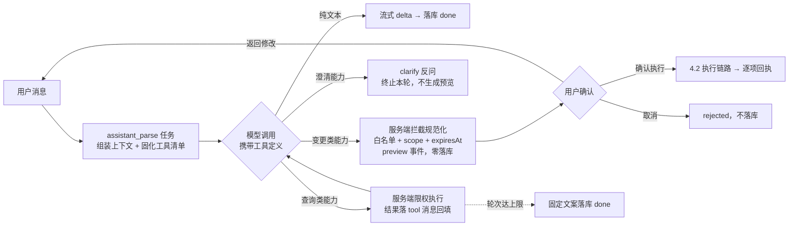

# 软件测试平台——智能助手

**文档版本**：V1.0
**日期**：2026-10-02
**状态**：起草中

---

## 1. 引言

### 1.1 编写目的

对**智能助手**能力域进行详细设计：定义按用户归属的会话与消息接口、SSE 流式协议、对话式任务执行（工具调用循环）、澄清与变更预览结构、确认执行与回执规则。会话 / 消息表（`ai_assistant_conversation` / `ai_assistant_message`）与任务资源（`type = assistant_parse`）的 DDL 与公共协议见总册 `docs/04-detailed-design/07-ai-capability/02-ai-infra-overview.md`，本文档不重复定义。

### 1.2 范围与对应设计

- 对应需求：`docs/01-requirements/07-ai-capability/04-srs-ai-assistant.md`（US-AI-010 ~ 014）。
- 对应概要：`docs/02-high-level-design/07-ai-capability/02-hld-ai-capability.md` 第 4.2、4.7 节。
- 落库对象为**测试用例、测试评审、测试计划**三类业务数据：执行时复用既有业务服务与校验（快照语义沿用既有机制），助手不自建落库通道。

### 1.3 参考资料

- 总册：`docs/04-detailed-design/07-ai-capability/02-ai-infra-overview.md`（2.9 助手表、3.6 任务资源、错误码 101–123）
- `docs/00-spec/20-contracts/01-api.md` 9（WebSocket 与实时协议）、`docs/02-high-level-design/04-hld-data-interface.md` 2.1（`/api/ai` 分类与上下文头）

---

## 2. 数据设计

本分册**不新增表**，仅 `ai_assistant_conversation` 与 `ai_assistant_message` 补列：

- 会话与消息：`ai_assistant_conversation`（`user_id` 唯一归属 + `workspace_id` 归属空间过滤 + `context_snapshot` 内含**会话私有项目状态** `projectId / projectName`）、`ai_assistant_message`（`intent` 预览 / `execution` 回执 / `citations` 来源引用 / `images` 附图引用），DDL 见总册 2.9；
- 会话表补列（C5 迁移说明，随 PR 提供，DDL 见总册 2.9）：`workspace_id`（NOT NULL，创建时取 `X-Active-Workspace`），索引改为 `(user_id, workspace_id, created_at)`；无存量数据，迁移仅加列与重建索引，不涉及回填与清理；
- 消息表补列（C5 迁移说明，随 PR 提供，DDL 见总册 2.9）：`tool_calls`（assistant 消息的工具调用载荷）与 `tool_call_id`（`role = tool` 结果消息回指），`role` 枚举扩展 `tool`；加列不回填、不新增表与索引（配对查询走既有会话索引）；
- 消息表补列（C5 迁移说明，随 PR 提供，DDL 见总册 2.9）：`images`（用户消息的附图文件引用 `[{ fileId, name }]`，仅存引用不存字节；存量行为空）；加列不回填、不新增表与索引（附图随消息行读写）；
- 意图解析执行：`ai_task`（`type = assistant_parse`，`workspace_id` 取 `X-Active-Workspace` 头，`project_id` 取执行上下文）；执行语义为对话式工具调用循环（4.1），单条消息的多跳模型调用共享本任务。

---

## 3. 接口详细设计

### 3.1 通用约定

- 基础路径：`/api/ai/conversations`；响应 `Result<T>`，示例**仅展示 `data`**。
- **上下文头按操作分层**（C4）：

| 操作 | 请求头 | 理由 |
| ---- | ---- | ---- |
| 会话列表 / 创建 | `Authorization` + `X-Active-Workspace` | 列表按 `workspace_id` 过滤当前空间会话；创建写入归属空间（头缺失 1000002008） |
| 重命名 / 归档 / 删除 / 消息历史 | 仅 `Authorization` | 会话按人归属，管理与回看动作不带工作空间 / 项目条件 |
| 发送消息 | + `X-Active-Workspace` | 只读问答与工具执行的限权作用域；且须与会话 `workspace_id` 一致（1000018263） |
| 执行落库 | + `X-Active-Workspace` | 目标项目取自固化 `intent.scope`，**不携带项目头**；归属空间一致按 1000018263、空间维自检按 1000018256（4.2） |

- **助手接口一律不携带 `X-Active-Project`**：助手内确定的项目只存在于会话状态与 `intent.scope`（服务端数据），不注入请求头，也不改变全局项目选择。
- 全部接口先校验会话 `user_id = 当前用户`，否则 1000018251（防 IDOR，管理员同样不越权）。

### 3.2 会话列表

- **路径**：`GET /api/ai/conversations`
- **参数**：`keyword`（标题包含，可选）、`pageNo`、`pageSize`（默认 20）。
- **过滤**：仅返回 `workspace_id` = `X-Active-Workspace` 的本人会话（头缺失 1000002008）。
- **响应**（按 `created_at` 倒序）：

```json
{
  "list": [
    {
      "id": "…",
      "title": "生成登录模块用例",
      "workspaceId": "…",
      "status": "active",
      "lastMessageAt": "2026-10-02T09:10:00Z",
      "messageCount": 8
    }
  ],
  "total": 12
}
```

### 3.3 创建会话

- **路径**：`POST /api/ai/conversations`
- **请求头**：`X-Active-Workspace`（必带，缺失 1000002008），服务端写入 `workspace_id`。
- **请求**（`context` 为页面实体引用，非上下文标识；归属空间由服务端从请求头写入 `workspace_id` 并记入 `context_snapshot`）：

```json
{
  "title": "生成登录模块用例",
  "context": { "entityType": "mindmap_document", "entityId": "…", "entityTitle": "登录用例文档" }
}
```

- **响应**：会话对象（同 3.2 单条，含 `workspaceId`）；`context_snapshot = { workspaceId, context, capturedAt }`。
- **校验**：`title` ≤ 100 字符（缺省「新会话」，首问后回填）；`context.entityId` 可选，须属当前用户可见范围。

### 3.4 会话重命名 / 归档 / 删除

- `PATCH /api/ai/conversations/{conversationId}` `{ "title": "…" }` —— 重命名。
- `PATCH /api/ai/conversations/{conversationId}` `{ "status": "archived" }` —— 归档（归档后不可发消息，1000018259）。
- `DELETE /api/ai/conversations/{conversationId}` —— 逻辑删除会话与全部消息；**不影响任何已确认落库的数据**（需求分册口径）。

### 3.5 发送消息（SSE 流式）

- **路径**：`POST /api/ai/conversations/{conversationId}/messages`
- **请求**：

```json
{
  "content": "给登录模块补全验证码过期的用例",
  "attachments": [{ "entityType": "mindmap_document", "entityId": "…" }],
  "images": [{ "fileId": "…" }]
}
```

- **消息附图**：`images` 为用户随消息上传的图片文件引用（平台级文件资源标识，仅存引用不存字节）：单条 ≤3 张、类型 png / jpg / jpeg / gif / webp / bmp、单张 ≤10MB；附图非空要求视觉能力模型，无可用候选在提交期按 1000018124 快速失败（总册 4.2）。
- **响应**：`Content-Type: text/event-stream`，SSE 契约（本文档为唯一定义处，其他分册引用）：

| event | data | 说明 |
| ---- | ---- | ---- |
| `delta` | `{ "text": "…" }` | 助手正文增量（只读问答流式生成） |
| `tool_call` | `{ "toolName": "…", "summary": "…" }` | 查询类能力执行进度帧（循环内可选下发，前端显示进行态） |
| `clarify` | `{ "question": "…", "options": ["…"] }` | 执行中信息不足或多理解时的反问（由澄清能力产生，同时落 `content`） |
| `preview` | `{ …intent 结构见 4.3 }` | 变更入参经服务端规范化后的预览（落消息 `intent` 字段） |
| `citations` | `[{ "type": "requirement", "id": "…", "title": "REQ-001", "quote": "…" }]` | 来源引用（只读问答必带；落 `citations` 字段） |
| `done` | `{ "messageId": "…" }` | 本条助手消息完成落盘（`status = done`） |
| `error` | `{ "code": 1000018255, "msg": "意图解析失败" }` | 流终止错误 |
| 心跳 | `: ping` 注释行 | 每 15s，防中间层断连 |

- **服务端流程**：
  1. 落用户消息（`role = user`、`attachments`、`images`）→ 创建 `assistant_parse` 任务（总册 3.6.1）；
  2. 订阅任务流式输出转发为 SSE；`status = streaming` → 完成后置 `done`；
  3. 执行过程事件与产出分流：查询类能力执行时可下发进度帧（`tool_call`）；终态产出分为变更预览（`preview`）/ 澄清反问（`clarify`）/ 只读问答（`delta` + `citations`）；
  4. **断线恢复**：客户端断连后通过 3.6 消息历史轮询至 `status = done`，内容不丢失；服务端不因断连中止解析任务。
- **校验**：会话可发消息（1000018259）、会话归属空间与当前活跃空间一致（1000018263）、`content` 非空且 ≤ 4000 字符（1000018260）、附件引用合法（1000018262）、附图合法（≤3 张 / 图像类型 / 单张 ≤10MB，1000018264）；RAG 不可用时只读问答按总册 4.5 降级（1000018258），**不编造数据**。

### 3.6 消息历史

- **路径**：`GET /api/ai/conversations/{conversationId}/messages`
- **参数**：`pageNo`、`pageSize`（默认 20，倒序）。
- **响应**：

```json
{
  "list": [
    {
      "id": "…",
      "role": "assistant",
      "content": "已解析为以下变更…",
      "status": "done",
      "citations": [{ "type": "requirement", "id": "…", "title": "REQ-001", "quote": "…" }],
      "intent": {
        "kind": "create_plan",
        "targetType": "test_plan",
        "targetTitle": "登录回归计划",
        "createCount": 1,
        "changes": [
          { "field": "caseIds", "op": "add", "value": 8 },
          { "field": "startAt", "op": "add", "value": "2026-10-05T00:00:00Z" }
        ],
        "scope": { "workspaceId": "…", "projectId": "…", "projectName": "电商商城" },
        "expiresAt": "2026-10-02T09:20:00Z"
      },
      "execution": null,
      "createdAt": "2026-10-02T09:10:00Z"
    }
  ],
  "total": 8
}
```

- `scope` 为预览时点的目标作用域**展示与执行依据**（数据引用）：执行的目标项目与空间一律取固化 `intent.scope`，请求头仅作空间维自检（4.2）。
- `role = tool` 的中间工具结果消息**不返回**（服务层过滤；断线恢复只轮询终态助手消息，历史时间线不展示执行步骤）。
- 用户消息 `images` 为附图引用 `[{ fileId, name }]`（仅存引用不存字节），前端经文件模块换签取缩略图；助手消息恒不携带。

### 3.7 确认执行

- **路径**：`POST /api/ai/conversations/{conversationId}/messages/{messageId}/execute`
- **请求头**：仅 `X-Active-Workspace`（须与会话归属空间一致，1000018263）；**不携带项目头**——目标项目取自固化 `intent.scope`。
- **请求**：`{ "retryIndexes": [1, 3] }`；`retryIndexes` 可选，缺省表示首次执行（此时 `execution` 须为 `null`），非空表示对上次回执 `results` 中失败项按数组下标单项重试。
- **响应**（回执，整体 200；逐项成败，部分失败成功项保留）：

```json
{
  "execution": {
    "status": "executed",
    "executedBy": "…",
    "executedAt": "2026-10-02T09:12:00Z",
    "results": [
      { "action": "create_plan", "success": true, "createdId": "…", "link": "/workspace/projects/…/plans/…" },
      { "action": "create_case", "caseId": "…", "success": false, "errorCode": 1000018257, "errorMsg": "无权限执行该操作" }
    ]
  }
}
```

- **校验顺序**：会话归属（1000018251）→ 消息存在（1000018252）→ 归属空间一致（会话 `workspace_id` 与请求头不一致 1000018263）→ `intent` 非空（1000018255）→ 时效（`expiresAt` 超时 1000018253）→ 未执行过（1000018254）→ 空间维自检（`intent.scope.workspaceId` 与请求头不一致 1000018256，防御性）→ 权限（1000018257）；**无项目维校验**，目标项目一律取 `intent.scope.projectId`。
- **未执行过（1000018254）分档**：不带 `retryIndexes` 时 `execution` 非 `null` 即拒绝（含 `rejected`，取消后不可再执行）；带 `retryIndexes` 时要求 `execution.status = "executed"` 且各下标指向既有失败项，下标越界或指向成功项按参数非法（1000001001）拒绝。

### 3.8 取消预览

- **路径**：`POST /api/ai/conversations/{conversationId}/messages/{messageId}/cancel`
- **响应**：`execution = { status: "rejected", rejectedBy, rejectedAt }`；取消不产生任何数据（1000018254 防重复）。

---

## 4. 业务逻辑设计

### 4.1 对话式任务执行（工具调用循环）



- **循环与轮次**：单条消息最多 5 跳模型调用（常量固化，防死循环）；查询类能力串行执行、结果回填后继续循环；仍无法产出时以固定文案落库并 `done` 终止（正常终止，非错误码），用户可继续对话。
- **查询类能力**（只读，即时执行）：按 `X-Active-Workspace` 限权执行，结果以 `role = tool` 消息落库并回填模型；执行失败（权限不足、业务异常等）不中断会话——错误文本回填模型，由其改述、追问或改用其他能力；进度可经 `tool_call` 帧下发（3.5）。
- **澄清能力**（`ask_user`）：入参为 `question` 与 2~5 个 `options`；调用即生成 `clarify` 事件与 ClarifyCard、消息落 `content` 并 `done`，**终止本轮循环**；选项须来自查询所得候选或上下文，不得虚构。
- **变更类能力**（拦截，零落库）：模型发起变更调用后**不触发任何业务 Service**，由服务端按字段白名单与 4.3 结构规范化为 `intent`（scope 与 10 分钟过期由服务端补齐），经 `AssistantRefChecker` 越权与幻觉校验后发 `preview` 事件并终止循环；无法规范化按 1000018255，越权引用按 1000018261。
- **工具清单**（服务端固化注册，16 个；模型无权调用清单外能力，清单外调用按 1000018255 拒绝）：

| 类别 | 工具 | 说明 |
| ---- | ---- | ---- |
| 查询 / 检索 | `query_projects` / `query_doc_tree` / `query_cases` / `query_reviews` / `query_plans` / `query_progress` | 项目、模块 + 用例文档树、用例、评审、计划清单与进度；结果按活跃工作空间限权过滤 |
| 查询 / 检索 | `search_knowledge` | 知识检索合一：先按主题词匹配静态平台指引片段（按空间角色过滤、附站内 route），再执行 RAG 向量检索返回业务知识命中；向量不可用时指引片段仍可应答，双缺失按 1000018258 降级 |
| 澄清 | `ask_user` | `{question, options[2~5]}`，调用即生成 clarify 反问并终止本轮 |
| 变更（拦截） | `create_case` / `update_case` / `complete_case` / `batch_tag` / `create_review` / `adjust_review` / `create_plan` / `adjust_plan` | 入参与 kind 白名单对齐（4.3），规范化为 `intent` 预览，执行在用户确认后（4.2） |

- **模型调用**：工具定义注册与 `tool_calls` 回传统一经 Spring AI 2.0.x 执行（总册 4.2 调用层口径），平台不自实现 HTTP；每跳独立记账。
- **上下文组装**：system（角色指令 + 页面上下文附件）+ 同会话近 20 条消息（**含 `role = tool` 结果消息**）+ 工具定义；候选清单（项目 / 文档树 / 用例等）不再静态注入提示词，由模型按需查询。
- **消息附图**：当前消息 `images` 经泛化文件模块读回字节，作为随行媒体随本轮模型调用携带（多图同一媒体列表）；仅本轮理解，历史消息附图不随上下文回传（需求分册 1.6）。
- **上下文分层与会话私有项目**：全局层（活跃工作空间经请求头、全局项目选择）与会话层（`context_snapshot` 页面上下文 + 会话已定项目）严格分离。项目解析候选优先级：指令点名 ＞ 会话已定项目 ＞ 当前页面上下文（全局项目**只读作候选**）＞ `query_projects` ＞ `ask_user`（会话与当前指向不同且指令未指明时二选一，选项标注「当前 / 会话」来源）；解析结果**写入会话层与 `intent.scope`**，不修改全局项目选择、不注入任何请求头。
- **悬空补偿**：任务失败或中断时，为带 `tool_calls` 但缺回填的 assistant 消息补"未执行"的 `role = tool` 消息落库，保证 `tool_calls` 后必有回填的协议配对，重载与续聊不悬挂。
- **用量归因**：助手交互调用 `task_id = NULL`；判别与查询跳归因 `assistant_parse`，末跳回答生成归因 `assistant_answer`（总册 4.3）。
- **引用**：`citations` 取本条消息循环中检索类能力返回的命中（去重），只读问答必带（3.5）。
- **断线恢复**：任何终态（clarify / preview / done / error）先落盘再发事件，事件是已提交状态的投影（3.5）。
- 只读问答不进入预览流程，直接流式返回答案 + 来源引用；数据超权限范围时明确拒绝并说明（总册 4.4 限权检索）；**无明确业务对象的模糊指令不予执行**（由澄清能力承接）。

### 4.2 确认执行的校验与作用域

1. **预览阶段不产生任何落库数据**；变更类调用在预览生成前由服务端拦截，用户确认前不触发业务服务；`intent` 一经生成即固化（动作、目标、字段级变更、创建数量、scope 与过期时间）；
2. 执行的**目标项目与空间一律取固化 `intent.scope`**（服务端自有数据，客户端不传任何项目标识，C4 不涉及）；请求头仅作**空间维自检**：会话已按 `workspace_id` 归属空间过滤（4.4），归属空间不一致按 1000018263 拒绝，`scope.workspaceId` 与 `X-Active-Workspace` 不一致按 1000018256 拒绝（防御性，正常不可达）。**执行期无任何项目维拒绝**：确认即按预览声明的项目落库，无须选中或切换项目；项目权限由既有业务服务校验（第 3 条）；
3. 落库走**既有业务服务**，权限、必填、合法性校验与界面操作完全一致（参与者须空间成员、计划时间合法、圈选用例存在等），助手不放宽任何约束；
4. **逐项事务**：成功项落库保留，失败项不落库，回执附原因与可单项重试；
5. 每次执行（含部分失败）记审计；执行回执写 `execution` 后不可变更，单项重试产生新的执行子动作追加到 `results`（原条目保持不变）；
6. **执行输入**：执行以 `intent` 固化的 `params` 与 `changes` 为输入——`caseIds`（已校验为工作空间内标识）与 `changes`（按字段白名单 `title / priority / type / precondition / steps / expected` 解析，越界字段忽略）直传既有服务；`create_case` 多条时逐条数据取 `params.cases`（`[{title, priority, precondition, steps, expected}, …]`，每条一个回执项），缺省时按 `targetTitle` + `changes` 单条创建，未携带 `documentId` 时取项目下首份功能用例文档、未携带 `parentId` 时挂根节点（`documentId / parentId` 可由 `query_doc_tree` 查询所得直接指定，优先于缺省规则）；`create_review` 未携带 `participantIds` 时取执行人本人（携带时校验存在且属同一空间）；
7. **回执跳转链接**：`link` 为前端实际路由相对路径（`/workspace/projects/plans/{planId}`、`/workspace/projects/reviews/{reviewId}`、`/workspace/projects/functional-testing`），前端拿到即可跳转，不自行拼前缀。

### 4.3 预览（intent）结构

| 字段 | 说明 |
| ---- | ---- |
| kind | 动作类型：`create_case / update_case / complete_case / batch_tag / create_review / adjust_review / create_plan / adjust_plan` |
| targetType / targetTitle | 目标对象类型与名称 |
| createCount | 将创建的记录数量 |
| changes[] | 字段级变更：`field`、`op`（`add / replace`）、`value`（新增展示完整字段，修改展示原值 → 新值） |
| scope | 预览时点作用域（workspaceId / projectId 展示名） |
| expiresAt | 时效（默认生成后 10 分钟），超时需重新解析 |

- 首批支持的任务类型以需求分册 1.3 为准（用例新建 / 修改 / 补全 / 批量标记，评审创建与调整，计划创建与调整）；`batch_tag` 为批量设置优先级 / 类型标记（脑图既有标记语义，用例无标签数据模型），`update_case` 不含标签字段；进度查看类问题归只读问答（需求分册 1.5，直接作答附对象跳转链接，不产生 `kind`）。
- ID 类入参一律取自查询类能力返回的候选并经活跃工作空间校验（4.1），不得虚构；`changes` 按字段白名单规范化，越界字段忽略。

### 4.4 会话与上下文规则

- `workspace_id` 为会话归属空间（创建时固化）：会话列表按当前活跃空间过滤，发送与执行均以会话归属空间为前提，不一致按 1000018263 拒绝并提示切换作用域；
- `context_snapshot` 仅作默认上下文与来源展示，**不参与权限判定**；隔离与可见性仍只看 `user_id`；跨工作空间指代被拒绝（1000018261）；
- 会话私有项目状态存于 `context_snapshot`（`projectId / projectName`，解析或澄清写入，仅会话内生效）：不修改全局项目选择、不注入请求头，随会话生命周期保留；
- 删除会话只删会话与消息，已落库数据与执行审计不受影响；
- 多轮对话：`assistant_parse` 携带同会话近 N 条消息作为上下文（N = 20），澄清消息与工具调用结果（`role = tool`）计入。

---

## 5. 前端设计

### 5.1 全局入口与布局

- **入口**：全局常驻右下悬浮球，任意业务页面可唤起，不随路由销毁（挂在 `AppLayout` 层）；未进入工作空间上下文（「我的空间」列表页）不显示；默认收起，点击展开无遮罩浮层卡片。

```
AiAssistantPanel（浮层卡片：800×700、无遮罩、可拖动、默认收起）
├── PanelHeader（会话标题、重命名、归档、删除、新会话）
├── SessionList（历史会话，时间倒序，检索）
├── MessageTimeline
│   ├── UserMessage（正文 + 附件引用 + 图片缩略图）
│   ├── AssistantMessage（Markdown + citations 来源链接）
│   ├── ClarifyCard（反问 + 快捷选项回填输入框）
│   ├── PreviewCard（变更预览：目标、字段级 diff、创建数量；确认执行 / 取消 / 返回修改）
│   └── ReceiptCard（执行回执：逐项成败、对象跳转链接、单项重试）
├── ComposerInput（输入框 + 上下文附件选择 + 图片上传 + 发送）
└── StreamIndicator（流式打字动画、断线后“恢复中…”状态）
```

### 5.2 状态管理与交互

- Pinia store `aiAssistant`：面板开合、会话列表、当前会话消息、流式缓冲、`previewing / executing` 状态；
- 切换活跃工作空间：会话列表按新空间重载；当前会话不属新空间时收起当前会话、回到新建会话态；
- SSE 客户端：`fetch` + `ReadableStream` 解析事件；断连 → 标记 `interrupted` → 按 3.6 轮询消息至 `done` 自动补齐；
- 预览卡片倒计时展示 `expiresAt`；超时置灰「确认执行」并提供「重新解析」；
- 浮层卡片无遮罩：点击卡片外部不关闭，底层页面保持可交互；`[—]` / `[✕]` 或再点悬浮球收起（会话保留）；开合与拖动位置不持久化，每次进入默认收起、默认右下定位；
- 执行回执内对象链接点击跳转并收起面板（保留会话可回看）。

### 5.3 状态分支

- 空会话引导（示例指令）、流式进行中（含多步查询进度文案）、澄清反问、轮次超限（固定文案，可继续输入）、预览过期、执行部分失败、只读问答无引用（RAG 未就绪提示 1000018258）、会话归档态（只读）、权限不足（回执失败项说明）、图片上传失败重试与发送失败（无视觉模型 1000018124）输入与图片保留。

---

## 6. 错误码定义

号段：**1000018251–1000018279（智能助手）**，以 `ErrorCodeConstants` 实际登记为准，冲突时顺延。

| 错误码 | HTTP | 说明 |
| ---- | ---- | ---- |
| 1000018251 | 404 | 会话不存在或非本人会话 |
| 1000018252 | 404 | 消息不存在 |
| 1000018253 | 409 | 预览不存在或已过期 |
| 1000018254 | 409 | 预览已执行或已取消 |
| 1000018255 | 400 | 意图解析失败，无法生成预览（含变更入参无法规范化、清单外能力调用） |
| 1000018256 | 409 | 执行作用域与预览目标不一致（仅空间维自检，防御性；项目维不校验，见 4.2） |
| 1000018257 | 403 | 无权限执行该操作 |
| 1000018258 | 400 | 只读问答检索不可用（向量能力未就绪） |
| 1000018259 | 409 | 会话已归档，不可发送消息 |
| 1000018260 | 400 | 消息内容为空或超过长度限制 |
| 1000018261 | 409 | 跨工作空间指代被拒绝，请切换作用域 |
| 1000018262 | 400 | 附件引用非法 |
| 1000018263 | 409 | 会话不属于当前工作空间，请切换作用域 |
| 1000018264 | 400 | 图片附件非法（张数 / 类型 / 大小超限） |

---

## 7. 实施说明

**新增 / 修改文件**

| 文件 | 说明 |
| ---- | ---- |
| `server/.../controller/ai/AiAssistantController` | 会话 / 消息 / 执行 / 取消路由（仅路由，C2） |
| `server/.../service/ai/assistant/AssistantService + Impl` | 会话归属校验、消息落盘、SSE 桥接 |
| `server/.../service/ai/assistant/AssistantExecuteService + Impl` | 预览校验、作用域比对、分发既有业务服务落库 |
| `server/.../service/ai/assistant/tool/*` | 工具体系：`AssistantTool` 接口与清单注册（服务端固化 16 个）、查询 / 澄清 / 变更拦截工具实现 |
| `server/.../service/ai/assistant/AssistantToolLoop` | 工具调用循环编排（轮次上限、结果回填、事件桥接、悬空补偿），承接原 `AssistantParseHandler` 职责 |
| `server/.../service/ai/config/AiModelClient` | 扩展工具定义注册与 `tool_calls` 回传（经 Spring AI，不自实现 HTTP） |
| `server/.../framework/common/ErrorCodeConstants` | 登记 1000018251–1000018264 |
| `web/src/components/ai/assistant/*`（Panel、Timeline、PreviewCard、ReceiptCard） | 助手前端 |
| `web/src/stores/aiAssistant.ts`、`web/src/services/aiAssistant.ts` | 状态与 API（含 SSE 客户端封装） |

- **数据库**：无新增表（复用总册 2.9 两张表）；`ai_assistant_message` 补 `images`（附图引用）与 `tool_calls / tool_call_id` 列（2 节迁移说明，DDL 见总册 2.9）。
- **OpenAPI**：SSE 接口以 `text/event-stream` 单独标注（springdoc `@ApiResponse` content 为 `text/event-stream`），`@Operation` 事件清单含新增 `tool_call` 进度帧；execute / cancel 标注幂等语义。

**测试要点（C8 ≥ 70%）**

- 后端：会话归属越权全矩阵（1000018251）、SSE 事件序列与断线后消息完整、工具循环轮次上限与固定文案终止、查询失败回填不中断会话、**变更拦截在确认前零落库**、澄清事件与快捷选项、清单外能力拒绝、悬空工具消息补偿配对、预览时效与重复执行拦截、归属空间与空间维自检拒绝（1000018263 / 1000018256）、**执行按固化 scope 落库且无项目维拦截**、执行逐项事务与部分失败回执、只读问答引用必带、删除会话不触碰落库数据、消息附图全矩阵（张数 / 类型 / 大小按 1000018264、无视觉模型提交期 1000018124、附图媒体随本轮调用、历史附图不回传）；
- 前端：SSE 解析（含 `tool_call` 进度帧）与断连恢复轮询、多步查询进度与轮次超限提示、预览倒计时与过期降级、回执跳转与单项重试、归档态只读、图片选择上传（缩略图 chip、预校验与失败重试）与消息缩略图换签渲染、全部状态分支。

---

## 修改记录

| 版本 | 日期 | 说明 |
| ---- | ---- | ---- |
| V1.0 | 2026-10-02 | 初始版本 |
| V1.0 | 2026-10-03 | 助手面板由右侧抽屉改为无遮罩浮层卡片（可拖动、默认收起） |
| V1.0 | 2026-10-07 | `batch_tag` 与 `update_case` 口径对齐既有数据模型：批量标记为设置优先级 / 类型标记，不设标签字段 |
| V1.0 | 2026-10-07 | 明确 execute 单项重试口径（254 分档、retryIndexes、结果追加）、执行输入缺省与回执跳转链接格式 |
| V1.0 | 2026-10-07 | case 类 `changes` 白名单去 description 补 expected；`create_case` 多条数据取 `params.cases`；回执链接对齐前端实际路由 |
| V1.0 | 2026-10-16 | 执行机制由提示词分流改为对话式任务执行（工具调用循环）：1 引言、2 消息表补列、3.5 新增 `tool_call` 帧与产物分流、3.6 过滤 `role = tool` 消息、4.1 重写（16 个固化工具清单、轮次上限、拦截零落库、悬空补偿）、4.2/4.3 规范化与结构化 ID 口径、4.4 上下文含工具消息、5.3/6/7 状态、错误码说明与实施清单同步 |
| V1.0 | 2026-10-16 | 会话增加 `workspace_id` 归属空间：2 数据设计补迁移说明、3.1 鉴权表分层（列表 / 创建带 `X-Active-Workspace`）、3.2 过滤与响应、3.3 创建必带头、3.5/4.4 归属一致校验（新增 1000018263）、5.1/5.2 入口显隐与切换空间行为、6/7 错误码同步 |
| V1.0 | 2026-10-16 | 项目选择会话私有化：3.1/3.7 删项目头（助手接口不携带 `X-Active-Project`）、3.6/4.2 目标项目改取固化 `intent.scope`（执行期无项目维拒绝，256 收窄为空间维自检）、4.1 补上下文分层与解析候选优先级（冲突二选一）、4.4 补会话私有项目状态，2/6/7 数据、错误码与测试要点同步 |
| V1.0 | 2026-10-16 | 消息附图与视觉理解（US-AI-014）：2 消息表补 `images` 列与迁移说明、3.5 请求体 / 校验与附图口径（新增 1000018264）、3.6 附图回显、4.1 附图媒体随行与历史不回传、5.1/5.3 前端结构与状态、6/7 错误码与实施清单同步 |
| V1.0 | 2026-10-16 | 术语与状态口径残词勘误：3.5 服务端流程改「执行过程事件与产出分流，终态产出分为变更预览 / 澄清反问 / 只读问答」 |
