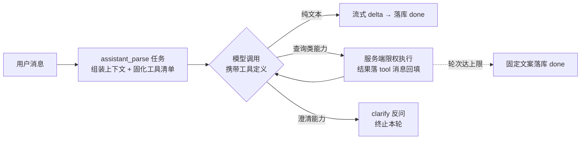

# 软件测试平台——智能助手

**文档版本**：V1.0
**日期**：2026-10-02
**状态**：起草中

---

## 1. 引言

### 1.1 编写目的

对**智能助手**能力域进行详细设计：定义按用户归属的会话与消息接口、SSE 流式协议、对话式任务执行（工具调用循环）、澄清结构与只读问答规则。**助手不提供数据变更操作**，不产生预览、不经人工确认、不写业务库。会话 / 消息表（`ai_assistant_conversation` / `ai_assistant_message`）与任务资源（`type = assistant_parse`）的 DDL 与公共协议见总册 `docs/04-detailed-design/07-ai-capability/02-ai-infra-overview.md`，本文档不重复定义。

### 1.2 范围与对应设计

- 对应需求：`docs/01-requirements/07-ai-capability/04-srs-ai-assistant.md`（US-AI-010、US-AI-013、US-AI-014）。
- 对应概要：`docs/02-high-level-design/07-ai-capability/02-hld-ai-capability.md` 第 4.2、4.6 节。
- 助手仅提供查询问答与澄清追问，不创建、修改或删除业务数据；`intent` / `execution` 数据库列保留但不写入、不随响应返回（无历史消息，无需展示兼容）。

### 1.3 参考资料

- 总册：`docs/04-detailed-design/07-ai-capability/02-ai-infra-overview.md`（2.9 助手表、3.6 任务资源、错误码 101–123）
- `docs/00-spec/20-contracts/01-api.md` 9（WebSocket 与实时协议）、`docs/02-high-level-design/04-hld-data-interface.md` 2.1（`/api/ai` 分类与上下文头）

---

## 2. 数据设计

本分册**不新增表**，仅 `ai_assistant_conversation` 与 `ai_assistant_message` 补列：

- 会话与消息：`ai_assistant_conversation`（`user_id` 唯一归属 + `workspace_id` 归属空间 + `project_id` 归属项目过滤 + `context_snapshot` 页面上下文）、`ai_assistant_message`（`tool_calls` 工具载荷 / `citations` 来源引用 / `images` 附图引用；`intent` / `execution` 数据库列保留但不写入、不暴露），DDL 见总册 2.9；
- 会话表补列（C5 迁移说明，随 PR 提供，DDL 见总册 2.9）：`workspace_id`（NOT NULL，创建时取 `X-Active-Workspace`）、`project_id`（NOT NULL，创建时取 `X-Active-Project`），索引改为 `(user_id, workspace_id, project_id, created_at)`；无存量数据，迁移仅加列与重建索引，不涉及回填与清理；
- 消息表补列（C5 迁移说明，随 PR 提供，DDL 见总册 2.9）：`tool_calls`（assistant 消息的工具调用载荷）与 `tool_call_id`（`role = tool` 结果消息回指），`role` 枚举扩展 `tool`；加列不回填、不新增表与索引（配对查询走既有会话索引）；
- 消息表补列（C5 迁移说明，随 PR 提供，DDL 见总册 2.9）：`images`（用户消息的附图文件引用 `[{ fileId, name }]`，仅存引用不存字节；存量行为空）；加列不回填、不新增表与索引（附图随消息行读写）；
- 问答执行：`ai_task`（`type = assistant_parse`，`workspace_id` 取 `X-Active-Workspace` 头、`project_id` 取 `X-Active-Project` 头）；执行语义为对话式工具调用循环（4.1），单条消息的多跳模型调用共享本任务。

---

## 3. 接口详细设计

### 3.1 通用约定

- 基础路径：`/api/ai/conversations`；响应 `Result<T>`，示例**仅展示 `data`**。
- 助手全部接口免 RBAC 权限码校验（登录即可），仅保留会话归属可见性（4.4）与工作空间 / 项目成员校验，不依赖权限码。
- **上下文头**（C4）：助手为**项目级能力**，全部接口统一携带 `Authorization` + `X-Active-Workspace` + `X-Active-Project`（头缺失 1000002008）：

| 操作 | 请求头 | 理由 |
| ---- | ---- | ---- |
| 会话列表 / 创建 | `Authorization` + `X-Active-Workspace` + `X-Active-Project` | 列表按 `workspace_id + project_id` 过滤当前项目会话；创建写入归属空间与项目 |
| 重命名 / 归档 / 删除 / 消息历史 | `Authorization` + `X-Active-Workspace` + `X-Active-Project` | 全部接口统一携带上下文头；会话按 `user_id` 归属，管理与回看动作仍带空间 / 项目头 |
| 发送消息 | `Authorization` + `X-Active-Workspace` + `X-Active-Project` | 只读问答与查询工具的限权作用域；须与会话 `workspace_id + project_id` 一致（1000018263） |

- **目标项目一律取 `X-Active-Project` 头**：助手入口仅在项目内可用，会话归属项目创建时固化于 `project_id`；服务端以头中项目为唯一查询作用域，不改变全局项目选择。
- 全部接口先校验会话 `user_id = 当前用户`，否则 1000018251（防 IDOR，管理员同样不越权）。

### 3.2 会话列表

- **路径**：`GET /api/ai/conversations`
- **参数**：`keyword`（标题包含，可选）、`pageNo`、`pageSize`（默认 20）。
- **过滤**：仅返回 `workspace_id` = `X-Active-Workspace` 且 `project_id` = `X-Active-Project` 的本人会话（头缺失 1000002008）。
- **响应**（按 `created_at` 倒序）：

```json
{
  "list": [
    {
      "id": "…",
      "title": "生成登录模块用例",
      "workspaceId": "…",
      "status": "active",
      "lastMessageAt": "2026-10-02T09:10:00Z",
      "messageCount": 8
    }
  ],
  "total": 12
}
```

### 3.3 创建会话

- **路径**：`POST /api/ai/conversations`
- **请求头**：`X-Active-Workspace` + `X-Active-Project`（均必带，缺失 1000002008），服务端写入 `workspace_id` 与 `project_id`。
- **请求**（`context` 为页面实体引用，非上下文标识；归属空间与项目由服务端从请求头写入 `workspace_id / project_id`，并将空间记入 `context_snapshot`）：

```json
{
  "title": "生成登录模块用例",
  "context": { "entityType": "mindmap_document", "entityId": "…", "entityTitle": "登录用例文档" }
}
```

- **响应**：会话对象（同 3.2 单条，含 `workspaceId` 与 `projectId`）；`context_snapshot = { workspaceId, context, capturedAt }`。
- **校验**：`title` ≤ 100 字符（缺省「新会话」，首问后回填）；`context.entityId` 可选，须属当前用户可见范围。

### 3.4 会话重命名 / 归档 / 删除

- `PATCH /api/ai/conversations/{conversationId}` `{ "title": "…" }` —— 重命名。
- `PATCH /api/ai/conversations/{conversationId}` `{ "status": "archived" }` —— 归档（归档后不可发消息，1000018259）。
- `DELETE /api/ai/conversations/{conversationId}` —— 逻辑删除会话与全部消息；**不影响任何已确认落库的数据**（需求分册口径）。

### 3.5 发送消息（SSE 流式）

- **路径**：`POST /api/ai/conversations/{conversationId}/messages`
- **请求头**：`Authorization` + `X-Active-Workspace` + `X-Active-Project`（作用域与会话归属一致，见校验）。
- **请求**：

```json
{
  "content": "登录模块有哪些用例？",
  "attachments": [{ "entityType": "mindmap_document", "entityId": "…" }],
  "images": [{ "fileId": "…" }]
}
```

- **消息附图**：`images` 为用户随消息上传的图片文件引用（平台级文件资源标识，仅存引用不存字节）：单条 ≤3 张、类型 png / jpg / jpeg / gif / webp / bmp、单张 ≤10MB；附图非空要求视觉能力模型，无可用候选在提交期按 1000018124 快速失败（总册 4.2）。
- **响应**：`Content-Type: text/event-stream`，SSE 契约（本文档为唯一定义处，其他分册引用）：

| event | data | 说明 |
| ---- | ---- | ---- |
| `delta` | `{ "text": "…" }` | 助手正文增量（只读问答流式生成） |
| `tool_call` | `{ "toolName": "…", "summary": "…" }` | 查询类能力执行进度帧（循环内可选下发，前端显示进行态） |
| `clarify` | `{ "question": "…", "options": ["…"] }` | 执行中信息不足或多理解时的反问（由澄清能力产生，同时落 `content`） |
| `citations` | `[{ "type": "requirement", "id": "…", "title": "REQ-001", "quote": "…" }]` | 来源引用（只读问答必带；落 `citations` 字段） |
| `done` | `{ "messageId": "…" }` | 本条助手消息完成落盘（`status = done`） |
| `error` | `{ "code": 1000018255, "msg": "意图解析失败" }` | 流终止错误 |
| 心跳 | `: ping` 注释行 | 每 15s，防中间层断连 |

- **服务端流程**：
  1. 落用户消息（`role = user`、`attachments`、`images`）→ 创建 `assistant_parse` 任务（总册 3.6.1）；
  2. 订阅任务流式输出转发为 SSE；`status = streaming` → 完成后置 `done`；
  3. 执行过程事件与产出分流：查询类能力执行时可下发进度帧（`tool_call`）；终态产出分为澄清反问（`clarify`）/ 只读问答（`delta` + `citations`）；
  4. **断线恢复**：客户端断连后通过 3.6 消息历史轮询至 `status = done`，内容不丢失；服务端不因断连中止解析任务。
- **校验**：会话可发消息（1000018259）、会话归属空间与当前活跃空间一致（1000018263）、会话归属项目与当前活跃项目一致（1000018263）、`content` 非空且 ≤ 4000 字符（1000018260）、附件引用合法（1000018262）、附图合法（≤3 张 / 图像类型 / 单张 ≤10MB，1000018264）；RAG 不可用时只读问答按总册 4.5 降级（1000018258），**不编造数据**。

### 3.6 消息历史

- **路径**：`GET /api/ai/conversations/{conversationId}/messages`
- **参数**：`pageNo`、`pageSize`（默认 20，倒序）。
- **响应**：

```json
{
  "list": [
    {
      "id": "…",
      "role": "assistant",
      "content": "当前项目共有 12 条登录模块用例…",
      "status": "done",
      "citations": [{ "type": "requirement", "id": "…", "title": "REQ-001", "quote": "…" }],
      "createdAt": "2026-10-02T09:10:00Z"
    }
  ],
  "total": 8
}
```

- 来源引用 `citations` 随只读回答返回；查询的目标项目与空间一律取请求头 `X-Active-Project` / `X-Active-Workspace`（4.2）。
- `role = tool` 的中间工具结果消息**不返回**（服务层过滤；断线恢复只轮询终态助手消息，历史时间线不展示执行步骤）。
- 用户消息 `images` 为附图引用 `[{ fileId, name }]`（仅存引用不存字节），前端经文件模块换签取缩略图；助手消息恒不携带。

---

## 4. 业务逻辑设计

### 4.1 对话式任务执行（工具调用循环）



- **循环与轮次**：单条消息最多 5 跳模型调用（常量固化，防死循环）；查询类能力串行执行、结果回填后继续循环；仍无法产出时以固定文案落库并 `done` 终止（正常终止，非错误码），用户可继续对话。5 跳上限与共享预算护栏（总册 4.2）**先到者终止**：预算耗尽按任务中止口径置 `aborted`，5 跳用尽仍按本条正常 `done`；共享 steps 按模型跳计，查询工具执行不额外计步。
- **中止与重跑**：用户主动中止时消息置 `interrupted`，仅模型或系统错误才置 `error`；禁止对同一 `messageId` 走通用「再次执行」重跑——用户重新发送生成新消息与新任务。中止后已发出的迟到模型调用只写独立 `ai_usage_log`，不改写任务 / 执行汇总与消息终态（总册 4.2）。
- **查询类能力**（只读，即时执行）：按 `X-Active-Workspace` + `X-Active-Project` 限权执行（仅返回头中项目内数据），结果以 `role = tool` 消息落库并回填模型；执行失败（权限不足、业务异常等）不中断会话——错误文本回填模型，由其改述、追问或改用其他能力；进度可经 `tool_call` 帧下发（3.5）。
- **澄清能力**（`ask_user`）：入参为 `question` 与 2~5 个 `options`；调用即生成 `clarify` 事件与 ClarifyCard、消息落 `content` 并 `done`，**终止本轮循环**；选项须来自查询所得候选或上下文，不得虚构。
- **工具清单**（服务端固化注册，8 个；模型无权调用清单外能力，清单外调用按 1000018255 拒绝）：

| 类别 | 工具 | 说明 |
| ---- | ---- | ---- |
| 查询 / 检索 | `query_projects` / `query_doc_tree` / `query_cases` / `query_reviews` / `query_plans` / `query_progress` | 项目、模块 + 用例文档树、用例、评审、计划清单与进度；结果按活跃工作空间及项目限权过滤 |
| 查询 / 检索 | `search_knowledge` | 知识检索合一：先按主题词匹配静态平台指引片段（按空间角色过滤、附站内 route），再执行 RAG 向量检索返回业务知识命中；向量不可用时指引片段仍可应答，双缺失按 1000018258 降级 |
| 澄清 | `ask_user` | `{question, options[2~5]}`，调用即生成 clarify 反问并终止本轮 |

- **模型调用**：工具定义注册与 `tool_calls` 回传统一经 Spring AI 2.0.x 执行（总册 4.2 调用层口径），平台不自实现 HTTP；每跳独立记账。
- **上下文组装**：system（角色指令 + 页面上下文附件）+ 同会话近 20 条消息（**含 `role = tool` 结果消息**）+ 工具定义；候选清单（项目 / 文档树 / 用例等）不再静态注入提示词，由模型按需查询。
- **消息附图**：当前消息 `images` 经泛化文件模块读回字节，作为随行媒体随本轮模型调用携带（多图同一媒体列表）；仅本轮理解，历史消息附图不随上下文回传（需求分册 1.6）。
- **上下文分层与项目作用域**：目标项目与空间由请求头 `X-Active-Project` / `X-Active-Workspace` 唯一确定（即会话归属项目与空间，创建时固化），`context_snapshot` 仅提供页面上下文引用。助手运行于**当前项目内**，无项目二选一澄清：跨项目指代（指令点名其他项目）按 1000018261 拒绝并提示切换作用域；`query_projects` 结果仅用于项目内对象定位，不改变目标项目与全局项目选择。
- **悬空补偿**：任务失败或中断时，为带 `tool_calls` 但缺回填的 assistant 消息补"未执行"的 `role = tool` 消息落库，保证 `tool_calls` 后必有回填的协议配对，重载与续聊不悬挂。
- **用量归因**：助手交互调用 `task_id = NULL`；判别与查询跳归因 `assistant_parse`，末跳回答生成归因 `assistant_answer`（总册 4.3）。
- **引用**：`citations` 取本条消息循环中检索类能力返回的命中（去重），只读问答必带（3.5）。
- **断线恢复**：任何终态（clarify / done / error）先落盘再发事件，事件是已提交状态的投影（3.5）。
- 助手仅提供只读问答，直接流式返回答案 + 来源引用；数据超权限范围时明确拒绝并说明（总册 4.4 限权检索）；**无明确业务对象的模糊指令不予执行**（由澄清能力承接）。

### 4.2 查询与澄清的作用域

- 助手仅提供查询与澄清能力，不产生预览、不经人工确认、不写业务库；`intent` / `execution` 数据库列保留但不写入、不暴露。
- 查询的**目标项目与空间一律取请求头 `X-Active-Project` / `X-Active-Workspace`**（会话归属项目与空间，客户端经 C4 头传递）；会话已按 `workspace_id + project_id` 归属过滤（4.3），归属不一致按 1000018263 拒绝并提示切换作用域。
- 查询按项目成员归属过滤，仅返回头中项目内数据（总册 4.3），范围外数据不进入任何 AI 上下文；跨工作空间 / 项目指代按 1000018261 拒绝。
- 查询类能力失败（权限不足、业务异常、向量能力未就绪 1000018258 等）不中断会话，错误文本回填模型由其改述或追问，不编造数据。

### 4.3 会话与上下文规则

- `workspace_id` 为会话归属空间、`project_id` 为会话归属项目（创建时均由请求头固化）：会话列表按当前活跃空间与项目过滤，发送与查询均以会话归属空间 / 项目为前提，不一致按 1000018263 拒绝并提示切换作用域；
- `context_snapshot` 仅作默认上下文与来源展示，**不参与归属判定**；隔离与可见性仍只看 `user_id`；跨工作空间指代被拒绝（1000018261）；
- 目标项目即会话归属 `project_id`（经 `X-Active-Project` 头传递），随会话生命周期固定；
- 删除会话只删会话与消息，平台业务数据不受影响；
- 多轮对话：`assistant_parse` 携带同会话近 N 条消息作为上下文（N = 20），澄清消息与工具调用结果（`role = tool`）计入。

---

## 5. 前端设计

### 5.1 全局入口与布局

- **入口**：项目级右下悬浮球，仅在活跃项目上下文内的业务页面可唤起，不随路由销毁（挂在 `AppLayout` 层）；未进入项目上下文（「我的空间」列表页、项目列表页及空间相关页面）不显示；默认收起，点击展开无遮罩浮层卡片。

```
AiAssistantPanel（浮层卡片：800×700、无遮罩、可拖动、默认收起）
├── PanelHeader（会话标题、重命名、归档、删除、新会话）
├── SessionList（历史会话，时间倒序，检索）
├── MessageTimeline
│   ├── UserMessage（正文 + 附件引用 + 图片缩略图）
│   ├── AssistantMessage（Markdown + citations 来源链接）
│   └── ClarifyCard（反问 + 快捷选项回填输入框）
├── ComposerInput（输入框 + 上下文附件选择 + 图片上传 + 发送）
└── StreamIndicator（流式打字动画、断线后“恢复中…”状态）
```

### 5.2 状态管理与交互

- Pinia store `aiAssistant`：面板开合、会话列表、当前会话消息、流式缓冲状态；
- 切换活跃工作空间或项目：会话列表按新空间 / 项目重载；当前会话不属新作用域时收起当前会话、回到新建会话态；
- SSE 客户端：`fetch` + `ReadableStream` 解析事件；断连 → 标记 `interrupted` → 按 3.6 轮询消息至 `done` 自动补齐；
- 浮层卡片无遮罩：点击卡片外部不关闭，底层页面保持可交互；`[—]` / `[✕]` 或再点悬浮球收起（会话保留）；开合与拖动位置不持久化，每次进入默认收起、默认右下定位。

### 5.3 状态分支

- 空会话引导（示例指令）、流式进行中（含多步查询进度文案）、澄清反问、轮次超限（固定文案，可继续输入）、只读问答无引用（RAG 未就绪提示 1000018258）、会话归档态（只读）、查询失败回填模型改述、图片上传失败重试与发送失败（无视觉模型 1000018124）输入与图片保留。

---

## 6. 错误码定义

号段：**1000018251–1000018279（智能助手）**，以 `ErrorCodeConstants` 实际登记为准，冲突时顺延。

| 错误码 | HTTP | 说明 |
| ---- | ---- | ---- |
| 1000018251 | 404 | 会话不存在或非本人会话 |
| 1000018252 | 404 | 消息不存在 |
| 1000018255 | 400 | 能力调用失败（清单外能力调用） |
| 1000018258 | 400 | 只读问答检索不可用（向量能力未就绪） |
| 1000018259 | 409 | 会话已归档，不可发送消息 |
| 1000018260 | 400 | 消息内容为空或超过长度限制 |
| 1000018261 | 409 | 跨工作空间指代被拒绝，请切换作用域 |
| 1000018262 | 400 | 附件引用非法 |
| 1000018263 | 409 | 会话不属于当前工作空间 / 项目，请切换作用域 |
| 1000018264 | 400 | 图片附件非法（张数 / 类型 / 大小超限） |

---

## 7. 实施说明

**新增 / 修改文件**

| 文件 | 说明 |
| ---- | ---- |
| `server/.../controller/ai/AiAssistantController` | 会话 / 消息路由（仅路由，C2） |
| `server/.../service/ai/assistant/AssistantService + Impl` | 会话归属校验、消息落盘、SSE 桥接 |
| `server/.../service/ai/assistant/tool/*` | 工具体系：`AssistantTool` 接口与清单注册（服务端固化 8 个：7 查询 / 检索执行体 + 1 澄清），无变更类工具 |
| `server/.../service/ai/assistant/AssistantToolLoop` | 工具调用循环编排（轮次上限、结果回填、事件桥接、悬空补偿），承接原 `AssistantParseHandler` 职责 |
| `server/.../service/ai/config/AiModelClient` | 扩展工具定义注册与 `tool_calls` 回传（经 Spring AI，不自实现 HTTP） |
| `server/.../framework/common/ErrorCodeConstants` | 登记 1000018251–1000018264（当前使用 251 / 252 / 255 / 258–264） |
| `web/src/components/ai/assistant/*`（Panel、Timeline、ClarifyCard） | 助手前端 |
| `web/src/stores/aiAssistant.ts`、`web/src/services/aiAssistant.ts` | 状态与 API（含 SSE 客户端封装） |

- **数据库**：无新增表、无新增列（复用总册 2.9 两张表）；`ai_assistant_message` 的 `intent` / `execution` 列保留但不写入、不暴露（无历史消息）。
- **OpenAPI**：SSE 接口以 `text/event-stream` 单独标注（springdoc `@ApiResponse` content 为 `text/event-stream`），`@Operation` 事件清单含 `tool_call` 进度帧；助手不提供 execute / cancel 端点。

**测试要点（C8 ≥ 70%）**

- 后端：会话归属越权全矩阵（1000018251）、SSE 事件序列与断线后消息完整、工具循环轮次上限与固定文案终止、查询失败回填不中断会话、澄清事件与快捷选项、清单外能力拒绝、悬空工具消息补偿配对、归属空间 / 项目一致性拒绝（1000018263）、跨项目指代拒绝（1000018261）、只读问答引用必带、助手全程零业务写入、删除会话不触碰业务数据、消息附图全矩阵（张数 / 类型 / 大小按 1000018264、无视觉模型提交期 1000018124、附图媒体随本轮调用、历史附图不回传）；
- 前端：入口在项目上下文显示 / 空间相关页面隐藏、SSE 解析（含 `tool_call` 进度帧）与断连恢复轮询、多步查询进度与轮次超限提示、澄清卡回填、归档态只读、图片选择上传（缩略图 chip、预校验与失败重试）与消息缩略图换签渲染、全部状态分支；请求头断言覆盖全部助手接口携带 `X-Active-Project`。

---

## 修改记录

| 版本 | 日期 | 说明 |
| ---- | ---- | ---- |
| V1.0 | 2026-10-02 | 初始版本 |
| V1.0 | 2026-10-03 | 助手面板由右侧抽屉改为无遮罩浮层卡片（可拖动、默认收起） |
| V1.0 | 2026-10-07 | `batch_tag` 与 `update_case` 口径对齐既有数据模型：批量标记为设置优先级 / 类型标记，不设标签字段 |
| V1.0 | 2026-10-07 | 明确 execute 单项重试口径（254 分档、retryIndexes、结果追加）、执行输入缺省与回执跳转链接格式 |
| V1.0 | 2026-10-07 | case 类 `changes` 白名单去 description 补 expected；`create_case` 多条数据取 `params.cases`；回执链接对齐前端实际路由 |
| V1.0 | 2026-10-16 | 执行机制由提示词分流改为对话式任务执行（工具调用循环）：1 引言、2 消息表补列、3.5 新增 `tool_call` 帧与产物分流、3.6 过滤 `role = tool` 消息、4.1 重写（16 个固化工具清单、轮次上限、拦截零落库、悬空补偿）、4.2/4.3 规范化与结构化 ID 口径、4.4 上下文含工具消息、5.3/6/7 状态、错误码说明与实施清单同步 |
| V1.0 | 2026-10-16 | 会话增加 `workspace_id` 归属空间：2 数据设计补迁移说明、3.1 鉴权表分层（列表 / 创建带 `X-Active-Workspace`）、3.2 过滤与响应、3.3 创建必带头、3.5/4.4 归属一致校验（新增 1000018263）、5.1/5.2 入口显隐与切换空间行为、6/7 错误码同步 |
| V1.0 | 2026-10-16 | 项目选择会话私有化：3.1/3.7 删项目头（助手接口不携带 `X-Active-Project`）、3.6/4.2 目标项目改取固化 `intent.scope`（执行期无项目维拒绝，256 收窄为空间维自检）、4.1 补上下文分层与解析候选优先级（冲突二选一）、4.4 补会话私有项目状态，2/6/7 数据、错误码与测试要点同步 |
| V1.0 | 2026-10-16 | 消息附图与视觉理解（US-AI-014）：2 消息表补 `images` 列与迁移说明、3.5 请求体 / 校验与附图口径（新增 1000018264）、3.6 附图回显、4.1 附图媒体随行与历史不回传、5.1/5.3 前端结构与状态、6/7 错误码与实施清单同步 |
| V1.0 | 2026-10-16 | 术语与状态口径残词勘误：3.5 服务端流程改「执行过程事件与产出分流，终态产出分为变更预览 / 澄清反问 / 只读问答」 |
| V1.0 | 2026-10-17 | 概要引用同步：`02-hld-ai-capability.md` 删除追溯矩阵节后章节顺延，对应概要由「第 4.2、4.7 节」改「第 4.2、4.6 节」 |
| V1.0 | 2026-11-07 | 4.1 补执行裁决口径：5 跳上限与共享预算护栏先到者终止（steps 按模型跳计）、用户中止消息置 `interrupted`、禁止同 `messageId` 重跑、迟到用量只记明细不改汇总 |
| V1.0 | 2026-11-18 | 3.1 补 AI 能力域免 RBAC 权限码校验口径：助手接口登录即可，仅保留会话归属可见性与工作空间成员校验；3.7 校验顺序「权限」改「既有业务服务校验」 |
| V1.0 | 2026-11-18 | 助手改为项目级能力（反转 2026-10-16「项目选择会话私有化」）：会话表增 `project_id`（2 数据设计）、列表 / 发送 / 执行按空间 + 项目过滤与校验，全部接口统一携带 `X-Active-Workspace` + `X-Active-Project`（3.1/3.2/3.3/3.5/3.7），目标项目取头而非 `intent.scope`（3.6/4.1/4.2/4.4，删项目二选一），入口仅项目内显示（5.1/5.2），1000018256 补项目维自检、1000018263 含项目，7 实施与测试同步 |
| V1.0 | 2026-11-22 | 智能助手移除变更类能力：1.1 / 1.2 定位改为只读问答与澄清，2 数据设计标注 `intent` / `execution` 为存量只读载荷，3.1 删执行落库头与预览作用域、3.5 删 `preview` 事件、3.6 响应去预览 / 回执、删 3.7 确认执行与 3.8 取消预览，4.1 工具清单 16→8（无变更类）、4.2 改查询与澄清作用域、删 4.3 预览结构、4.4 去预览作用域，5.1–5.3 删预览 / 回执相关卡片与状态，6 注销变更专用错误码，7 实施与测试同步 |
