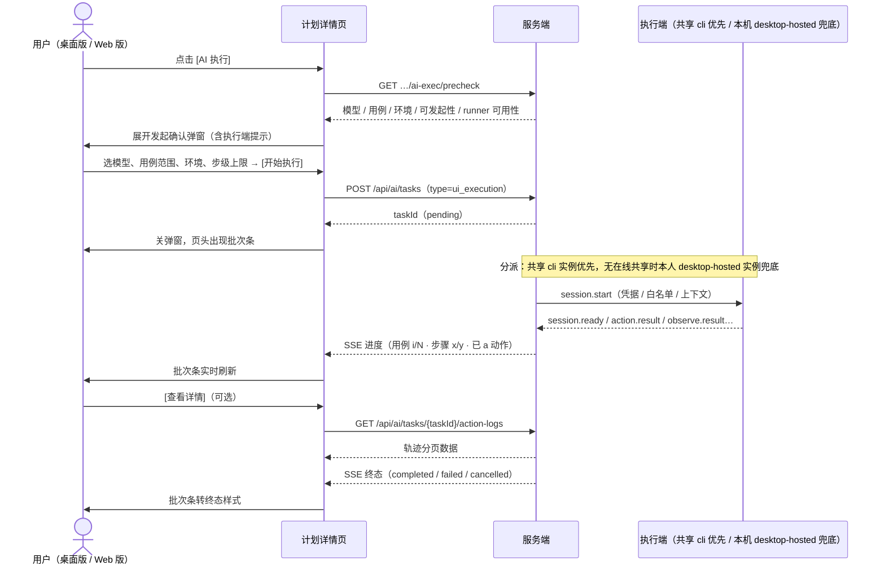
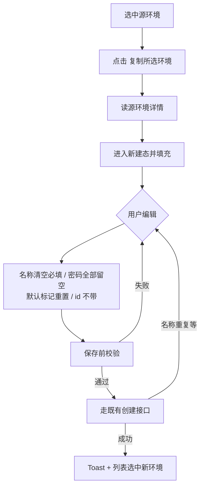

# 软件测试平台——AI 执行与测试环境

**文档版本**：V1.0  
**日期**：2026-10-14  
**状态**：起草中

---

## 1. 概述

### 1.1 编写目的

定义 AI 执行（UI 自动化测试）与功能测试环境管理的页面结构、交互流程、状态分支与状态管理，为前端开发与验收提供依据。

### 1.2 范围与对应文档

- 对应需求 `docs/01-requirements/03-function-testing/03-srs-ai-ui-testing.md`、交互设计总览 `docs/05-interaction-design/03-function-testing/02-workspace-ui-overview.md`、详细设计 `docs/04-detailed-design/03-function-testing/09-ai-ui-testing.md`。
- 测试计划详情页的 AI 执行入口、批次条、五态统计与执行详情在**本文详述**，测试计划分册 `06-workspace-ui-test-plan.md` 只作指针引用（A 口径，自含原则）。
- 视觉色彩引用 `docs/05-interaction-design/03-visual-design.md` 的 CSS 变量与色板，不另定颜色值；全局交互规范（Toast、二次确认、骨架屏）沿用总览 1.3。

### 1.3 定义与缩写

| 术语 | 定义 |
| ---- | ---- |
| 桌面版 | Electron 壳包裹 `web/` 构建产物的产品形态，一套代码双形态（见概设 6.1 术语消歧） |
| Web 版 | 浏览器访问的平台形态 |
| 形态判别 | 前端运行时判断当前形态：存在 Electron 全局桥（`window.electronBridge`）即桌面版，否则 Web 版 |
| desktop-hosted 实例 | 桌面版托管的执行端子进程，注册为用户绑定（仅本人批次可分派、无在线共享实例时兜底分派） |
| cli 共享实例 | 独立部署的命令行执行端，任意用户批次均可分派 |
| 批次 | 一次 AI 执行发起的完整执行过程，对应一个 AI 任务实例 |

### 1.4 客户端形态总口径

| 能力 | 桌面版 | Web 版 |
| ---- | ---- | ---- |
| 测试环境管理（`?tab=ft-environments`） | ✅ | ✅（配置能力，双端一致） |
| [🤖 AI 执行] 按钮与发起确认弹窗 | ✅ | ✅（后端强制校验执行端可用性，见 2.3） |
| 本机执行端（Runner 子进程）托管与设置面板 | ✅ | ❌（无壳，无本机执行端） |
| 批次进度条、[取消] 与执行详情 | ✅ | ✅（双端一致） |
| 计划五态统计、执行记录改判 | ✅ | ✅ |

**显隐为前端呈现策略、非安全边界**：服务端仅按权限点（`funcenv:*` / `ai:exec`）校验，不区分客户端形态；Web 版绕过界面直接调用发起接口仍可提交（该风险已知并接受，需求 3.2）。前端不做任何形态伪装或反调试。

---

## 2. 页面设计

### 2.1 测试环境子模块页

**入口**：功能测试框架页左侧菜单新增第 5 项「测试环境」（`?tab=ft-environments`），按 `funcenv:view` 显隐；无权限用户直接访问路由时内容区显示「暂无权限」空态。双端渲染一致。

**页面结构**（左列表 + 右表单，双白卡等高并排，沿用功能测试页双卡结构）：

```
┌─────────────────────────────────────────────────────────────┐
│ 测试环境                          [+ 新建] [复制所选环境]      │
│ AI 执行的入口、账号与预置动作配置                              │
├─────────────────────────────────────────────────────────────┤
│ 预置动作（项目默认）：5 步 · [编辑]                            │
├──────────────┬──────────────────────────────────────────────┤
│ 环境列表      │ 表单区：基本信息 / 入口 URL / 账号 /           │
│ ● staging(默认)│ 已知数据状态 / 操作提示 / 执行参数             │
│   dev         │ 预置动作：( )使用项目默认 (•)自定义覆盖         │
│   prod        │                              [保存][删除]    │
└──────────────┴──────────────────────────────────────────────┘
```

**左侧列表**：

| 元素 | 行为 |
| ---- | ---- |
| 列表项 | 名称 + 默认徽标（「默认」chip）+ 副行「入口 N · 账号 M」；选中项浅蓝底高亮（同侧栏选中态） |
| 选中切换 | 点击列表项 → 右侧表单加载该环境详情；有未保存修改时先弹「当前修改未保存，切换将丢弃」二次确认 |
| 顶部动作 | [+ 新建]（`funcenv:edit`）；[复制所选环境]（选中列表项后可用，无选中时禁用并 tooltip「请先选择源环境」） |

**右侧表单区**（自上而下五个分组，组间 1px 分割线）：

1. **基本信息**：名称（必填，≤100 字）、描述（≤500 字）、默认标记（el-switch，项目内单默认——开启时提示「将取消其他环境的默认标记」）；
2. **入口 URL**：条目列表（名称 + URL + 删除），[+ 添加入口]；名称供预置动作引用；
3. **账号**：条目列表（用户名 / 别名 / 角色 / 备注 / 密码），[+ 添加账号]；密码列已保存账号显示 `●●●●●` + 「已设置」，留空 = 不修改；新账号密码必填；
4. **已知数据状态 / 操作提示**：多行文本域；
5. **执行参数**：视口宽高（数字对）、动作超时秒数（默认 10）、允许执行 JS（el-switch，默认开，关闭时红色小字「关闭后 AI 无法使用 JS 定位兜底」）。

**预置动作分组**：环境表单内单选——( ) 使用项目默认 / (•) 自定义覆盖；选「自定义覆盖」才展开步骤编辑器（2.2）。列表项副行据此显示「预置动作：项目默认 / 已覆盖」。

**交互与状态分支**：

| 操作 / 状态 | 行为 |
| ---- | ---- |
| 新建 | 表单清空进入新建态；[保存] 走创建接口，成功 Toast + 列表刷新并选中新项 |
| **复制** | [复制所选环境] → 读源环境详情填充**新建态表单**：名称清空（必填重填）、默认标记重置为关、入口 URL / 数据状态 / 操作提示 / 预置动作 / 执行参数带入、账号带入用户名/别名/角色/备注而**密码全部留空**（提示条「密码不可复制，请逐个重填」）、一切 id 类字段不带；用户改名补密码后 [保存] 走**既有创建接口**（纯前端行为，无专用复制接口） |
| 保存 | 前端先校验（名称必填、入口 URL 格式、新账号密码必填、预置动作结构），通过后提交；失败按错误码映射 Toast（1000011031 名称已存在、1000011032 入口不合法、1000011034 密码不能为空）并定位到问题分组 |
| 删除 | [删除] 二次确认（「删除后被计划引用的展示将降级为已删除环境，执行中批次不受影响」）；被预置动作引用时服务端拒绝（1000011041），Toast「该条目被预置动作引用，请先修改」 |
| 加载中 | 列表与表单区各自骨架屏；表单加载完成前 [保存] 禁用 |
| 列表空态 | 「暂无环境，点击[新建]创建」+ 大图标引导 |
| 保存失败 | Toast 错误消息，表单保留用户输入不回滚 |
| 无 `funcenv:edit` | 表单全组只读（禁用输入与按钮），顶部仅保留 [+ 新建] 以外的只读操作；[复制] 隐藏 |
| 项目级预置动作加载失败 | 置顶区块显示「预置动作加载失败 [重试]」，不阻塞环境表单其余部分 |

### 2.2 预置动作编辑器（方案 ② 表单化步骤编辑器）

**两级编辑入口**：页面置顶区块「预置动作（项目默认）：N 步 · [编辑]」编辑项目级（`PUT /api/project/ft-preset-actions`）；环境表单选「自定义覆盖」时展开同一编辑器编辑环境级（随环境保存提交）。控件与校验完全复用。

**编辑器结构**：

```
┌─ 预置动作 ─────────────────────────────────────────────┐
│ 步骤 1  [navigate ▼]  地址 [Web端 ▼]          ↑ ↓ 🗑  │
│ 步骤 2  [fill ▼]      定位 [placeholder=用户名]        │
│                       内容 (•)文本 [admin] ( )账号 [管理员▼] │
│ 步骤 3  [fill ▼]      定位 [placeholder=密码]          │
│                       内容 ( )文本 (•)账号 [管理员▼]    │
│ 步骤 4  [press ▼]     按键 [Enter ▼]          ↑ ↓ 🗑  │
│ 步骤 5  [wait ▼]      秒数 [3]（≤10）        ↑ ↓ 🗑  │
│                                    [+ 添加步骤] [完成] │
└────────────────────────────────────────────────────────┘
```

| 要素 | 规则 |
| ---- | ---- |
| 原语下拉 | 仅 `navigate / click / fill / press / select / wait / find_text` 七项（禁 evaluate 与其他原语） |
| 参数表单 | 按原语渲染：navigate 地址 = **入口条目下拉**（存 `entryName`，无字面 URL 输入）；fill 内容 = 文本 或 **账号下拉**（存 `credentialAlias`，明文不出现于编辑器）；click / select / find_text = 定位文本；press = 键名下拉；wait = 秒数（≤10） |
| 步序操作 | 每行 [↑][↓][🗑]；首行 ↑ 与末行 ↓ 禁用 |
| 添加 | [+ 添加步骤] 追加默认空行（原语未选态） |
| 保存前校验 | 原语已选且参数齐全、步数 ≤20、引用条目存在；错误定位到步骤行内红字（如「步骤 3：账号引用「超级管理员」不存在」），存在错误时不提交 |
| 保存 | [完成] 提交；成功 Toast + 编辑器收起；失败 Toast，编辑器保持展开且保留内容 |
| 数据来源 | 入口 / 账号下拉选项即当前页面已加载的子表数据，零额外请求 |

**状态分支**：编辑器空态（项目级从未配置时显示「未配置项目默认预置动作，AI 将自主完成登录等前置 [+ 添加步骤]」）；保存中 [完成] 按钮 loading；环境表单选回「使用项目默认」时环境级覆盖编辑区收起（已填内容暂存，再次选覆盖时恢复）。

### 2.3 AI 执行发起确认弹窗（计划详情页，双端一致）

**入口**：计划详情页操作组 [🤖 AI 执行]，**双端一致渲染**（1.4）。显示条件（客户端判断，服务端兜底）：计划状态 new/in_progress 且具备 `ai:exec`；点击后请求 `GET …/ai-exec/precheck`，以下前置在响应回来前按钮转 loading、失败 Toast 后恢复。执行端可用性由后端在提交时强制校验（无在线共享或本人专属实例则拒绝并提示 `no_runner` 文案），前端提示与禁用只是提前呈现。

```
┌─ AI 执行 ────────────────────────────────┐
│ 模型    [系统默认模型 ▼]                  │
│ 用例范围 [✓]全选（已选 12/12）  树形勾选   │
│ 执行环境 [staging ▼]（回显计划绑定，可改）  │
│ 步级动作上限 [50]（1–200）                │
│                        [取消] [开始执行]  │
└──────────────────────────────────────────┘
```

| 要素 | 行为 |
| ---- | ---- |
| 模型 | 下拉取 `precheck.models`，默认项为 `isDefault` |
| 用例范围 | [✓]全选（已选 N/N）+ 树形勾选（按文档分组，取 `precheck.cases`）；全不勾 = 全部（提交 `caseIds:[]`） |
| 执行端提示 | 按 `precheck.runner.preferred` 显示一行灰字（`cli` →「将由共享执行端执行」/ `desktop-hosted` →「将在本机执行（桌面版）」）；`runner.available=false`（`blockReason=no_runner`）时红色提示条「无可用执行端（共享与本机均未在线）」+ [重试] 重新 precheck（运维部署共享实例或桌面版拉起本机实例后可消除），[开始执行] 禁用 |
| 执行环境 | 下拉取 `precheck.environments`；默认回显 `boundEnvironmentId`，环境已删或未绑定则默认选项目默认环境；列表为空时提示「请先在测试环境创建环境」并禁用 [开始执行] |
| 步级动作上限 | 数字输入，默认 `params.stepActionLimit`（50），范围 1–200，越界前端拦截 |
| [开始执行] | loading 态提交 `POST /api/ai/tasks`；成功 → 关弹窗 → 页头出现批次条（2.4）+ Toast「AI 执行已开始」 |
| [取消] | 关弹窗不提交 |

**前置与失败分支**（`precheck.runnable=false` 时按 `blockReason` 处理）：

| blockReason | 前端行为 |
| ---- | ---- |
| `plan_not_allowed` | [AI 执行] 入口不出现（前置状态校验后隐藏） |
| `no_runner` | 弹窗内红色提示条「无可用执行端（共享与本机均未在线）」+ [重试] 重新 precheck；[开始执行] 禁用（见执行端提示行） |
| `duplicate_running` | 弹窗内黄色提示条「该计划已有进行中的批次」+ [查看进行中批次] 跳转执行详情，不拦截提交 |
| AI 总开关关闭 / 无模型 | 入口禁用 + tooltip 沿总册口径 |
| precheck 请求失败 | Toast 错误消息，弹窗不打开 |
| 提交失败 | Toast 错误消息，弹窗保持展开、表单值保留 |

### 2.4 执行中批次条（双端一致）

**位置**：计划详情页页头下方通栏；有进行中或近批次时展示。

```
┌──────────────────────────────────────────────────────────┐
│ 🤖 AI 执行中  3/12 · 订单新建-正常流程 · 步骤 2/5 · 已 15 动作 │
│ [━━━━━━━░░░░░░░░] 42%                        [查看详情][取消] │
└──────────────────────────────────────────────────────────┘
```

| 状态 | 呈现 |
| ---- | ---- |
| 进行中 | 橙色主题 + 进度条 + 实时语义（SSE 驱动）；[查看详情] 跳转任务详情；**[取消] 双端一致渲染**，二次确认后走任务取消 |
| 已完成 | 绿色收尾条：「AI 执行完成 · 通过 8 · 失败 2 · 阻塞 1 · 跳过 1 · [查看详情]」，10s 后可手动关闭 |
| 已失败 | 红色：「AI 执行失败 · [查看详情]」 |
| 已取消 | 中性灰：「AI 执行已取消 · [查看详情]」 |
| SSE 断连 | 进度数值冻结 + 「实时进度已断开，[重试]」；详情页仍可手动刷新 |
| 无批次 | 不渲染批次条 |

**取消**：二次确认「取消后已写入的执行结果保留，未执行用例不再处理」→ 成功 Toast，批次条转「已取消」态。取消失败（任务已结束）Toast 提示并刷新批次条。

### 2.5 AI 执行详情页（双端一致，复用任务详情页）

`ui_execution` 类型任务在既有 AiTaskDetailPage 上追加以下区块：

**批次汇总**（页头下方四色计数 chip）：通过 🟢 N · 失败 🔴 N · 阻塞 ⚪ N · 跳过 🟣 N。

**轨迹列表**（按用例 → 阶段分组的静态时间线，`GET /api/ai/tasks/{taskId}/action-logs` 分页加载，默认 100/页，按 seq 升序）：

| 行类型 | 呈现 |
| ---- | ---- |
| `action` | 「▶ 动作名 · 目标摘要」+ 观察摘要灰字；点击展开完整观察（元素表折叠） |
| `action_failed` | 红色行 + 原因码中文映射（4 节映射表）+ 失败观察摘要；行内 ⚠ 图标 tooltip 显示原始原因码 |
| `verdict` | 四值徽标（通过 🟢 / 失败 🔴 / 阻塞 ⚪ / 跳过 🟣）+ 判定证据文字 + 截图缩略图（点开大图） |
| `note` | 灰字说明行（拆解留痕、截断提示等） |
| 预置动作阶段 | `phase=precondition` 分组置顶，标「预置动作（直接执行）」；失败时整组红 + 第 N 步定位 |
| `evaluate` 行 | `params` 中 JS 源码等宽字体（monospace）逐字展示，不可折叠省略 |
| 密码位置 | 恒显示占位符原文（如 `{{credential:admin}}`），页面无任何解密能力 |

**状态分支**：轨迹 loading 骨架屏；空态「尚未产生轨迹」；加载失败 [重试]；任务失败时页头红条 + 过程补充记录（总册 1.5 口径）；`truncated` 提示条「观察内容超限已截断」。

**改判**：verdict 行 [改判] 跳转计划详情既有执行记录入口（无新代码）；本页不内嵌改判表单。

### 2.6 计划详情页与列表页联动改造

| 位置 | 改造 |
| ---- | ---- |
| 详情页页头统计 | 「通过 n · 失败 n · 阻塞 n · **跳过 n** · 待执行 n · 共 N」（消费 progress 新增 `skipped`）；跳过 chip 用 🟣 中性紫 |
| 快照节点徽标 | 五态：✓通过 🟢、✕失败 🔴、⚠阻塞 ⚪、↷跳过 🟣（新增样式）、待执行不渲染 |
| 手动标记工具栏 | 仍四态按钮（不提供跳过；服务端 1000011039 双保险） |
| 列表/详情环境列 | 渲染 `environmentName`；null 显示「已删除环境」（tooltip「环境已删除，可编辑计划重新选择」）；列表 chip 样式不变 |
| 创建计划表单 | 「执行环境」由自由文本输入改为**环境下拉**（数据取环境列表接口）；无环境时下拉禁用 + 提示「暂无测试环境，[去创建]」跳转 `?tab=ft-environments` |

### 2.7 本机执行端面板（仅桌面版，设置区）

**入口**：桌面版设置区新增「执行端」页签（Web 版不渲染该页签，1.4）。桌面版随登录自动以子进程拉起 Runner 并注册为用户绑定实例（详设 4.1），本面板只做状态呈现与进程启停，不含任何通道配置。

```
┌─ 执行端 ────────────────────────────────────────┐
│ 状态  🟢 在线（本机执行端）                       │
│ 模式  desktop-hosted · 绑定：张明（当前用户）      │
│ 最近心跳  3 秒前                                 │
│               [停止] [查看日志]                  │
└─────────────────────────────────────────────────┘
```

| 状态 | 呈现 |
| ---- | ---- |
| 在线 | 🟢 + 「在线（本机执行端）」+ 最近心跳相对时间（「N 秒/分钟前」） |
| 离线 / 未启动 | ⚪ + 「本机执行端未启动」+ [启动]（拉起子进程并注册） |
| 注册中 | 🟡 + 「正在注册…」 |
| 启动失败 | 🔴 + 失败摘要 + [重试]；Tooltip 提示查看本地日志 |

- **[停止]**：二次确认「停止后本人批次将分派至共享执行端（若可用）」→ 结束子进程，状态转离线。
- **[查看日志]**：抽屉展示本地滚动日志尾部（默认 200 行，实时追加）；**日志经统一脱敏过滤器**（密码字段、Authorization、凭据帧内容显示 `***`），面板内无导出按钮。
- 状态数据源：桌面版壳经服务端执行端注册表查询本实例（`runner_id` 由壳持有），轮询 5s 或壳推送；面板不与 Runner 直连。
- **状态分支**：加载中骨架；查询失败显示「状态获取失败 [重试]」不阻塞其余设置项；用户退出登录时壳自动结束子进程，面板不再可达。

---

## 3. 核心交互流程

### 3.1 发起与执行主流程



### 3.2 复制环境填充流程



---

## 4. 视觉与状态要求

### 4.1 色彩与徽标

| 元素 | 样式 |
| ---- | ---- |
| 通过 / 完成 | 成功色（语义绿） |
| 失败 | 危险色（语义红） |
| 阻塞 | 中性警示（白底灰边 ⚪） |
| **跳过（新增）** | 中性紫（`--el-color-primary` 之外的紫系，遵循视觉设计变量体系，全端统一） |
| 待执行 | 默认中性 |
| 批次条进行中 | 主题主色（橙系，沿用任务进行中色） |

### 4.2 失败原因码中文映射（前端展示口径）

| reasonCode | 文案 |
| ---- | ---- |
| `not_visible` | 元素不可见 |
| `covered` | 元素被遮挡，无法点击 |
| `no_response` | 点击后页面无响应 |
| `not_found` | 元素已不存在 |
| `timeout` | 动作超时 |
| `evaluate_error` | 脚本执行出错 |
| `whitelist_violation` | 导航目标超出允许范围 |
| 其他 | 显示原始码 + tooltip「未知原因码，请升级客户端」 |

### 4.3 状态分支总表

| 页面 | 加载 | 空态 | 错误 | 权限不足 |
| ---- | ---- | ---- | ---- | ---- |
| 测试环境页 | 列表/表单骨架屏 | 「暂无环境，点击[新建]创建」 | Toast + 区块级重试 | 只读或「暂无权限」 |
| 预置动作编辑器 | —（随页面加载） | 「未配置…AI 将自主完成登录」 | 区块「加载失败 [重试]」 | 编辑入口隐藏 |
| 发起弹窗 | 按钮 loading → 弹窗骨架 | 用例范围空提示 | Toast，弹窗不打开/不关闭 | 入口不渲染 |
| 本机执行端面板 | 骨架屏 | —（未启动即空态文案） | 「状态获取失败 [重试]」 | 页签不渲染（Web 版） |
| 批次条 | 首帧前不渲染 | 不渲染 | SSE 断连提示条 + [重试] | 双端可见（只读） |
| 执行详情 | 轨迹骨架屏 | 「尚未产生轨迹」 | [重试] | `ai:exec` + 任务归属校验 |
| 计划页统计 | 随详情加载 | — | 数字区域 `—` 占位 | — |

---

## 5. 状态管理

| 状态 | 持有位置 | 生命周期与规则 |
| ---- | ---- | ---- |
| 环境列表 / 选中项 | FtEnvironmentPage 组件态 | 进入子模块加载；切换选中项前做脏检查；保存成功后局部更新选中项 |
| 环境表单草稿 | 同上（独立于详情数据） | 新建 / 复制 / 编辑三种来源汇入同一草稿对象；保存成功后以服务端回读覆盖草稿；离开页面有未保存修改时路由守卫拦截二次确认 |
| 预置动作编辑器态 | 编辑器组件内 | 两级入口共享组件实例级状态；展开时快照、[完成] 提交后收起、[取消] 还原快照 |
| 批次进度 | 计划详情页订阅 AI 任务 SSE（沿用 AI 底座通道） | 进入有进行中批次的计划详情时订阅、离开或终态时退订；断连按既有重连口径 |
| 发起弹窗表单 | 弹窗组件内 | 打开时以 precheck 结果初始化；提交中禁用全部控件；成功即销毁实例 |
| 本机执行端状态 | 桌面版壳持有 `runner_id`，设置面板查询服务端注册表（轮询 5s 或壳推送） | 随桌面版进程生命周期；退出登录时壳结束子进程并停止上报 |
| 客户端形态 | 全局单例（形态判别结果缓存） | 运行时一次判定后缓存；仅用于显隐，不参与任何数据请求参数 |

---

## 修改记录

| 版本 | 日期 | 说明 |
| ---- | ---- | ---- |
| V1.0 | 2026-10-14 | 初始版本 |
| V1.0 | 2026-10-14 | 桌面版集成执行端：1.3/1.4 补执行端归属术语与能力表、2.3 发起弹窗补执行端提示与 `no_runner` 分支、3.1 时序图补本机执行端、新增 2.7 本机执行端面板、5 状态管理补壳生命周期 |
| V1.0 | 2026-10-14 | 发起入口与取消按钮改为双端一致渲染（1.4、2.3、2.4），执行端提示与 `no_runner` 文案按共享优先口径调整（2.3、3.1） |
