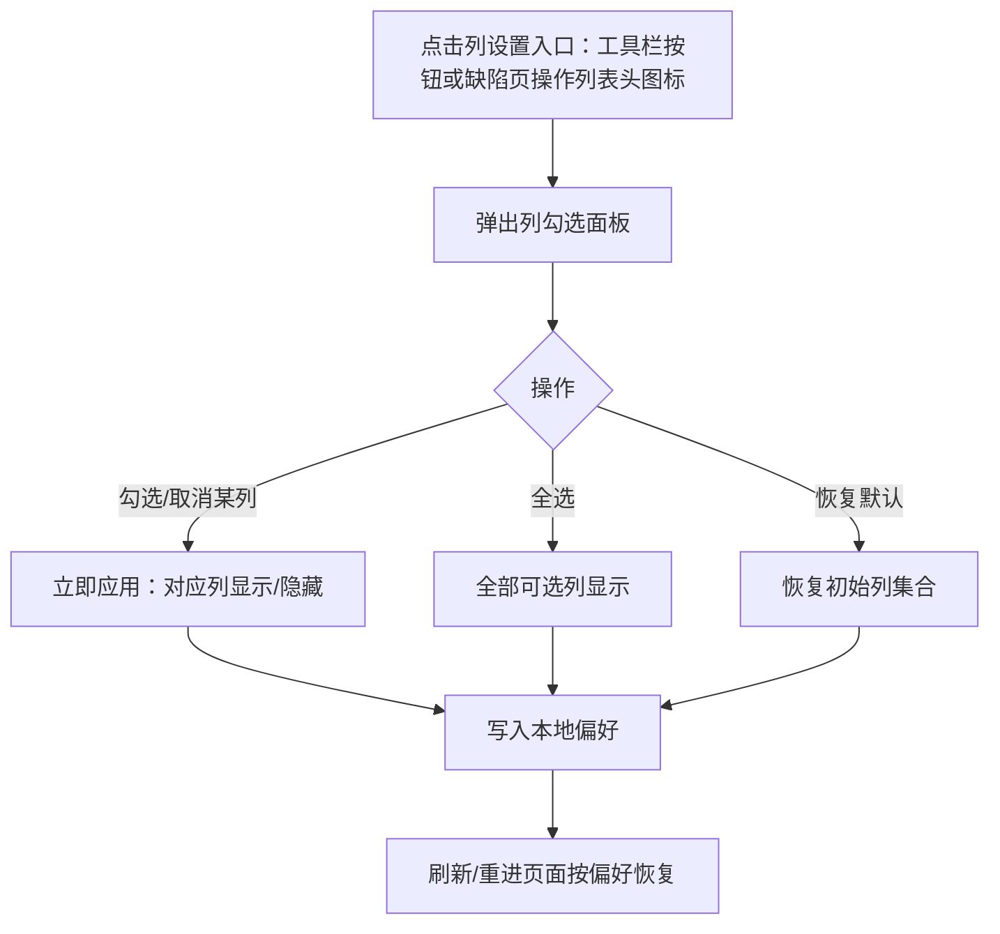

# 软件测试平台——列表列显隐配置

**文档版本**：V1.0  
**日期**：2026-11-16  
**状态**：起草中

---

## 1. 概述

本文定义标准列表页统一的**列显隐配置**入口、交互与记忆规则，供各列表页交互设计引用，避免逐页重复定义。行为适用于 `docs/06-implementation-plan/07-list-page-standardization-plan.md` 登记的 12 个标准列表页；专用布局页（项目卡片网格、成员双表、环境/函数/公共组件）、编辑器与详情/分享页、用例脑图工作区、`DebugPage` 调试工作台不属于本文范围。

列显隐只改变当前浏览器展示哪些业务列，不改变数据查询、分页、筛选、排序、批量与行操作行为。

## 2. 入口与布局

- 标准入口为列表工具栏内的 **[列设置]** 按钮，位于筛选/搜索操作之后、主操作按钮之前，与其他工具栏控件同一行、窄屏时可换行。
- 缺陷列表页采用操作列表头入口：列设置按钮仅显示设置图标（`aria-label` 为「列设置」），右对齐置于操作列表头，表头不显示「操作」标题；行内操作单元格保持左对齐，不受表头对齐影响。勾选面板与记忆规则和其他页面一致。
- 点击按钮弹出浮层面板，面板锚定按钮，随页面滚动不脱离；面板内为各业务列的勾选清单。
- 面板底部提供 **[全选]** 与 **[恢复默认]** 两个操作：[全选] 勾选全部可选列，[恢复默认] 恢复代码定义的初始列集合。

## 3. 列的可配置性

| 列类型 | 是否可隐藏 | 说明 |
| ---- | ---- | ---- |
| 标题 / 名称主列 | 可 | 隐藏后列表仍按其余列展示，行操作入口不变 |
| 普通业务列（类型、状态、时间、人员等） | 可 | 逐列独立勾选 |
| 选择列（勾选框） | 不可 | 涉及批量操作，固定展示、面板内禁用勾选 |
| 操作列（`fixed` 右侧） | 不可 | 行操作入口，固定展示、面板内禁用勾选 |

不可隐藏列在面板内以勾选禁用态呈现，不提供取消入口，避免用户误操作导致功能不可用。

## 4. 交互流程

- 勾选变更即时生效，无需额外确认按钮；关闭面板即完成一次配置。
- 隐藏列不影响当前页数据、页码、筛选条件与已展开状态。

## 5. 记忆与恢复

- 列偏好存储在浏览器 `localStorage`，键由**页面标识 + 当前用户标识**组成，不同页面、不同账号之间互相隔离；未登录或无法取得用户标识时以匿名维度存储。
- 刷新页面、重新进入页面或切换模块后返回，按上次保存的偏好恢复列显隐。
- 跨设备、跨浏览器不跟随（不引入后端偏好存储）。
- 读取偏好时做合法性校验：忽略已不存在的列标识、强制补回不可隐藏列；校验失败或存储内容异常时回退到初始列集合，不阻断页面加载。
- 写入偏好异常（隐私模式、配额不足等）时静默降级为仅当前会话有效，不影响列表正常使用。

## 6. 键盘与可访问性

- [列设置] 按钮支持键盘聚焦与回车/空格触发，焦点态清晰可见。
- 面板内各列勾选框支持键盘逐项聚焦与切换，禁用列不可聚焦或聚焦后不可切换。
- 面板支持 `Esc` 关闭并将焦点返回触发按钮。

## 7. 窄屏表现

- 窄屏下工具栏内的列设置按钮随工具栏换行；缺陷列表页的列设置图标随操作列固定显示在表头右侧。面板宽度不超过视口，超出时面板内纵向滚动。
- 隐藏非核心列后表格可容纳更多有效信息；横向滚动能力保留，固定列始终可见（`UI-SC-05`）。

## 修改记录

| 版本 | 日期 | 说明 |
| ---- | ---- | ---- |
| V1.0 | 2026-11-16 | 建立标准列表页列显隐配置的入口、交互、记忆与可访问性口径 |
| V1.0 | 2026-11-18 | 补充缺陷列表页列设置入口例外：置于操作列表头、仅图标右对齐，行内操作保持左对齐 |

**文档结束**
