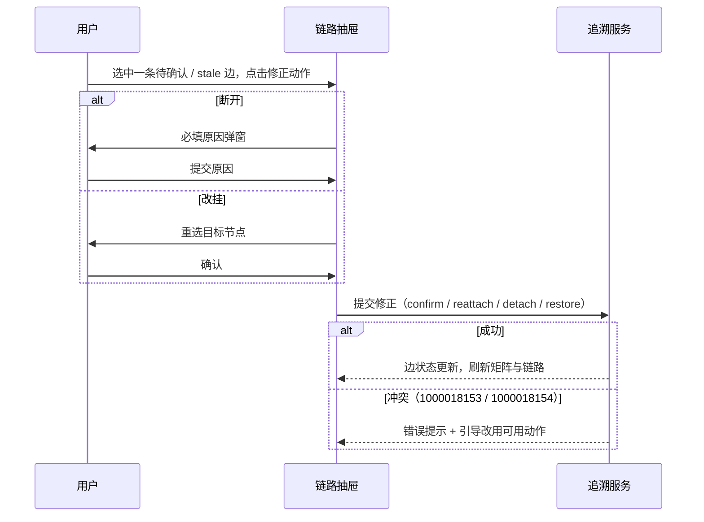
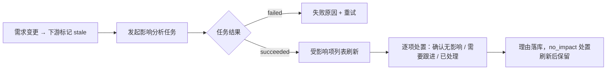

# 软件测试平台——追溯矩阵

**文档版本**：V1.0  
**日期**：2026-10-03  
**状态**：起草中

---

## 1. 概述

追溯矩阵作为需求管理的页内子模块呈现（顶栏「需求管理」→ 页内侧栏），展示需求 → 模块/文档/用例 → 缺陷的全链路关系，提供矩阵与链路两种视图，以及人工建边、边修正、覆盖修正、缺口引导与变更影响处置。权限：`trace:view` 可查看矩阵/链路/覆盖/缺口/受影响项；`trace:edit` 可进行建边、修正与处置，无编辑权限时写操作入口隐藏、视图只读。视觉遵循《视觉设计》（`docs/05-interaction-design/03-visual-design.md`）。

**路由**：`/workspace/projects/requirements?tab=trace`（旧路径 `/workspace/projects/trace` 重定向至此，既有深链保持可用）

**入口**：顶栏「需求管理」→ 页内侧栏「追溯矩阵」；需求详情「查看追溯」（切至本页并以该条目为起点定位只读链路）、分析页缺口引导、任务完成后「查看影响」链接。AI 未启用时覆盖统计与影响分析入口降级（覆盖列展示「—」）。

**页面结构**（需求管理壳层双栏，侧栏与子页行为见 `docs/05-interaction-design/06-requirement-management/02-requirement-ui.md`）：

```
┌────────┬──────────────────────────────────────────────────────────┐
│ 需求列表│ 追溯矩阵                                  [矩阵] [缺口]   │
│ 追溯矩阵├──────────────────────────────────────────────────────────┤
│        │ 状态▾ 覆盖▾ 关键词[__] [查询] [重置]           共 12 条   │
│        ├──────────────────────────────────────────────────────────┤
│        │ 需求 \ 下游   模块  脑图文档  测试用例  缺陷   覆盖状态       │
│        │ REQ-001 登录   1      1        12     —    ● 部分覆盖      │
└────────┴──────────────────────────────────────────────────────────┘
```

## 2. 页面设计

### 2.1 矩阵视图

#### 2.1.1 布局

```
┌──────────────────────────────────────────────────────────────────┐
│ 追溯矩阵                                        [矩阵] [缺口]     │
├──────────────────────────────────────────────────────────────────┤
│ 状态▾ 覆盖▾ 关键词[____] [查询] [重置] (2)            共 12 条   │
├──────────────────────────────────────────────────────────────────┤
│ 需求 \ 下游      模块   脑图文档   测试用例   缺陷    覆盖状态       │
│ REQ-001 登录      1       1         12      —      ● 部分覆盖      │
│ REQ-002 订单      1       1          0      —      ● 未覆盖        │
│ REQ-003 支付      1       1          8      2      ● 完整覆盖      │
├──────────────────────────────────────────────────────────────────┤
│ 图例：○有效 ◐待确认 ⚠stale ⚠⚠conflict    共 12 条 · 每页 20 条  < 1  2  3 > │
└──────────────────────────────────────────────────────────────────┘
```

> 筛选工具栏与分页条置于内容卡片内，以 1px 分割线与表格分隔、各自持有 14px 20px 留白，表格左右贴合卡片边缘（`UI-SC-10`）；筛选工具栏右端常驻当前结果总数「共 N 条」，分页条左侧为图例、右侧为「共 N 条 · 每页 N 条」与分页控件；筛选仅作用于矩阵视图，缺口视图不显示矩阵筛选。

| 区块 | 交互 |
| ---- | ---- |
| 筛选 | 状态、覆盖、关键词三项 + 查询/重置，入口角标显示条件数；作卡片工具栏，右端常驻「共 N 条」 |
| 分页 | 与图例同处卡片底部分割线行：左侧图例，右侧「共 N 条 · 每页 N 条」+ 分页控件，每页 10 / 20 / 50 可切 |
| 单元格 | 展示该需求到该下游类型的有效边计数；点击打开链路抽屉并定位对应类型 |
| 覆盖徽标 | `covered / partial / uncovered / pending / —`，悬浮展示判定依据 |
| stale / conflict 高亮 | 行或单元格警示高亮（`--color-warning` / `--color-danger`），悬浮解释成因（版本比对失效 / 人工与 AI 结论冲突），点击进入链路处理 |
| 行点击 | 打开链路抽屉（以该需求为起点） |

### 2.2 链路视图抽屉（TraceChainDrawer）

```
┌──────────────────────────────────────────────────────────────────┐
│ 链路视图：REQ-001 登录验证码                     [关闭]            │
├──────────────────────────────────────────────────────────────────┤
│ 需求 REQ-001                                                     │
│  ├─ 模块 登录  ─○─ 脑图文档 登录脑图                              │
│  │                  └─ 用例 12（属性徽标）                        │
│  │                       └─ 缺陷 BUG-12（BUG-12 已解决）         │
│  └─ 用例 CASE-9 ◐（待确认，建议生成）    [确认] [改挂] [断开]       │
├──────────────────────────────────────────────────────────────────┤
│ 图例：○有效  ◐待确认  ⚠stale  ⚠⚠conflict  ⋯已断开                 │
│         [+ 人工建边]                                             │
└──────────────────────────────────────────────────────────────────┘
```

| 交互 | 说明 |
| ---- | ---- |
| 节点树 | 按关系层级展开/折叠；节点类型图标区分，下游节点点击跳对应详情（跨页可返回） |
| 边状态 | 每条边显示状态徽标；`stale`（版本比对失效）与 `conflict`（人工与 AI 结论冲突）行内高亮并提供处理动作 |
| 修正动作 | 确认（待确认边转有效）、改挂（重选目标节点）、断开（必填原因）、恢复（已断开边重新生效）；冲突边可采纳人工结论或保留 AI 结论 |
| 人工建边 | `trace:edit` 可见；选择源/目标节点与关系类型；同一对节点已存在有效边时提示（1000018153）并引导改用修正动作 |
| 权限降级 | 无 `trace:edit` 时隐藏全部写动作，仅浏览 |

### 2.3 覆盖修正（CoveragePanel）

| 项 | 交互 |
| ---- | ---- |
| 依据展示 | 展示 AI 覆盖判定的依据（关联用例、判定说明与引用来源） |
| 人工修正 | 表单选择覆盖结论 + 修正说明；保存后标记为人工结论，后续 AI 分析不再自动覆盖 |
| 空态 | 该需求无覆盖分析记录 → 「未分析」+「发起覆盖分析」 |

### 2.4 缺口清单（GapList）

| 项 | 交互 |
| ---- | ---- |
| 缺口列表 | 按缺口类型分组（未生成用例 / 未评审 / 未进计划等），行内展示需求条目 |
| 引导动作 | 「发起生成」跳生成配置、「发起评审」「加入计划」接入既有创建入口；已具备条件的项置灰 |
| 空态 | 「当前无追溯缺口」 |

> 与矩阵视图同为内容卡片：错误提示条在卡片外，缺口类型切换作卡片工具栏，表格贴边，分页条以 1px 分割线分隔并持「共 N 条 · 每页 N 条」计数（`UI-SC-10`）；首次切入缺口视图按当前缺口类型取数，骨架与整卡 loading 口径见 2.6。

### 2.5 影响处置（ImpactDispositionPanel）

| 项 | 交互 |
| ---- | ---- |
| 受影响项列表 | 需求变更标记后，沿追溯边列出下游受影响项（模块/文档/用例/缺陷），含影响路径 |
| 三类处置 | 逐项选择「确认无影响」「需要跟进」「已处理」；`no_impact` 处置在刷新后保留 |
| 理由录入 | 跟进与已处理须填理由；提交后写处置记录 |
| 影响分析任务 | 「发起影响分析」走通用任务口径，完成后面板数据刷新，失败可重试 |

### 2.6 状态分支

- **矩阵空态**：项目无需求 → 引导「新建需求」；
- **链路空态**：该需求无下游关系 → 引导「发起 AI 生成」；
- **加载**：首屏在卡片内显示骨架屏（筛选工具栏 / 缺口类型切换随卡片常驻可见），缺口视图首次切入即按当前缺口类型取数；筛选、翻页与缺口类型切换刷新为整卡 loading 遮罩；
- **错误**：矩阵与缺口加载失败 → 各自错误提示条 +「重试」，保留上次已加载数据；
- **任务进行中**：覆盖/影响分析进度条，完成刷新、失败重试；
- **stale / conflict**：图例常驻，未处理项高亮计数；
- **权限不足**：无 `trace:view` 时需求管理侧栏不显示「追溯矩阵」子项，本页不可达；无 `trace:edit` 时写动作隐藏（只读降级）；仅有 `trace:view` 而无 `requirement:view` 时，进入需求管理默认落在本子页；
- **AI 未启用**：覆盖列「—」，影响分析入口隐藏。

## 3. 核心交互流程

### 3.1 边修正



### 3.2 影响分析与处置



## 4. 视觉与状态要求

- 链路边状态：有效 `--color-success`、待确认 `--color-info`、stale `--color-warning`、conflict `--color-danger`、已断开 `--color-neutral-400`（图例常驻，图标 + 文字不单靠颜色表意）；
- 覆盖徽标沿用《视觉设计》4.1 状态色（完整 `--color-success`、部分 `--color-warning`、未覆盖 `--color-danger`、待分析 `--color-info`、AI 关闭中性灰）；
- 单元格警示高亮用 `--color-warning-light` / `--color-danger-light` 底；
- 抽屉、弹窗与表格样式沿用 Element Plus 体系及《视觉设计》中性色阶。

## 5. 状态管理

- Pinia store `traceMatrix`：矩阵分页数据、当前链路缓存、缺口与受影响项；
- 与 `aiTask` store 联动：覆盖 / 影响分析任务 `succeeded` 后触发矩阵与覆盖数据刷新；
- 链路抽屉内修正动作成功后原位更新边状态并同步矩阵计数；跨页跳转返回时保留筛选与视图。

## 修改记录

| 版本 | 日期 | 说明 |
| ---- | ---- | ---- |
| V1.0 | 2026-10-03 | 初始版本 |
| V1.0 | 2026-10-15 | 改为需求管理页内子模块：路由并入 `/workspace/projects/requirements?tab=trace`（旧路径重定向），入口补顶栏侧栏项，概述增页面结构示意 |
| V1.0 | 2026-10-15 | 矩阵与缺口列表样式对齐测试计划列表：筛选收敛为矩阵卡片工具栏、骨架入卡片与整卡 loading 遮罩、分页条分割线与计数文案（`UI-SC-10`），补加载与错误状态分支，缺口视图首入即取数 |
