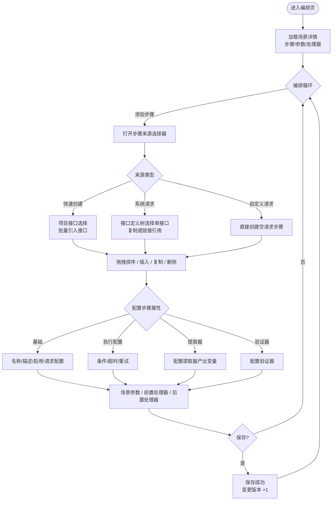

# 软件测试平台——场景编排页

**文档版本**：V1.0  
**日期**：2026-09-23  
**状态**：起草中

---

## 1. 场景编排页

**路由**：`/workspace/projects/scenes/:sceneId/edit`

### 1.1 页面布局

布局为**顶部导航栏 + 左右双栏内联编排**（采纳交互原型）：顶部固定导航栏承载面包屑（测试场景 › 场景名）、默认环境与全局操作，**自身不设下内边距**，与下方页签条只留 4px 缝隙（避免头部下边距与内容区上边距叠加）；主体为**左侧步骤卡片列表 + 右侧步骤内联详情面板**——左栏以**带边框的卡片**包裹，右栏明细**不设父容器**（由明细自身头部带与内容分区承担层次），两栏**等高**，之间以**透明分割条**拖拽调整宽度（平时不显示，拖拽中显示反馈）。页面不设外层卡片容器。操作与保存语义见 3.1.3。

```
┌──────────────────────────────────────────────────────────────────────────┐
│  *名称 [输入框]  *模块 [下拉] │ 已发布 P1 · 描述 · 执行历史 │ 环境 [下拉] [动作组] │
├──────────────┬─────┬─────────────────────────────────────────────────────┤
│  步骤列表      │ 透明│  步骤 #1 详情（内联）                                 │
│  [+ 添加步骤]  │ 可拖│  ─ 基本信息 ──────────────────────────────          │
│  1 [▶] 登录   │     │  名称 / 启用 / 请求配置（方法·URL）                    │
│  2 [▶] 下单   │     │  ┌ 前置处理 ┐ ┌ 验证器 ┐ ┌ 后置处理 ┐ ┌ 提取器 ┐         │
│  3 [▶] 清数据  │     │  （步骤编辑内联于右侧，随选中步骤切换）                 │
│              │     │                                                   │
│  ── 场景级 ──  │     │                                                   │
│  场景参数 /    │     │                                                   │
│  前置 / 后置   │     │                                                   │
├──────────────┴─────┴─────────────────────────────────────────────────────┤
└──────────────────────────────────────────────────────────────────────────┘
```

- **场景变量页签**：以**容器**包裹 KV 表格，**高度与步骤 / 处理器页签的容器一致**（撑满页签面板）、描边圆角并内部滚动；不重复页签标题行、隐藏列表列头（列名由 `变量名 / 值 / 描述` 占位符承担）。
- **左侧步骤列表**：垂直步骤卡片，支持添加、选中、拖拽排序、插入前、复制、启停、单步调试、删除（见 1.2）。卡片头部常驻类型、方法 / SQL、来源、验证器与提取器计数 tag（计数有值才显示），不依赖展开查看；选中卡片后其详情**内联渲染在右侧面板**，随选中步骤切换，不再使用抽屉弹窗。
- **右侧步骤详情面板**：步骤编辑内联于此（见 1.4，标签为 基础/执行配置/变量/验证器/提取器），随选中步骤切换，不再使用抽屉弹窗；未选中步骤时呈现**居中空态卡片**（图标 + 说明文案），不使用单行灰字占位。
- **顶部导航栏**：**允许换行**（不强求单行）；自左至右依次为——**字段区**（名称、模块两个必填字段各带小标签，**必填星号随标签同行**，不单独占行）→ **信息组**（发布状态徽标、优先级、描述与执行历史，以分隔线与字段区分开）→ 默认环境下拉 → 右端**动作组**。标签与按钮一律短文案：字段标签为「名称」「模块」（必填提示仍为「请填写场景名称」「请选择所属模块」），动作组为新建态 `[▶ 运行] [保存] [发布]`、编辑态同组另加 `[删除]`。**动作组全部为 link 类型按钮**，`[发布]` 取主色、`[删除]` 取危险色并弹二次确认（删除成功返回列表）；`[▶ 运行]` 与 `[保存]` 之间留间距，其余按钮沿用组件默认间距。默认环境下拉**无边框、选中值取主色、不可清除**，宽度 140px。关注、复制场景、创建定时任务仍在列表页行内/更多操作提供；场景执行为**双入口**——列表行内 [执行]（直接触发）与编辑页顶部 [▶ 运行]，语义见 `docs/04-detailed-design/05-api-testing/16-test-scenario-execution.md`。
- **优先级**：选项 P0/P1/P2/P3，新建场景缺省 P2；选项带优先级配色徽标（色值引用 `docs/05-interaction-design/03-visual-design.md` 4.2 的 `--color-priority-p*` 变量）。
- **左右分栏**：左列表以**带边框卡片**包裹（1px 描边、圆角、白底），右明细**不设父容器**，两栏 Flex 拉伸**等高**；中间**不显示分割线**，透明分割条（12px 热区）仍可拖拽调整宽度，拖拽过程中才显示指示线（最小/最大宽度约束，见 1.6 保存时校验保证右栏可见）。页面**不设外层卡片容器**，tabs 与内容区直接承接头部信息，顶部导航的下内边距收窄至一道窄缝。
- **不设底部状态条**：平台无自动保存，落库只由 `[保存]` / `[发布]` 与运行前自动保存触发，页面不显示「自动保存已开启」「未保存修改」一类状态文案。

### 1.2 步骤列表操作

| 操作 | 触发方式 | 反馈 |
| ---- | ---- | ---- |
| 添加步骤 | 点击 [+ 添加步骤] | 打开步骤来源选择器（见 1.3），选择后插入到当前选中步骤之后（无选中时追加到末尾），步骤自动编号 |
| 选中步骤 | 点击步骤卡片任意区域（拖拽手柄、启用复选框、「操作」按钮除外） | 卡片高亮，右侧面板切换至该步骤的「步骤属性」并回显配置 |
| 默认选中 | 进入步骤页签或当前无选中步骤且列表非空时 | 自动选中第一个步骤并载入右侧明细，不展示空态占位 |
| 编辑步骤属性 | 在右侧内联详情面板修改 | 面板内即时校验；编辑态修改需点击顶部 [保存] 落库，页面不展示自动保存状态 |
| 排序 | 拖动卡片左侧拖拽手柄 | 拖拽过程中卡片浮起，松开后触发重排序，序号即时重排 |
| 插入步骤 | 卡片悬停浮现 [+ 在之前插入] | 打开步骤来源选择器，插入到该步骤之前 |
| 复制步骤 | 卡片悬停 [复制] | 在该步骤之后插入完全相同的副本并选中，右侧内联表单回填副本配置（复制模式，与原步骤无关联），随场景保存落库 |
| 启用/禁用 | 卡片右侧启用复选框（文字「启用」） | 即时切换；禁用步骤置灰、不参与执行，序号保留 |
| 调试单步骤 | 卡片悬停 [执行] | 仅执行该步骤（使用当前环境配置），下方弹出单步骤执行结果浮层 |
| 删除步骤 | 卡片悬停 [删除] | 二次确认（引用源被删除的链接步骤仅提供此操作）；删除后后续步骤序号前移 |

### 1.3 步骤来源选择器（添加步骤弹窗）

```
┌──────────────────────────────────────────────────────────────┐
│  添加步骤                                                   │
│  ┌──────────┐ ┌──────────┐ ┌──────────┐                        │
│  │ 快速创建  │ │ 系统请求  │ │ 自定义请求│                        │
│  │ 批量引入  │ │ 从接口定义│ │ 手工构造  │                        │
│  └──────────┘ └──────────┘ └──────────┘                        │
│  ┌ 来源列表（随标签切换） ┬ 已选步骤（右侧）───────────────┐     │
│  │ 项目接口列表           │ [✓] 用户接口                  │     │
│  │   ├ 用户接口           │ [✓] 登录接口                  │     │
│  │   └ 登录接口           │                                 │     │
│  └───────────────────────┴─────────────────────────────────┘     │
│  导入模式   (●) 复制  ( ) 链接引用                                │
│  参数策略   [优先当前场景参数 ▾]                                  │
│  环境策略   [使用当前环境 ▾]                                     │
│  [取消]                                              [添加]      │
└──────────────────────────────────────────────────────────────┘
```

| 操作 | 触发方式 | 反馈 |
| ---- | ---- | ---- |
| 选择来源类型 | 切换顶部三个来源标签 | 「快速创建」展示项目接口列表，勾选后一键引入接口定义（批量创建）；「系统请求」展示接口定义树，勾选单个接口**仅导入该接口本身为一个步骤**；「自定义请求」隐藏选择器，确认后直接创建空请求步骤 |
| 勾选接口/步骤 | 勾选条目 | 实时回显到右侧已选列表，支持批量多选 |
| 选择导入模式 | 单选复制/链接引用 | 链接引用提示「步骤内容将跟随源更新，可独立调整启用状态与参数值」 |
| 选择参数策略 | [优先当前场景参数 ▾] | 下拉选项：优先当前场景参数 / 优先原接口参数 |
| 选择环境策略 | [使用当前环境 ▾] | 下拉选项：使用当前环境 / 使用原接口环境 |
| 添加 | 点击 [添加] | 关闭弹窗，按序插入步骤卡片；「快速创建」插入接口步骤并提示「已添加 N 个步骤」；链接引用步骤卡片带「链」标识，复制步骤无标识 |
| 链接引用源被删除 | 运行时检测 | 步骤置灰并标注「源已删除，使用快照」，仅保留 [移除] 操作（见 `docs/04-detailed-design/01-readme.md` 4.5） |

### 1.4 步骤属性面板

**基础标签**：

| 项 | 交互 |
| ---- | ---- |
| 步骤名称 | 输入框，必填，≤200 字符，失焦校验非空 |
| 步骤描述 | 多行输入框 |
| 类型与来源 | 只读标识：[http]/[jdbc]、[系统请求]/[自定义]/[复制]/[链接引用]；链接引用提供 [查看源] 跳转 |
| 启用复选框 | 单步骤启用/禁用（文字「启用」） |
| 请求配置区 | 按步骤类型渲染：http 显示方法、URL（支持变量引用）、Query、REST 参数、请求体、请求头、认证（No/Basic/Digest）；jdbc 显示数据源下拉 + SQL 编辑区 + 查询类型。链接引用步骤请求配置只读展示源内容 |

**执行配置标签**：

| 项 | 交互 |
| ---- | ---- |
| 条件表达式 | 输入框，为空表示总是执行；支持变量与内置函数，提供表达式帮助 |
| 请求超时（毫秒） | 数字输入，留空继承环境默认值 |
| 失败重试次数 | 数字输入 0–10，默认 0 |
| 失败规则 | 不再提供请求级/场景级失败规则配置；场景执行语义固定为「停止运行」（任一步骤失败即终止后续步骤） |

**变量标签**（步骤级变量编辑器）：

| 项 | 交互 |
| ---- | ---- |
| 变量列表 | 表格：变量名、值（支持变量引用与内置函数）、来源（手动/从接口导入）、描述；行内编辑/删除，支持排序 |
| 添加变量 | [+ 添加变量] 打开配置表单（变量名必填、值、描述），确认后加入列表 |
| 从接口导入 | [从接口导入] 打开接口变量选择器，勾选后按合并策略导入（保留已有手动变量），导入项带「接口」来源标识 |
| 提示 | 步骤级变量解析优先级高于场景参数（见 1.3） |

**提取器标签**：

| 项 | 交互 |
| ---- | ---- |
| 提取器列表 | 表格：类型（JSONPath/XPath/正则/边界/响应头/整响应/Groovy 脚本）、表达式、目标变量名、描述；行内编辑/删除 |
| 添加提取器 | [+ 添加提取器] 打开配置表单，类型切换联动表达式输入提示 |
| 从公共组件引入 | [从公共组件引入] 打开资产选择器，勾选后以**复制**方式引入（见需求 1.8） |

**验证器标签**：

| 项 | 交互 |
| ---- | ---- |
| 验证器列表 | 行卡片列表：启用复选框（文字「启用」）+ 验证目标下拉（占位符，收窄 200px）+ 比较条件下拉（占位符）+ 表达式输入 + 期望值输入 + 行内 [删除]（**图标按钮**，悬停提示「删除该验证器」）；Tab 标签显示有效条数徽标。提取器列表同构：启用复选框 + 提取来源下拉（收窄 180px）+ 表达式 + 变量名 + 行内图标 [删除] |
| 添加验证器 | [+ 添加验证器] 新建空行（**默认勾选启用**），填写即生效 |
| 从公共组件引入 | [从公共组件引入] 打开资产选择器，勾选后以**复制**方式引入（见需求 3.9） |

### 1.5 场景级配置（左侧面板标签）

**场景参数标签**：

```
┌──────────────────────────────────────────────┐
│  场景参数                        [+ 添加参数] │
│  参数名       │值            │描述     │操作  │
│  username    │admin         │测试用户名│…    │
│  password    │${env:TEST_…} │密码     │…    │
│  （参数值支持变量引用与内置函数，如 ${random}│
│  、${timestamp()}，见 `docs/05-interaction-design/01-readme.md` 第 3 章引用帮助）│
└──────────────────────────────────────────────┘
```

- 场景参数即步骤间变量传递的数据源，`${参数名}` 引用；
- 默认环境为编辑页 [运行 ] 的执行预选环境；列表行内 [执行] 不弹环境选择，环境缺省回退项目默认环境。

**前置处理器标签 / 后置处理器标签**：两个独立标签页，分别配置场景级前置处理器与后置处理器（数据模型共享 `type` 为 `pre`/`post` 的同一处理器列表，页面按类型拆分展示）。两个标签页均为**左侧处理器列表 + 右侧内联编辑表单**的左右分栏（与步骤编排同构，中间分割条可拖拽调宽）。每条处理器含类型（http/jdbc）、名称、脚本配置摘要、启用开关；支持新增、编辑、删除、排序、复制、从公共组件复制引入，进入页签（或列表载入）即默认选中第一条，**未选中或无处理器时右栏显示空态「暂无前置处理器 / 暂无后置处理器，请先新增」，与左侧列表等高、白底实线框**（与步骤页签同构）。右侧表单顶部为名称、启用开关与 http/jdbc 类型切换：http 表单为「方法 + 路径行 + Query 参数 / 请求体 / 请求头 / 提取器页签」，jdbc 表单为「SQL / 提取器页签」（SQL 语句 + 参数列表），两者结构随类型切换而不同。http 处理器的 ref 下拉与 jdbc 数据源下拉均取**场景关联环境**（场景所选环境）的 http 配置 / 数据源；未选环境时下拉为空并提示先选择环境。处理器不设独立保存入口，随场景整体保存：编辑态由 `[保存]` 提交，新建态随 `[保存]` / `[发布]` 一并落库（见 1.6）。

### 1.6 保存、发布与删除

| 操作 | 触发方式 | 反馈 |
| ---- | ---- | ---- |
| 手动保存 | 点击 [保存]（编辑态） | 全量校验（步骤名称非空、请求配置完整）→ 提交；成功 Toast；乐观锁冲突（409）提示「场景已被他人修改，请刷新后重试」 |
| 保存草稿 | 点击 [保存]（新建态） | 仅将编排内容（步骤/场景参数/处理器）落为草稿，不发布场景 |
| 创建 | 点击 [发布]（新建态） | 全量校验 → 一次性创建并置为已发布；创建态未保存前步骤/参数以**本地草稿**形式编排，可先 `[▶ 运行]` 场景级校验（走草稿执行），确认后随场景基础信息一同提交并正式落库 |
| 删除 | 点击 [删除]（编辑态） | 二次确认「删除场景后不可恢复」→ 提交删除 → 返回列表；被定时任务引用时提示无法删除 |

- **编辑页顶部 [运行 ]**：编辑态 `[运行 ]` 以当前页面实时配置触发场景执行（可变参数优先取页面当前值）；新建态未保存时 `[运行 ]` 走草稿执行，仅校验步骤、不落库、不产生执行记录。场景执行失败语义固定为「停止运行」：任一步骤失败，后续步骤不再执行并在报告中标记未执行（不再提供失败规则配置）。列表行内 [执行] 直接触发的口径见 1.1 与 `docs/04-detailed-design/05-api-testing/16-test-scenario-execution.md`。
- 关注、复制场景、创建定时任务仍在列表页行内/更多操作提供（见 2.x）；编辑页不再提供这些入口，但提供 [导入]（见 2.6 导入入口）以补充步骤到当前场景。
- 新建态可在创建前直接编排与试运行：步骤、场景变量、前置/后置处理器在创建页即可构建本地草稿，点击 [保存草稿] 落草稿、点击 [创建] 时随场景基础信息一同提交并正式落库。

### 1.7 步骤编排流程



### 1.8 页面状态

| 状态 | 表现 |
| ---- | ---- |
| 正常态 | 步骤卡片、属性面板、场景级标签正常渲染 |
| 空态 | 场景无步骤：步骤列表区展示引导插图「暂无步骤」+ 居中 [＋ 添加步骤] 按钮（与前后置处理器列表同构）；右侧面板显示「暂无执行步骤，请先新增」，与左侧列表卡片等高、白底实线框 |
| 加载态 | 进入页面整体骨架屏；保存/删除按钮 loading + 禁用；链接引用步骤刷新源时卡片角标加载动画 |
| 错误态 | 详情加载失败：全屏错误占位 + [重试]；保存失败：Toast 明确原因（校验错误定位首个错误项红字、乐观锁冲突 409） |

### 1.9 GitLab 导入场景的页面形态

导入场景按导入模式分为两类，均进入本文档定义的编排页，`gitlab_ci` 场景以只读形态呈现；来源徽标与源状态徽标见场景列表分册 `docs/05-interaction-design/05-api-testing/09-scenario-ui-list.md`。

**`platform` 导入场景**——与平台原生场景共用本文档全部编排能力，附加：

| 元素 | 行为 |
| ---- | ---- |
| 来源徽标 | 顶部导航栏场景名旁 [GitLab] 徽标，hover 展示仓库与项目路径，点击跳转 GitLab 集成页并落到「导入」页签 |
| 源引用 | 基础信息区展示源文件相对路径，可点击跳转仓库侧文件（新窗口） |
| 源状态提示条 | 源码已退化 / 仓库不可达时顶部信息条提示，不阻断编辑；仓库不可达时 [运行 ] 置灰并提示原因；仓库级「源有更新」不在编排页呈现（见场景列表分册与 GitLab 集成分册） |
| 保存提示 | 保存成功 Toast 附注「平台侧修改在再次导入时按归属合并，默认不被覆盖」 |

**`gitlab_ci` 场景**——进入同一编排页（路由不变 `/workspace/projects/scenes/:sceneId/edit`），交互模式不变，**页面整体以只读形态呈现**：

```text
┌─ 导航卡 ──────────────────────────────────────────────────────────────┐
│ 场景名 订单回归-替换下单  订单回归  [已发布] [GitLab] [源状态]  执行历史▾ │
│                                                    待执行 [▶ 运行] │
└───────────────────────────────────────────────────────────────────────┘
│ 源状态提示条（仅异常态：源码已退化 / 仓库不可达）                        │
┌─ 主体卡 ──────────────────────────────────────────────────────────────┐
│ 所属模块        来源类型              仓库              默认分支        │
│ 订单回归        GitLab 流水线 gitlab_ci  order-api-tests ↗  master      │
│ 源引用                                                                  │
│ src/test/java/.../OrderApiTest.java#replaceOrder ↗                     │
│                                                                         │
│ 用例                                                                    │
│ 方法名        用例名称（@Test description）      源文件                  │
│ replaceOrder  订单替换-PC端                      src/test/java/.../… ↗   │
│ 只读形态：不提供步骤编排、场景变量与处理器编辑；用例与步骤的维护一律在仓库侧 │
└───────────────────────────────────────────────────────────────────────┘
```

| 规则 | 说明 |
| ---- | ---- |
| 容器 | **导航卡 + 主体卡**两张卡片（白底、1px 描边、圆角、浅阴影），卡间 12px；源状态提示条位于两卡之间，仅异常态渲染 |
| 顶部单行 | 场景名 → 所属模块（次级文字）→ 发布状态徽标 → [GitLab] 徽标 → 源状态徽标 → **执行历史**（弹层，与平台编辑页同一组件）→ 弹性留白 → **运行状态**（待执行 / 执行中 / 执行成功 / 执行失败）→ 右端 [▶ 运行]（**link 主色**，唯一动作，文案与平台一致）。不展示优先级与环境选择 |
| 只读范围 | 隐藏 [保存] / [发布] / [删除] / [导入] 等编辑动作与全部步骤 / 变量 / 处理器编辑控件，任何字段不可编辑，用例与步骤的维护一律在仓库侧完成 |
| 主体区域 | 步骤区替换为**信息网格**（所属模块、来源类型 `GitLab 流水线 + gitlab_ci`、仓库 ↗、默认分支、源引用 ↗，`auto-fit` 多列自适应）与其下的**用例区**：标题「用例」+ 方法名 / 用例名称（`@Test` 的 description）/ 源文件 kv 行——恒为单条，来自场景详情接口，仅展示、不可勾选执行；用例区末尾给出只读说明句（不重复「恒为单个用例」之类的计数说明） |
| 源路径展示 | 源引用与源文件**隐藏包目录**：中段折叠为 `...`，格式 `src/test/java/.../TestClass.java`（源引用保留 `#方法` 后缀）；**跳转链接仍用完整路径** |
| 执行历史 | 与平台编辑页同款**头部弹层**（行内状态 / 时间 / 报告 ↗ + 分页，无记录给空态），不再在页面底部另设历史区块 |
| 执行 | 点击 [▶ 运行] 即触发流水线执行（文案不随引擎变化，无引擎下拉、无环境选择），Toast 提示后运行状态转「执行中」并轮询至终态 |
| 源状态 | 源码已退化 / 仓库不可达以顶部徽标与提示条呈现，提示文案为「源码解析失败，当前展示为上次成功导入的内容（BR-1.12）；不阻断查看与执行」/「仓库不可达：[运行] 已置灰，源引用不可跳转仓库侧文件」；仓库不可达时 [运行] 置灰；仓库级「源有更新」不在本页呈现（见场景列表分册与 GitLab 集成分册） |
| 删除 | 场景删除仅可在列表页行内操作，遵循既有确认与引用校验 |

## 修改记录

| 版本 | 日期 | 说明 |
| ---- | ---- | ---- |
| V1.0 | 2026-09-23 | 初始版本 |
| V1.0 | 2026-10-03 | 顶栏返回按钮与场景名徽章改为面包屑 |
| V1.0 | 2026-10-11 | 新增 1.9 GitLab 导入场景的页面形态：`platform` 导入场景共用编排页并附加来源 / 源状态元素，`gitlab_ci` 场景使用独立只读详情视图（用例清单 + [流水线运行]） |
| V1.0 | 2026-10-11 | 执行入口口径对齐《执行与历史》：由「回归编辑页单入口」改为「列表行内 [执行] + 编辑页 [运行] 双入口」 |
| V1.0 | 2026-10-11 | `gitlab_ci` 场景展示口径修正：进入同一编排页以只读形态呈现（隐藏编辑控件、步骤区替换为用例清单），不新增独立视图与路由 |
| V1.0 | 2026-10-11 | `gitlab_ci` 场景只读形态改为单个用例信息：场景与测试方法一一对应，废止「用例清单」多用例草图 |
| V1.0 | 2026-10-11 | 源状态口径对齐源探查设计：编排页删除「源已变更」徽标，仓库级「源有更新」不进编排页 |
| V1.0 | 2026-10-12 | 场景保存提示对齐重复导入覆盖策略：附注改为「默认不被覆盖」，是否覆盖由仓库配置决定 |
| V1.0 | 2026-10-17 | 编排页头部展示口径修订：必填字段带小标签且星号随标签同行、动作组对齐实际按钮，状态 / 优先级 / 描述 / 执行历史聚为信息组并以分隔线分组，自动保存状态条归入内容卡片，右侧面板空态卡片化；`gitlab_ci` 只读页补元数据行与只读执行历史区，[流水线运行] 固定最右端 |
| V1.0 | 2026-10-17 | 头部文案与控件口径收敛：字段标签改为「名称 / 模块」，默认环境去 label 并改无边框主色、不可清除、宽 140px；动作组一律 link 类型且 [▶ 运行] 与 [保存] 之间留间距；优先级与执行历史补下拉箭头并整修两个下拉面板，历史行 [报告] 右对齐；移除自动保存状态条（该功能不存在），落库口径改记 1.6 |
| V1.0 | 2026-10-17 | 步骤列表与明细口径：卡片除拖拽手柄、启用复选框、「操作」外任意区域点击即进入右侧编辑；启用改复选框（文字「启用」）；卡片头部常驻验证器 / 提取器计数 tag（自适应高度不裁切）；明细类型单选改「HTTP / JDBC」、名称输入加宽、环境引用下拉收窄，各页签 header 与内容留 12px 间距 |
| V1.0 | 2026-10-17 | 步骤卡片移除展开 / 折叠入口及其展开区：概要信息（验证器 / 提取器计数）改为常驻头部 tag，卡片信息一屏读完；「操作」下拉 trigger 补下拉箭头 |
| V1.0 | 2026-10-17 | 编排区分栏改版：左右两栏各自为带边框卡片且等高，移除中间可见分割线（透明分割条保留拖拽，拖拽中显示指示线），处理器页签同步 |
| V1.0 | 2026-10-17 | 验证器 / 提取器行内控件整改：启用开关改复选框（文字「启用」），验证目标与提取来源下拉分别收窄至 200px / 180px，行内 [删除] 由文字按钮改为图标按钮（带悬停提示） |
| V1.0 | 2026-10-17 | 容器层级再收敛：右栏明细不再套卡片父容器、页面外层卡片容器移除（tabs 直接承接头部信息）、顶部导航下间距收窄；进入步骤页签默认选中第一个步骤 |
| V1.0 | 2026-10-17 | 明细与左侧列表卡片上下对齐（右栏不留内边距），明细 header 内距收到 4px 使其高度与左侧头部块等高（41px）、去掉头部背景色，配置下拉去边框并取主色，控件尺寸不变 |
| V1.0 | 2026-10-17 | 头部与页签条间距收敛：顶部导航去掉下内边距、外层间距 12px → 4px，两处上下边距不再叠加 |
| V1.0 | 2026-10-17 | 右侧空态改造：文案改「暂无执行步骤，请先新增」，与左侧列表卡片等高（不设外边距）、白底实线框（撤回背景色与虚线） |
| V1.0 | 2026-10-17 | 场景变量页签改版：KV 表格外包容器且高度与其他页签容器一致，去掉内部重复标题行、隐藏列头（列名交回占位符），列宽仍由 th 维持 |
| V1.0 | 2026-10-17 | 步骤列表空态与处理器列表同构（引导插图「暂无步骤」+ 居中 [＋ 添加步骤]），前后置处理器右栏空态同步步骤改造（文案 / 等高 / 白底实线框），处理器默认选中补监听列表载入 |
| V1.0 | 2026-10-17 | `gitlab_ci` 只读页对齐 demo（api-scenes.html edit-ci）：导航卡 + 主体卡、顶部单行（场景名 / 模块 / 状态 / 徽标 / 执行历史 / 运行状态四态 / 实心 [▶ 运行]）、主体改为信息网格 + 用例 kv + 只读说明；信息网格固定 **3 列两行**（与用例 kv 行对齐）、**卡片内文本一律不加粗**；执行入口文案与平台统一为「运行」；移除「恒为单个用例」计数文案与提示句中的按钮枚举；源引用与源文件折叠包目录为 `src/test/java/.../TestClass.java`（链接仍用完整路径）；执行历史改用与平台同款头部弹层，撤回页底历史区块 |
| V1.0 | 2026-10-17 | `gitlab_ci` 只读页 [▶ 运行] 由实心主色改为 link 主色，与平台编辑页动作按钮风格统一 |
