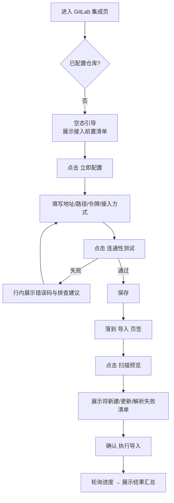

# 软件测试平台——GitLab 集成页面交互设计

**文档版本**：V1.0
**日期**：2026-10-11
**状态**：起草中

---

> 本文档为接口测试域交互设计分册：GitLab 集成页（项目设置子模块）的页面交互设计。模块范围、菜单路由与权限口径见总览分册 `docs/05-interaction-design/05-api-testing/26-gitlab-ui-overview.md`；视觉规范见 `docs/05-interaction-design/03-visual-design.md`。

---

## 1. 布局设计

GitLab 集成页为**整页单面板**布局：一项目一仓库，页面不设仓库列表，也不提供「新增」入口，正文即本项目唯一配置的详情面板（页签：基础配置 / 导入）；未配置时整页呈现空态引导。执行不在本页发生，由场景侧执行入口（列表行内 [执行] / 编排页顶部 [运行]）承载。

```text
┌───────────────────────────────────────────────────────────────┐
│ [基础配置] [导入]                  [⋯]  连通性 ● 已连通       │
│                                                               │
│  名称        GitLab 实例地址    令牌(掩码)                      │
│  测试源码目录  资源目录        环境声明文件路径                   │
│  重复导入覆盖  开关（默认关）                                 │
│                                                               │
│  项目路径    qa/order-api-tests         （创建后锁定）          │
│  默认分支    master                     （创建后锁定）          │
│  接入方式    platform                   （创建后锁定）          │
│                                                               │
│  [连通性测试]                                 [保存]          │
└───────────────────────────────────────────────────────────────┘
```

**布局规则**：

- 页面全宽单面板，一项目一仓库：已配置后不存在新增入口与多配置切换；
- 创建后锁定的字段（项目路径、默认分支、接入方式）以只读文本呈现，不渲染为禁用输入框，也不作为可提交的表单项；
- 删除配置属低频高影响操作，移出表单动作行，由页签栏右侧 [⋯] 更多菜单承载，菜单内以危险色呈现并二次确认；
- 页签默认落在「基础配置」；从场景页「来源」跳转进入时直接落到「导入」页签；
- 未配置时整页呈现空态引导与 [立即配置] 主按钮，保存成功后自动落到「导入」页签；删除配置后回到空态引导；
- 页签栏常驻「连通性状态」徽标，失败时徽标转为告警色并可点击展开错误详情；
- 页签栏常驻 **[源有更新] 徽标**：源探查发现默认分支有新提交（探查提交与上次导入不一致）时显示，hover 说明「默认分支有新提交，导入或同步后生效」，点击落到「导入」页签；导入或同步成功后自动消失；探查失败时徽标转为「探查失败」告警态并展示上次探查时间，不提供手动重试入口。

## 2. 核心交互流程

### 2.1 首次接入



### 2.2 导入幂等闸门拦截

```mermaid
flowchart TD
    A[点击 执行导入 / 扫描预览] --> B{闸门判定<br/>HEAD 与上次导入一致 且 上次无遗留真实错误?}
    B -- 否 --> H[正常进入解析]
    B -- 是 --> C[拦截<br/>提示「目标分支与上次导入一致」]
    C --> D[展示上次导入汇总]
    D --> G[仅提供 [查看上次结果]]
    H --> I[预览出计数清单<br/>或直接执行导入]
```

拦截成立时：预览不拉取源码、不扫描（响应 `gate.blocked = true`），导入返回 `1000017709`；`errorFailed > 0` 或存在新提交时判定放行，直接进入正常解析流程（遗留真实错误的重跑无需强制入口）。

## 3. 页面设计

### 3.1 新增 / 编辑仓库配置

| 字段 | 控件 | 必填 | 校验与提示 |
| ---- | ---- | ---- | ---- |
| 名称 | 单行文本 | 是 | ≤ 200 字符 |
| GitLab 地址 | 单行文本 | 是 | 仅 http/https，结尾不留 `/`，提示「支持自建实例」 |
| 项目路径 | 首次配置为单行文本，已配置态为只读文本 | 是 | 形如 `group/subgroup/repo`，不含 `.git` 后缀与协议前缀，不以 `/` 开头；提交前去除首尾空白与首尾 `/` 后再实测与保存，占位文案为「group/subgroup/repo」；**创建后锁定**，变更须删除后重建 |
| 默认分支 | 首次配置为单行文本，已配置态为只读文本 | 否 | 缺省 `master`，连通性测试通过后回显实际分支名；**创建后锁定** |
| 接入方式 | 首次配置为选项卡片，已配置态为只读文本 | 是 | 平台执行 / 流水线执行；选项卡片自带差异说明（解析深度、平台侧可编辑性、执行引擎、仓库侧前置改造），下方常驻说明文字重申；**创建后锁定**。标签不取「执行方式」（已被定时任务 `execution_scope`、执行记录与报告的 `execution_mode` 占用）与「导入方式」（已被接口导入记录 `import_type` 占用） |
| 访问令牌 | 密码框 | 新建必填 | 仅写不读，编辑态留空表示不修改，提示所需权限范围 |
| 测试源码目录 | 单行文本 | 否 | 缺省 `src/test/java` |
| 资源目录 | 单行文本 | 否 | 缺省 `src/test/resources` |
| 环境声明文件路径 | 单行文本 | 否 | 缺省 `common/env/env.yaml`；流水线执行下置灰并提示「流水线执行不读取环境声明」 |
| 重复导入覆盖 | 开关 | 否 | 默认关闭（再次导入不覆盖已修改的平台侧内容）；开启时提示「再次导入将用仓库内容覆盖平台侧场景内容」；流水线执行下不渲染（平台侧只读，无覆盖语义） |

**动作行按钮**：[连通性测试]（独立主动校验，测试不触发保存）/[ 保存 ]（校验通过才提交；保存时服务端同样强制实测连通性，失败返回 1000017702 并保留已填内容，不落库）。动作行内 [ 保存 ] 固定右端末端，[连通性测试] 及其连接结果靠左，两者之间留空不补其他控件；只读态整行不渲染。重新发起测试即清除上一次连接结果，按钮 loading 期间不残留旧的成功或错误信息，待新结果返回后再展示。

**页签栏 [⋯] 更多菜单**：仅含「删除配置」一项，以危险色呈现；点击二次确认，并提示「存在启用中的 GitLab 同步任务时禁止删除」；删除成功后回到整页空态引导。该菜单同时说明：变更绑定仓库或接入方式须先删除再重建。

### 3.2 导入页签

| 元素 | 行为 |
| ---- | ---- |
| [扫描预览] | 提交后按钮转 loading，期间禁用 [执行导入]；重新发起扫描即清空上一次预览结果，loading 期间既不展示旧的汇总与结果视图，也不闪现空态引导；完成后展示汇总条与结果视图 |
| 汇总条 | 新建 N / 更新 N / 解析失败 N / 真实错误 N，四段横向排列，解析失败段可点击展开 |
| 结果视图 | 同一按钮组三段切换：**解析成功 / 解析失败 / 真实错误**，各段带计数，**恒默认解析成功**，不提供「全部」段；段下渲染对应列表——解析成功段列 `sceneKey`、场景名与新建 / 更新标记，失败段以紧凑多行列表呈现（类型标签 + `sceneKey` + 原因），列表为空时给出对应空态文案；解析成功段条数超过服务端截断上限时提示「仅展示前 200 条，共 N 条」；支持导出 CSV（失败原因文本内嵌出错文件路径） |
| [执行导入] | 预览通过后才可点击；点击二次确认，文案随「重复导入覆盖」配置切换——关闭（默认）「导入将按归属标识合并，已修改的平台侧内容不被覆盖，是否继续？」；开启「导入将按归属标识合并，并以仓库内容覆盖已修改的平台侧场景内容，是否继续？」；提交中与导入进行中按钮**持续转 loading** |
| 进度条 | 导入中展示阶段（拉取源码 / 扫描测试类 / 解析用例 / 合并环境 / 回写结果）与计数，阶段文字前带旋转 loading 图标 |
| 上次导入信息 | 常驻页签顶部：时间、提交号前 7 位、四段计数；提交号可点击跳转 GitLab |

**动作行**：[扫描预览] 与 [执行导入] 为「图标 + link」按钮并取主色调，固定在动作行右端；[导出 CSV] 与权限提示（缺 `api-scene:edit` 时出现）靠左。两个主操作不使用填充式主按钮，避免与页面其他动作争抢视觉权重；loading 与禁用态沿用 Element Plus 按钮自身表现。

## 4. 视觉与状态要求

| 状态 | 呈现 |
| ---- | --- |
| 空态 | 整页居中引导文案「尚未配置 GitLab 仓库」+ [立即配置] 主按钮 + 前置要求清单（Maven/TestNG/Ryze 结构、`@Test` + `@RyzeTest` 成对、令牌权限；流水线执行额外列 CI 改造要求） |
| 加载态 | 连通性测试、预览、导入、轮询期间对应区域骨架屏或按钮 loading，不整页遮罩；导入期间 [执行导入] 按钮持续转 loading，进度区阶段文字前带旋转图标 |
| 部分失败 | 导入结果不整体报错，四段计数中解析失败段以告警色呈现，真实错误段以错误色呈现 |
| 幂等拦截 | 非错误提示：页面顶部信息条（`info` 色）而非错误条，附 [查看上次结果] 动作 |
| 仓库不可达 | 详情页徽标转告警色，可点击展开错误码；本页**不提供**「修复」或「重试」按钮 |
| 源有更新 | 页签栏 [源有更新] 徽标（告警色），hover 说明「默认分支有新提交，导入或同步后生效」；不阻断任何操作，导入或同步成功后自动消失 |
| 探查失败 | [源有更新] 徽标转为「探查失败」态并展示上次探查时间；不提供手动重试入口，下周期自动重试 |
| 权限不足 | 缺编辑权限时表单整体只读、操作按钮隐藏；缺查看权限时菜单项不展示 |
| 网络异常 | 提交类操作失败统一 Toast，保留已填内容不清空表单 |

色彩一律引用 `docs/05-interaction-design/03-visual-design.md` 的 CSS 变量，不在本分册定义色值。

## 5. 状态管理

| 状态 | 归属 | 说明 |
| ---- | ---- | ---- |
| 仓库配置详情 | 页面本地状态 | 进入页签加载，切换 tab 时保留已填未保存内容，离开模块前提示 |
| 表单草稿 | 页面本地状态 | 编辑中内容不自动提交；保存前放弃修改（刷新或离开页面）需二次确认 |
| 导入进度 | 轮询态 | 提交后开始轮询，页面离开即停止；进度不落本地存储，重进重新查询 |
| 令牌输入 | 不落任何状态 | 不写入本地存储、不回填、不进入表单缓存 |

## 修改记录

| 版本 | 日期 | 说明 |
| ---- | ---- | ---- |
| V1.0 | 2026-10-11 | 初始版本：GitLab 集成页面与执行入口交互设计 |
| V1.0 | 2026-10-11 | 路由预览与批次进度视图取消分批展示，流水线组恒为单条流水线 |
| V1.0 | 2026-10-11 | 布局由左列表 + 右详情改为整页单面板：移除仓库列表与新增入口，空态改为整页引导 |
| V1.0 | 2026-10-11 | 集成页移除「执行」页签，执行入口统一由场景侧承载，页面仅保留基础配置与导入 |
| V1.0 | 2026-10-11 | 删除批量执行路由预览、场景执行按钮与批次进度视图内容：平台不存在场景列表批量执行，单场景执行入口为场景编辑页顶部 [运行]，定时任务执行记录仅展示触发状态与最终结果；文档更名为「GitLab 集成页面交互设计」 |
| V1.0 | 2026-10-11 | 执行入口口径统一为双入口：列表行内 [执行]（直接触发）与编排页顶部 [运行] |
| V1.0 | 2026-10-11 | 项目路径、默认分支随导入模式一并创建后锁定并以只读文本呈现；[删除] 移出表单动作行，改由页签栏 [⋯] 更多菜单承载 |
| V1.0 | 2026-10-11 | 动作行按钮对齐口径明确：[保存] 固定右端末端，[连通性测试] 及其连接结果靠左 |
| V1.0 | 2026-10-11 | 连通性口径修正：测试为独立主动动作，保存时服务端强制实测通过（失败 1000017702 不落库），撤回「不阻塞保存」表述 |
| V1.0 | 2026-10-11 | 接入方式取值由「平台模式 / 流水线模式」改为「平台执行 / 流水线执行」，字段标签由「导入模式」改为「接入方式」；首次配置控件由单选改为选项卡片，差异说明随选项就地呈现 |
| V1.0 | 2026-10-11 | 新增 [源有更新] 徽标与「探查失败」态：仓库级源探查结果在页签栏常驻展示 |
| V1.0 | 2026-10-12 | 基础配置表单新增「重复导入覆盖」开关（默认关闭，流水线执行下不渲染）；[执行导入] 二次确认文案随该配置切换 |
| V1.0 | 2026-10-12 | 幂等拦截口径随详设 3.4 收敛：拦截仅成立于「提交一致且上次无遗留真实错误」，拦截动作移除 [重新导入]（有真实错误时判定自然放行，重跑走正常导入流程） |
| V1.0 | 2026-10-13 | 导入明细表列口径与详设 3.2 预览契约及 SRS F1.2 功能点 4 对齐：移除「源文件路径」列，预览响应 details 仅含类型 / 类或方法 / 原因，出错文件路径由失败原因文本承载 |
| V1.0 | 2026-10-17 | 项目路径校验与提示口径明确：不以 `/` 开头，提交前去除首尾空白与首尾 `/` 后再实测与保存（带前导 `/` 会被 GitLab 误报为路径不存在），占位文案固定为「group/subgroup/repo」 |
| V1.0 | 2026-10-17 | 连通性测试补充重测口径：发起新一次测试即清除上一次连接结果，loading 期间不残留旧的成功或错误信息 |
| V1.0 | 2026-10-17 | 导入页签动作行调整：[扫描预览] 与 [执行导入] 改为「图标 + link」按钮并取主色调、固定右端，[导出 CSV] 与权限提示靠左 |
| V1.0 | 2026-10-17 | 导入页签新增「解析成功清单」（默认折叠，场景级 `sceneKey` + 场景名 + 新建 / 更新标记，超出服务端截断上限时提示条数）；失败明细由表格降级为紧凑多行列表，类型筛选与导出 CSV 保留 |
| V1.0 | 2026-10-17 | 重新发起扫描即清空上一次预览结果：loading 期间不展示旧的汇总、清单与明细，也不闪现空态引导 |
| V1.0 | 2026-10-17 | 结果展示改为三段按钮组（解析成功 / 解析失败 / 真实错误，各段带计数，恒默认解析成功，撤回「全部」段与默认折叠）；导入期间 [执行导入] 持续转 loading，进度区阶段前带旋转图标 |

