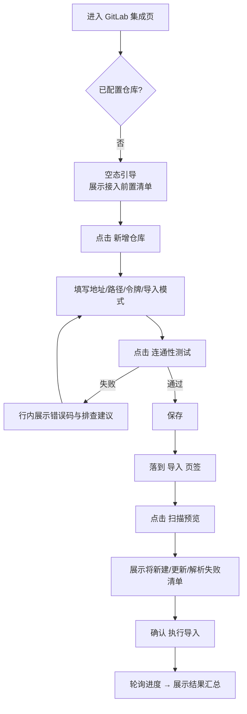
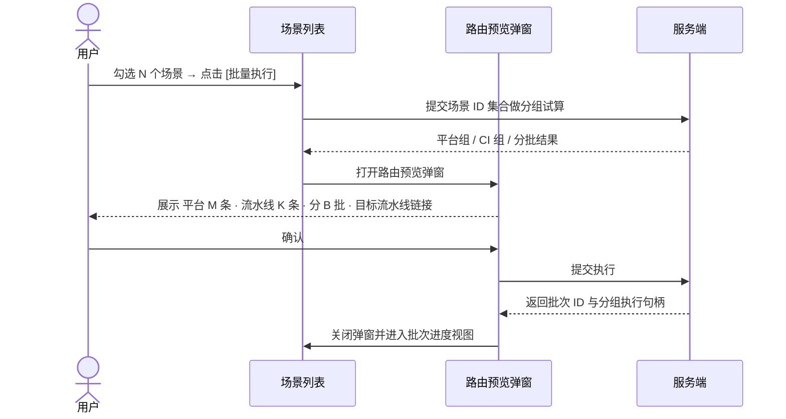

# 软件测试平台——GitLab 集成页面与执行入口交互设计

**文档版本**：V1.0
**日期**：2026-10-11
**状态**：起草中

---

> 本文档为接口测试域交互设计分册：GitLab 集成页（项目设置子模块）、场景执行入口与批次进度视图的页面交互设计。模块范围、菜单路由与权限口径见总览分册 `docs/05-interaction-design/05-api-testing/26-gitlab-ui-overview.md`；视觉规范见 `docs/05-interaction-design/03-visual-design.md`。

---

## 1. 布局设计

GitLab 集成页采用**左列表 + 右详情**布局：左侧为仓库配置列表（一项目一仓库时退化为单卡片，仍保留列表结构以便扩展），右侧为选中配置的详情面板。

```text
┌──────────────────┬───────────────────────────────────────────────┐
│ 仓库配置          │ [基础配置] [导入] [执行]                         │
│                  │                                               │
│ ● order-api-     │  名称        GitLab 地址     项目路径            │
│   tests          │  默认分支    导入模式(只读)   令牌(掩码)          │
│   ● 已连通        │                                               │
│   ● platform     │  [连通性测试]  [保存]  [删除]                    │
│                  │                                               │
│ [+ 新增仓库]      │                                               │
└──────────────────┴───────────────────────────────────────────────┘
```

**布局规则**：

- 左列表固定宽度，超出滚动；右详情自适应剩余宽度；
- 详情面板三个页签默认落在「基础配置」；从场景页「来源」跳转进入时直接落到「导入」页签；
- 未配置任何仓库时，右详情区整体呈现空态引导，左列表仅保留 [+ 新增仓库]；
- 页签栏常驻「连通性状态」徽标，失败时徽标转为告警色并可点击展开错误详情。

## 2. 核心交互流程

### 2.1 首次接入



### 2.2 导入幂等闸门拦截

```mermaid
flowchart TD
    A[点击 执行导入 / 扫描预览] --> B{闸门判定}
    B -- 目标分支无新提交 --> C[拦截<br/>提示「目标分支与上次导入一致」]
    C --> D[展示上次导入汇总]
    D --> E{仍有遗留真实错误?}
    E -- 是 --> F[提供 [重新导入] 按钮]
    E -- 否 --> G[仅提供 [查看上次结果]]
    B -- 有新提交 --> H[正常进入解析]
```

### 2.3 批量执行路由预览



## 3. 页面设计

### 3.1 新增 / 编辑仓库配置

| 字段 | 控件 | 必填 | 校验与提示 |
| ---- | ---- | ---- | ---- |
| 名称 | 单行文本 | 是 | ≤ 200 字符 |
| GitLab 地址 | 单行文本 | 是 | 仅 http/https，结尾不留 `/`，提示「支持自建实例」 |
| 项目路径 | 单行文本 | 是 | 形如 `group/subgroup/repo`，不含 `.git` 后缀与协议前缀；重复提交提示「本项目已绑定该仓库」 |
| 默认分支 | 单行文本 | 否 | 缺省 `master`，连通性测试通过后回显实际分支名 |
| 导入模式 | 单选 | 是 | 平台模式 / 流水线模式；下方常驻说明文字解释两者差异；**编辑态整块只读** |
| 访问令牌 | 密码框 | 新建必填 | 仅写不读，编辑态留空表示不修改，提示所需权限范围 |
| 测试源码目录 | 单行文本 | 否 | 缺省 `src/test/java` |
| 资源目录 | 单行文本 | 否 | 缺省 `src/test/resources` |
| 环境声明文件路径 | 单行文本 | 否 | 缺省 `common/env/env.yaml`；流水线模式下置灰并提示「流水线模式不读取环境声明」 |

**按钮**：[连通性测试]（不阻塞保存，独立校验）/[ 保存 ]（校验通过才提交）/[ 删除 ]（二次确认，提示存在启用中的 GitLab 同步任务时禁止删除）。

### 3.2 导入页签

| 元素 | 行为 |
| ---- | ---- |
| [扫描预览] | 提交后按钮转 loading，期间禁用 [执行导入]；完成后展示汇总条与明细表 |
| 汇总条 | 新建 N / 更新 N / 解析失败 N / 真实错误 N，四段横向排列，解析失败段可点击展开 |
| 明细表 | 列为类型（解析失败 / 真实错误）、类或方法、原因、源文件路径；支持按类型筛选与导出 CSV |
| [执行导入] | 预览通过后才可点击；点击二次确认「导入将按归属标识合并，已修改的平台侧内容不被覆盖，是否继续？」 |
| 进度条 | 导入中展示阶段（拉取源码 / 扫描测试类 / 解析用例 / 合并环境 / 回写结果）与计数 |
| 上次导入信息 | 常驻页签顶部：时间、提交号前 7 位、四段计数；提交号可点击跳转 GitLab |

### 3.3 执行页签

展示本仓库场景的执行入口说明与最近执行记录（仓库、流水线编号、状态、耗时、跳转链接）。CI 场景跳转 GitLab 流水线的链接在新窗口打开。

## 4. 视觉与状态要求

| 状态 | 呈现 |
| ---- | --- |
| 空态 | 右详情区居中引导文案「尚未配置 GitLab 仓库」+ [新增仓库] 主按钮 + 前置要求清单（Maven/TestNG/Ryze 结构、`@Test` + `@RyzeTest` 成对、令牌权限；流水线模式额外列 CI 改造要求） |
| 加载态 | 连通性测试、预览、导入、轮询期间对应区域骨架屏或按钮 loading，不整页遮罩 |
| 部分失败 | 导入结果不整体报错，四段计数中解析失败段以告警色呈现，真实错误段以错误色呈现 |
| 幂等拦截 | 非错误提示：页面顶部信息条（`info` 色）而非错误条，附 [重新导入] 或 [查看上次结果] 动作 |
| 仓库不可达 | 详情页徽标转告警色，执行页签内场景行显示 `repo_unreachable` 标签与错误码，**不提供**「修复」或「重试」按钮 |
| 权限不足 | 缺编辑权限时表单整体只读、操作按钮隐藏；缺查看权限时菜单项不展示 |
| 网络异常 | 提交类操作失败统一 Toast，保留已填内容不清空表单 |

色彩一律引用 `docs/05-interaction-design/03-visual-design.md` 的 CSS 变量，不在本分册定义色值。

## 5. 页面结构示意

### 5.1 场景执行按钮

平台引擎场景与流水线引擎场景均渲染**单个**按钮，文案随引擎变化，不渲染下拉或次级菜单：

```text
┌────────────────────────────────┐
│  场景：订单替换-PC端             │
│  来源：GitLab 导入 · platform   │
│                                │
│  [ ▶ 运行 ]   [ 编辑 ]  [ ⋯ ]   │   ← 平台引擎
└────────────────────────────────┘

┌────────────────────────────────┐
│  场景：监管报送-批量            │
│  来源：GitLab 导入 · gitlab_ci  │
│                                │
│  [ ▶ 流水线运行 ] [ 编辑 ] [ ⋯ ] │   ← 流水线引擎
└────────────────────────────────┘
```

### 5.2 批次执行进度视图

批量执行确认后进入进度视图，平台组与流水线组并列，全部终态后汇总：

```text
┌───────────────────────────────────────────────────────┐
│ 批次执行进度                              [关闭] [刷新]  │
│                                                       │
│ 平台组  3/5 完成 ████████░░                            │
│   ├ 订单查询-列表          ✓ 成功      1.2s   [报告]   │
│   ├ 订单详情-校验          ✓ 成功      0.9s   [报告]   │
│   ├ 订单取消-异常          ✗ 失败      1.5s   [报告]   │
│   └ …                                                 │
│                                                       │
│ 流水线组  1/2 批次完成 ██████░░░░                      │
│   ├ 批次 1 / 2 · 流水线 #142   ⟳ 运行中   [GitLab ↗]  │
│   └ 批次 2 / 2 · 流水线 #143   ✓ 成功     用例 45/45  │
│                                                       │
│ 汇总  场景 8 · 用例 238 · 通过 231 · 失败 5 · 跳过 2   │
│                       [ 查看套件报告 ]                  │
└───────────────────────────────────────────────────────┘
```

批次视图不做自动跳转：两侧均终态后汇总区出现 [查看套件报告]，用户主动点击进入；未终态时该按钮禁用并提示「仍有流水线未结束」。

## 6. 状态管理

| 状态 | 归属 | 说明 |
| ---- | ---- | ---- |
| 仓库配置详情 | 页面本地状态 | 进入页签加载，切换 tab 时保留已填未保存内容，离开模块前提示 |
| 表单草稿 | 页面本地状态 | 编辑中内容不自动提交；切换编辑对象时若有未保存修改需二次确认 |
| 导入进度 | 轮询态 | 提交后开始轮询，页面离开即停止；进度不落本地存储，重进重新查询 |
| 路由预览结果 | 短暂态 | 每次点击 [批量执行] 重新试算，不做缓存，避免分组结果过期 |
| 批次进度 | 服务端权威 | 前端仅轮询渲染，刷新页面后按批次 ID 恢复视图；两侧均终态后停止轮询 |
| 令牌输入 | 不落任何状态 | 不写入本地存储、不回填、不进入表单缓存 |

## 修改记录

| 版本 | 日期 | 说明 |
| ---- | ---- | ---- |
| V1.0 | 2026-10-11 | 初始版本：GitLab 集成页面与执行入口交互设计 |

