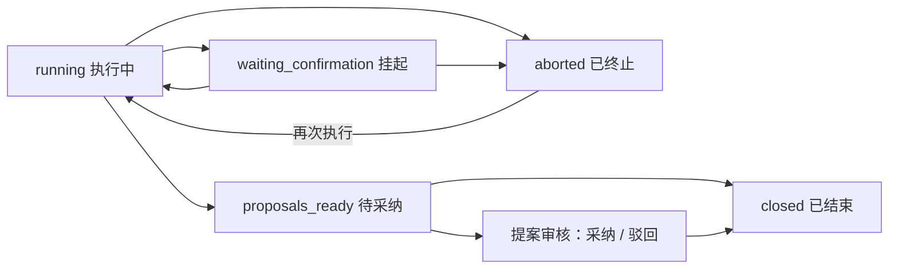
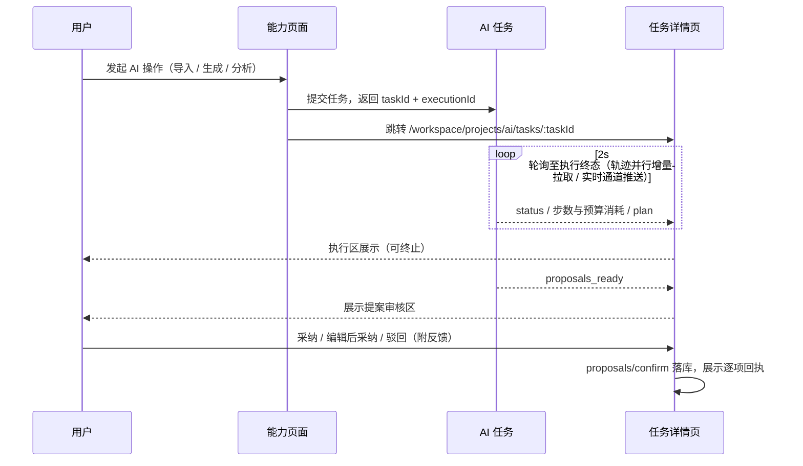

# 软件测试平台——AI 任务中心与提案审核

**文档版本**：V1.0  
**日期**：2026-10-03  
**状态**：起草中

---

## 1. 概述

AI 任务中心是项目内全部 AI 任务的统一入口，任务统一经 `POST /api/ai/tasks` 提交、`GET /api/ai/tasks/{id}` 查询，执行过程经轨迹接口（`GET /api/ai/tasks/{id}/executions/{executionId}/events`）与实时通道呈现；任务详情与提案审核合并为同一个任务详情页，任务中心与各能力页统一跳转该页。通用提案审核面板（`AiProposalReviewPanel`）为各能力域复用组件，以详情页内审核区的形式渲染，本分册定义其通用交互，生成链、需求导入、缺陷批量分类等域扩展见各自分册。执行编排归 AI、写库编排归应用层的双平面机制见 `docs/02-high-level-design/07-ai-capability/03-hld-ai-task.md`。

**路由**：任务中心 `/workspace/projects/ai/tasks`；任务详情 `/workspace/projects/ai/tasks/:taskId`（任务中心的子路由）

**入口**：不占顶部动态菜单，采用「就近按钮 + 顶栏指示器」双层入口：

- **能力页按钮**：可发起 AI 任务的能力页（需求列表、追溯矩阵、缺陷 AI 分析）页头提供「任务中心」按钮，按 `ai:task` 权限显隐，供用户主动回看历史任务；
- **顶栏指示器**：项目模式下顶部导航栏常驻 AI 任务指示器（按 `ai:task` 权限显隐，不占动态菜单位），角标展示进行中（`running`）任务数，点击进入本页，供用户被动感知任务进度（导航布局见 `docs/05-interaction-design/02-global-navigation.md` §2）。

AI 未启用或未配置模型时，任务入口与本页内容按总册 4.5 隐藏或降级提示。

## 2. 页面设计

### 2.1 任务中心页

#### 2.1.1 布局

```
┌──────────────────────────────────────────────────────────────────┐
│ AI 任务中心                                                       │
├──────────────────────────────────────────────────────────────────┤
│ 类型▾  状态▾      [查询] [重置]                          [刷新]    │
├──────────────────────────────────────────────────────────────────┤
│ 任务名 │ 类型 │ 状态 │ 执行摘要 │ 发起人 │ 发起时间 │ 操作         │
│ 导入PRD│需求导入│执行中│ ▓▓▓░ 23步 │ 张三 │ 10-02 09:00│ 详情 终止   │
│ 生成用例│生成链 │已终止│ 原因摘要  │ 李四 │ 10-01 14:20│ 详情 再次执行│
├──────────────────────────────────────────────────────────────────┤
│ 共 28 条    每页 [20▾]     < 1  2 >                              │
└──────────────────────────────────────────────────────────────────┘
```

#### 2.1.2 交互说明

| 区块 | 交互 |
| ---- | ---- |
| 筛选 | 任务类型、任务状态两项下拉 + 查询/重置；状态取值 `running / proposals_ready / closed / aborted` |
| 状态徽标 | `running` 执行中（步数与预算消耗 + 最近动作）/ `running` 挂起（待人工批准副作用）/ `proposals_ready` 待采纳 / `closed` 已结束（中性灰）/ `aborted` 已终止（悬浮终止原因） |
| 行操作 | 「详情」跳转任务详情页；`running` 显示「终止」（二次确认）；`aborted` 显示「再次执行」；`proposals_ready` 显示「审核」，跳转详情页并定位审核区 |
| 分页 | 20 / 50 / 100 每页；筛选与页码离开页面保活 |

#### 2.1.3 状态分支

- 空态：无任务 → 「暂无 AI 任务」+ 各能力入口引导；
- 加载：表格骨架屏；刷新失败错误条 + 重试；
- 权限不足：无权限不展示任务中心入口，直达路由 403；
- AI 未启用：整页降级提示「AI 能力未启用 / 未配置模型」。

### 2.2 任务详情页（AiTaskDetailPage）

任务中心行「详情 / 审核」与各能力页提交任务后的统一落点，任务执行过程与提案审核在同一页面自上而下呈现，无需二次打开浮层。

```
┌──────────────────────────────────────────────────────────────────┐
│ AI 任务中心 › 任务详情：导入 PRD 解析              [终止] [再次执行]  │
│ 类型 需求导入 · 发起人 张三 · 发起时间 10-02 09:00   [待采纳徽标]     │
│ 步数 23/40 · 时长 94s/600s · tokens 4600/200000                   │
│ 终止原因：（已终止时展示，含错误码）                                │
├──────────────────────────────────────────────────────────────────┤
│ 计划步骤（AI 规划，随轨迹更新）                                     │
│  ● 解析需求   ● 生成模块结构   ◐ 生成脑图文档                      │
│  ○ 标记用例节点  ○ 填充用例属性                                    │
├──────────────────────────────────────────────────────────────────┤
│ 提案计数：[模块 2] [文档 3] [用例 47]   [展开轨迹 ▾]                │
│ 提案审核区（proposals_ready 且有提案时渲染，见 2.3）                │
└──────────────────────────────────────────────────────────────────┘
```

| 区块 | 交互 |
| ---- | ---- |
| 面包屑 | 内容区顶部「AI 任务中心 › 任务详情」：点「AI 任务中心」回列表（筛选与页码保活），「任务详情」为当前页项不可点，遵循《面包屑导航规范》（`docs/00-spec/50-ui/05-breadcrumb.md`，UI-BC-01）；从能力页跳转而来时经浏览器返回恢复来源页上下文 |
| 执行区 | 步数与预算消耗、当前步骤、终止原因与错误码；按 `GET /api/ai/tasks/{id}` 2 秒轮询，`aborted / closed` 停止 |
| 计划步骤 | 展示 AI 在执行开始产出的计划步骤快照（`plan`，可见思考产物）：当前步骤高亮、完成步骤打勾、终止原因标红；步骤由 AI 自主规划，不承诺固定序列 |
| 轨迹区 | 「展开轨迹」按游标增量拉取（`events?afterSeq=`），实时通道推送时即时合并；轨迹只增不改，可回看与复制 |
| 操作 | `running` 可终止（二次确认）；`aborted` 可再次执行（产生新执行实例与新提案）；`proposals_ready` 且有提案时下半区直接展示审核区，无「进入审核」二次跳转 |
| 提案计数 | 徽标点击定位审核区对应节点 |
| 审核区占位 | `running` 显示「执行进行中，完成后在此审核」；`proposals_ready` 无提案显示空态；`aborted / closed` 不渲染审核区 |

### 2.3 提案审核区（AiProposalReviewPanel，页内渲染）

任务详情页下半区的页内分区组件，按任务类型渲染对应提案树形态。

```
┌──────────────────────────────────────────────────────────────────┐
│ 提案审核                                    已处理 N / 共 M        │
├──────────────────────────┬───────────────────────────────────────┤
│ 提案树                    │ 内容预览 / 与既有数据对比              │
│ ▸ ▢ 模块：登录             │ AI 建议：…                            │
│   ▢ 文档：验证码            │ 既有数据：…（编辑后采纳时并排 diff）    │
│     ○ 用例节点（属性徽标）  │ 来源引用：[P3 §2.1]（点击跳原文）       │
│   ⚠ 疑似重复 / 来源已变更   │                                       │
├──────────────────────────┴───────────────────────────────────────┤
│ [单条采纳] [编辑后采纳] [整树采纳] [驳回（可附反馈）]  [批量操作▾]    │
└──────────────────────────────────────────────────────────────────┘
```

| 区块 | 交互 |
| ---- | ---- |
| 提案树 | 按能力域结构渲染，`kind` 图标区分；半选态支持树级批量选择；警示标记（疑似重复 `suspectedDuplicateOf`、来源需求已变更）行内高亮 |
| 内容预览 | 只读渲染单条提案；「编辑后采纳」进入可编辑态并展示 AI 建议 vs 既有数据并排对比 |
| 来源引用 | `sourceRefs` 引用链接点击跳需求原文定位，浏览器返回详情页后审核区选择态与编辑态保留 |
| 动作 | 单条采纳 / 编辑后采纳 / 整树采纳 / 驳回附反馈（驳回反馈可触发再次执行）；批量操作：批量采纳、批量驳回 |
| 确认协议 | 全部动作统一走提案确认接口（`POST /api/ai/tasks/{taskId}/proposals/confirm`），确认过的提案不可重复确认（1000018113）；任务非 `proposals_ready` 不可确认（1000018111） |
| 回执 | 提交后展示逐项成败回执；失败项可单项重试；全驳回回执明确「未创建任何数据」 |

### 2.4 状态分支汇总

- 详情页加载：骨架屏；任务不存在或越权 → 404 提示 + 返回任务中心；
- 任务终止：详情页展示终止原因与错误码（用户中止 / 预算耗尽 / 执行错误），再次执行产生新执行实例与新提案；
- 提案全驳回：回执 + 审核区空态（「已全部驳回」）；
- 部分采纳：回执逐项成败，树上残留未处理项保持待确认态；
- 确认冲突（并发或重复确认）：提示「该提案已确认」并刷新审核区状态；
- 权限不足：隐藏审核动作，提案只读预览。

## 3. 核心交互流程

### 3.1 任务生命周期



> 终态（`aborted / closed`）停止详情轮询；心跳超时或预算耗尽的执行由服务端清扫置 `aborted`（1000018117 / 1000018127），前端以最新查询结果为准。

### 3.2 执行过程与审核时序



## 4. 视觉与状态要求

- 计划步骤与执行区高亮：`--color-primary-500` 体系；完成步骤 `--color-success`、终止标红 `--color-danger`、挂起 `--color-info`、已结束中性灰 `--color-neutral-400`；
- 状态徽标与终止原因悬浮层遵循《视觉设计》4.1 状态色与中性色体系；
- 提案树警示标记用 `--color-warning`（疑似重复）与 `--color-danger`（来源已变更）图标 + 文字，不单靠颜色表意；
- 回执列表成功项 `--color-success`、失败项 `--color-danger-light` 底。

## 5. 状态管理

- Pinia store `aiTask`：任务详情 2 秒轮询（`GET /api/ai/tasks/{id}`），`aborted / closed` 停止，随详情页路由进入/离开启停；轨迹事件增量拉取（`events?afterSeq=`，实时通道推送时即时合并）；任务中心列表与筛选条件；提案确认状态缓存；顶栏指示器进行中任务数（`GET /api/ai/tasks/running-count`，15 秒轮询，仅项目模式且具备 `ai:task` 权限时装载，任务提交/终止/再次执行后即时刷新）；
- 跨页面任务进度联动：能力页通过 `aiTask` 订阅自己提交的 `taskId`，跳转详情页后由详情页接管轮询，返回来源页时回调刷新来源列表；
- 审核区选择态与编辑态存组件本地（详情页随路由缓存），切换提案时提示未保存编辑，来源页往返不丢失；
- 确认动作成功后以服务端返回的确认状态覆盖本地缓存，避免重复确认。

## 修改记录

| 版本 | 日期 | 说明 |
| ---- | ---- | ---- |
| V1.0 | 2026-10-03 | 初始版本 |
| V1.0 | 2026-10-03 | 任务详情抽屉与产物审核面板合并为任务详情页（`/workspace/projects/ai/tasks/:taskId`），能力页提交后统一跳转该页，回退入口按 UI-BC-01 用面包屑 |
| V1.0 | 2026-10-15 | 入口改为「就近按钮 + 顶栏指示器」双层模型：能力页按钮按 `ai:task` 显隐，顶栏新增进行中任务数指示器（15s 轮询 `running-count`）；状态管理补指示器计数 |
| V1.0 | 2026-10-16 | 同步 AI Task 双平面口径（`docs/02-high-level-design/07-ai-capability/03-hld-ai-task.md`）：状态机改 `running（含挂起）→ proposals_ready → closed / aborted`，取消 / 重试改「终止 / 再次执行」；进度条与阶段时间线改为预算消耗 + AI 计划步骤 + 轨迹回看；`AiArtifactReviewPanel` 更名 `AiProposalReviewPanel`，确认端点改 `proposals/confirm`；状态管理补轨迹增量拉取 |
