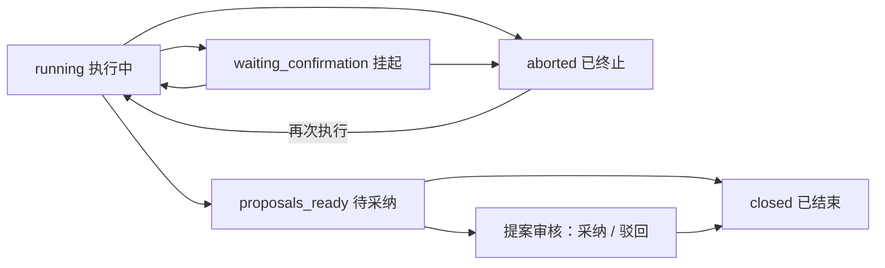
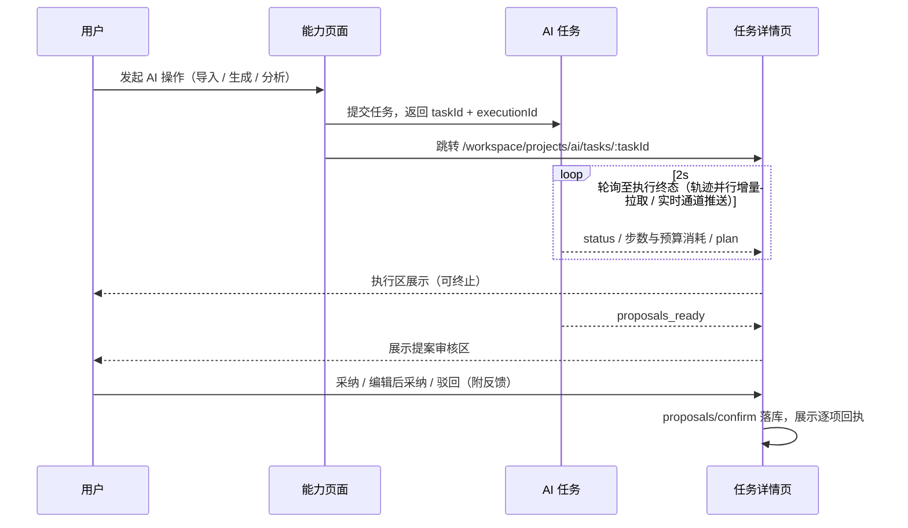

# 软件测试平台——AI 任务中心与提案审核

**文档版本**：V1.0  
**日期**：2026-10-03  
**状态**：起草中

---

## 1. 概述

AI 任务中心是项目内全部 AI 任务的统一入口，任务统一经 `POST /api/ai/tasks` 提交、`GET /api/ai/tasks/{id}` 查询，执行过程经轨迹接口（`GET /api/ai/tasks/{id}/executions/{executionId}/events`）与实时通道呈现；任务详情与提案审核合并为同一个任务详情页，任务中心与各能力页统一跳转该页。通用提案审核面板（`AiProposalReviewPanel`）为各能力域复用组件，以详情页内审核区的形式渲染（只读类型如 AI 评审仅展示提案明细、不渲染审核动作），本分册定义其通用交互，需求导入等域扩展见各自分册。执行编排归 AI、写库编排归应用层的双平面机制见 `docs/02-high-level-design/07-ai-capability/03-hld-ai-task.md`。

**路由**：任务中心 `/workspace/projects/ai/tasks`；任务详情 `/workspace/projects/ai/tasks/:taskId`（任务中心的子路由）

**入口**：不占顶部动态菜单，由顶部导航栏常驻的 AI 任务指示器承载——项目模式下常驻显示（不占动态菜单位、不按权限码过滤），角标展示进行中（`running`）任务数，点击进入本页，供用户感知并回看任务进度（导航布局见 `docs/05-interaction-design/02-global-navigation.md` §2）。

AI 未启用或未配置模型时，任务入口与本页内容按总册 4.5 隐藏或降级提示。

## 2. 页面设计

### 2.1 任务中心页

#### 2.1.1 布局

```
┌──────────────────────────────────────────────────────────────────┐
│ AI 任务中心                                                       │
├──────────────────────────────────────────────────────────────────┤
│ 类型▾  状态▾      [查询] [重置]                          [刷新]    │
├──────────────────────────────────────────────────────────────────┤
│ 任务名       │ 类型 │ 状态 │ 执行摘要 │ 发起人 │ 发起时间 │ 操作         │
│ 导入PRD      │需求导入│执行中│ ▓▓▓░ 23步 │ 张三 │ 10-02 09:00│ 详情 终止   │
│ PRD 拆解      │需求导入│已终止│ 原因摘要  │ 张三 │ 10-01 14:20│ 详情 再次执行│
├──────────────────────────────────────────────────────────────────┤
│ 共 28 条    每页 [20▾]     < 1  2 >                              │
└──────────────────────────────────────────────────────────────────┘
```

#### 2.1.2 交互说明

| 区块 | 交互 |
| ---- | ---- |
| 筛选 | 任务类型、任务状态两项下拉 + 查询/重置；状态取值 `running / proposals_ready / closed / aborted`；列表展示当前项目内全部任务并标注发起人（无项目上下文时展示全部任务） |
| 任务名 | 展示 `title`（提交创建时按「类型描述 - 来源标题」生成，执行不改写）；存量空值时按任务类型名兜底，超长省略并显示 tooltip |
| 状态徽标 | `running` 执行中（步数与预算消耗 + 最近动作）/ `running` 挂起（待人工批准副作用）/ `proposals_ready` 待采纳 / `closed` 已结束（中性灰）/ `aborted` 已终止（悬浮终止原因） |
| 行操作 | 「详情」跳转任务详情页；`running` 显示「终止」（二次确认）；`aborted` 显示「再次执行」；`proposals_ready` 显示「审核」，跳转详情页并定位审核区（`review_case_review` 为只读展示，跳转后回看执行过程与提案）。`case_optimize` / `mindmap_case_generation` / `review_case_review` 三类任务仅 `aborted` 态提供「再次执行」（沿用原任务新建执行实例），`running` / `proposals_ready` / `closed` 不提供；后两类的重新发起由业务入口按原输入新建任务，不覆盖原记录 |
| 分页 | 20 / 50 / 100 每页；筛选与页码离开页面保活 |

#### 2.1.3 状态分支

- 空态：无任务 → 「暂无 AI 任务」+ 各能力入口引导；
- 加载：表格骨架屏；刷新失败错误条 + 重试；
- AI 未启用：整页降级提示「AI 能力未启用 / 未配置模型」。

### 2.2 任务详情页（AiTaskDetailPage）

任务中心行「详情 / 审核」与各能力页提交任务后的统一落点，任务执行过程与提案审核在同一页面自上而下呈现，无需二次打开浮层。

```
┌──────────────────────────────────────────────────────────────────┐
│ AI 任务中心 › 任务详情：导入 PRD 解析              [终止] [再次执行]  │
│ 类型 需求导入 · 发起人 张三 · 发起时间 10-02 09:00 [待采纳][已采纳]   │
│ 步数 23/40 · 时长 94s/600s · tokens 4600/200000                   │
│ 终止原因：（已终止时展示，含错误码）                                │
├──────────────────────────────────────────────────────────────────┤
│ 计划步骤（AI 规划，随轨迹更新）                                     │
│  ● 解析需求   ● 生成模块结构   ◐ 生成脑图文档                      │
│  ○ 标记用例节点  ○ 填充用例属性                                    │
├──────────────────────────────────────────────────────────────────┤
│ 提案计数：[模块 2] [文档 3] [用例 47]   [展开轨迹 ▾]                │
│ 提案审核区（proposals_ready 且有提案时渲染；只读类型无审核动作，见 2.3）│
│ 已结束：只读回看卡片（逐条 已采纳/已驳回 标签 + 提案标题 + 驳回原因）  │
│           点击卡片展开/收起，查看该提案产物明细（按需加载）           │
└──────────────────────────────────────────────────────────────────┘
```

| 区块 | 交互 |
| ---- | ---- |
| 面包屑 | 内容区顶部「AI 任务中心 › 任务详情」：点「AI 任务中心」回列表（筛选与页码保活），「任务详情」为当前页项不可点，遵循《面包屑导航规范》（`docs/00-spec/50-ui/05-breadcrumb.md`，UI-BC-01）；从能力页跳转而来时经浏览器返回恢复来源页上下文 |
| 任务标题 | 面包屑与页头展示 `title`（创建时生成，存量空则按类型名兜底），超长省略 + tooltip |
| 任务级结果 | `closed` 态在状态徽标旁展示聚合标识：全部采纳「已采纳」、全部驳回「已驳回」、混合「部分采纳」，由 `proposals[].confirmStatus` 派生（`pending / not_applicable` 不参与统计） |
| 执行区 | 步数与预算消耗、当前步骤、终止原因与错误码；按 `GET /api/ai/tasks/{id}` 2 秒轮询，仅 `running`（进行中）继续，状态非进行中即停止 |
| 计划步骤 | 展示 AI 在执行开始产出的计划步骤快照（`plan`，可见思考产物）：当前步骤高亮、完成步骤打勾、终止原因标红；步骤由 AI 自主规划，不承诺固定序列 |
| 轨迹区 | 「展开轨迹」按游标增量拉取（`events?afterSeq=`），实时通道推送时即时合并；轨迹只增不改，可回看与复制 |
| 操作 | `running` 可终止（二次确认）；`aborted` 可再次执行（产生新执行实例与新提案）；`proposals_ready` 且有提案时下半区直接展示审核区，无「进入审核」二次跳转；`review_case_review` 按只读策略展示，不提供采纳 / 编辑后采纳 / 驳回动作。`case_optimize` / `mindmap_case_generation` / `review_case_review` 三类任务仅 `aborted` 态显示「再次执行」，`running` / `proposals_ready` / `closed` 不显示 |
| 提案计数 | 徽标点击定位审核区对应节点 |
| 审核区占位 | `running` 显示「执行进行中，完成后在此审核」；`proposals_ready` 无提案显示空态；`closed` 渲染只读回看卡片区（可展开收起查看明细，无采纳 / 驳回操作按钮）；`aborted` 不渲染审核区；`review_case_review` 全状态以只读模式展示提案明细，不提供审核动作 |

### 2.3 提案审核区（AiProposalReviewPanel，页内渲染）

任务详情页下半区的页内分区组件，按任务类型在单张卡片内直出当前待处理提案，不嵌套产物子卡，也不设左侧列表与右侧预览分栏。

```
┌──────────────────────────────────────────────────────────────────┐
│ 提案审核                                    已处理 N / 共 M        │
│ ──────────────────────────────────────────────────────────────── │
│ [上一个]        第 N / M 条        [下一个]   （多产物时显示）      │
│ 类型标签  提案标题  [状态标签]                                    │
│ 描述 / 结构化字段 / 排序建议                                      │
│ 项目      现有内容                    AI 建议（变更项高亮）        │
│ 来源引用：[P3 §2.1]（点击跳原文）  ⚠ 疑似重复 / 来源已变更        │
│                                    [采纳] [修改后采纳] [驳回]     │
│ 采纳 / 驳回后自动切换下一条待处理产物                             │
└──────────────────────────────────────────────────────────────────┘
```

| 区块 | 交互 |
| ---- | ---- |
| 产物内容 | 审核区仅 1 张卡，卡内直出当前定位提案的类型 / 标题 / 状态、描述、字段与动作，不再嵌套产物子卡；不设左侧列表、勾选框与「已选 x 条 / 共 x 条」计数 |
| 产物导航 | 提案数 ≥ 2 时卡片顶部显示 [上一个] / [下一个] 与「第 N / M 条」；按任务详情下发的 `proposals[]` 顺序遍历全部提案（含已处置项），首条禁用 [上一个]、末条禁用 [下一个]；切换时按 `proposalKey` 获取完整产物信息替换卡片内容 |
| 已处置项 | 导航到已采纳 / 已驳回提案时卡片只读，展示处置结果与驳回原因，不渲染采纳 / 编辑后采纳 / 驳回动作（1000018113 不重复确认） |
| 导航加载 | 切换时卡片内 loading；加载失败卡片内提示并提供重试，已加载项明细保留缓存、切回不重复请求，不阻塞其余操作 |
| 卡内明细 | 只读渲染单条提案的描述、结构化字段与排序建议；警示标记（疑似重复 `suspectedDuplicateOf`、来源需求已变更）卡片内提示 |
| 既有 vs 建议 | 需对比时以卡内轻量三列呈现「项目 / 现有内容 / AI 建议」：列标用弱化文字而非表头块，变更行高亮，无变化项可折叠，避免既有值与建议值视觉混同且不增加嵌套层级 |
| 展示范围 | 同一时刻只展示 1 条提案，由导航在任务详情下发的全部 `proposals[]` 中定位（含已处置项）；采纳或驳回成功后刷新清单并自动切换为下一条待处理提案，其内容按需加载；全部处理完成保留卡片供导航回看，头部提示完成状态并给出返回任务中心入口，不整块替换为空态 |
| 来源引用 | `sourceRefs` 引用链接点击跳需求原文定位，浏览器返回详情页后编辑态保留 |
| 动作 | 卡片内单条采纳 / 编辑后采纳 / 驳回附反馈（驳回反馈可触发再次执行）；仅 `pending` 提案渲染动作，已处置项只读；不提供勾选、全选与批量采纳 / 批量驳回 |
| 确认协议 | 全部动作统一走提案确认接口（`POST /api/ai/tasks/{taskId}/proposals/confirm`），确认过的提案不可重复确认（1000018113）；任务非 `proposals_ready` 不可确认（1000018111） |
| 回执 | 提交后展示逐项成败回执；失败项可单项重试；全驳回回执明确「未创建任何数据」 |

`closed` 态改用只读回看卡片区，不提供任何采纳 / 驳回操作：

| 区块 | 交互 |
| ---- | ---- |
| 卡片头 | 逐条展示提案标题、`kind` 标签与已采纳 / 已驳回 / 部分采纳标签；驳回项展示驳回原因；整卡可点击展开 / 收起 |
| 展开 / 收起 | 卡片默认收起，点击展开；首次展开按 `GET /api/ai/tasks/{taskId}/proposals/{proposalKey}` 按需加载该提案完整内容并展开明细，再次点击收起；已加载内容保留，重复展开不重复请求 |
| 明细内容 | 按任务类型解析产物明细：描述、结构化字段、来源引用（可点击跳原文）与警示标记 |
| 状态分支 | 明细加载中卡片内局部 loading；加载失败卡片内提示并提供重试，不阻塞其余卡片；内容为空展示「暂无明细」 |

### 2.4 状态分支汇总

- 详情页加载：骨架屏；任务不存在或不属于当前项目 → 404 提示 + 返回任务中心；
- 任务终止：详情页展示终止原因与错误码（用户中止 / 预算耗尽 / 执行错误），再次执行产生新执行实例与新提案；`case_optimize` / `mindmap_case_generation` / `review_case_review` 三类任务仅 `aborted` 态提供再次执行，`proposals_ready` / `closed` 的原任务保留只读回看，重新发起在业务入口按原输入新建任务；
- 任务已结束：展示任务级结果标识与只读提案回看卡片区，逐条标记已采纳 / 已驳回并展示驳回原因，卡片可展开收起查看该提案产物明细；
- 提案全驳回：回执 + 审核区头部提示「已全部驳回」，保留卡片供导航回看并只读展示驳回原因；
- 部分采纳：回执逐项成败，刷新清单后自动切换展示下一条未处理提案；
- 导航加载失败：卡片内提示并提供重试，已加载项明细保留缓存；
- 确认冲突（并发或重复确认）：提示「该提案已确认」并刷新审核区状态。

## 3. 核心交互流程

### 3.1 任务生命周期



> 状态非 `running`（进行中）即停止详情轮询；心跳超时或预算耗尽的执行由服务端清扫置 `aborted`（1000018117 / 1000018127），前端以最新查询结果为准。

### 3.2 执行过程与审核时序



## 4. 视觉与状态要求

- 计划步骤与执行区高亮：`--color-primary-500` 体系；完成步骤 `--color-success`、终止标红 `--color-danger`、挂起 `--color-info`、已结束中性灰 `--color-neutral-400`；
- 状态徽标与终止原因悬浮层遵循《视觉设计》4.1 状态色与中性色体系；
- 提案树警示标记用 `--color-warning`（疑似重复）与 `--color-danger`（来源已变更）图标 + 文字，不单靠颜色表意；
- 回执列表成功项 `--color-success`、失败项 `--color-danger-light` 底。

## 5. 状态管理

- Pinia store `aiTask`：任务详情 2 秒轮询（`GET /api/ai/tasks/{id}`），仅 `running`（进行中）继续，状态非进行中即停止，随详情页路由进入/离开启停；轨迹事件增量拉取（`events?afterSeq=`，实时通道推送时即时合并）；任务中心列表与筛选条件；提案确认状态缓存；顶栏指示器进行中任务数（`GET /api/ai/tasks/running-count`，15 秒轮询，仅项目模式时装载、不按权限码过滤，任务提交/终止/再次执行后即时刷新）；
- 跨页面任务进度联动：能力页通过 `aiTask` 订阅自己提交的 `taskId`，跳转详情页后由详情页接管轮询，返回来源页时回调刷新来源列表；
- 审核区卡片清单与编辑态存组件本地（详情页随路由缓存），提案状态以服务端确认结果为准，处理后按最新清单刷新展示范围，来源页往返不丢失；
- 审核区当前导航索引与已加载产物明细存组件本地；导航按 `proposals[]` 顺序定位，切换时按 `proposalKey` 按需获取完整内容，已加载项重复切换不重复请求；处置后按最新清单重算索引与位置，已处置项只读。
- 确认动作成功后以服务端返回的确认状态覆盖本地缓存，避免重复确认；提案 `note`（驳回原因）随详情一并缓存供只读回看卡片区使用；卡片展开态与按需加载的产物明细存组件本地，离开详情页释放。

## 修改记录

| 版本 | 日期 | 说明 |
| ---- | ---- | ---- |
| V1.0 | 2026-10-03 | 初始版本 |
| V1.0 | 2026-10-03 | 任务详情抽屉与产物审核面板合并为任务详情页（`/workspace/projects/ai/tasks/:taskId`），能力页提交后统一跳转该页，回退入口按 UI-BC-01 用面包屑 |
| V1.0 | 2026-10-15 | 入口改为「就近按钮 + 顶栏指示器」双层模型：能力页按钮按 `ai:task` 显隐，顶栏新增进行中任务数指示器（15s 轮询 `running-count`）；状态管理补指示器计数 |
| V1.0 | 2026-10-16 | 同步 AI Task 双平面口径（`docs/02-high-level-design/07-ai-capability/03-hld-ai-task.md`）：状态机改 `running（含挂起）→ proposals_ready → closed / aborted`，取消 / 重试改「终止 / 再次执行」；进度条与阶段时间线改为预算消耗 + AI 计划步骤 + 轨迹回看；`AiArtifactReviewPanel` 更名 `AiProposalReviewPanel`，确认端点改 `proposals/confirm`；状态管理补轨迹增量拉取 |
| V1.0 | 2026-10-17 | 追溯需求整体取消：能力页按钮示例仅保留「需求列表」「缺陷 AI 分析」两页 |
| V1.0 | 2026-10-20 | 移除能力页「任务中心」按钮，任务中心入口收敛为顶栏指示器单层入口（1 概述） |
| V1.0 | 2026-11-18 | AI 任务中心免 RBAC 权限码校验：顶栏指示器不再按 `ai:task` 显隐，移除任务中心与审核区的「权限不足」分支，仅保留项目成员归属与 AI 任务归属可见性 |
| V1.0 | 2026-11-18 | 任务标题与采纳结果展示、列表范围收窄：列表与详情展示 `title`（空则类型名兜底）且仅当前用户任务；`closed` 态新增任务级结果标识与逐条已采纳 / 已驳回只读回看区（含驳回原因），`aborted` 不渲染审核区 |
| V1.0 | 2026-11-18 | 任务列表范围由「仅当前用户」改为按项目上下文展示全部任务并标注发起人，页面文案同步为项目内任务统一入口 |
| V1.0 | 2026-11-19 | 2.2 / 2.3 / 2.4 / 5 `closed` 态只读回看改为可展开收起的提案卡片，首次展开按需加载产物明细，补充加载中 / 失败 / 空明细状态分支 |
| V1.0 | 2026-11-19 | 2.3 通用提案审核区（`AiProposalReviewPanel`）改为明细卡片直出待处理前 3 条，移除左侧列表 / 勾选 / 全选 / 批量操作与「已选」计数；既有 vs 建议改三列分区高亮对比，同步 2.4 / 5 状态管理描述 |
| V1.0 | 2026-11-19 | 2.3 / 2.4 审核区由前 3 条改为只展示当前 1 条待处理提案，采纳 / 驳回后自动切换下一条并按需加载内容 |
| V1.0 | 2026-11-19 | 2.3 审核区扁平化为单卡：取消嵌套产物子卡，对比区改卡内轻量三列，消除「外层卡 + 内层卡 + 表格」三层嵌套 |
| V1.0 | 2026-11-19 | 任务明细定时获取停止条件调整：仅 `running`（进行中）继续轮询，状态非进行中（含 `proposals_ready`）即停止定时器，同步 2.2 / 3.1 / 5 |
| V1.0 | 2026-11-21 | 移除 AI+需求 生成链能力域：1 概述域扩展示例、2.1 任务列表示例与 2.3 回看明细内容同步删除对应条目 |
| V1.0 | 2026-11-21 | 移除存量批量分类能力：1 概述域扩展示例改引缺陷重复扫描 |
| V1.0 | 2026-11-21 | 移除存量重复扫描任务：1 概述域扩展示例改引缺陷分诊 |
| V1.0 | 2026-11-23 | 任务标题改创建时生成：2.1 / 3 展示口径改为「类型描述 - 来源标题」，执行不改写；存量空值仍按类型名兜底 |
| V1.0 | 2026-11-23 | AI 评审任务详情页改只读展示、不提供审核动作（保留执行与提案回看）；通用审核区新增「上一个 / 下一个」按全部提案导航（含已处置项、已处置只读），切换按 `proposalKey` 按需获取产物信息，全部处置完成保留卡片供导航回看 |
| V1.0 | 2026-11-23 | 2.1 / 2.2 / 2.4 明确轻量能力任务仅 `aborted` 态提供「再次执行」，其余状态由业务入口按原输入新建任务且不覆盖原记录 |
