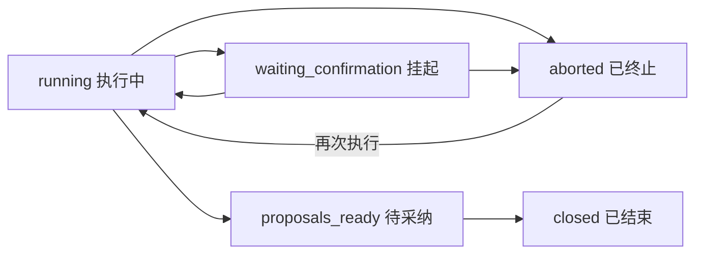
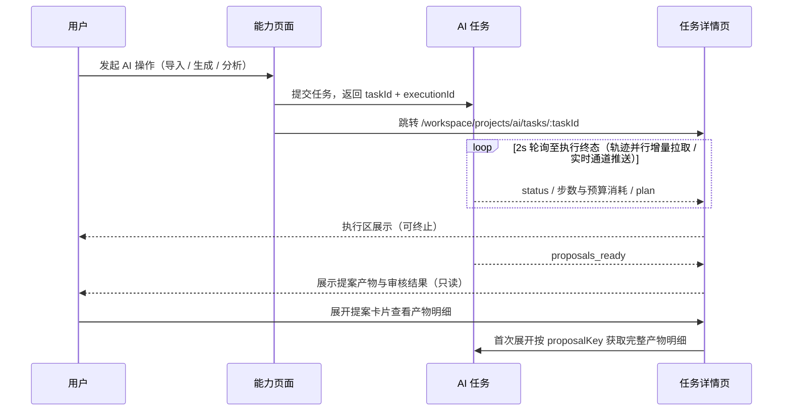

# 软件测试平台——AI 任务中心与任务详情

**文档版本**：V1.0  
**日期**：2026-11-25  
**状态**：起草中

---

## 1. 概述

AI 任务中心是项目内全部 AI 任务的统一入口，任务统一经 `POST /api/ai/tasks` 提交、`GET /api/ai/tasks/{id}` 查询，执行过程经轨迹接口（`GET /api/ai/tasks/{id}/executions/{executionId}/events`）与实时通道呈现；任务详情展示执行过程、计划步骤、轨迹，并提供提案产物与审核结果的只读查看，不提供任何审核操作。提案的采纳、编辑后采纳与驳回统一在各业务面板完成：需求导入在需求管理页的导入结果审核区（见 `docs/05-interaction-design/03-function-testing/07-requirement-ui.md`），AI 评审在评审详情页 AI 评审面板（见 `docs/05-interaction-design/03-function-testing/05-workspace-ui-test-review.md`），用例优化与脑图生成用例在脑图面板（见 `docs/05-interaction-design/07-ai-capability/07-assisted-features-ui.md`）。执行编排归 AI、写库编排归应用层的双平面机制见 `docs/02-high-level-design/07-ai-capability/03-hld-ai-task.md`。

**路由**：任务中心 `/workspace/projects/ai/tasks`；任务详情 `/workspace/projects/ai/tasks/:taskId`（任务中心的子路由）

**入口**：不占顶部动态菜单，由顶部导航栏常驻的 AI 任务指示器承载——项目模式下常驻显示（不占动态菜单位、不按权限码过滤），角标展示进行中（`running`）任务数，点击进入本页，供用户感知并回看任务进度（导航布局见 `docs/05-interaction-design/02-global-navigation.md` §2）。

AI 未启用或未配置模型时，任务入口与本页内容按总册 4.5 隐藏或降级提示。

## 2. 页面设计

### 2.1 任务中心页

#### 2.1.1 布局

> 视觉与结构对齐验收基准 `prototype/project/plans.html`（页头 + 单卡片：toolbar / 表格 / 分页一体）。本页无「新建」业务，页头仅保留标题与描述，不设主操作按钮。

```
┌──────────────────────────────────────────────────────────────────┐
│ AI 任务中心                                                       │
│ 项目内 AI 任务的统一入口，跟踪执行过程与采纳结果                     │
├──────────────────────────────────────────────────────────────────┤
│ [任务类型 ▾] [任务状态 ▾] [查询] [重置]              共 28 条      │
├──────────────────────────────────────────────────────────────────┤
│ 任务名       │ 类型 │ 状态 │ 执行摘要 │ 发起人 │ 发起时间 │ 操作         │
│ 导入PRD      │需求导入│执行中│ ▓▓▓░ 23步 │ 张三 │ 10-02 09:00│ 详情 终止   │
│ PRD 拆解      │需求导入│已终止│ 原因摘要  │ 张三 │ 10-01 14:20│ 详情 再次执行│
├──────────────────────────────────────────────────────────────────┤
│ 共 28 条 · 每页 20 条                    每页 [20▾]   < 1  2 >    │
└──────────────────────────────────────────────────────────────────┘
```

#### 2.1.2 交互说明

| 区块 | 交互 |
| ---- | ---- |
| 筛选 | 任务类型、任务状态两项下拉 + 查询/重置，位于卡片工具栏内；状态取值 `running / proposals_ready / closed / aborted`；列表展示当前项目内全部任务并标注发起人（无项目上下文时展示全部任务） |
| 计数与布局 | 工具栏右侧「共 N 条」，分页左侧「共 N 条 · 每页 20 条」；页头、工具栏、表格与分页同处单卡片内，表体内部滚动，工具栏与分页条常驻 |
| 任务名 | 展示 `title`（提交创建时按「类型描述 - 来源标题」生成，执行不改写）；存量空值时按任务类型名兜底，超长省略并显示 tooltip |
| 状态徽标 | `running` 执行中（步数与预算消耗 + 最近动作）/ `running` 挂起（待人工批准副作用）/ `proposals_ready` 待采纳 / `closed` 已结束（中性灰）/ `aborted` 已终止（悬浮终止原因） |
| 行操作 | 「详情」跳转任务详情页；`running` 显示「终止」（二次确认）；`aborted` 显示「再次执行」。`proposals_ready` 不提供审核入口，提案处置由对应业务面板承担。任务详情可查看执行过程与采纳结果回看。`case_optimize` / `mindmap_case_generation` / `review_case_review` 三类任务仅 `aborted` 态提供「再次执行」（沿用原任务新建执行实例），`running` / `proposals_ready` / `closed` 不提供；后两类的重新发起由业务入口按原输入新建任务，不覆盖原记录 |
| 分页 | 20 / 50 / 100 每页；筛选与页码离开页面保活 |
| 列表区 | 列表高度固定为内容区剩余高度，表头与分页条固定、表体内部滚动，页面不产生纵向滚动条（见 `docs/00-spec/50-ui/03-scroll-container.md` UI-SC-05 / UI-SC-06） |

#### 2.1.3 状态分支

- 空态：无任务 → 「暂无 AI 任务」+ 各能力入口引导；
- 加载：表格骨架屏；刷新失败错误条 + 重试；
- AI 未启用：整页降级提示「AI 能力未启用 / 未配置模型」。

### 2.2 任务详情页（AiTaskDetailPage）

任务中心行「详情」与各能力页提交任务后的统一落点，展示执行过程、计划步骤、轨迹与采纳结果回看，不提供审核动作。

```
┌──────────────────────────────────────────────────────────────────┐
│ AI 任务中心 › 任务详情：导入 PRD 解析              [终止] [再次执行]  │
│ 类型 需求导入 · 发起人 张三 · 发起时间 10-02 09:00 [待采纳][已采纳]   │
│ 步数 23/40 · 时长 94s · tokens 4600/200000                         │
│ 终止原因：（已终止时展示，含错误码）                                │
├──────────────────────────────────────────────────────────────────┤
│ 计划步骤（AI 规划，随轨迹更新）                                     │
│  ● 解析需求   ● 生成模块结构   ◐ 生成脑图文档                      │
│  ○ 标记用例节点  ○ 填充用例属性                                    │
├──────────────────────────────────────────────────────────────────┤
│ 轨迹：展开查看决策、工具调用与结果摘要（游标增量 / 实时推送）        │
│ 提案与结果（只读）：沿用审核面板信息布局，展示提案产物、确认状态、    │
│                   驳回原因与采纳结果；上一个/下一个切换，无审核按钮   │
└──────────────────────────────────────────────────────────────────┘
```

| 区块 | 交互 |
| ---- | ---- |
| 面包屑 | 内容区顶部「AI 任务中心 › 任务详情」：点「AI 任务中心」回列表（筛选与页码保活），「任务详情」为当前页项不可点，遵循《面包屑导航规范》（`docs/00-spec/50-ui/05-breadcrumb.md`，UI-BC-01）；从能力页跳转而来时经浏览器返回恢复来源页上下文 |
| 任务标题 | 面包屑与页头展示 `title`（创建时生成，存量空则按类型名兜底），超长省略 + tooltip |
| 任务级结果 | `closed` 态在状态徽标旁展示聚合标识：全部采纳「已采纳」、全部驳回「已驳回」、混合「部分采纳」，由 `proposals[].confirmStatus` 派生（`pending / not_applicable` 不参与统计） |
| 执行区 | 步数与预算消耗、当前步骤、终止原因与错误码；按 `GET /api/ai/tasks/{id}` 2 秒轮询，仅 `running`（进行中）继续，状态非进行中即停止 |
| 计划步骤 | 展示 AI 在执行开始产出的计划步骤快照（`plan`，可见思考产物）：当前步骤高亮、完成步骤打勾、终止原因标红；步骤由 AI 自主规划，不承诺固定序列 |
| 轨迹区 | 「展开轨迹」按游标增量拉取（`events?afterSeq=`），实时通道推送时即时合并；轨迹只增不改，可回看与复制 |
| 决策详情展开 | 点击「AI 决策」事件行展开详情区，分「请求摘要 / 模型响应」两段，复用折叠 JSON 展示与复制；数据来自 `detail.rawRequest` / `detail.rawResponse`，不另发请求；字段缺失或为空展示「暂无原始数据」空态 |
| 模型响应 content | 先尝试解析为 JSON（含剥离 Markdown 代码围栏后重试）：成功按结构化节点折叠展示，失败保留原文字符串；只处理顶层 `content`，存储仍为原文、不截断；复制按钮复制展示内容，所见即所得 |
| 操作 | `running` 可终止（二次确认）；`aborted` 可再次执行（产生新执行实例与新提案）；`proposals_ready` / `closed` 均可查看提案产物与审核结果，但不渲染采纳 / 驳回 / 编辑后采纳等审核动作，提案处置入口在对应业务面板。`case_optimize` / `mindmap_case_generation` / `review_case_review` 三类任务仅 `aborted` 态显示「再次执行」，`running` / `proposals_ready` / `closed` 不显示 |
| 提案与结果 | 有提案时渲染只读审核面板（见 2.3），展示提案产物、确认状态、驳回原因与采纳结果；支持上一个/下一个切换，不提供审核操作；`aborted` 且无提案时不渲染 |

### 2.3 提案与审核结果只读查看（AiProposalReviewPanel 只读模式，页内渲染）

任务详情页下半区复用 `AiProposalReviewPanel` 的信息展示结构：同一套提案头、导航、明细字段、对比、来源引用与警示渲染；任务详情仅关闭审核操作（采纳、修改后采纳、驳回、回执、编辑弹窗）。待处置任务的实际审核在对应业务面板完成。

```
┌──────────────────────────────────────────────────────────────────┐
│ 需求导入 / 用例优化 / ...                       已处理 N / 共 M     │
│ [上一个] 第 2 / 3 条 [下一个]                                      │
│ 需求建议  登录验证码                                   [待采纳]     │
│ 模块/来源/描述/字段/对比/排序/来源引用/警示（按需加载）              │
│ （只读查看，无审核操作按钮）                                       │
└──────────────────────────────────────────────────────────────────┘
```

| 区块 | 交互 |
| ---- | ---- |
| 面板头 | 复用 `AiProposalReviewPanel` 头部信息：任务类型标题、已处理/共计；只读模式不显示操作入口 |
| 导航 | 多条提案时显示“上一个 / 下一个”与当前位置；切换时按 `proposalKey` 按需加载当前提案完整内容，已加载内容缓存复用 |
| 产物明细 | 复用同一面板的明细区域：`kind`、标题、确认状态、驳回原因、描述、结构化字段、来源引用、既有 vs 建议对照、排序项与警示标记；描述按 Markdown 只读渲染，与需求导入审核区共用同一展示组件 |
| 只读边界 | 不渲染采纳、编辑后采纳、驳回、批量选择、确认回执、编辑弹窗等动作；`proposals_ready` 状态仅表示业务面板仍可处置，详情页同步展示待采纳状态与产物 |
| 状态分支 | 明细加载中局部 loading；加载失败提示并提供重试，不阻塞其他提案；内容为空展示「暂无明细」 |

### 2.4 状态分支

- 详情页加载：骨架屏；任务不存在或不属于当前项目 → 404 提示 + 返回任务中心；
- 任务终止：详情页展示终止原因与错误码（用户中止 / 预算耗尽 / 执行错误），再次执行产生新执行实例与新提案；`case_optimize` / `mindmap_case_generation` / `review_case_review` 三类任务仅 `aborted` 态提供再次执行，`proposals_ready` / `closed` 的原任务保留只读查看，重新发起在业务入口按原输入新建任务；
- 任务待采纳：展示提案产物与审核结果（待采纳状态），可展开查看明细；详情页不提供审核动作，实际处置在对应业务面板完成；
- 任务已结束：展示任务级结果标识与只读提案回看卡片区，逐条标记已采纳 / 已驳回并展示驳回原因与产物明细；
- 无提案：不渲染提案回看区；`proposals_ready` 空提案显示空态说明，`closed` / `aborted` 按无提案处理；
- 明细加载失败：卡片内提示并提供重试，已加载明细保留缓存。

## 3. 核心交互流程

### 3.1 任务生命周期



> 状态非 `running`（进行中）即停止详情轮询；心跳超时或预算耗尽的执行由服务端清扫置 `aborted`（1000018117 / 1000018127），前端以最新查询结果为准。

### 3.2 执行过程与提案回看时序



## 4. 视觉与状态要求

- 计划步骤与执行区高亮：`--color-primary-500` 体系；完成步骤 `--color-success`、终止标红 `--color-danger`、挂起 `--color-info`、已结束中性灰 `--color-neutral-400`；
- 状态徽标与终止原因悬浮层遵循《视觉设计》4.1 状态色与中性色体系；
- 提案明细警示标记用 `--color-warning`（疑似重复）与 `--color-danger`（来源已变更）图标 + 文字，不单靠颜色表意。

## 5. 状态管理

- Pinia store `aiTask`：任务详情 2 秒轮询（`GET /api/ai/tasks/{id}`），仅 `running`（进行中）继续，状态非进行中即停止，随详情页路由进入/离开启停；轨迹事件增量拉取（`events?afterSeq=`，实时通道推送时即时合并）；任务中心列表与筛选条件；顶栏指示器进行中任务数（`GET /api/ai/tasks/running-count`，15 秒轮询，仅项目模式时装载、不按权限码过滤，任务提交/终止/再次执行后即时刷新）；
- 跨页面任务进度联动：能力页通过 `aiTask` 订阅自己提交的 `taskId`，跳转详情页后由详情页接管轮询，返回来源页时回调刷新来源列表；
- 提案与审核结果回看卡片的展开态与已加载产物明细存组件本地，离开详情页释放；提案确认状态与 `note`（驳回原因）随详情一并缓存供只读查看；已加载项重复展开不重复请求。

## 修改记录

| 版本 | 日期 | 说明 |
| ---- | ---- | ---- |
| V1.0 | 2026-10-03 | 初始版本 |
| V1.0 | 2026-10-03 | 任务详情抽屉与产物审核面板合并为任务详情页（`/workspace/projects/ai/tasks/:taskId`），能力页提交后统一跳转该页，回退入口按 UI-BC-01 用面包屑 |
| V1.0 | 2026-10-15 | 入口改为「就近按钮 + 顶栏指示器」双层模型：能力页按钮按 `ai:task` 显隐，顶栏新增进行中任务数指示器（15s 轮询 `running-count`）；状态管理补指示器计数 |
| V1.0 | 2026-10-16 | 同步 AI Task 双平面口径（`docs/02-high-level-design/07-ai-capability/03-hld-ai-task.md`）：状态机改 `running（含挂起）→ proposals_ready → closed / aborted`，取消 / 重试改「终止 / 再次执行」；进度条与阶段时间线改为预算消耗 + AI 计划步骤 + 轨迹回看；`AiArtifactReviewPanel` 更名 `AiProposalReviewPanel`，确认端点改 `proposals/confirm`；状态管理补轨迹增量拉取 |
| V1.0 | 2026-10-17 | 追溯需求整体取消：能力页按钮示例仅保留「需求列表」「缺陷 AI 分析」两页 |
| V1.0 | 2026-10-20 | 移除能力页「任务中心」按钮，任务中心入口收敛为顶栏指示器单层入口（1 概述） |
| V1.0 | 2026-11-18 | AI 任务中心免 RBAC 权限码校验：顶栏指示器不再按 `ai:task` 显隐，移除任务中心与审核区的「权限不足」分支，仅保留项目成员归属与 AI 任务归属可见性 |
| V1.0 | 2026-11-18 | 任务标题与采纳结果展示、列表范围收窄：列表与详情展示 `title`（空则类型名兜底）且仅当前用户任务；`closed` 态新增任务级结果标识与逐条已采纳 / 已驳回只读回看区（含驳回原因），`aborted` 不渲染审核区 |
| V1.0 | 2026-11-18 | 任务列表范围由「仅当前用户」改为按项目上下文展示全部任务并标注发起人，页面文案同步为项目内任务统一入口 |
| V1.0 | 2026-11-19 | 2.2 / 2.3 / 2.4 / 5 `closed` 态只读回看改为可展开收起的提案卡片，首次展开按需加载产物明细，补充加载中 / 失败 / 空明细状态分支 |
| V1.0 | 2026-11-19 | 2.3 通用提案审核区（`AiProposalReviewPanel`）改为明细卡片直出待处理前 3 条，移除左侧列表 / 勾选 / 全选 / 批量操作与「已选」计数；既有 vs 建议改三列分区高亮对比，同步 2.4 / 5 状态管理描述 |
| V1.0 | 2026-11-19 | 2.3 / 2.4 审核区由前 3 条改为只展示当前 1 条待处理提案，采纳 / 驳回后自动切换下一条并按需加载内容 |
| V1.0 | 2026-11-19 | 2.3 审核区扁平化为单卡：取消嵌套产物子卡，对比区改卡内轻量三列，消除「外层卡 + 内层卡 + 表格」三层嵌套 |
| V1.0 | 2026-11-19 | 任务明细定时获取停止条件调整：仅 `running`（进行中）继续轮询，状态非进行中（含 `proposals_ready`）即停止定时器，同步 2.2 / 3.1 / 5 |
| V1.0 | 2026-11-21 | 移除 AI+需求 生成链能力域：1 概述域扩展示例、2.1 任务列表示例与 2.3 回看明细内容同步删除对应条目 |
| V1.0 | 2026-11-21 | 移除存量批量分类能力：1 概述域扩展示例改引缺陷重复扫描 |
| V1.0 | 2026-11-21 | 移除存量重复扫描任务：1 概述域扩展示例改引缺陷分诊 |
| V1.0 | 2026-11-23 | 任务标题改创建时生成：2.1 / 3 展示口径改为「类型描述 - 来源标题」，执行不改写；存量空值仍按类型名兜底 |
| V1.0 | 2026-11-23 | AI 评审任务详情页改只读展示、不提供审核动作（保留执行与提案回看）；通用审核区新增「上一个 / 下一个」按全部提案导航（含已处置项、已处置只读），切换按 `proposalKey` 按需获取产物信息，全部处置完成保留卡片供导航回看 |
| V1.0 | 2026-11-23 | 2.1 / 2.2 / 2.4 明确轻量能力任务仅 `aborted` 态提供「再次执行」，其余状态由业务入口按原输入新建任务且不覆盖原记录 |
| V1.0 | 2026-11-23 | 任务中心与任务详情移除审核功能：列表删除「审核」操作，任务详情保留提案产物与审核结果只读查看、不提供审核动作；提案处置统一在业务面板完成 |
| V1.0 | 2026-11-23 | 2.2 补决策详情展开交互与模型响应 `content` 展示口径：先按 JSON 解析（含代码围栏剥离）、失败保留原文，复制跟随展示内容 |
| V1.0 | 2026-11-25 | 2.1 任务中心移除页头「刷新」按钮与「最近刷新」时间戳；列表区改为占满内容区剩余高度、表体内部滚动，页面不再出现纵向滚动条 |
| V1.0 | 2026-11-25 | 2.2 执行区时长改为只展示实际耗时，不再显示时长预算上限（预算护栏移除时长维度） |
| V1.0 | 2026-11-25 | 2.3 提案描述按 Markdown 只读渲染，与需求导入审核区共用同一展示组件 |
