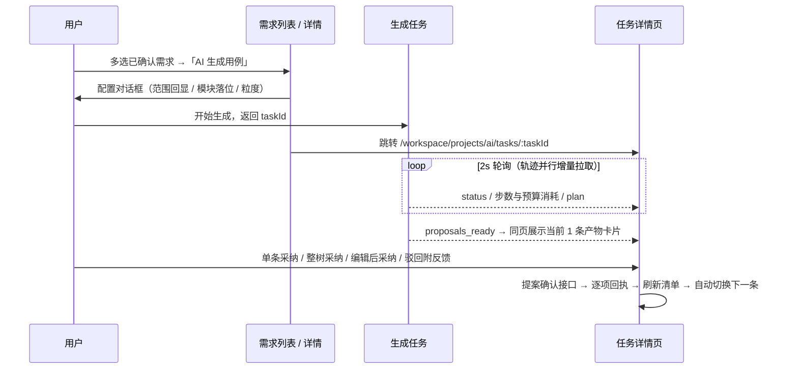

# 软件测试平台——AI+需求 生成链交互

**文档版本**：V1.0  
**日期**：2026-10-03  
**状态**：起草中

---

## 1. 概述

生成链从需求列表/详情发起，将**已确认的需求**生成模块、脑图用例文档与测试用例；产出为提案，经人工审核采纳后落库。任务执行与提案审核统一在任务详情页呈现，确认协议与通用审核区复用 `docs/05-interaction-design/07-ai-capability/03-ai-task-ui.md`，本分册只定义生成链特有交互。视觉遵循《视觉设计》（`docs/05-interaction-design/03-visual-design.md`）。

**入口**：需求列表多选 / 详情页「AI 生成用例」按钮；AI 未启用或未配置模型时入口隐藏（总册 4.5）。按钮取短名，完整语义由悬浮 tooltip 承载（"基于需求生成模块、脑图用例文档与测试用例"），置灰时提示"仅已确认需求可生成"。

## 2. 页面设计

### 2.1 发起配置对话框（GenerationConfigDialog）

```
┌──────────────────────────────────────────────────────────────────┐
│ AI 生成用例                                                        │
├──────────────────────────────────────────────────────────────────┤
│ 生成范围（已选 3 条需求）                                          │
│   ☑ REQ-001 登录验证码                                            │
│   ☑ REQ-002 订单超时                                              │
│   ☐ REQ-003 草稿需求   （置灰：草稿状态不可生成）                   │
│ 目标模块落位：[自动识别 ▾ / 指定模块 ▾]                             │
│ 用例粒度偏好：[标准 ▾]                                             │
├──────────────────────────────────────────────────────────────────┤
│                              [取消]  [开始生成]                    │
└──────────────────────────────────────────────────────────────────┘
```

| 区块 | 交互 |
| ---- | ---- |
| 生成范围 | 回显已选需求；不可选需求置灰并提示原因（草稿 / 已变更 / 已归档）；空选时「开始生成」禁用 |
| 目标模块 | 默认自动识别（AI 归入模块树），可切换指定已有模块 |
| 粒度偏好 | 影响生成用例的详细程度，沿用既有口径选项 |
| 说明 | 对话框正文首行说明提案与去向：基于所选需求生成模块、脑图用例文档与测试用例，提交后进入任务详情审核采纳 |
| 提交 | 成功返回 `taskId` 并跳转任务详情页（`/workspace/projects/ai/tasks/:taskId`，执行与审核一体）；同项目已有进行中同输入生成任务（1000018209）时提示先处理并提供任务中心入口 |

### 2.2 执行过程（统一呈现于任务详情页）

- 提交成功即跳转任务详情页，执行区展示 AI 计划步骤时间线（典型序列：解析需求 → 生成模块结构 → 生成脑图文档 → 标记用例节点 → 填充用例属性，步骤由 AI 自主规划，文案以任务 `plan` 快照为准）；当前步骤高亮、终止标红；
- 执行区含步数与预算消耗、终止原因摘要、提案计数徽标（模块 / 文档 / 用例）；完整过程可展开轨迹回看；
- 操作：执行中「终止」、已终止「再次执行」；`proposals_ready` 后同页下半区直接展示卡片式产物审核区，无二次跳转。

### 2.3 产物审核区（卡片直出）

任务详情页审核区复用通用提案审核面板，生成链在**单张审核卡内**直出当前待处理产物：卡内直接呈现类型 / 层级、标题、用例属性、来源引用与警示，不再嵌套产物子卡；审核区只展示当前 1 条待处理产物，单条采纳或驳回成功后刷新清单并自动切换为下一条待处理产物，其内容按需加载。顶部保留「已处理 x / 共 x」总进度。

| 扩展点 | 交互 |
| ---- | ---- |
| 产物内容 | 审核区单卡内呈现当前一条待处理提案，模块 → 文档 → 用例节点的层级与类型以标签表达；不嵌套产物子卡，不设左侧树列表与右侧预览分栏 |
| 展示范围 | 只展示当前 1 条待处理产物；处理后自动切换下一条，全部处理完成展示空态与返回任务中心入口 |
| 对比视图 | 「编辑后采纳」并排展示 AI 建议 vs 既有数据 diff |
| 来源引用 | 用例节点 `sourceRefs` 点击回跳需求原文定位 |
| 警示标记 | 「来源需求已变更」卡片内提示；`suspectedDuplicateOf` 疑似重复警示（`--color-warning` 图标 + 文字） |
| 单条动作 | 卡片内提供采纳、整树采纳、修改后采纳、驳回附反馈（触发再次执行）；不提供勾选、全选、批量采纳与批量驳回 |
| 回执 | 逐项成败回执；全驳回明确未创建数据 |

### 2.4 状态分支

- 任务执行中（步骤与预算消耗）/ 待采纳 / 已终止（原因 + 再次执行）/ 已结束（灰态）；
- 提案审核：全部驳回、部分采纳回执（逐项成败）；
- 发起时所选需求状态已变化（不再满足条件）→ 提交报错并刷新范围回显；
- AI 未启用 / 未配置模型 → 发起入口隐藏（总册 4.5）。

## 3. 核心交互流程



## 4. 视觉与状态要求

- 计划步骤时间线：完成 `--color-success`、当前 `--color-primary-500`、终止 `--color-danger`、未开始 `--color-neutral-300`；
- 置灰不可选项：`--color-neutral-300` 边框 + `--color-neutral-400` 文本，悬浮显示原因；
- 疑似重复与来源变更警示：`--color-warning` / `--color-danger` 图标 + 文字（不单靠颜色表意）；
- 属性徽标（优先级等）沿用《视觉设计》用例优先级色（`--color-priority-p0` ~ `--color-priority-p3`）。

## 5. 状态管理

- 复用 `aiTask` store：执行轮询（`aborted / closed` 停止）、再次执行后沿用同一任务引用，详情页跳转与返回不中断来源页上下文；
- 配置对话框状态（范围、落位、粒度）存组件本地，提交成功即释放；
- 审核区卡片列表与编辑态存组件本地；产物状态以服务端确认结果为准，处理后按最新清单刷新展示范围。

## 修改记录

| 版本 | 日期 | 说明 |
| ---- | ---- | ---- |
| V1.0 | 2026-10-03 | 初始版本 |
| V1.0 | 2026-10-03 | 任务进度与产物审核统一跳转任务详情页，删除抽屉与「进入审核」二次跳转 |
| V1.0 | 2026-10-06 | 重复任务错误码勘误为 1000018209；补圈选建议发起入口（需求列表「AI 圈选建议」，2.4） |
| V1.0 | 2026-10-15 | 发起入口按钮与配置对话框更名「AI 生成用例」，长语义由 tooltip 与对话框首行说明承载 |
| V1.0 | 2026-10-16 | 同步 AI Task 双平面口径（`docs/02-high-level-design/07-ai-capability/03-hld-ai-task.md`）：2.2 六阶段时间线改 AI 计划步骤 + 轨迹回看，操作改终止 / 再次执行，状态机改 `proposals_ready / aborted / closed`；2.3 更名提案审核区（复用 `AiProposalReviewPanel`） |
| V1.0 | 2026-10-16 | 对齐 AI Task 状态机：状态管理改「执行轮询（`aborted / closed` 停止）、再次执行后沿用同一任务引用」，对话框说明改「提案与去向」 |
| V1.0 | 2026-11-12 | 整体移除评审与计划圈选建议（US-AI-008，原 2.4，后续小节顺延） |
| V1.0 | 2026-11-18 | 生成链免 RBAC 权限码校验：移除「权限不足隐藏 AI 生成用例入口 / 任务只读」分支，入口对项目成员常驻可用 |
| V1.0 | 2026-11-19 | 2.3 产物审核区改为卡片直出待处理前 3 条并移除勾选与批量操作，同步执行/流程/状态管理描述 |
| V1.0 | 2026-11-19 | 2.3 / 3 审核区改为只展示当前 1 条待处理产物，采纳 / 驳回后自动切换下一条 |
| V1.0 | 2026-11-19 | 2.3 审核区扁平化为单卡，取消嵌套产物子卡与对比表格外框，消除三层嵌套 |
