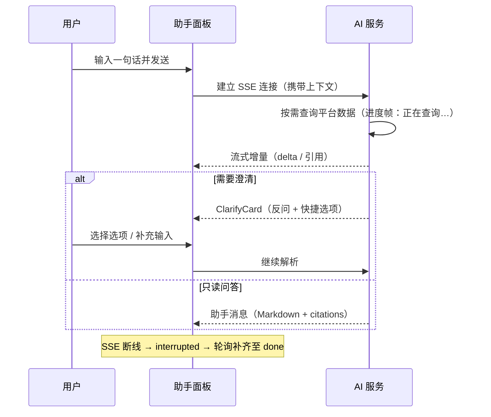

# 软件测试平台——智能助手

**文档版本**：V1.0  
**日期**：2026-10-03  
**状态**：起草中

---

## 1. 概述

智能助手为**项目级**能力，核心链路：**一句话 → 对话式任务执行（查询补全与澄清追问）→ 流式回答（附来源引用）**（总册 1.5 口径，`docs/01-requirements/07-ai-capability/02-srs-ai-capability.md`）。助手为只读能力，不创建、修改或删除业务数据；查询遵守项目成员归属与数据范围约束，会话与消息**仅创建人可见**。入口挂载应用壳层，不随路由销毁。视觉遵循《视觉设计》（`docs/05-interaction-design/03-visual-design.md`）。

**入口**：项目内右下角悬浮球（`AppLayout` 层）；AI 总开关关闭或未配置模型时入口隐藏（总册 4.5）；未进入项目上下文（「我的空间」列表页、项目列表页及空间相关页面）时入口隐藏。

## 2. 页面设计

### 2.1 全局入口与面板布局

```
┌──────────────────────────────────────────────────────────────────┐
│ [业务页面]（正常滚动与交互，无遮罩、不冻结）                        │
│                                       ┌─────────────────────────┐│
│                                       │ 助手  [会话▾] [✎][🗑][＋] ││
│                                       │ 历史会话（倒序，检索）     ││
│                                       ├─────────────────────────┤│
│                                       │ 👤 用户：登录模块有哪些用例？││
│                                       │ 🤖 助手：共 12 条用例…     ││
│                                       │   [来源引用链接]           ││
│                                       │   [澄清卡：选项1 / 选项2]  ││
│                                       ├─────────────────────────┤│
│                                       │ [📎][🖼] [输入一句话…] [发送] ││
│                                       └─────────────────────────┘│
│                                                 [🤖] 悬浮球（默认）│
└──────────────────────────────────────────────────────────────────┘
```

| 区块 | 交互 |
| ---- | ---- |
| 悬浮球 | 右下角常驻；未启用 AI 或未进入项目上下文（空间相关页面）时不渲染；点击展开浮层卡片，再点悬浮球或卡片 `[—]` / `[✕]` 收起（会话保留）；每次进入默认收起，不记忆开合状态 |
| 浮层卡片 | 宽 800px、高 700px，右下默认定位、可拖动调整；半透明投影；**无遮罩、不锁定底层滚动**，点击卡片外部不关闭；小屏（< 768px）近全宽贴底 |
| PanelHeader | 会话标题（可重命名）、归档、删除、新会话；归档会话转只读 |
| SessionList | 仅展示本人在当前活跃工作空间及当前项目创建的会话（会话归属创建时空间与项目），时间倒序 + 关键词检索；点击切换，切换时保留未发送草稿 |
| MessageTimeline | 消息类型见 2.2；新消息自动滚动到底部，用户上滑查看历史时暂停自动跟随并显示「回到最新」 |
| ComposerInput | 输入框 + 上下文附件选择 + 图片选择 + 发送（Enter 发送 / Shift+Enter 换行）；图片选择即时上传并展示缩略 chip（可删除），发送前预校验张数（≤3）/ 类型 / 大小（≤10MB），超限即时提示不发请求；流式生成中禁用发送 |
| StreamIndicator | 流式打字动画；断线后显示「恢复中…」 |

### 2.2 消息类型

| 类型 | 呈现与交互 |
| ---- | ---- |
| 用户消息 | 正文 + 附件引用 + 图片缩略图（经换签加载，失败显示「图片加载失败」占位） |
| 助手消息 | Markdown 渲染 + `citations` 来源引用链接（点击展开来源摘要 / 跳转定位） |
| 澄清反问卡（ClarifyCard） | 反问文案 + 快捷选项；点击选项回填输入框并发送，也可自行输入；助手执行过程中的追问同样以本卡呈现 |
| 查询进行态 | 多步查询执行中于气泡内展示轻量步骤文案（如「正在查询计划…」），随最终内容替换；无进度事件时不渲染 |

### 2.3 只读问答与澄清

1. 助手基于查询类能力的结果流式生成回答，附来源引用；引用可点击展开摘要或跳转定位；
2. 信息不足或存在多种理解时生成 ClarifyCard 反问，用户选择快捷选项或自行输入后继续对话；
3. 只读问答不产生任何落库数据，助手全程不触发业务写入；
4. 查询按**当前活跃工作空间与项目**（即会话归属作用域）限权过滤，跨项目指代被拒绝并提示切换作用域。

### 2.4 状态分支

- **空会话引导**：展示示例指令（查数据、看进度、问覆盖等），点击填入输入框；
- **流式进行中**：打字动画 + 输入禁用，多步查询时追加步骤文案（如「正在查询计划…」）；
- **澄清反问**：等待用户选择或输入；
- **轮次超限**：固定文案提示本轮无法完成，输入框保持可用，可继续对话；
- **查询失败**：错误信息由助手改述或追问，不中断会话；
- **只读问答无引用**：RAG 未就绪时提示（1000018258），仅给出通用回答；
- **会话归档**：只读可回看，不可续写；
- **图片发送**：选择即上传，上传失败可重试；张数 / 类型 / 大小超限即时提示；附图消息在无可用视觉模型时发送失败并提示（1000018124），输入与图片保留、可修改后重发；
- **切换活跃工作空间 / 项目**：会话列表按新作用域重新加载；当前打开的会话不属新作用域时自动收起当前会话、回到新建会话态；在归属空间 / 项目之外发送会话消息被服务端拒绝（1000018263）并提示切换作用域；
- **断线**：SSE 中断 → 消息标记「恢复中」→ 自动轮询补齐至 `done`，无需用户干预；
- **小屏适配**：视口 < 768px 时浮层卡片近全宽、贴底展示，遮挡区域最小化。

## 3. 核心交互流程

### 3.1 一次问答



## 4. 视觉与状态要求

- 流式光标与进行态用 `--color-primary-500`；
- 引用链接用主色文字 + 下划线悬浮态（`--color-primary-500`）；
- 会话归档等收敛态用中性色阶（`--color-neutral-400` 文本）；
- 浮层卡片白底 + 圆角 + 投影沿用《视觉设计》既有浮层规范，不硬编码色值；悬浮球常态用中性色、激活展开态用 `--color-primary-500`；
- 悬浮球仅显示统一 AI 图标、不渲染文字，功能名由 `title` / `aria-label` 承担。

## 5. 状态管理

- Pinia store `aiAssistant`：面板开合、会话列表、当前会话消息、流式缓冲状态；
- SSE 客户端：`fetch` + `ReadableStream` 解析事件；断连标记 `interrupted` → 按通用口径轮询消息至 `done` 自动补齐；
- 悬浮球与浮层卡片挂 `AppLayout` 层，路由切换不重置会话；草稿输入按会话暂存；开合状态不持久化，每次进入默认收起；卡片拖动位置不持久化，回到默认右下定位。

## 修改记录

| 版本 | 日期 | 说明 |
| ---- | ---- | ---- |
| V1.0 | 2026-10-03 | 初始版本 |
| V1.0 | 2026-10-03 | 入口面板由右侧抽屉改为无遮罩浮层卡片（可拖动、默认收起，不记忆开合状态） |
| V1.0 | 2026-10-16 | 执行机制切换为对话式任务执行（工具调用）：1 链路改写，2.2 补查询进行态与澄清卡追问口径，2.3 规范化措辞，2.4 补多步查询与轮次超限分支，3.1 补按需查询步骤 |
| V1.0 | 2026-10-16 | 会话归属创建时工作空间：入口在未进入工作空间的页面隐藏（1 入口、2.1 悬浮球与 SessionList），2.4 补切换空间与归属不一致（1000018263）分支 |
| V1.0 | 2026-10-16 | 消息附图（vision 方案 WP-V.3）：2.1 输入区补图片选择与预校验、2.2 用户消息补图片缩略图、2.4 补图片发送与无视觉模型（1000018124）分支 |
| V1.0 | 2026-10-16 | 项目选择会话私有化：2.2 澄清卡补来源型选项前缀（当前 / 会话二选一），2.3 补"确认按预览目标项目执行、无须切换全局选择" |
| V1.0 | 2026-11-18 | 智能助手免 RBAC 权限码校验：移除入口「无权限不渲染」与「权限不足」分支，调用落库改由业务校验与项目成员归属校验约束，保留会话「仅创建人可见」 |
| V1.0 | 2026-11-18 | 助手改为项目级能力：1 入口 / 2.1 悬浮球与 SessionList 仅项目上下文可见、去项目二选一前缀、2.3 确认按当前项目执行、2.4 补切换项目与归属不一致分支 |
| V1.0 | 2026-11-22 | 智能助手移除变更类能力：1 核心链路改为流式回答（附来源引用）、2.1 面板示例与 2.2 消息类型去预览 / 回执卡、2.3 改为只读问答与澄清、2.4 去预览过期与执行失败分支、3.1 时序图去变更确认分支、4 视觉去字段级 diff、5 状态管理去预览态与倒计时 |
| V1.0 | 2026-11-26 | 悬浮球换用统一 AI 图标：4 视觉明确仅图标、不渲染文字，功能名由 `title` / `aria-label` 承担 |
