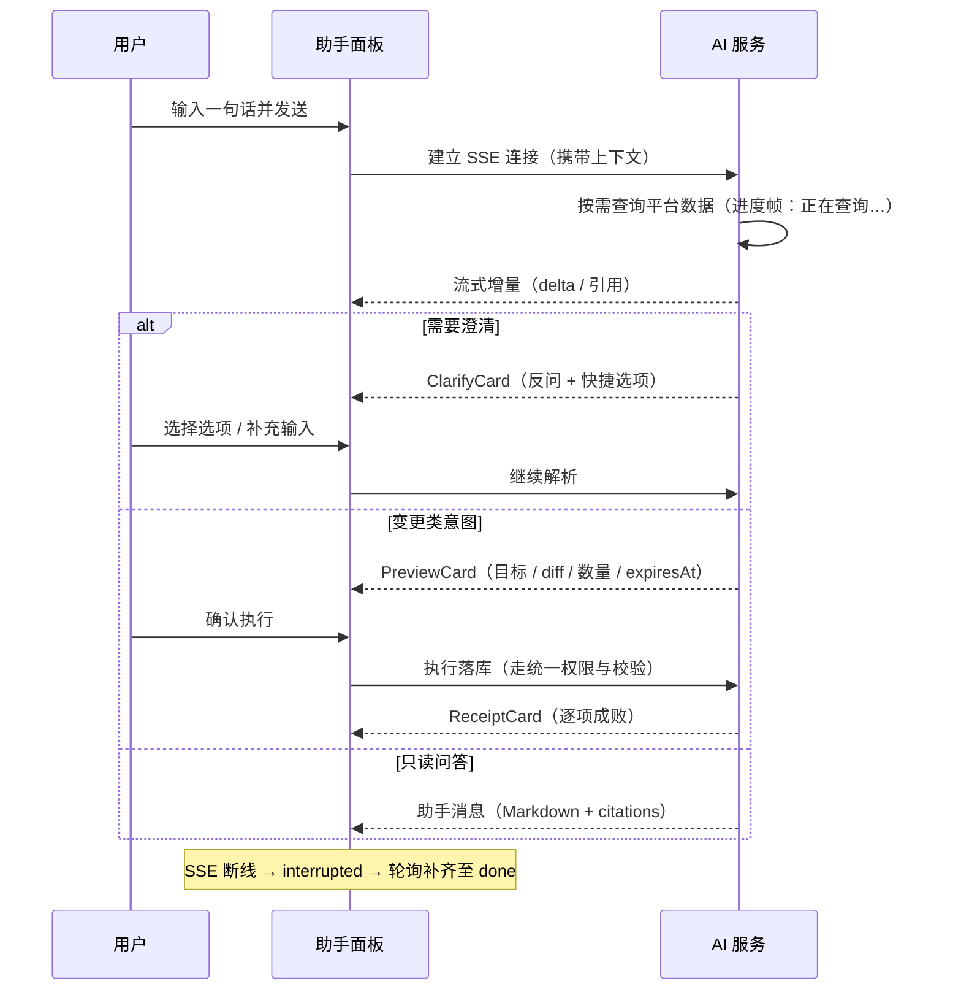

# 软件测试平台——智能助手

**文档版本**：V1.0  
**日期**：2026-10-03  
**状态**：起草中

---

## 1. 概述

智能助手为平台级全局能力，核心链路：**一句话 → 对话式任务执行（查询补全与澄清追问）→ 变更预览 → 人工确认 → 落库 → 回执**（总册 1.5 口径，`docs/01-requirements/07-ai-capability/02-srs-ai-capability.md`）。助手不绕过任何权限与业务校验；会话与消息**仅创建人可见**。入口挂载应用壳层，不随路由销毁。视觉遵循《视觉设计》（`docs/05-interaction-design/03-visual-design.md`）。

**入口**：全局常驻右下角悬浮球（`AppLayout` 层）；AI 总开关关闭或未配置模型时入口隐藏（总册 4.5）；未进入工作空间上下文（如「我的空间」列表页）时入口隐藏。

## 2. 页面设计

### 2.1 全局入口与面板布局

```
┌──────────────────────────────────────────────────────────────────┐
│ [业务页面]（正常滚动与交互，无遮罩、不冻结）                        │
│                                       ┌─────────────────────────┐│
│                                       │ 助手  [会话▾] [✎][🗑][＋] ││
│                                       │ 历史会话（倒序，检索）     ││
│                                       ├─────────────────────────┤│
│                                       │ 👤 用户：帮我建一个登录评审││
│                                       │ 🤖 助手：已解析意图…       ││
│                                       │   [变更预览卡]            ││
│                                       │   [确认执行][取消][修改]    ││
│                                       │   [回执卡：成功3 · 失败1]   ││
│                                       ├─────────────────────────┤│
│                                       │ [📎][🖼] [输入一句话…] [发送] ││
│                                       └─────────────────────────┘│
│                                                 [🤖] 悬浮球（默认）│
└──────────────────────────────────────────────────────────────────┘
```

| 区块 | 交互 |
| ---- | ---- |
| 悬浮球 | 右下角常驻；未启用 AI、无权限或未进入工作空间上下文时不渲染；点击展开浮层卡片，再点悬浮球或卡片 `[—]` / `[✕]` 收起（会话保留）；每次进入默认收起，不记忆开合状态 |
| 浮层卡片 | 宽 800px、高 700px，右下默认定位、可拖动调整；半透明投影；**无遮罩、不锁定底层滚动**，点击卡片外部不关闭；小屏（< 768px）近全宽贴底 |
| PanelHeader | 会话标题（可重命名）、归档、删除、新会话；归档会话转只读 |
| SessionList | 仅展示本人在当前活跃工作空间创建的会话（会话归属创建时空间），时间倒序 + 关键词检索；点击切换，切换时保留未发送草稿 |
| MessageTimeline | 消息类型见 2.2；新消息自动滚动到底部，用户上滑查看历史时暂停自动跟随并显示「回到最新」 |
| ComposerInput | 输入框 + 上下文附件选择 + 图片选择 + 发送（Enter 发送 / Shift+Enter 换行）；图片选择即时上传并展示缩略 chip（可删除），发送前预校验张数（≤3）/ 类型 / 大小（≤10MB），超限即时提示不发请求；流式生成中禁用发送 |
| StreamIndicator | 流式打字动画；断线后显示「恢复中…」 |

### 2.2 消息类型

| 类型 | 呈现与交互 |
| ---- | ---- |
| 用户消息 | 正文 + 附件引用 + 图片缩略图（经换签加载，失败显示「图片加载失败」占位） |
| 助手消息 | Markdown 渲染 + `citations` 来源引用链接（点击展开来源摘要 / 跳转定位） |
| 澄清反问卡（ClarifyCard） | 反问文案 + 快捷选项；点击选项回填输入框并发送，也可自行输入；助手执行过程中的追问同样以本卡呈现 |
| 查询进行态 | 多步查询执行中于气泡内展示轻量步骤文案（如「正在查询计划…」），随最终内容替换；无进度事件时不渲染 |
| 变更预览卡（PreviewCard） | 变更目标、字段级 diff、将创建的记录数量；动作：确认执行 / 取消 / 返回修改；顶部倒计时展示 `expiresAt` |
| 执行回执卡（ReceiptCard） | 逐项成败、对象跳转链接、单项重试；点击对象链接跳转并收起面板（会话保留可回看） |

### 2.3 变更预览与执行

1. 助手请求变更类操作经服务端规范化后，以 PreviewCard 展示预览，**预览阶段不产生任何落库数据**；
2. 「确认执行」→ 进入 `executing`，回执生成前 ComposerInput 禁用；
3. 「取消」→ 丢弃本次变更；「返回修改」→ 将解析摘要回填输入框供修改重发；
4. 预览超时（`expiresAt` 到期）→ 确认按钮置灰，提供「重新解析」；
5. 执行结果以 ReceiptCard 展示，失败项可单项重试；助手调用落库同样受权限与校验约束，失败原因如实回执。

### 2.4 状态分支

- **空会话引导**：展示示例指令（创建评审、生成计划、查数据等），点击填入输入框；
- **流式进行中**：打字动画 + 输入禁用，多步查询时追加步骤文案（如「正在查询计划…」）；
- **澄清反问**：等待用户选择或输入；
- **轮次超限**：固定文案提示本轮无法完成，输入框保持可用，可继续对话；
- **预览过期**：确认置灰 + 重新解析；
- **执行部分失败**：回执逐项标注 + 单项重试；
- **只读问答无引用**：RAG 未就绪时提示（1000018258），仅给出通用回答；
- **会话归档**：只读可回看，不可续写；
- **权限不足**：执行回执失败项展示具体原因，不产生任何数据；
- **图片发送**：选择即上传，上传失败可重试；张数 / 类型 / 大小超限即时提示；附图消息在无可用视觉模型时发送失败并提示（1000018124），输入与图片保留、可修改后重发；
- **切换活跃工作空间**：会话列表按新空间重新加载；当前打开的会话不属新空间时自动收起当前会话、回到新建会话态；在归属空间之外发送会话消息被服务端拒绝（1000018263）并提示切换作用域；
- **断线**：SSE 中断 → 消息标记「恢复中」→ 自动轮询补齐至 `done`，无需用户干预；
- **小屏适配**：视口 < 768px 时浮层卡片近全宽、贴底展示，遮挡区域最小化。

## 3. 核心交互流程

### 3.1 一次问答（含变更确认）



## 4. 视觉与状态要求

- 流式光标与进行态用 `--color-primary-500`；回执成功项 `--color-success`、失败项 `--color-danger-light` 底；
- 字段级 diff：新增/变更以 `--color-success-light` 与 `--color-danger-light` 背景区分并附 +/- 图标（不单靠颜色表意）；
- 引用链接用主色文字 + 下划线悬浮态（`--color-primary-500`）；
- 预览过期、会话归档等收敛态用中性色阶（`--color-neutral-400` 文本）；
- 浮层卡片白底 + 圆角 + 投影沿用《视觉设计》既有浮层规范，不硬编码色值；悬浮球常态用中性色、激活展开态用 `--color-primary-500`。

## 5. 状态管理

- Pinia store `aiAssistant`：面板开合、会话列表、当前会话消息、流式缓冲、`previewing / executing` 状态；
- SSE 客户端：`fetch` + `ReadableStream` 解析事件；断连标记 `interrupted` → 按通用口径轮询消息至 `done` 自动补齐；
- 悬浮球与浮层卡片挂 `AppLayout` 层，路由切换不重置会话；草稿输入按会话暂存；开合状态不持久化，每次进入默认收起；卡片拖动位置不持久化，回到默认右下定位；
- 预览倒计时由 `expiresAt` 驱动，到期仅置灰确认并提示重新解析。

## 修改记录

| 版本 | 日期 | 说明 |
| ---- | ---- | ---- |
| V1.0 | 2026-10-03 | 初始版本 |
| V1.0 | 2026-10-03 | 入口面板由右侧抽屉改为无遮罩浮层卡片（可拖动、默认收起，不记忆开合状态） |
| V1.0 | 2026-10-16 | 执行机制切换为对话式任务执行（工具调用）：1 链路改写，2.2 补查询进行态与澄清卡追问口径，2.3 规范化措辞，2.4 补多步查询与轮次超限分支，3.1 补按需查询步骤 |
| V1.0 | 2026-10-16 | 会话归属创建时工作空间：入口在未进入工作空间的页面隐藏（1 入口、2.1 悬浮球与 SessionList），2.4 补切换空间与归属不一致（1000018263）分支 |
| V1.0 | 2026-10-16 | 消息附图（vision 方案 WP-V.3）：2.1 输入区补图片选择与预校验、2.2 用户消息补图片缩略图、2.4 补图片发送与无视觉模型（1000018124）分支 |
