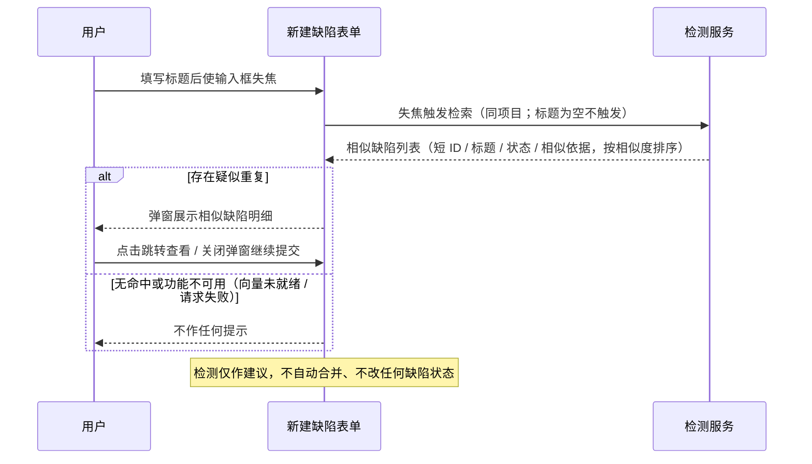
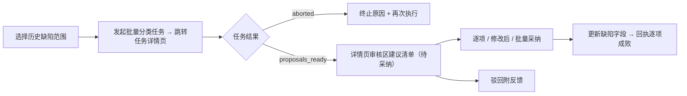

# 软件测试平台——AI 缺陷分析

**文档版本**：V1.0  
**日期**：2026-10-03  
**状态**：起草中

---

## 1. 概述

缺陷分析面向缺陷管理模块提供三类能力：趋势与质量度量、自动分类与分诊、重复缺陷检测（`docs/01-requirements/07-ai-capability/05-srs-ai-defect-analysis.md`）。承载形态为独立分析页 + 新建缺陷表单建议区 + 存量扫描入口。拥有缺陷查看权限的用户可见分析入口；统计与建议范围限于当前项目。视觉遵循《视觉设计》（`docs/05-interaction-design/03-visual-design.md`）。

**路由**：`/workspace/projects/bugs/analysis`（缺陷管理工具栏「AI 分析」进入）

## 2. 页面设计

### 2.1 缺陷分析页

#### 2.1.1 布局

```
┌──────────────────────────────────────────────────────────────────┐
│ AI 缺陷分析     范围[近30天▾] 分组[按周▾]      ⓘ口径脚注           │
├──────────────────────────────────────────────────────────────────┤
│ 趋势：新增 / 关闭 / 存量 折线图（数据点可点击下钻）                 │
├───────────────────────┬──────────────────────────────────────────┤
│ 度量卡片               │ AI 摘要                                   │
│ 修复时长 p50 / p90     │ [生成] / [重新生成] [引用来源]             │
│ 重开率 / 重复占比      │ 生成中… / 已终止[再次执行]              │
│ 等级分布环图           │                                          │
├───────────────────────┴──────────────────────────────────────────┤
│ 分诊队列（激活未指派）        [批量分类] [存量重复扫描]              │
│ 1. BUG-12 致命 · 已放置3天（同模块热点）      ← 可拖拽调整         │
└──────────────────────────────────────────────────────────────────┘
```

#### 2.1.2 交互说明

| 区块 | 交互 |
| ---- | ---- |
| 范围与分组 | 时间范围 + 分组维度（周/月等），口径以页脚注说明；切换后全页数据重取 |
| 趋势图 | 新增/关闭/存量折线；点击数据点 → 下钻缺陷列表（携带时间与分组参数） |
| 度量卡片 | 修复时长 p50/p90、重开率、重复占比、等级分布环图；悬浮显示取数口径 |
| AI 摘要 | 只读建议，不写入任何数据；「生成 / 重新生成」按当前范围计算，附引用来源链接；失败展示原因 + 再次执行 |
| 分诊队列 | 激活未指派缺陷的处理顺序建议（结合严重等级、存放时长、模块热点），悬浮显示建议理由；可拖拽调整，调整仅作用于跟进视图，AI 不自动改派缺陷 |
| 批量分类 | 对未分类或分类存疑的历史缺陷发起后台任务 → 跳转任务详情页，审核区以列表模式逐项/批量采纳后更新缺陷字段 |
| 存量重复扫描 | 发起后台扫描 → 疑似重复分组待采纳 → 人工采纳分组后按既有重复缺陷机制逐条处理 |

### 2.2 新建缺陷表单建议区

| 组件 | 交互 |
| ---- | ---- |
| 「AI 建议」入口按钮 | 挂在提交缺陷页标题输入框尾部（append，图标 + 「AI 建议」）：AI 未启用时不渲染挂载内容、输入组按无 append 形态收口；标题为空时禁用置灰，填入标题后启用并以呼吸光晕 + 魔棒微晃作闪烁提示；点击发起实时建议 **SSE 流式请求**（按钮转 loading 至连接关闭，期间无总超时，后端 15s 心跳保活），按标题 / 已填重现步骤 / 所属模块一次性返回全部建议（`done` 事件到达后渲染徽标）；请求失败或流中断轻提示原因且不阻塞录入，可再次点击重试 |
| SuggestBadge | 基于标题（及已填重现步骤、所属模块），为优化后标题、重现步骤、缺陷类型、严重等级、优先级、所属模块、关联用例、关键词给出建议值，行内标记展示（标题建议挂标题输入框下方、重现步骤建议挂编辑器下方、关联用例建议挂「选择用例」按钮旁，其余沿用侧栏表单项行内）；点击一键采纳；用户已填值与建议不一致时以用户值为准，不覆盖（标题与重现步骤经点击采纳后写入，属用户主动动作） |
| BugDuplicateDialog | 标题输入框失焦触发检索同项目相似存量缺陷（标题为空不触发）；功能不可用（AI 未启用 / 向量未就绪 / 请求失败）或无命中时不作任何提示；存在命中时弹窗按相似度排序展示明细（短 ID、标题、状态、相似依据），点击短 ID 跳转查看；检测结果仅作建议，不自动合并、不改状态 |

### 2.3 批量分类审核（任务详情页审核区 · 列表模式）

- 发起后跳转任务详情页，审核区以列表模式渲染缺陷建议清单：缺陷短 ID、当前分类 vs AI 建议分类、理由；
- 动作：单条采纳、修改后采纳、批量采纳、驳回附反馈；回执逐项成败；
- 任务执行过程、页面结构与确认协议见 `docs/05-interaction-design/07-ai-capability/03-ai-task-ui.md`。

### 2.4 状态分支

- **范围无数据**：图表补 0 展示或空态提示（随分组连续）；
- **摘要生成中 / 失败**：卡片内 loading / 失败原因 + 再次执行；
- **批量任务**：执行中、待采纳、已终止（再次执行）、部分采纳回执（通用任务口径）；
- **向量未就绪**：录入重复检测静默不弹窗，存量重复扫描入口置灰 + 「向量索引未就绪」提示；
- **实时建议失败**：轻提示失败原因，不自动重试，用户可再次点击「AI 建议」触发；不影响表单其余填写与提交；失败含三种形态——流建立前同步校验失败（输入非法 / 无可用模型 / 权限拒绝）、流内 `error` 事件（模型调用失败）、**连接中断**（网络断开或中间层断连，loading 结束并提示可重试）；
- **权限不足**：无缺陷查看权限不显示分析入口，直达路由 403；
- **AI 未启用**：入口隐藏（总册 4.5）。

## 3. 核心交互流程

### 3.1 录入时重复检测



### 3.2 批量分类采纳



## 4. 视觉与状态要求

- 趋势线与度量卡片数值用中性色为主，异常波动以 `--color-warning` / `--color-danger` 强调；
- 建议值标记（SuggestBadge）用 `--color-primary-*` 浅底徽标 + 图标，区别于用户已填值；
- 相似度排序：高相似项前置并以 `--color-warning` 图标标注（不单靠颜色表意）；
- 等级分布环图沿用缺陷等级色（`--color-bug-fatal / serious / general / minor`，见《视觉设计》4.3）。

## 5. 状态管理

- Pinia store `bugAnalysis`：范围与分组条件、趋势/度量数据、摘要任务状态、批量任务引用（轮询复用 `aiTask` store）；
- 新建表单建议与检测结果存组件本地，提交后释放；
- 批量分类/扫描完成后刷新分析页与缺陷列表数据；
- 范围切换取消上一请求（防竞态），以最新范围结果为准。

## 修改记录

| 版本 | 日期 | 说明 |
| ---- | ---- | ---- |
| V1.0 | 2026-10-03 | 初始版本 |
| V1.0 | 2026-10-03 | 批量分类发起后跳转任务详情页，审核在详情页审核区（列表模式）完成 |
| V1.0 | 2026-10-16 | 同步 AI Task 双平面口径（`docs/02-high-level-design/07-ai-capability/03-hld-ai-task.md`）：3.2 流程状态改 `proposals_ready / aborted`（失败重试改终止 + 再次执行），待确认改待采纳，2.x 状态分支与措辞同步 |
| V1.0 | 2026-10-19 | 2.2 补「AI 建议」入口按钮：标题输入框 append 挂载，AI 未启用不显示、标题空禁用、可操作态闪烁 |
| V1.0 | 2026-10-19 | 录入重复检测改标题失焦触发 + 弹窗展示（DuplicateCheckPanel → BugDuplicateDialog）：功能不可用或无命中不作提示，2.4 / 3.1 分支同步 |
| V1.0 | 2026-10-20 | 新建建议实时化：「AI 建议」点击改同步等待返回；SuggestBadge 范围改优化后标题 / 重现步骤 / 类型 / 等级 / 优先级 / 模块 / 关联用例 / 关键词，移除 AssigneeCandidateChips；2.4 补实时建议失败分支 |
| V1.0 | 2026-10-20 | 「AI 建议」改 SSE 流式：连接无总超时（后端 15s 心跳保活），`done` 事件渲染徽标；2.4 失败分支补流建立前同步失败 / 流内 error / 连接中断三形态 |
