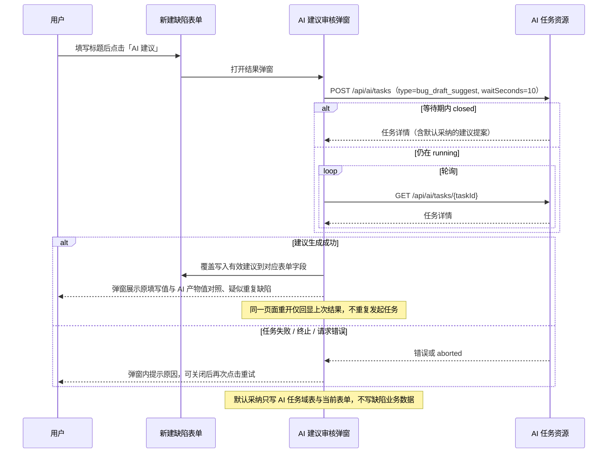

# 软件测试平台——AI 缺陷分析

**文档版本**：V1.0  
**日期**：2026-10-03  
**状态**：起草中

---

## 1. 概述

缺陷分析面向缺陷管理模块提供新建缺陷 AI 建议，其中一并给出重复缺陷检测（`docs/01-requirements/07-ai-capability/05-srs-ai-defect-analysis.md`）。承载形态为提交缺陷页内的 AI 建议结果弹窗：任务完成后默认采纳提案并将有效建议覆盖写入表单，弹窗展示原填写值与产物值对照。建议入口对项目成员常驻可见，不按权限码过滤；建议与检测范围限于当前项目。视觉遵循《视觉设计》（`docs/05-interaction-design/03-visual-design.md`）。

## 2. 页面设计

### 2.2 新建缺陷建议审核弹窗

| 组件 | 交互 |
| ---- | ---- |
| 「AI 建议」入口按钮 | 挂在提交缺陷页标题输入框尾部（append，图标 + 「AI 建议」）：AI 未启用时不渲染挂载内容、输入组按无 append 形态收口；标题为空时禁用置灰，填入标题后启用并以呼吸光晕 + 魔棒微晃作闪烁提示；点击直接按标题 / 已填重现步骤 / 所属模块提交 `bug_draft_suggest` AI 任务并打开结果弹窗；任务请求使用通用 AI 任务资源的短等待快路径，未在等待期内完成时转为轮询任务详情直到终态；同一页面再次打开仅回显上次结果，不重复发起任务 |
| SuggestionReviewPanel | 弹窗内按产物分组展示优化后标题、重现步骤、缺陷类型、严重等级、优先级、所属模块、关联用例、关键词的建议值与理由；任务完成后默认采纳，有效建议覆盖写入对应表单字段，每项以「原填写值 / AI 产物值」两列对照展示；不再提供逐项采纳操作，不调用人工提案确认接口 |
| DuplicateSuggestList | 弹窗内展示同一建议提案返回的疑似重复缺陷（短 ID、标题、状态、相似依据，按相似度排序），点击短 ID 跳转查看；无命中或向量未就绪时不渲染列表、不作提示；检测结果仅作建议，不自动合并、不改状态 |

### 2.3 状态分支

- **提交中 / 运行中**：弹窗展示加载态，轮询期间不阻塞表单填写；
- **建议就绪**：覆盖回填表单并展示字段原值与建议值对照、疑似重复缺陷；`duplicates` 为空时不渲染列表、不作提示，字段建议照常展示；
- **任务失败 / 终止**：弹窗内提示失败或终止原因，可关闭弹窗后再次点击「AI 建议」重新提交任务；不自动重试，不影响表单其余填写与提交；
- **AI 未启用 / 无可用模型 / 输入非法**：提交前或提交时按通用错误提示处理，弹窗内显示可理解错误信息，用户可修正后重试；
- **AI 未启用**：入口隐藏（总册 4.5）。

## 3. 核心交互流程

### 3.1 新建缺陷建议（含重复缺陷检测）

## 4. 视觉与状态要求

- 结果弹窗使用统一弹窗容器，产物按字段分组展示，原填写值与 AI 产物值以两列对照、理由作为辅助信息；
- 任务完成后立即反馈已自动填入状态，不展示逐项采纳按钮；
- 疑似重复列表用 `--color-neutral-*` 边框分隔条目，高相似项前置并以 `--color-warning` 图标标注（不单靠颜色表意）；
- 相似度仅作排序信号，百分比展示不对外承诺阈值。

## 5. 状态管理

- 新建表单建议与重复检测结果同属一次建议结果，存提交缺陷页本地状态；同一页面仅发起一次任务，关闭弹窗后再次打开仅回显上次结果，不重复请求，页面提交或离开后释放；
- 建议结果来自 AI 任务提案，弹窗按任务详情加载；任务完成后按提交人默认写入采纳记录并覆盖写入表单，原填写值仅用于对照展示，不再参与优先级判定。

## 修改记录

| 版本 | 日期 | 说明 |
| ---- | ---- | ---- |
| V1.0 | 2026-10-03 | 初始版本 |
| V1.0 | 2026-10-03 | 批量分类发起后跳转任务详情页，审核在详情页审核区（列表模式）完成 |
| V1.0 | 2026-10-16 | 同步 AI Task 双平面口径（`docs/02-high-level-design/07-ai-capability/03-hld-ai-task.md`）：3.2 流程状态改 `proposals_ready / aborted`（失败重试改终止 + 再次执行），待确认改待采纳，2.x 状态分支与措辞同步 |
| V1.0 | 2026-10-19 | 2.2 补「AI 建议」入口按钮：标题输入框 append 挂载，AI 未启用不显示、标题空禁用、可操作态闪烁 |
| V1.0 | 2026-10-19 | 录入重复检测改标题失焦触发 + 弹窗展示（DuplicateCheckPanel → BugDuplicateDialog）：功能不可用或无命中不作提示，2.4 / 3.1 分支同步 |
| V1.0 | 2026-10-20 | 新建建议实时化：「AI 建议」点击改同步等待返回；SuggestBadge 范围改优化后标题 / 重现步骤 / 类型 / 等级 / 优先级 / 模块 / 关联用例 / 关键词，移除 AssigneeCandidateChips；2.4 补实时建议失败分支 |
| V1.0 | 2026-10-20 | 「AI 建议」改 SSE 流式：连接无总超时（后端 15s 心跳保活），`done` 事件渲染徽标；2.4 失败分支补流建立前同步失败 / 流内 error / 连接中断三形态 |
| V1.0 | 2026-11-18 | AI 缺陷分析免 RBAC 权限码校验：分析入口对项目成员常驻可见，移除「无缺陷查看权限 403」与实时建议「权限拒绝」分支，仅保留项目归属与业务校验 |
| V1.0 | 2026-11-21 | 移除趋势摘要与存量批量分类：2.1 布局与交互表删除摘要卡片和批量分类入口，2.3 状态分支与 3.2 采纳流程删除对应内容，5 状态管理同步收窄 |
| V1.0 | 2026-11-21 | 移除存量重复扫描任务：1 概述承载形态、2.1 布局按钮与交互表行、2.3 扫描任务与入口置灰状态分支、5 状态管理同步收窄 |
| V1.0 | 2026-11-23 | 重复缺陷检测并入新建缺陷建议：删除标题失焦触发与弹窗，2.2 / 3.1 改为一次建议请求返回字段建议与疑似重复列表，2.3 / 4 / 5 同步；向量未就绪静默降级 |
| V1.0 | 2026-11-23 | 新建缺陷 AI 建议改为审核弹窗：点击「AI 建议」开启弹窗展示 AI 产物，采纳后立即写入表单，无需重新生成 |
| V1.0 | 2026-11-23 | 新建缺陷 AI 建议接入通用 AI 任务资源：弹窗提交 `bug_draft_suggest` 任务、等待或轮询提案结果，移除独立建议 SSE 交互口径 |
| V1.0 | 2026-11-25 | 新建缺陷建议改为点击即发起、完成即默认采纳回填：弹窗展示原填写值与 AI 产物值对照，同一页面重开仅回显上次结果，移除逐项采纳交互 |
