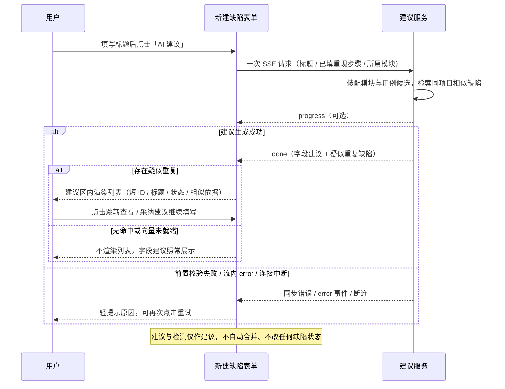

# 软件测试平台——AI 缺陷分析

**文档版本**：V1.0  
**日期**：2026-10-03  
**状态**：起草中

---

## 1. 概述

缺陷分析面向缺陷管理模块提供新建缺陷实时建议，其中一并给出重复缺陷检测（`docs/01-requirements/07-ai-capability/05-srs-ai-defect-analysis.md`）。承载形态为新建缺陷表单建议区。建议入口对项目成员常驻可见，不按权限码过滤；建议与检测范围限于当前项目。视觉遵循《视觉设计》（`docs/05-interaction-design/03-visual-design.md`）。

## 2. 页面设计

### 2.2 新建缺陷表单建议区

| 组件 | 交互 |
| ---- | ---- |
| 「AI 建议」入口按钮 | 挂在提交缺陷页标题输入框尾部（append，图标 + 「AI 建议」）：AI 未启用时不渲染挂载内容、输入组按无 append 形态收口；标题为空时禁用置灰，填入标题后启用并以呼吸光晕 + 魔棒微晃作闪烁提示；点击发起实时建议 **SSE 流式请求**（按钮转 loading 至连接关闭，期间无总超时，后端 15s 心跳保活），按标题 / 已填重现步骤 / 所属模块一次性返回全部建议与疑似重复缺陷；请求失败或流中断轻提示原因且不阻塞录入，可再次点击重试 |
| SuggestBadge | 基于标题（及已填重现步骤、所属模块），为优化后标题、重现步骤、缺陷类型、严重等级、优先级、所属模块、关联用例、关键词给出建议值，行内标记展示（标题建议挂标题输入框下方、重现步骤建议挂编辑器下方、关联用例建议挂「选择用例」按钮旁，其余沿用侧栏表单项行内）；点击一键采纳；用户已填值与建议不一致时以用户值为准，不覆盖（标题与重现步骤经点击采纳后写入，属用户主动动作） |
| DuplicateSuggestList | 建议区内展示同请求返回的疑似重复缺陷（短 ID、标题、状态、相似依据，按相似度排序），点击短 ID 跳转查看；无命中或向量未就绪时不渲染列表、不作提示；检测结果仅作建议，不自动合并、不改状态 |

### 2.3 状态分支

- **向量未就绪或请求失败**：`duplicates` 为空，不渲染列表、不作提示，字段建议照常展示；
- **无命中**：不渲染列表，字段建议照常展示；
- **实时建议失败**：轻提示失败原因，不自动重试，用户可再次点击「AI 建议」触发；不影响表单其余填写与提交；失败含三种形态——流建立前同步校验失败（输入非法 / 无可用模型）、流内 `error` 事件（模型调用失败）、**连接中断**（网络断开或中间层断连，loading 结束并提示可重试）；
- **AI 未启用**：入口隐藏（总册 4.5）。

## 3. 核心交互流程

### 3.1 新建缺陷建议（含重复缺陷检测）

## 4. 视觉与状态要求

- 建议值标记（SuggestBadge）用 `--color-primary-*` 浅底徽标 + 图标，区别于用户已填值；
- 疑似重复列表用 `--color-neutral-*` 边框分隔条目，高相似项前置并以 `--color-warning` 图标标注（不单靠颜色表意）；
- 相似度仅作排序信号，百分比展示不对外承诺阈值。

## 5. 状态管理

- 新建表单建议与重复检测结果同属一次建议结果，存组件本地，提交后释放；
- 重复检测不再单独触发，结果随建议 `done` 事件一并写入；用户填写值始终优先于建议值。

## 修改记录

| 版本 | 日期 | 说明 |
| ---- | ---- | ---- |
| V1.0 | 2026-10-03 | 初始版本 |
| V1.0 | 2026-10-03 | 批量分类发起后跳转任务详情页，审核在详情页审核区（列表模式）完成 |
| V1.0 | 2026-10-16 | 同步 AI Task 双平面口径（`docs/02-high-level-design/07-ai-capability/03-hld-ai-task.md`）：3.2 流程状态改 `proposals_ready / aborted`（失败重试改终止 + 再次执行），待确认改待采纳，2.x 状态分支与措辞同步 |
| V1.0 | 2026-10-19 | 2.2 补「AI 建议」入口按钮：标题输入框 append 挂载，AI 未启用不显示、标题空禁用、可操作态闪烁 |
| V1.0 | 2026-10-19 | 录入重复检测改标题失焦触发 + 弹窗展示（DuplicateCheckPanel → BugDuplicateDialog）：功能不可用或无命中不作提示，2.4 / 3.1 分支同步 |
| V1.0 | 2026-10-20 | 新建建议实时化：「AI 建议」点击改同步等待返回；SuggestBadge 范围改优化后标题 / 重现步骤 / 类型 / 等级 / 优先级 / 模块 / 关联用例 / 关键词，移除 AssigneeCandidateChips；2.4 补实时建议失败分支 |
| V1.0 | 2026-10-20 | 「AI 建议」改 SSE 流式：连接无总超时（后端 15s 心跳保活），`done` 事件渲染徽标；2.4 失败分支补流建立前同步失败 / 流内 error / 连接中断三形态 |
| V1.0 | 2026-11-18 | AI 缺陷分析免 RBAC 权限码校验：分析入口对项目成员常驻可见，移除「无缺陷查看权限 403」与实时建议「权限拒绝」分支，仅保留项目归属与业务校验 |
| V1.0 | 2026-11-21 | 移除趋势摘要与存量批量分类：2.1 布局与交互表删除摘要卡片和批量分类入口，2.3 状态分支与 3.2 采纳流程删除对应内容，5 状态管理同步收窄 |
| V1.0 | 2026-11-21 | 移除存量重复扫描任务：1 概述承载形态、2.1 布局按钮与交互表行、2.3 扫描任务与入口置灰状态分支、5 状态管理同步收窄 |
| V1.0 | 2026-11-23 | 重复缺陷检测并入新建缺陷建议：删除标题失焦触发与弹窗，2.2 / 3.1 改为一次建议请求返回字段建议与疑似重复列表，2.3 / 4 / 5 同步；向量未就绪静默降级 |
