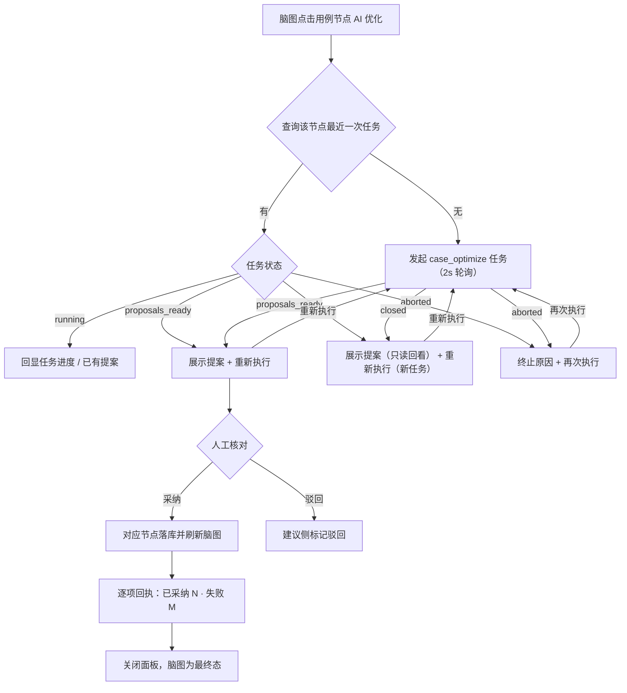
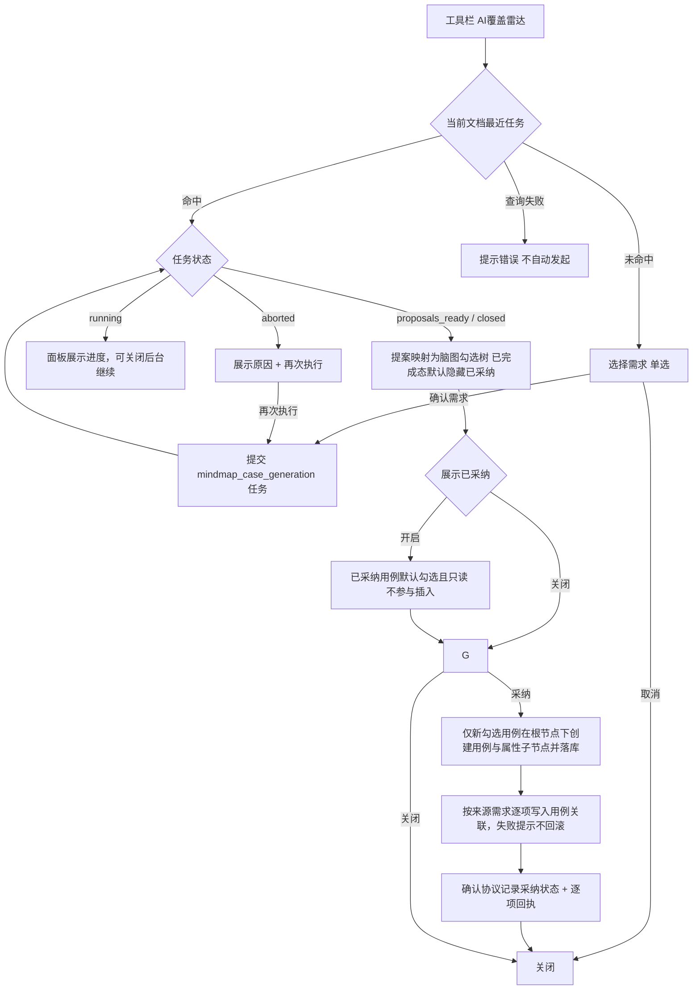

# 软件测试平台——AI 辅助功能

**文档版本**：V1.0  
**日期**：2026-10-03  
**状态**：起草中

---

## 1. 概述

辅助功能面向脑图用例编辑与测试计划执行，提供三项轻量交互式建议：**用例优化**、**执行顺序建议**、**脑图生成用例**。建议不直接生效，经人工采纳后落库，人工编辑过的内容 AI 不自动覆盖（总册 1.5，`docs/01-requirements/07-ai-capability/02-srs-ai-capability.md`）。用例优化的建议为一组可定位到具体节点的**操作指令**：`更新` 按节点 ID 原地改写内容（含用例标题 / 属性子节点 / 优先级 / 标签，ID 与层级不变），`新增` 按父节点 ID 在任意节点下创建子节点，不采用删旧插新。采纳由脑图前端在当前树上执行节点操作并落库，任务详情页不参与用例优化采纳。脑图生成用例从工具栏发起，提案以脑图形式回显并勾选插入当前文档根节点下，任务详情页同样只回看、不审核。AI 未启用时入口隐藏（总册 4.5）；视觉遵循《视觉设计》（`docs/05-interaction-design/03-visual-design.md`）。

**入口**：

```
脑图用例节点悬浮窗（左键单击用例节点展开）
└── 「AI 优化」（当前节点，case_optimize）

脑图编辑器工具栏（最右侧）
└── 「AI覆盖雷达」→ 查当前文档最近任务 → 命中回显 / 未命中选需求（单选）→ AI 生成面板（mindmap_case_generation）

测试计划详情
└── 「执行顺序建议」（plan_order）
```

用例优化与执行顺序建议各自使用对应的任务与面板：用例优化从悬浮窗发起后悬浮窗收起，面板仍以对话框呈现；隐藏 / 置灰规则按 2.3 的状态分支生效（`docs/05-interaction-design/03-function-testing/04-workspace-ui-test-case.md` 1.2 定义悬浮窗的展开与关闭）。

点击「AI 优化」先查询该节点最近一次任务（项目内任意成员发起的任务均可复用）：查到则按状态回显进度或提案，否则发起新任务（见 2.4）。

## 2. 页面设计

### 2.1 对照面板（AssistComparePanel，用例优化使用）

#### 2.1.1 布局

```
┌──────────────────────────────────────────────────────────────────────┐
│ AI 优化建议              来源：[REQ-001 登录验证码]（点击跳详情）      │
├──────────────────────────────────────────────────────────────────────┤
│ 操作 1  登录用例 › 步骤 1 · 标题                                [更新]│
│   现有：输入邮箱                                                      │
│   建议：输入邮箱和密码          理由：补充账号类型说明                 │
├──────────────────────────────────────────────────────────────────────┤
│ 操作 2  登录用例 · 优先级                                        [更新]│
│   现有：P1                                                           │
│   建议：P0                    理由：上游需求 REQ-001 优先级为高        │
├──────────────────────────────────────────────────────────────────────┤
│ 操作 3  登录用例 · 新增步骤                                      [新增]│
│   新节点：输入图形验证码       理由：上游需求要求校验图形验证码         │
│                              无变化项默认折叠（展开共有 N 项）        │
├──────────────────────────────────────────────────────────────────────┤
│ [采纳] [驳回]                                     已采纳 N / 共 M    │
└──────────────────────────────────────────────────────────────────────┘
```

#### 2.1.2 交互说明

| 区块 | 交互 |
| ---- | ---- |
| 多节点切换 | 一次选中多个节点发起时，面板顶部下拉切换核对节点；采纳后自动推进到下一个待处理节点，页脚「已采纳 N / 共 M」按节点统计 |
| 操作指令列表 | 每条指令独占一卡：`更新` 显示「节点路径 · 字段」（现有 vs 建议两栏）与理由，`新增` 显示「在节点路径下新增类型节点」与新节点内容；节点路径按祖先链展示（如「登录用例 › 步骤 1」），便于定位到具体节点；同值更新项折叠为「无变化 N 项」，可展开核对；同级 / 标签一致项照常展示，可采纳并留痕 |
| 原地更新语义 | `更新` 采纳后仅改写目标节点内容，节点 ID 与层级保持不变；`新增` 采纳后在指定父节点下挂载新节点；均不删除原节点再插入 |
| 来源引用 | `sourceRefs` 点击跳需求详情定位 |
| 动作 | 采纳、驳回；采纳按当前核对节点提交其人工核对后的全部操作，提交后自动推进到下一个待处理节点，对应指令标记已处理，回执逐项展示成败（节点已不存在时标记跳过） |
| 动作置灰 | 动作区对只读 / 已处理 / 全无变化态置灰，并常驻展示原因文案（不依赖悬浮） |
| 脑图联动 | 采纳成功后由前端按操作指令即时更新脑图节点并落库，不重载整棵脑图；进行中任务期间展示进度入口（超交互等待） |

### 2.2 执行顺序建议面板（PlanOrderPanel）

```
┌──────────────────────────────────────────────────────────────────┐
│ 执行顺序建议                                                       │
├──────────────────────────────────────────────────────────────────┤
│ 1  BUG-32 相关用例 · 理由：阻塞面最广（悬浮查看完整理由）   ≡拖拽    │
│ 2  BUG-07 相关用例 · 理由：核心链路                       ≡拖拽    │
│ 3  冒烟用例集                                          ≡拖拽    │
├──────────────────────────────────────────────────────────────────┤
│ 采纳前 vs 采纳后 顺序对照                                          │
├──────────────────────────────────────────────────────────────────┤
│                                   [应用建议] [放弃]                │
└──────────────────────────────────────────────────────────────────┘
```

| 区块 | 交互 |
| ---- | ---- |
| 顺序列表 | AI 建议顺序带序号徽标，行悬浮展示建议理由；可拖拽调整 |
| 前后对照 | 应用前展示「采纳前/采纳后」顺序 diff，便于核对变化 |
| 应用 / 放弃 | 「应用建议」按当前（含人工拖拽调整后）顺序生效并 toast 提示；「放弃」关闭面板不产生变更 |

### 2.3 状态分支

- **任务执行中**：入口处展示进度入口（复用任务执行进度），完成后面板打开；
- **全部建议与现状一致**：用例优化场景折叠展示 + 「无变化」提示，仅可关闭；级别同级项照常展示并可采纳（采纳写修改记录留痕）；
- **部分采纳**：回执逐项成败，未处理项保留在建议侧；
- **只读节点**：用例优化入口对只读或未保存节点置灰并提示原因；
- **动作区置灰**：入口放行后面板动作仍按只读 / 已处理 / 全无变化三类态置灰，并常驻展示原因文案（交互说明见 2.1.2）；
- **AI 未启用 / 未配置模型**：入口隐藏（总册 4.5）；
- **来源需求已变更**：面板顶部提示，建议仅供参考、可继续采纳。
- **任务未完成**：点击入口回显该节点的任务进度；已产出提案但任务未结束时直接展示提案；
- **任务已产出提案**：展示该任务的提案（含已采纳 / 已驳回状态），并提供「重新执行」（见 2.4）；
- **任务已处理完毕**：展示任务提案的只读回看，并提供「重新执行」（按同一输入发起新任务，见 2.4）；
- **任务已终止**：展示终止原因与「再次执行」（见 2.4）。

### 2.4 任务复用与重新执行（按用例节点）

点击用例节点「AI 优化」时，按该节点查询最近一次任务（不限当前文档查看会话，项目内任意成员发起的任务均可复用），按以下顺序处理：

| 场景 | 表现 |
| ---- | ---- |
| 该节点无任务 | 发起 `case_optimize` 任务 |
| 最近任务执行中（`running`） | 回显任务进度；已产出提案时直接展示提案，不重复发起 |
| 最近任务已产出提案（`proposals_ready`） | 展示提案（含已采纳 / 已驳回状态），提供「重新执行」；点击后沿用同一任务新建执行实例 |
| 最近任务已处理完毕（`closed`） | 展示提案只读回看，提供「重新执行」；点击后按同一输入发起新任务（已关闭任务不允许再次执行） |
| 最近任务已终止（`aborted`） | 展示终止原因与「再次执行」；点击后沿用同一任务新建执行实例 |
| 切换用例节点 | 按目标节点独立查询，面板只展示该节点所属任务的数据，不与其它节点混用 |
| 查询无结果 / 查询失败 | 无结果时发起新任务；查询失败时提示错误且不自动发起，避免误耗额度 |

复用只作用于任务入口与前端展示：不改变任务与提案的后端状态；仅取最近一次任务，不回放更早的历史任务（更早任务仍可在任务列表回看）。

### 2.5 脑图生成用例面板

```
┌──────────────────────────────────────────────────────────────────────┐
│ AI覆盖雷达        来源：REQ-001 登录验证码（点击跳详情）              │
├──────────────────────────────────────────────────────────────────────┤
│ 生成中… 当前步骤：填充用例属性                        [关闭弹窗]      │
│ 关闭后任务仍在后台运行，可从顶部 AI 任务角标 / 任务中心查看          │
├──────────────────────────────────────────────────────────────────────┤
│ [全选] 关键字[____] 优先级[P0▾] [ ] 展示已采纳   已选 3 / 共 8       │
│ ┌ 候选卡片区（固定高度内滚动，卡片按用例 → 属性子节点分层） ──────┐ │
│  ☑ 获取验证码                                  P0                   │
│    └ 前置：用户处于登录页                                            │
│    └ 步骤：输入手机号 → 点击获取验证码                                │
│    └ 预期：提示验证码已发送                                          │
│  ☐ 验证码错误提示                                P1                   │
│  ☑ 已登录校验（已采纳，只读）                   P2                   │
│ └──────────────────────────────────────────────────────────────────┘ │
├──────────────────────────────────────────────────────────────────────┤
│                              [采纳] [重新执行] [关闭]                │
└──────────────────────────────────────────────────────────────────────┘
```

| 区块 | 交互 |
| ---- | ---- |
| 入口 | 工具栏「AI覆盖雷达」→ 按当前文档查询最近一次生成任务；命中直接打开面板回显进度 / 提案，未命中才进「选择需求」单选弹窗（仅已确认需求可选）→ 确认后打开面板并立即提交任务；查询失败只提示错误、不自动发起；AI 未启用时按钮隐藏（置灰原因优先展示） |
| 生成中 | 展示步骤进度与预算消耗；可关闭弹窗，任务后台继续，顶部角标 / 任务中心可查看；不跳任务详情页 |
| 生成失败 / 已终止 | 展示原因与「再次执行」（沿用同一任务新建执行实例） |
| 弹窗布局 | 弹窗高度固定（约 88vh），上下留白一致（各约 6vh），顶部与浏览器窗口下沿距离相等；顶部信息 / 状态提示、筛选栏与底部操作区固定不滚动；仅候选卡片区内部滚动，不出现弹窗外层滚动条；结果区不额外包裹容器，直接由用例选择器自身承担边框与滚动；弹窗容器（header / body / footer）四边 padding 收紧，内容区间距不变 |
| 脑图勾选树 | 复用用例选择器的脑图式勾选树：按提案层级展示用例与前置 / 步骤 / 预期子节点，支持关键字与优先级过滤、全选；用例标题带优先级徽标；「全选」勾选 / 取消作用于全部提案用例节点，部分勾选时呈半选态 |
| 已采纳用例展示 | 重复打开已完成任务面板时默认不展示已采纳用例；勾选「展示已采纳用例」后混入候选卡片区，默认勾选且不可取消，卡片标注「已采纳」为只读回看项；关闭勾选即从候选树移除 |
| 子节点一并插入 | 勾选用例节点时连同其整棵子树一起插入：用例节点下的前置 / 步骤 / 预期子节点随父节点落到当前文档，不要求逐个子节点勾选 |
| 来源引用 | 顶部所选需求可点击跳需求详情；来源需求在任务期间变更时展示提示，由人工决定是否采纳 |
| 采纳 | 仅对本次新勾选的未采纳用例按既有节点操作追加到当前文档根节点下（用例节点带前置 / 步骤 / 预期子节点与 AI 生成标识），即时落库并刷新脑图；同时按提案来源引用自动关联来源需求（缺失时取任务输入需求），关联失败提示但不回滚已插入节点；已采纳用例不重复插入、不重复关联、不重复回传状态；逐项回执成败；勾选全为已采纳用例时按钮置灰 |
| 任务详情 | 只回看执行过程与提案，不提供采纳 / 编辑后采纳 / 驳回等审核操作；采纳状态由面板采纳动作记录 |

## 3. 核心交互流程



脑图生成用例流程：



## 4. 视觉与状态要求

- 操作指令以 `--color-primary-*` 浅底标记 + 「更新」/「新增」小徽标，字段内容变化时标「变更」、级别变化时标「调整」、级别一致时标「同级」；建议级别按《视觉设计》用例优先级色落色（P0 / P1 / P2 / P3 对应 `--color-priority-p0` / `--color-priority-p1` / `--color-priority-p2` / `--color-priority-p3`），并保留文字徽标，不单靠颜色表意；
- 无变化折叠项用中性色阶（`--color-neutral-400` 文本）；
- 拖拽手柄与序号徽标：当前排序 `--color-primary-500`，调整中目标位 `--color-primary-100` 底；
- 回执成功 `--color-success`、失败 `--color-danger-light` 底。

## 5. 状态管理

- 任务执行复用 `aiTask` store 轮询（仅 `running` 进行中继续，状态非进行中即停止）；
- 点击入口查询后端最近一次任务（`GET /api/ai/tasks/{type}/latest`，项目内任意成员发起的任务均可复用）：用例优化按用例节点传 `nodeId`，「AI覆盖雷达」按当前文档省略 `nodeId`；命中后按任务状态回显进度 / 提案，无任务时才进入发起流程；查询失败只提示错误、不自动发起；仅取最近一次，不查询更早历史；
- 重新执行：`proposals_ready` / `aborted` 沿用同一任务新建执行实例；`closed` 按同一输入发起新任务；切换节点时丢弃过期查询响应，避免旧任务提案内容写入新任务；
- 对照面板与顺序面板私有状态（选择、采纳进度、拖拽顺序）挂组件本地，不入全局 store；脑图生成用例的全选、勾选集合、展示已采纳开关与需求关联回执同样挂面板本地；
- 采纳成功即时刷新脑图 store / 计划详情数据；关闭面板释放本地状态。

## 修改记录

| 版本 | 日期 | 说明 |
| ---- | ---- | ---- |
| V1.0 | 2026-10-03 | 初始版本 |
| V1.0 | 2026-10-10 | 随落地实现补齐：2.1 增多节点切换与动作置灰两行、折叠口径统一为无变化项，2.3 补动作区置灰状态分支并修正错字，4 节徽标文案与级别落色对齐实际实现 |
| V1.0 | 2026-10-16 | 同步 AI Task 双平面口径（`docs/02-high-level-design/07-ai-capability/03-hld-ai-task.md`）：3.x 流程状态改 `proposals_ready / aborted`（失败重试改终止 + 再次执行），轮询停轮条件改 `aborted / closed` |
| V1.0 | 2026-10-16 | 对齐 AI Task 状态机：视觉要求级别措辞由「产物级别」改「建议级别」 |
| V1.0 | 2026-11-18 | AI 辅助功能免 RBAC 权限码校验：移除「权限不足隐藏入口」分支及动作置灰的「无权限」态，入口与动作仅按业务状态置灰 |
| V1.0 | 2026-11-18 | 用例级别推荐：级别取值改 P0–P3、同级项不再折叠并标「同级」、落色对齐 p0–p3、状态分支区分补全与级别推荐 |
| V1.0 | 2026-11-18 | 补充脑图用例节点悬浮窗入口：AI 补全与级别推荐沿用同一任务与状态分支 |
| V1.0 | 2026-11-18 | AI 补全与级别推荐入口收拢到用例节点悬浮窗，移除脑图编辑器工具栏入口 |
| V1.0 | 2026-11-18 | 用例补全与级别推荐合并为「AI 优化」：悬浮窗单一入口、对照面板同屏展示四类字段与级别、移除补充节点预览，任务类型改 `case_optimize` |
| V1.0 | 2026-11-18 | 新增当前文档会话内的待处理结果复用：按节点隔离命中既有结果面板、已处理 / 失败重新发起、切换文档或离开页面清空缓存 |
| V1.0 | 2026-11-19 | 任务明细定时获取停止条件调整：仅 `running`（进行中）继续轮询，状态非进行中即停止，同步状态管理描述 |
| V1.0 | 2026-11-18 | 任务复用改为后端按节点查询最近一次任务（项目内成员共享）：不再依赖文档会话缓存；已处理完毕任务重新执行按同一输入发起新任务 |
| V1.0 | 2026-11-19 | 用例优化对照面板改为节点操作指令列表：更新显示节点路径 · 字段两栏对照、新增显示在指定父节点下创建新节点，均带更新 / 新增徽标与理由，同步视觉徽标口径 |
| V1.0 | 2026-11-19 | 节点操作由脑图前端在当前树上执行并落库、不重载整棵脑图：移除陈旧值跳过提示，任务详情页不参与用例优化采纳 |
| V1.0 | 2026-11-19 | 新增「脑图生成用例」入口与面板（2.1 / 2.5 / 3）：工具栏最右侧单选需求后发起任务，提案脑图式勾选后插入当前文档根节点下；任务详情只读、无审核动作 |
| V1.0 | 2026-11-20 | 用例优化对照面板动作收敛为单个「采纳」：合并逐条采纳与批量采纳为按当前核对节点提交并自动推进，驳回保留，同步 2.1 页面结构、交互说明与 3 流程图 |
| V1.0 | 2026-11-20 | 「AI测试用例」更名「AI覆盖雷达」并调整入口流程：先按当前文档查最近任务，命中直接回显，未命中才选需求发起；同步 2.5 面板文案、交互表、流程图与状态管理 |
| V1.0 | 2026-11-20 | 2.5 补齐结果弹窗布局与选择口径：弹窗固定高度、候选卡片区内部滚动、结果区不额外包裹容器；明确全选 / 半选态与勾选用例时整棵子节点一并插入 |
| V1.0 | 2026-11-20 | 2.5 补齐已完成任务回看口径：默认隐藏已采纳用例，可勾选展示且默认勾选只读；动作「插入选中用例」改「采纳」，已采纳用例不重复插入脑图 |
| V1.0 | 2026-11-20 | 2.5 补齐采纳时自动关联来源需求：按提案来源引用（缺失回退任务输入）写入用例关联，节点未落库时有界重试，失败提示不回滚 |
| V1.0 | 2026-11-20 | 2.5 生成面板弹窗高度调至约 88vh、上下留白一致，弹窗容器四边 padding 收紧，内容区间距不变（AI 优化弹窗同步收紧容器 padding） |
