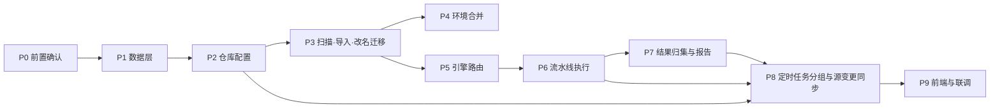

# 软件测试平台——GitLab 集成开发方案与计划

**文档版本**：V1.0
**日期**：2026-10-11
**状态**：起草中

---

## 1. 引言

### 1.1 编写目的

将 GitLab 集成的需求、概要与详细设计转化为可执行的开发路径：明确模块依赖与实施顺序、工作包清单、交付批次与验收门禁，作为开发排期、PR 审查与人工验收的共同依据。本文不排期、不给人天，功能行为与表结构以基线文档为准。

### 1.2 范围

覆盖：仓库配置、工程扫描与导入、环境合并、引擎路由与 CI 执行、定时任务分组改造、结果归集与报告聚合、前端页面与权限接入。

不覆盖：测试工程侧的 CI 配置改造属接入方职责（见需求分册附录），平台侧只提供约定文件模板；GitLab 实例自身的部署与升级不在本计划内。

### 1.3 基线文档

| 层 | 文档 | 用途 |
| ---- | ---- | ---- |
| 需求 | `docs/01-requirements/05-api-testing/11-api-srs-gitlab-integration.md` | 功能行为、业务规则与验收口径 |
| 需求（改） | `docs/01-requirements/05-api-testing/08-api-srs-scheduled-task.md` | 「GitLab 同步」任务类型取值与执行记录字段口径 |
| 概要 | `docs/02-high-level-design/05-api-testing/11-hld-api-gitlab-integration.md` | 模块职责边界与核心机制 |
| 详细 | `docs/04-detailed-design/05-api-testing/32-gitlab-integration-overview.md` | DDL、接口、错误码、业务逻辑 |
| 详细（改） | `docs/04-detailed-design/05-api-testing/27-scheduled-task-scheduler.md` | 定时任务分组与完成判据 |
| 详细（改） | `docs/04-detailed-design/02-project-module.md` | 模块源侧归属标识 |
| 交互 | `docs/05-interaction-design/05-api-testing/26-gitlab-ui-overview.md` | 页面结构、核心交互流程与状态分支 |
| 详细（改） | `docs/04-detailed-design/05-api-testing/25-scheduled-task-overview.md` | 「GitLab 同步」任务类型与任务管理 |

### 1.4 定义与缩写

沿用需求分册「定义与缩写」（`docs/01-requirements/05-api-testing/11-api-srs-gitlab-integration.md` 1.4）；`WP` 指工作包，`P` 指实施阶段。

## 2. 开发方案

### 2.1 总体实施策略

**后端先行、纵向切片、每批可验收**：

1. 先落数据层与仓库配置，使「能连上、能保存」成立；
2. 再落导入链路，使「能把工程变成场景」成立；
3. 最后落执行链路，使「能跑、能出报告」成立；
4. 前端随每批后端能力同步交付，不整体后置。

依赖外部协作的项前置到 P0 处理：CI 配置改造约定需与接入方对齐、接入方 Ryze 版本与结果契约需确认。任一未确认则对应工作包降级为不阻塞后续批次的可延后项。JavaParser 依赖已确认引入，不再作为前置项。

### 2.2 分支与协作

基于 `develop` 拉 `feature/api-gitlab-integration`，批次内工作包按逻辑单元拆分提交，提交格式遵循总则 C7；合并走 PR，每批完成后合回 `develop` 再开下一批，不长期悬挂大分支。

### 2.3 模块依赖与实施顺序

顺序依据：数据层是全部能力的地基；导入先于路由（路由依赖场景来源属性）；流水线执行先于结果归集（归集依赖批次标识）；定时任务分组同时依赖路由与流水线执行，故置于其后。

### 2.4 技术实施要点

| 要点 | 说明 |
| ---- | ---- |
| 源码解析 | 引入 JavaParser 做结构化解析，块注释剥离为强制前置步骤；解析失败必须能区分「可预期」与「真实错误」两类并分别计数 |
| 改名迁移 | 变更文件清单取自 GitLab compare，`renamed_file` 仅作提示，必须叠加方法集合 / 步骤模板引用集合的重合度校验；校验不通过一律退回删旧建新，禁止直接迁移 |
| 稳定键合并 | 模块与场景均按源侧标识 upsert，禁止按名称匹配作为主判定路径；模块树为包容器 + 类模块两层，包容器按完整包名认领 |
| 凭据 | 加密存取、只进不出，日志与异常消息脱敏 |
| 流水线对接 | 采用轮询而非回调，轮询状态落库以支持进程重启后恢复 |
| 异步回写 | 批次结果回收不得阻塞触发线程，完成判据以库中状态为准 |
| 定时任务改造 | 在既有触发链路中插入分组步骤，分组逻辑不得改变既有平台组行为 |

### 2.5 环境与依赖管控

| 依赖 | 处置 |
| ---- | ---- |
| JavaParser | **已确认引入**（`com.github.javaparser:javaparser-core`），解析器收敛在内部抽象之后，便于后续替换实现 |
| GitLab API 客户端 | 优先使用既有 HTTP 组件封装，避免引入专用 SDK |
| 测试用 GitLab 实例 | 需可用的自建或托管实例与一个样例工程，用于联调 |
| 接入方 CI 改造 | 属外部依赖，P0 阶段对齐约定，未就绪不阻塞平台侧其余批次；平台侧契约（接口 / 变量 / 报文）已入档详细设计 4.6，模板正本为 `ci-templates/gitlab/robotest-batch.gitlab-ci.yml`，待接入方确认 |
| 接入方 Ryze 版本 | 须支持按「测试类全限定名#方法名」导出结果信封（结果文件契约见详细设计 4.6），P0 阶段确认版本结论并在真实仓库验证产出 |

## 3. 开发计划

### 3.1 阶段划分

| 阶段 | 名称 | 内容 | 前置 | 状态 |
| ---- | ---- | ---- | ---- | ---- |
| P0 | 前置确认 | CI 约定对齐、Ryze 版本与结果契约确认、联调实例就绪 | — | 进行中（平台侧已交付，外部确认待定） |
| P1 | 数据层 | 新表与扩展列迁移、错误码登记 | P0（依赖决策） | 已完成 |
| P2 | 仓库配置 | 配置 CRUD 与连通性测试 | P1 | 已完成 |
| P3 | 扫描与导入 | 源码解析、模块归属（包容器 + 类）、改名迁移、增量同步、幂等闸门 | P1、P2 | 已完成（WP-3.1～WP-3.5） |
| P4 | 环境合并 | 环境读取、合并、封印 | P3 | 已完成 |
| P5 | 引擎路由 | 路由判定与任务触发分组 | P3 | 已完成 |
| P6 | 流水线执行 | 清单冻结、批次票据、触发、CI 回调取清单、轮询与生命周期 | P2、P5 | 已完成（WP-6.1、WP-6.2） |
| P7 | 结果归集与报告 | 制品下载与信封解析、映射、报告聚合 | P6 | 已完成 |
| P8 | 定时任务扩展 | 分组插入与完成判据扩展、「GitLab 同步」任务类型与执行链路 | P3、P5、P6、P7 | 已完成（WP-8.1、WP-8.2） |
| P9 | 前端与联调 | 页面、权限、端到端联调 | 各批次 | 进行中（WP-9.1、WP-9.2、WP-9.3、WP-9.4 已完成，待端到端联调） |

### 3.2 工作包清单

| 编号 | 名称 | 阶段 | 依赖 | 产出 | 验收要点 | 状态 |
| ---- | ---- | ---- | ---- | ---- | ---- | ---- |
| WP-0.1 | JavaParser 依赖决策（已确认引入） | P0 | — | 依赖引入结论 | 已确认，P1 起可直接依赖 | 已完成 |
| WP-0.2 | CI 配置改造约定对齐 | P0 | — | 变量名、清单获取方式与结果上报路径 | 接入方确认；结果输出目录、文件命名与信封结构按详细设计 4.6 固化，接入方不得变更 | 平台侧已交付（契约入档 + 模板正本 `ci-templates/gitlab/robotest-batch.gitlab-ci.yml`），待接入方确认 |
| WP-0.3 | Ryze 版本与结果契约确认 | P0 | — | 接入方 Ryze 版本结论与信封产出验证记录 | 真实仓库可产出 `testClass#testMethod` 信封文件 | 待确认（不阻塞交付） |
| WP-1.1 | 迁移脚本 | P1 | WP-0.1 | 新表与扩展列 DDL | 存量数据不受影响 | 已完成 |
| WP-1.2 | 错误码登记 | P1 | — | 号段登记 | 与既有号段无冲突 | 已完成 |
| WP-2.1 | 仓库配置接口 | P2 | WP-1.1 | CRUD 与连通性测试 | 一项目一仓库、模式不可变 | 已完成 |
| WP-3.1 | 源码扫描与解析 | P3 | WP-0.1、WP-1.1 | 测试类与用例识别 | 块注释方法不计、两类失败分列 | 已完成 |
| WP-3.2 | 模块归属与场景生成 | P3 | WP-3.1 | 稳定键 upsert | 重复导入结果一致 | 已完成 |
| WP-3.3 | 幂等闸门 | P3 | WP-3.1 | 提交比对与跳过 | 预览与导入共用同一判定 | 已完成 |
| WP-3.4 | 改名迁移 | P3 | WP-2.1、WP-3.2 | 文件级改名探查与源侧标识迁移 | 采信需通过内容校验；不通过时退回删旧建新 | 已完成 |
| WP-3.5 | 源探查服务 | P3 | WP-2.1 | 30 分钟周期探查仓库 HEAD，回写探查列并派生「源有更新」 | 标记随导入 / 同步自动消除；探查失败留痕且不影响场景使用 | 已完成 |
| WP-4.1 | 环境合并与封印 | P4 | WP-3.1 | 合并写入与封印 | 保留用户自有条目 | 已完成 |
| WP-5.1 | 引擎路由 | P5 | WP-3.2 | 路由判定 | 三类输入判定正确 | 已完成 |
| WP-6.1 | 清单冻结与流水线触发 | P6 | WP-2.1、WP-5.1 | 触发、批次票据与冻结清单 | 触发前快照已落库；变量只含批次票据 | 已完成 |
| WP-6.2 | 状态轮询与恢复 | P6 | WP-6.1 | 轮询与重启恢复 | 重启后未完成批次可继续；终态后写入被忽略 | 已完成 |
| WP-7.1 | 用例结果回收与映射 | P7 | WP-6.1 | 制品下载、信封解析与回写 | `testClass#testMethod` 映射准确；缺失信封计解析失败 | 已完成 |
| WP-7.2 | 报告聚合 | P7 | WP-7.1 | 混合套件报告 | 二次更新不产生空洞 | 已完成 |
| WP-8.1 | 定时任务分组与完成判据 | P8 | WP-5.1、WP-6.1、WP-7.1 | 分组与判据扩展 | 平台组行为不变 | 已完成（先行交付，端到端验收待 WP-7.1 后随批次四人工验收） |
| WP-8.2 | 源变更同步任务 | P8 | WP-3.2、WP-3.4 | 「GitLab 同步」任务类型与执行链路 | 到点自动同步、无变更跳过、结果计数正确 | 已完成（先行交付，端到端验收随批次四人工验收） |
| WP-9.1 | 仓库配置前端 | P9 | WP-2.1 | 设置页与状态分支 | 空态、失败、权限分支覆盖 | 已完成（先行交付，人工验收随批次四进行） |
| WP-9.2 | 导入前端 | P9 | WP-3.2、WP-3.3 | 预览、进度、失败明细 | 幂等拦截提示准确 | 已完成（先行交付，人工验收随批次四进行） |
| WP-9.3 | 执行入口文案 | P9 | WP-5.1 | 编辑页 [运行] 按钮文案 | 文案随引擎正确 | 已完成（先行交付，人工验收随批次四进行） |
| WP-9.4 | 场景展示适配 | P9 | WP-3.2、WP-5.1、WP-3.5 | 列表来源 / 源状态徽标与 [来源] 筛选、仓库级提示条；集成页 [源有更新] 徽标；`gitlab_ci` 场景编排页只读形态与单个用例信息 | 徽标与源状态取值正确；「源有更新」不逐场景标注且随同步消失；只读场景无任何编辑入口，[流水线运行] 可触发 | 已完成（先行交付，人工验收随批次四进行） |

### 3.3 交付批次建议

| 批次 | 范围 | 验收重点 | 状态 |
| ---- | ---- | ---- | ---- |
| 批次一（P1–P2） | 数据层 + 仓库配置 | 连通性测试可用；模式创建后不可变；令牌不回显 | 已交付（待人工验收） |
| 批次二（P3–P4） | 导入 + 改名迁移 + 环境合并 | 真实样例工程导入结果与预期用例数一致；模块树为包容器 + 类两层；重复导入幂等；解析失败不建场景；改名迁移通过内容校验、不通过时正确退回删旧建新；环境按 refName 合并保留用户条目、封印后不再回同步 | 已交付（待人工验收） |
| 批次三（P5–P7） | 路由 + CI 执行 + 归集 | 单场景执行路由正确；清单冻结先于触发；结果制品解析与 `testClass#testMethod` 映射准确；终态去重不丢结果；混合报告可读 | 已交付（待人工验收） |
| 批次四（P8–P9） | 定时任务分组 + 源变更同步 + 前端 | 混合任务完成判据正确；同步任务到点执行与无变更跳过正确；前端全状态分支覆盖（含场景展示适配） | 已交付（待人工验收） |

### 3.4 验收门禁

每批合并前须满足：

| 门禁 | 要求 |
| ---- | ---- |
| 质量 | `bash scripts/validate-backend.sh` 与 `bash scripts/validate-web.sh` 全绿，覆盖率达标（C8） |
| 规范 | 无 `any`（C1）、业务逻辑不在 Controller（C2）、异常经统一入口且错误码为 10 位（C3）、上下文不入 URL（C4） |
| 数据 | 迁移说明齐备、UUID 用默认策略、无物理外键（C5）、索引合规（C9） |
| 文档 | 详细设计与本计划的状态同步更新，错误码与 DDL 无漂移 |
| 人工 | 批次二起需用户人工验收，验收结果记录后再合入下一批 |

**人工验收记录**（验收人填写；批次状态以本表结论为准）：

| 批次 | 验收人 | 验收日期 | 结论（通过 / 不通过及原因） |
| ---- | ---- | ---- | ---- |
| 批次一（P1–P2） | 待验收 | — | 待验收 |
| 批次二（P3–P4） | — | — | 未开始 |
| 批次三（P5–P7） | — | — | 未开始 |
| 批次四（P8–P9） | — | — | 未开始 |

### 3.5 提交拆分建议

按「一个提交只做一件事」拆分：迁移脚本、错误码登记、配置接口、扫描解析、场景生成（包容器 + 类两层）、改名迁移、幂等闸门、环境合并、路由、清单冻结与触发、轮询恢复、结果回收、报告聚合、任务分组、同步任务类型、每个前端页面各自独立提交；文档改动与代码改动分提交。

## 4. 风险与应对

| 风险 | 影响 | 应对 |
| ---- | ---- | ---- |
| 改名识别误判导致数据错挂 | 平台侧场景内容被挂到错误的类上 | 相似度提示必须叠加内容校验；校验不通过一律退回删旧建新，宁可留陈旧条目 |
| CI 改造约定迟迟不定 | 流水线端到端无法验收 | 批次三后端先交付，端到端验收延后至约定确认后 |
| 接入方 CI 执行器到平台不可达 | 清单取不到，流水线跑空 | P0 确认网络放通；取清单失败时 CI 侧重试，仍失败则流水线显式失败而非静默通过 |
| 结果制品超出上限或被清理 | 用例结果无法回收 | 占位截断沿用平台既有规则；未回收到任何可用信封时整批按失败并附流水线链接 |
| 样例工程 YAML 大量缺失 | 导入结果低于预期 | 属可预期失败，验收以「失败清单准确」而非「全部成功」为准 |
| GitLab 版本差异导致 API 行为不一 | 触发或查询异常 | 连通性测试记录版本信息，对低版本给出明确不支持提示 |
| 定时任务改造影响既有平台链路 | 回归风险 | 分组逻辑独立单元测试，平台组路径行为逐条比对既有用例 |

## 5. 计划维护

- 工作包状态在本文件「工作包清单」的依赖列与状态中标记，完成一个勾一个；
- 基线文档变更（尤其是 DDL、接口与业务规则）须同步更新对应工作包的验收要点；
- 批次范围调整须说明原因并保留批次编号，不复用已交付批次号；
- 外部依赖（CI 约定、接入方 Ryze 版本与结果契约）确认后，将结论回写至 2.5 与对应工作包；已确认的 JavaParser 依赖结论已落 2.5。

## 修改记录

| 版本 | 日期 | 说明 |
| ---- | ---- | ---- |
| V1.0 | 2026-10-11 | 初始版本：GitLab 集成开发方案与计划 |
| V1.0 | 2026-10-11 | JavaParser 依赖确认引入；新增源变更同步任务与改名迁移工作包；模块层级改按深度 2 实施 |
| V1.0 | 2026-10-11 | P0 前置改为 Ryze 版本与结果契约确认，移除分批阈值实测；P6/P7 工作包改为清单冻结、CI 回调与制品回收 |
| V1.0 | 2026-10-11 | 删除批量执行与路由预览相关工作包：WP-5.1 收敛为引擎路由，WP-9.3 改为编辑页执行入口文案，P9 不再包含批次视图 |
| V1.0 | 2026-10-11 | 新增 WP-9.4 场景展示适配前端（来源 / 源状态徽标、`gitlab_ci` 场景编排页只读形态与用例清单），批次四验收重点同步 |
| V1.0 | 2026-10-11 | 基线文档登记定时任务需求分册，「GitLab 同步」任务类型在需求层与执行记录字段口径同步登记 |
| V1.0 | 2026-10-11 | WP-9.4 表述修正：`gitlab_ci` 只读形态展示单个用例信息（场景与测试方法一一对应），废止「用例清单」 |
| V1.0 | 2026-10-11 | 新增 WP-3.5 源探查服务（30 分钟周期、仓库级「源有更新」派生标记），WP-9.4 范围补集成页徽标与场景列表提示条 |
| V1.0 | 2026-10-11 | 工作包清单新增「状态」列并标记进度：WP-0.1 / WP-1.1 / WP-1.2 / WP-2.1 已完成，P0 外部依赖项标记为待确认（不阻塞交付） |
| V1.0 | 2026-10-11 | 交付批次表新增「状态」列：批次一（P1–P2）标记为已交付（待人工验收） |
| V1.0 | 2026-10-11 | WP-0.2 状态更新为「平台侧已交付」：CI 侧接口 / 变量 / 报文契约已入档详细设计 4.6，模板正本落 `ci-templates/gitlab/robotest-batch.gitlab-ci.yml`，待接入方确认；2.5 同步登记模板位置 |
| V1.0 | 2026-10-12 | 阶段划分表新增「状态」列：P1 / P2 已完成，P3 标记为进行中（WP-3.1 开发中），其余待开发；工作包清单 WP-3.1 状态改为开发中 |
| V1.0 | 2026-10-12 | WP-3.1 源码扫描与解析完成：JavaParser 依赖落地、块注释剥离 + 两类失败分列组件与 GitLabApiClient 目录/文件读取就绪，样例工程实测 20 类 193 用例与设计口径一致 |
| V1.0 | 2026-10-12 | WP-3.2 模块归属与场景生成完成并标记「已完成」：`reimport_overwrite` 覆盖策略落库、模块/场景稳定键查询、分支 HEAD 与远程 `!include` 套件加载、导入编排服务（预览干跑 / 单事务导入 / 进度闸门）与三端点全部落地，重复导入结果一致 |
| V1.0 | 2026-10-12 | WP-3.3 commit 幂等闸门完成并标记「已完成」：双模式同一判定（HEAD 与上次导入一致且 `errorFailed == 0` 跳过），导入同步抛 `1000017709`、预览返回 `gate.blocked=true` 不解析，HEAD 由闸门评估取定并透传落库 |
| V1.0 | 2026-10-12 | WP-3.4 改名迁移完成并标记「已完成」：compare 两阶段探查（fetch 取候选对、scan 后回读校验，重合度 ≥ 0.5 采信）、撞键过滤与有效键命中、包容器旧包名桥接复用、导入事务内先迁移再按稳定键 upsert；compare / 校验失败计 `errorFailed` 并降级删旧建新 |
| V1.0 | 2026-10-12 | 修改记录按日期重排（10-11 条目前置）；验收门禁补「人工验收记录」表，批次一验收结论待回填 |
| V1.0 | 2026-10-12 | WP-3.5 源探查服务完成并标记「已完成」：30 分钟固定周期回写 `head_commit` / `head_checked_at` / `head_probe_status`，失败仅留 `unreachable` 并保留上次提交号，全程只读不触发导入；P3 阶段随之标记为已完成 |
| V1.0 | 2026-10-12 | WP-4.1 环境合并与封印完成并标记「已完成」：Ryze `env.yaml` 元件按字段映射转平台结构（映射表回写详设 3.5），按 refName 覆盖式合并保留用户条目，`source_id` 写一次封印，场景仅回填 NULL 项；文件缺失 / 解析失败降级 skip；P4 与批次二同步标记为已交付（待人工验收） |
| V1.0 | 2026-10-12 | WP-5.1 引擎路由完成并标记「已完成」：三类输入（平台原生 / `platform` 导入 / `gitlab_ci` 导入）经纯函数组件判定引擎，仓库已删除回退 `platform`（BR-1.4）；场景详情返回派生字段 `engine`（详设 5.3 已补）；执行入口触发与 `1000017707` 校验归 WP-6.1；P5 阶段随之标记为已完成 |
| V1.0 | 2026-10-13 | WP-6.1 清单冻结与流水线触发完成并标记「已完成」：批次载体为 `api_execution_record`（同 `batch_id` 的 pending 记录即冻结快照），先落库后触发、触发变量只含 `ROBOTEST_BATCH_ID`，触发失败整批置 `error` 留痕；执行入口按引擎路由分流（`1000017707` 仓库禁用校验、空步骤校验仅拦平台分支）；CI 侧 `GET /api/ci/batches/{batchId}/manifest` 幂等取清单，认证为 `ROBOTEST-CI-TOKEN` 静态令牌过滤器（fail-closed）；错误码新增 `1000017713`（批次未命中）；P6 阶段标记为进行中 |
| V1.0 | 2026-10-13 | WP-6.2 状态轮询与重启恢复完成并标记「已完成」：轮询为扫描驱动、无内存态（按 `batch_id`/`pipeline_iid` 扫 `running` 记录，重启首轮扫描即接管未完成批次），一批次一次 GitLab 查询、查询失败（`1000017705`）下周期自然重试；终态写闸门条件更新仅 `pending`/`running` 生效，命中 0 行即后到写入被忽略（CI 回报与轮询补拉共用入口）；轮询检测到流水线终态只触发钩子、状态写入待 WP-7.1 结果回收经闸门落库；补实现详设 3.3 既有端点 `GET /api/project/api-executions/{executionId}`；轮询周期配置 `robotest.gitlab.pipeline-poll-interval-ms`（默认 30 秒）；P6 阶段标记为已完成 |
| V1.0 | 2026-10-13 | 风险「制品超出上限或被清理」的应对删除 JUnit 测试报告汇总降级档（与需求附录、详设 4.6 同步）：未回收到任何可用信封时整批按失败并附流水线链接 |
| V1.0 | 2026-10-13 | WP-8.1 定时任务分组与完成判据完成并标记「已完成」（先行交付，端到端验收待 WP-7.1 后随批次四人工验收）：测试计划执行按引擎先分组后过滤（平台组过滤条件与分组前逐条一致、平台组行为不变，回归套件通过），流水线组冻结清单后触发一条流水线、触发失败整批置 `error` 不拦平台组；任务终态由扫描式完成判据跟踪器裁定（复用 `robotest.gitlab.pipeline-poll-interval-ms` 周期、批次作用域按创建时刻不早于本次 `last_execution_at` 过滤、平台侧终态与失败取本触发套件报告摘要 `summary.failedScenes` 与终态 / 失败任务执行记录（平台组无可用场景写 `success` 标记记录）、判据满足时补写流水线组任务执行记录），仅平台组任务仍由触发线程直接终局、仓库被禁用的流水线组场景失败一并计任务失败；执行记录新增局部索引 `idx_exec_scheduled_task_id`（关联字段强制索引，5→6 经评审确认）；P8 阶段标记为进行中；判据落地口径同步详设 27 §2 |
| V1.0 | 2026-10-13 | WP-7.1 用例结果回收与映射完成并标记「已完成」：CI 回报与轮询补拉双通道共用单飞与记录级条件终态去重（仅 `pending`/`running` 生效，后到写入命中 0 行被忽略）；制品按 `__Ryze_Native_Result__/` 目录过滤解压，信封按 `source_ref` 归属判定后经 Ryze 结果映射回写执行记录与场景级报告（报告先插、占位落空回删）；CI 自报计数以 `ci` 前缀合入批次 summary，平台对账数（期望 / 实际 / `errorFailed` / 流水线链接）由回收端写入；CI 回报完成端点 `POST /api/ci/batches/{batchId}/completion` 落地（终态去重，制品未就绪推迟给轮询通道）；错误码新增 `1000017714`（制品下载失败）与 `1000017715`（信封缺失或无法解析），号段扩至 `1000017715`；P7 阶段标记为进行中 |
| V1.0 | 2026-10-13 | WP-7.2 报告聚合完成并标记「已完成」：结果回收完成后将 CI 组场景数据集并入本触发套件报告（`external_id` = 任务 ID）——平台组已首写按 `sceneId` 幂等追加并全量重算 `summary` 与状态（任一场景非 success 即 failed，追加保留首写触发总耗时）；纯 CI 任务（平台组无可用场景、触发失败、平台组崩溃无报告）由回收端首写套件报告（`durationMs` 取批次记录耗时最大值）；无结果记录以 failed 占位数据集计入，二次更新不产生空洞；单场景执行仅场景级报告不适用套件；P7 阶段标记为已完成 |
| V1.0 | 2026-10-13 | WP-8.2 「GitLab 同步」任务类型与执行链路完成并标记「已完成」（先行交付，端到端验收随批次四人工验收）：任务类型 `gitlab_sync` 落地（创建 / 更新校验绑定项目仓库，`executeNow` 异步分支预插入 `running` 执行记录并返回 `executionId`、`status` 恒 `running`）；执行链路由 `GitLabSyncTaskHandler` 承接——`syncImport` 按项目取仓库、HEAD 幂等闸门命中返回无变更跳过（`status = success` + 无变更说明 + 计数 `skipped = 1`），未命中走 3.5 导入流程单事务落库，与手动导入互不排队（G2 / BR-1.36 upsert 幂等）；执行记录新增 `sync_summary JSONB` 列承载同步摘要（新增 / 更新 / 解析失败 / 真实错误数、提交号），状态枚举补 `running`；执行期异常一律落 `failed` 记录留痕、手动触发仅前置校验异常上抛；定时触发经 `ScheduledTaskRunner` 三分支分发、手动触发经 `launchGitLabSyncAsync` 入池异步执行；落地口径同步详设 25 §1 / §2.1.2、26 §1.6 / §1.7、27 §1 / §4 |
| V1.0 | 2026-10-13 | WP-9.1 仓库配置前端完成并标记「已完成」（先行交付，人工验收随批次四进行）：设置页落地空态 / 已配置 / 首次配置 / 只读状态分支，服务层封装 `/api/project/git-repos` 查询 / 连通性测试 / 创建 / 更新 / 删除 5 端点；页签栏连通性徽标只反映本会话最近一次测试结果（成功 / 失败转不可达可点开详情 / 未测试），「⋯」删除菜单对同步任务占用（`1000017712`）拒删，路径冲突（`1000017703`）等错误以 `code + message` 展示，锁定字段（仓库地址 / 默认分支 / 导入模式）创建后只读（`1000017711`），令牌只写不回填、不落本地存储；保存成功后自动落导入页签（占位空态，内容随 WP-9.2 交付），项目设置入口按 `api-env:view` 或 `api-scene:view` 任一权限放行；前端门禁 EXIT=0（lint / typecheck / 3472 测试、C8 86.31%）；P9 阶段标记为进行中 |
| V1.0 | 2026-10-13 | WP-9.3 执行入口文案完成并标记「已完成」（先行交付，人工验收随批次四进行）：场景详情派生字段 `engine`（详设 5.3）透传至编排页头部，[运行] 按钮文案随引擎派生——`gitlab_ci` 为「▶ 流水线运行」、其余（含创建态）为「▶ 运行场景」，执行逻辑不变仍由后端按引擎路由分流；前端门禁 EXIT=0（lint / typecheck / 3475 测试、C8 86.31%） |
| V1.0 | 2026-10-13 | WP-9.4 场景展示适配完成并标记「已完成」（先行交付，人工验收随批次四进行）：后端场景列表 / 详情 DTO 补来源 4 字段（`sourceType` / `repoId` / `sourceRef` / `sourceStatus`）与 `gitlab_ci` 用例信息 `caseInfo`（methodName 取 sourceId `#` 后段、sourceFile 取 sourceRef `#` 前段），列表分页新增 `sourceType` 筛选参数（C11 部分更新）；前端落地四块——场景列表来源徽标 / 源状态徽标（parse_failed 源码已退化、repo_removed 来源已移除、repo_unreachable 仓库不可达）与 [来源] 筛选、仓库级「源有更新」提示条（服务端派生 `hasUpdates`、跳集成页导入页签）、集成页 [源有更新] 徽标与 `?gl=` 初始化落页签、`gitlab_ci` 场景编排页只读形态（顶部仅场景名徽标与 [流水线运行]，主体为只读信息区 + 单个用例信息表，仓库不可达时执行入口置灰并提示原因，保存 Toast 附注平台侧修改合并口径）；前端门禁 EXIT=0（lint / typecheck / 3508 测试、C8 86.48%），后端门禁 EXIT=0 |
| V1.0 | 2026-10-13 | WP-9.2 导入前端状态补记为「已完成」（先行交付，人工验收随批次四进行）：导入页签落地预览 / 进度轮询 / 失败明细三态，幂等拦截提示随错误码展示 |
| V1.0 | 2026-10-14 | 交付批次表状态回填：批次三、批次四随其工作包全部完成标记为「已交付（待人工验收）」 |
