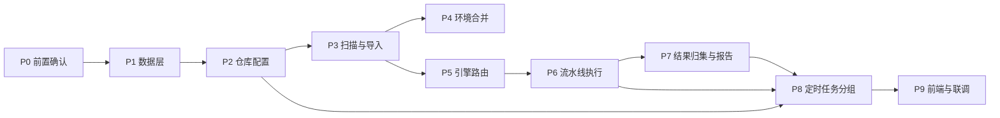

# 软件测试平台——GitLab 集成开发方案与计划

**文档版本**：V1.0
**日期**：2026-10-11
**状态**：起草中

---

## 1. 引言

### 1.1 编写目的

将 GitLab 集成的需求、概要与详细设计转化为可执行的开发路径：明确模块依赖与实施顺序、工作包清单、交付批次与验收门禁，作为开发排期、PR 审查与人工验收的共同依据。本文不排期、不给人天，功能行为与表结构以基线文档为准。

### 1.2 范围

覆盖：仓库配置、工程扫描与导入、环境合并、引擎路由与 CI 执行、定时任务分组改造、结果归集与报告聚合、前端页面与权限接入。

不覆盖：测试工程侧的 CI 配置改造属接入方职责（见需求分册附录），平台侧只提供约定文件模板；GitLab 实例自身的部署与升级不在本计划内。

### 1.3 基线文档

| 层 | 文档 | 用途 |
| ---- | ---- | ---- |
| 需求 | `docs/01-requirements/05-api-testing/11-api-srs-gitlab-integration.md` | 功能行为、业务规则与验收口径 |
| 概要 | `docs/02-high-level-design/05-api-testing/11-hld-api-gitlab-integration.md` | 模块职责边界与核心机制 |
| 详细 | `docs/04-detailed-design/05-api-testing/32-gitlab-integration-overview.md` | DDL、接口、错误码、业务逻辑 |
| 详细（改） | `docs/04-detailed-design/05-api-testing/27-scheduled-task-scheduler.md` | 定时任务分组与完成判据 |
| 详细（改） | `docs/04-detailed-design/02-project-module.md` | 模块源侧归属标识 |

### 1.4 定义与缩写

沿用需求分册「定义与缩写」（`docs/01-requirements/05-api-testing/11-api-srs-gitlab-integration.md` 1.4）；`WP` 指工作包，`P` 指实施阶段。

## 2. 开发方案

### 2.1 总体实施策略

**后端先行、纵向切片、每批可验收**：

1. 先落数据层与仓库配置，使「能连上、能保存」成立；
2. 再落导入链路，使「能把工程变成场景」成立；
3. 最后落执行链路，使「能跑、能出报告」成立；
4. 前端随每批后端能力同步交付，不整体后置。

依赖外部协作的项前置到 P0 处理：JavaParser 依赖需团队讨论确认、CI 配置改造约定需与接入方对齐、分批阈值需实测。任一未确认则对应工作包降级为不阻塞后续批次的可延后项。

### 2.2 分支与协作

基于 `develop` 拉 `feature/api-gitlab-integration`，批次内工作包按逻辑单元拆分提交，提交格式遵循总则 C7；合并走 PR，每批完成后合回 `develop` 再开下一批，不长期悬挂大分支。

### 2.3 模块依赖与实施顺序

顺序依据：数据层是全部能力的地基；导入先于路由（路由依赖场景来源属性）；流水线执行先于结果归集（归集依赖批次标识）；定时任务分组同时依赖路由与流水线执行，故置于其后。

### 2.4 技术实施要点

| 要点 | 说明 |
| ---- | ---- |
| 源码解析 | 结构化解析优先，块注释剥离为强制前置步骤；解析失败必须能区分「可预期」与「真实错误」两类并分别计数 |
| 稳定键合并 | 模块与场景均按源侧标识 upsert，禁止按名称匹配作为主判定路径 |
| 凭据 | 加密存取、只进不出，日志与异常消息脱敏 |
| 流水线对接 | 采用轮询而非回调，轮询状态落库以支持进程重启后恢复 |
| 异步回写 | 批次结果回收不得阻塞触发线程，完成判据以库中状态为准 |
| 定时任务改造 | 在既有触发链路中插入分组步骤，分组逻辑不得改变既有平台组行为 |

### 2.5 环境与依赖管控

| 依赖 | 处置 |
| ---- | ---- |
| JavaParser | **需团队讨论确认后引入**；未确认前解析器以可替换的内部抽象实现，接口不变 |
| GitLab API 客户端 | 优先使用既有 HTTP 组件封装，避免引入专用 SDK |
| 测试用 GitLab 实例 | 需可用的自建或托管实例与一个样例工程，用于联调 |
| 接入方 CI 改造 | 属外部依赖，P0 阶段对齐约定，未就绪不阻塞平台侧其余批次 |

## 3. 开发计划

### 3.1 阶段划分

| 阶段 | 名称 | 内容 | 前置 |
| ---- | ---- | ---- | ---- |
| P0 | 前置确认 | 依赖决策、CI 约定对齐、联调实例就绪 | — |
| P1 | 数据层 | 新表与扩展列迁移、错误码登记 | P0（依赖决策） |
| P2 | 仓库配置 | 配置 CRUD 与连通性测试 | P1 |
| P3 | 扫描与导入 | 源码解析、模块归属、增量同步、幂等闸门 | P1、P2 |
| P4 | 环境合并 | 环境读取、合并、封印 | P3 |
| P5 | 引擎路由 | 路由判定与批量分组 | P3 |
| P6 | 流水线执行 | 触发、分批、轮询、生命周期 | P2、P5 |
| P7 | 结果归集与报告 | 用例回收、映射、报告聚合 | P6 |
| P8 | 定时任务分组 | 分组插入与完成判据扩展 | P5、P6、P7 |
| P9 | 前端与联调 | 页面、权限、批次视图、端到端联调 | 各批次 |

### 3.2 工作包清单

| 编号 | 名称 | 阶段 | 依赖 | 产出 | 验收要点 |
| ---- | ---- | ---- | ---- | ---- | ---- |
| WP-0.1 | JavaParser 依赖决策 | P0 | — | 依赖引入结论 | 团队确认记录 |
| WP-0.2 | CI 配置改造约定对齐 | P0 | — | 变量名与结果上报约定 | 接入方确认 |
| WP-0.3 | 分批阈值实测 | P0 | — | 阈值取值结论 | 真实实例验证记录 |
| WP-1.1 | 迁移脚本 | P1 | WP-0.1 | 新表与扩展列 DDL | 存量数据不受影响 |
| WP-1.2 | 错误码登记 | P1 | — | 号段登记 | 与既有号段无冲突 |
| WP-2.1 | 仓库配置接口 | P2 | WP-1.1 | CRUD 与连通性测试 | 一项目一仓库、模式不可变 |
| WP-3.1 | 源码扫描与解析 | P3 | WP-0.1、WP-1.1 | 测试类与用例识别 | 块注释方法不计、两类失败分列 |
| WP-3.2 | 模块归属与场景生成 | P3 | WP-3.1 | 稳定键 upsert | 重复导入结果一致 |
| WP-3.3 | 幂等闸门 | P3 | WP-3.1 | 提交比对与跳过 | 预览与导入共用同一判定 |
| WP-4.1 | 环境合并与封印 | P4 | WP-3.1 | 合并写入与封印 | 保留用户自有条目 |
| WP-5.1 | 引擎路由与批量分组 | P5 | WP-3.2 | 路由判定与路由预览数据 | 三类输入判定正确 |
| WP-6.1 | 流水线触发与分批 | P6 | WP-2.1、WP-5.1 | 触发与批次记录 | 变量拼接与分批正确 |
| WP-6.2 | 状态轮询与恢复 | P6 | WP-6.1 | 轮询与重启恢复 | 重启后未完成批次可继续 |
| WP-7.1 | 用例结果回收与映射 | P7 | WP-6.1 | 结果回写 | 方法名映射准确 |
| WP-7.2 | 报告聚合 | P7 | WP-7.1 | 混合套件报告 | 二次更新不产生空洞 |
| WP-8.1 | 定时任务分组与完成判据 | P8 | WP-5.1、WP-6.1、WP-7.1 | 分组与判据扩展 | 平台组行为不变 |
| WP-9.1 | 仓库配置前端 | P9 | WP-2.1 | 设置页与状态分支 | 空态、失败、权限分支覆盖 |
| WP-9.2 | 导入前端 | P9 | WP-3.2、WP-3.3 | 预览、进度、失败明细 | 幂等拦截提示准确 |
| WP-9.3 | 执行入口与批次视图 | P9 | WP-5.1、WP-6.1 | 路由预览与进度 | 单按钮文案与分组一致 |

### 3.3 交付批次建议

| 批次 | 范围 | 验收重点 |
| ---- | ---- | ---- |
| 批次一（P1–P2） | 数据层 + 仓库配置 | 连通性测试可用；模式创建后不可变；令牌不回显 |
| 批次二（P3–P4） | 导入 + 环境合并 | 真实样例工程导入结果与预期用例数一致；重复导入幂等；解析失败不建场景 |
| 批次三（P5–P7） | 路由 + CI 执行 + 归集 | 单场景与批量执行路由正确；流水线结果完整回收；混合报告可读 |
| 批次四（P8–P9） | 定时任务 + 前端 | 混合任务完成判据正确；前端全状态分支覆盖 |

### 3.4 验收门禁

每批合并前须满足：

| 门禁 | 要求 |
| ---- | ---- |
| 质量 | `bash scripts/validate-backend.sh` 与 `bash scripts/validate-web.sh` 全绿，覆盖率达标（C8） |
| 规范 | 无 `any`（C1）、业务逻辑不在 Controller（C2）、异常经统一入口且错误码为 10 位（C3）、上下文不入 URL（C4） |
| 数据 | 迁移说明齐备、UUID 用默认策略、无物理外键（C5）、索引合规（C9） |
| 文档 | 详细设计与本计划的状态同步更新，错误码与 DDL 无漂移 |
| 人工 | 批次二起需用户人工验收，验收结果记录后再合入下一批 |

### 3.5 提交拆分建议

按「一个提交只做一件事」拆分：迁移脚本、错误码登记、配置接口、扫描解析、场景生成、幂等闸门、环境合并、路由、触发分批、轮询恢复、结果回收、报告聚合、任务分组、每个前端页面各自独立提交；文档改动与代码改动分提交。

## 4. 风险与应对

| 风险 | 影响 | 应对 |
| ---- | ---- | ---- |
| JavaParser 依赖未获确认 | 解析方案需替换 | 解析器收敛在内部抽象后，替换实现不影响上游 |
| CI 改造约定迟迟不定 | 流水线端到端无法验收 | 批次三后端先交付，端到端验收延后至约定确认后 |
| 分批阈值估计偏差 | 超长变量串触发失败 | P0 实测取值，代码中阈值可配、不硬编码 |
| 样例工程 YAML 大量缺失 | 导入结果低于预期 | 属可预期失败，验收以「失败清单准确」而非「全部成功」为准 |
| GitLab 版本差异导致 API 行为不一 | 触发或查询异常 | 连通性测试记录版本信息，对低版本给出明确不支持提示 |
| 定时任务改造影响既有平台链路 | 回归风险 | 分组逻辑独立单元测试，平台组路径行为逐条比对既有用例 |

## 5. 计划维护

- 工作包状态在本文件「工作包清单」的依赖列与状态中标记，完成一个勾一个；
- 基线文档变更（尤其是 DDL、接口与业务规则）须同步更新对应工作包的验收要点；
- 批次范围调整须说明原因并保留批次编号，不复用已交付批次号；
- 外部依赖（JavaParser 决策、CI 约定、阈值实测）确认后，将结论回写至 2.5 与对应工作包。

## 修改记录

| 版本 | 日期 | 说明 |
| ---- | ---- | ---- |
| V1.0 | 2026-10-11 | 初始版本：GitLab 集成开发方案与计划 |

| 版本 | 日期 | 说明 |
| ---- | ---- | ---- |
| V1.0 | 2026-10-11 | 初始版本：GitLab 集成开发方案与计划 |
