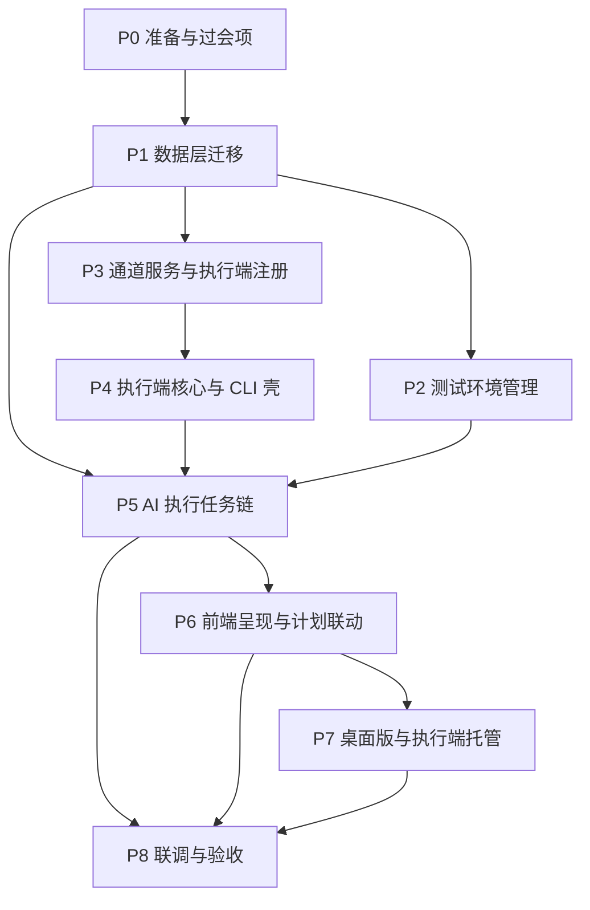

# 软件测试平台——AI UI 执行开发方案与计划

**文档版本**：V1.0
**日期**：2026-10-14
**状态**：起草中

---

## 1. 引言

### 1.1 编写目的

将 AI UI 执行（AI 驱动的 UI 自动化测试执行）能力的文档链（需求、概要、详细、交互、架构）转化为可执行的开发方案与阶段计划：明确总体实施策略、模块依赖与实施顺序、工作包清单、交付批次与验收门禁，作为开发排期、PR 审查与人工验收的共同依据。

### 1.2 范围

本计划覆盖以下交付内容：

1. **测试环境管理**：环境条目 CRUD、入口 URL 与执行参数、测试账号（掩码与占位符）、预置动作两级配置（项目级 / 环境级覆盖）；
2. **AI 执行后端链路**：`ui_execution` 任务类型接入、发起前置校验（含执行端可用性）、批次执行主循环（组装冻结 → 预置动作 → 用例级循环 → 步进决策 → 判定回写 → 止损）、两个提示词场景；
3. **通道服务与执行端**：执行端实例注册表、WSS 通道服务与分派规则、执行端（Runner）核心与 CLI 壳；
4. **轨迹与统计**：动作轨迹落库与查询、执行记录来源与跳过语义、计划五态统计与环境列改造；
5. **前端双形态**：环境管理页、发起确认弹窗、批次进度与取消、执行详情、计划页联动；
6. **桌面版**：Electron 壳包裹 `web/`（一套代码双形态）、托管执行端子进程（专属实例）与本机执行端面板。

不覆盖：本计划不描述功能行为、表结构、接口报文与页面交互细节，它们分别以需求、详细设计、交互设计文档为准；执行端与桌面壳的协议细节以 `docs/04-detailed-design/09-runner/02-runner-core.md` 为单一事实源。

**基线外依赖登记**：桌面版引入 `electron` / `electron-builder`、执行端引入 Playwright——均为过会项（概设 7 节、合并册 6.4），随 WP-0.1 落地登记于 2.5。

### 1.3 基线文档

| 层 | 文档 | 用途 |
| ---- | ---- | ---- |
| 需求 | `docs/01-requirements/03-function-testing/03-srs-ai-ui-testing.md` | 功能行为与验收口径（含执行端归属与分派、客户端形态业务规则） |
| 概要 | `docs/02-high-level-design/03-function-testing/03-hld-ai-ui-testing.md` | 模块划分、双形态客户端层、6.1 术语消歧与分派规则、7 部署视图 |
| 详细 | `docs/04-detailed-design/03-function-testing/09-ai-ui-testing.md` | 合并册：DDL、接口 3.1–3.10、错误码、主循环、执行端注册表与分派、前端与桌面版组件 |
| 详细 | `docs/04-detailed-design/09-runner/01-readme.md`、`docs/04-detailed-design/09-runner/02-runner-core.md` | 执行端通道协议单一事实源（帧、原因码、15 执行原语、CLI 壳与桌面版托管） |
| 详细 | `docs/04-detailed-design/03-function-testing/06-project-workspace-test-plan.md` | 测试计划改造（绑定环境、五态统计、skip 语义） |
| 详细 | `docs/04-detailed-design/07-ai-capability/02-ai-infra-overview.md` | AI 底座（任务框架、`ui_execution` 任务类型与提示词场景登记） |
| 详细 | `docs/04-detailed-design/02-project-module.md` | 10 位错误码号段登记（1000011031–1000011060） |
| 交互 | `docs/05-interaction-design/03-function-testing/07-workspace-ui-ai-execution.md` | 页面设计单一分册（环境页、编辑器、弹窗、批次条、执行详情、计划联动、本机执行端面板） |
| 交互 | `docs/05-interaction-design/03-function-testing/02-workspace-ui-overview.md` | 左侧菜单与执行结果跳过态登记 |
| 架构 | `docs/03-architecture/02-repository-architecture.md` | `runner/`、`desktop/` 顶层目录职责与选型 |

### 1.4 定义与缩写

| 术语 | 定义 |
| ---- | ---- |
| 执行端（Runner） | 在浏览器中执行动作、回传观察的独立进程组件；不决策、不判定、不持有模型凭据（定义唯一处为概设 6.1） |
| 共享实例 / 专属实例 | 执行端实例的两种归属：`cli` 独立部署为共享（任意用户批次可分派、优先）；`desktop-hosted` 桌面版托管为专属（仅本人批次、共享缺失时兜底） |
| 批次 | 一次 AI 执行发起的完整执行过程，对应一个 AI 任务实例 |
| 预置动作 | 确定性动作序列（典型为登录），由执行端直跑、不经模型；两级配置（项目级默认、环境级覆盖） |
| 步级预算 | 每步骤的动作下发次数上限，计数在服务端；达上限步骤判 blocked |
| 工作包 | 计划的实施单元，编号 WP-*；本文只描述工作包与依赖，不排期、不给人天 |
| 交付批次 | 面向验收与合入的分组，一批对应一个可独立验收的范围 |

## 2. 开发方案

### 2.1 总体实施策略

1. **文档驱动**：实现严格以 1.3 基线文档为唯一依据；发现实现与文档冲突时暂停，先由用户确认以哪边为准，再改文档或改代码，禁止静默偏离。
2. **数据先行、通道先行**：先交付数据库迁移，再落通道服务与执行端注册表，然后是 AI 执行任务链，最后按交互稿做前端与桌面版。
3. **服务端为唯一决策面**：预算计数、分派选择、白名单与枚举校验、判定全部在服务端；执行端只执行与观察，客户端与执行端之间无直连（桌面版托管也不例外）。
4. **后端先行于前端**：接口经 springdoc 暴露 OpenAPI 后，前端按契约并行；API 变更先后端后前端。
5. **凭据最小暴露**：明文仅在 `session.start` 帧内存处理过程出现，不落日志、不进轨迹、不进模型上下文；前端永不接触明文。
6. **提交粒度**：一个提交只做一件事（C7），前后端变更分属不同提交，严格目录隔离（只改本端目录）；`runner/`、`desktop/` 独立构建链的提交同样纳入各端门禁管理（见 2.5）。

### 2.2 分支与协作

- **分支模型**：`master` ← `develop` ← `feature/*`（总则 `docs/00-spec/30-quality-delivery/02-workflow.md` 第 1 章）；当前工作分支 `feature/ai-ui-testing-srs`，批次收口后向 `develop` 发 PR，不在本地直接合入。
- **提交规范**：`<emoji> <type>(<scope>): <description>`，scope 按业务域（如 `ftenv`、`ft`、`ai`、`runner`、`desktop`）。
- **门禁**：提交前运行本端验证脚本至 EXIT=0（文档端 `node scripts/validate.mjs --docs`，前端 / 后端各自脚本），覆盖率满足 C8；`runner/` 与 `desktop/` 工程落地时同步纳入质量脚本登记（合并册 6.2 口径）。
- **跨端同步**：接口经 OpenAPI 分组同步；执行端帧协议以 Runner 详设 3 为单一事实源，服务端与执行端两侧按 6.3 对接清单互验。

### 2.3 模块依赖与实施顺序

### 2.4 技术实施要点

按模块列出实施要点；细节一律以对应基线文档为准，本文不重复定义。

#### 2.4.1 数据层与迁移

- 四张新表（`ft_environment`、`ft_preset_actions`、`ui_action_log`、`ai_runner_instance`）DDL 见合并册 2.1 / 2.3；`test_plan_execution_record` 补 `source` 列（默认 `manual`，无回填）；
- 符合 C5（公共四字段、UUID 框架默认策略、无物理外键）与 C9（索引每表 ≤5）；`ai_runner_instance` 为部署级注册表、不做工作空间过滤（合并册 2.3 归属口径）；
- 迁移以 `schema.sql` 初始化基线为口径（合并册 6.2），迁移说明随首个涉及数据库的提交交付。

#### 2.4.2 测试环境管理

- 环境 CRUD、入口 URL 列表、执行参数（viewport / 动作超时 / allow_evaluate / 步级上限）、项目内默认环境唯一；权限 `funcenv:view` / `funcenv:edit`（项目作用域）；
- 账号密码加密落库，列表与详情掩码回显、永不回明文；「复制环境」为纯前端行为（详情填充新建表单、密码全部留空、走既有创建接口，后端零改动）；
- 预置动作两级配置：项目级单行表 + 环境级覆盖，三级兜底（皆无 → AI 自主登录）；服务端在 `session.start` 组装时按解析优先级定稿，引用解析与白名单一并完成（合并册 4.5）；
- 数据更新只更新传入字段（C11）；业务异常统一 10 位错误码（C3）。

#### 2.4.3 通道服务与执行端注册

- 服务端监听 `wss://{server}/ws/runner`，长连接注册态：首帧 `register`（`desktop-hosted`+`ownerToken` / `cli`+`sharedKey`）upsert 注册表并回 `register.ack`，注册为部署级行为不校验工作空间上下文；
- 分派规则三级：在线 `cli` 共享（心跳最新优先）→ 提交人本人在线 `desktop-hosted` → 皆无报 1000011042；同一实例同一时刻仅一个进行中批次；
- 发起前置校验（后端强制）：提交时校验「存在在线共享或本人专属实例」，precheck 提供同规则只读快照（`runner{available,preferred,count}`）；
- 心跳 60s 缺失置 `offline` 摘除出分派池；凭据解密、白名单与原语枚举二次校验、`budgetSeq` 预算计数全部服务端完成（合并册 4.1）。

#### 2.4.4 执行端核心与 CLI 壳

- 协议帧、原因码、15 执行原语与观察结构以 Runner 详设 3 为单一事实源；`done` 为服务端语义原语不下发；
- 会话状态与凭据映射仅存内存，批次结束立即清零；截图走文件域上传后以 `screenshot_ref` 引用；
- CLI 壳：`runner start --config <path>`，`sharedKey` 注册为共享实例；日志统一脱敏过滤器（密码 / Authorization / 凭据帧显示 `***`）；
- 本地调试 `headless=false` + dev 服务端通道；协议版本不兼容回 `PROTOCOL_VERSION`。

#### 2.4.5 AI 执行任务链

- `ui_execution` 任务类型挂入既有 `TaskHandler` 注册机制（进度上报 / SSE / 超时 / 失活清扫全复用，AI 底座详设）；
- 主循环：组装冻结 → 预置动作直跑（失败即 blocked，不烧预算）→ 用例级循环（前置 / 动作 / 验证 / 判定 / 止损）→ 判定回写执行记录（来源 `source=ai`，skip 语义）；
- 步进决策：组包（冻结上下文 + 轨迹历史 + 最新观察 + 收敛注入）→ 模型调用（`ui_execution_decision` / `ui_execution_verdict` 两场景）→ 解析为动作或步骤完成；
- 预算三级熔断（步级上限 / 批次时长 / 连续失败停批）计数在服务端；错误码 1000011031–1000011042（合并册 3.11）。

#### 2.4.6 轨迹与计划联动

- 轨迹追加式落 `ui_action_log`（action / action_failed / verdict / note），分页查询供执行详情；批次结束只读；
- 计划改造：`environment` 列改存 `ft_environment.id` 并联表展示 `environmentName`（关联不上显示「已删除环境」）、五态统计（新增 skipped）、手动标记仍四态（服务端双保险拒绝 skip）。

#### 2.4.7 前端双形态与桌面版

- 环境管理页挂功能测试页 `?tab=ft-environments` 子路由（双端可用）；表单化预置动作编辑器用 Element Plus 拼装，无新依赖；
- 发起弹窗、批次条、执行详情、计划联动页面行为以交互分册 07 为唯一依据；发起入口与取消双端一致渲染，执行端可用性以后端校验为准；
- 形态判别全局单例（Electron 全局桥存在即桌面版），显隐为呈现策略、非安全边界；
- 桌面版：`desktop/` 壳工程包裹 `web/` 构建产物，随登录以子进程拉起 Runner 核心并以 `ownerToken` 注册专属实例，渲染进程不直连 Runner；设置区「执行端」面板（在线 / 离线 / 注册中 / 启动失败四态、启停、脱敏日志抽屉）。

### 2.5 环境与依赖管控

| 项 | 要求 |
| ---- | ---- |
| 数据库 | PostgreSQL 14+，沿用既有实例，无新扩展 |
| LLM 供给 | 沿用 AI 底座配置中心接入；执行决策与判定各需一个可用模型 |
| 实时通道 | 复用既有 WebSocket 服务承载 Runner 通道；进度沿用既有 SSE 任务通道 |
| 浏览器运行时 | 执行端宿主机需可安装 Playwright 浏览器；开发环境先验证 CDP 观察链路 |
| 依赖管控 | 尽量不新增外部依赖，确有必要时经团队讨论（总则第 5 节） |
| 新增外部依赖（过会项） | Playwright（执行端浏览器驱动与 CDP 观察），随 WP-0.1 过会后引入，登记于此 |
| 新增外部依赖（过会项） | Electron + electron-builder（`desktop/` 桌面版壳），随 WP-0.1 过会后引入，登记于此 |

## 3. 开发计划

### 3.1 阶段划分

| 阶段 | 名称 | 内容概要 | 前置依赖 |
| ---- | ---- | ---- | ---- |
| P0 | 准备与过会项 | Playwright / Electron 依赖过会、`runner/` `desktop/` 目录立项、LLM 端点确认 | — |
| P1 | 数据层迁移 | 四新表 + `source` 补列 DDL 与索引迁移 | P0 |
| P2 | 测试环境管理 | 环境与预置动作后端、环境管理前端 | P1 |
| P3 | 通道服务与执行端注册 | 注册表、WSS 通道、分派与发起前置校验 | P1 |
| P4 | 执行端核心与 CLI 壳 | 协议、15 原语、观察、CLI 壳 | P3 |
| P5 | AI 执行任务链 | `ui_execution` 接入、主循环、判定回写、提示词场景 | P2、P3、P4 |
| P6 | 前端呈现与计划联动 | 发起弹窗、批次条、执行详情、计划五态与环境列 | P5 |
| P7 | 桌面版与执行端托管 | Electron 壳、Runner 托管、执行端面板、形态判别 | P6 |
| P8 | 联调与验收 | 分批联调、权限与覆盖率校验、人工验收 | 各批次 |

### 3.2 工作包清单

| 编号 | 工作包 | 阶段 | 端 | 输入文档 | 依赖 | 完成判据 |
| ---- | ---- | ---- | ---- | ---- | ---- | ---- |
| WP-0.1 | 过会项与目录立项（Playwright、Electron，`runner/` `desktop/`） | P0 | 全 | 概设 7、合并册 6.4、架构文档 | — | 依赖决议落地并登记 2.5；`runner/` `desktop/` 骨架与独立构建链就绪 |
| WP-0.2 | 联调环境准备（LLM 端点 + Playwright 浏览器） | P0 | 后端 | AI 底座详设环境章节 | — | 模型连通性测试通过；执行端宿主机可拉起浏览器 |
| WP-1.1 | 数据层迁移（四新表 + `source` 补列） | P1 | 后端 | 合并册 2.1–2.3、6.2 | WP-0.2 | 迁移执行成功，C5 / C9 达标，无回填 |
| WP-2.1 | 测试环境管理后端（CRUD / 掩码 / 默认环境 / 预置动作两级） | P2 | 后端 | 合并册 3.1–3.6、4.3–4.5 | WP-1.1 | OpenAPI 暴露，`funcenv:*` 校验生效，错误码合规，C11 部分更新 |
| WP-2.2 | 测试环境管理前端（环境页、预置动作编辑器、复制环境） | P2 | 前端 | 交互分册 2.1–2.2 | WP-2.1 | 状态分支齐全，C1 无 `any`，复制环境密码全留空 |
| WP-3.1 | 通道服务与执行端注册（WSS、注册表、分派、前置校验） | P3 | 后端 | 合并册 2.3、3.7、4.1，Runner 详设 3.1–3.2 | WP-1.1 | 注册 / 心跳 / 摘除走通；三级分派与归属校验生效；precheck `runner` 快照与提交校验一致 |
| WP-4.1 | 执行端核心与 CLI 壳（协议、15 原语、观察、脱敏日志） | P4 | Runner | Runner 详设 3–6 | WP-3.1 | 对 dev 服务端完成注册 → 会话 → 原语执行 → 观察回传全链；日志脱敏验证通过 |
| WP-5.1 | `ui_execution` 任务接入（类型、precheck、发起校验、取消） | P5 | 后端 | 合并册 3.7–3.8、4.1 前置校验段，AI 底座详设 | WP-3.1 | 任务创建校验链完整（总开关 → 权限 → 模型 → 环境 → 执行端可用性）；取消口径生效 |
| WP-5.2 | 批次执行主循环与步进决策 | P5 | 后端 | 合并册 4.2–4.6，两提示词场景 | WP-5.1、WP-2.1、WP-4.1 | 组装冻结、预置动作兜底、预算三级熔断、判定回写 `source=ai` 与 skip 语义全部走通 |
| WP-5.3 | 轨迹接口与计划联动改造（action-logs、五态、环境列） | P5 | 后端 | 合并册 3.9–3.10，测试计划详设改造章节 | WP-5.2 | 轨迹分页查询、五态统计与 `environmentName` 展示口径生效，手动标记双保险拒绝 skip |
| WP-6.1 | 前端发起与批次呈现（弹窗、批次条、执行详情、计划页联动） | P6 | 前端 | 交互分册 2.3–2.6、3–5 | WP-5.1、WP-5.3 | `no_runner` 等分支齐全，SSE 进度与取消走通，C1 无 `any` |
| WP-7.1 | 桌面版壳与执行端托管（`desktop/`、ownerToken、执行端面板、形态判别） | P7 | 全 | 合并册 5.3、6.4，交互分册 2.7，Runner 详设 5 | WP-6.1、WP-4.1 | 一套代码双形态渲染正确；登录即注册专属实例、登出 / 超时下线；执行端面板四态与脱敏日志达标 |
| WP-8.1 | 分批联调与验收 | P8 | 全 | 各批对应文档 | 各批工作包 | 验证脚本 EXIT=0、C8 达标、人工验收通过 |

> 说明：P4 可与 P5 前半（WP-5.1）并行推进（WP-5.1 不依赖执行端可执行，仅 WP-5.2 主循环联调需要 WP-4.1 就绪）；WP-7.1 中形态判别的公共单例（`window.electronBridge` 检测）随 WP-6.1 先行落地，Web 版行为不受 P7 排期影响。

### 3.3 交付批次建议

按依赖关系建议三批交付，每批在 `develop` 收口一次 PR 并保留可发布状态：

| 批次 | 覆盖阶段 | 范围 | 验收重点 |
| ---- | ---- | ---- | ---- |
| 批次一 | P0、P1、P2 | 测试环境管理（双端可用的配置能力，不依赖执行链路） | 环境 CRUD 与掩码、预置动作两级配置与兜底、复制环境密码留空、默认环境唯一 |
| 批次二 | P3、P4、P5 | 通道服务、执行端核心与 AI 执行后端链路 | 注册与分派三级规则、发起前置校验拒绝、CLI 壳端到端批次（预置动作 → 步进决策 → 判定回写）、轨迹落库、预算熔断 |
| 批次三 | P6、P7 | 前端双形态与桌面版托管 | 发起弹窗与 `no_runner` 分支、批次进度与取消、执行详情轨迹、计划五态、桌面版双形态渲染与执行端面板 |

批次间关系：批次二依赖批次一的环境数据（`session.start` 组装取环境配置）；批次三前端按 OpenAPI 契约可与批次二并行开发，端到端联调待批次二收口。

### 3.4 验收门禁

每批收口必须全部满足：

1. 本端验证脚本 EXIT=0（C7 提交格式 + lint / typecheck / 测试 + 覆盖率 C8 + 契约一致性）；
2. 无 `any`（C1）、Controller 无业务逻辑（C2）、异常与错误码合规（C3）、上下文头传递（C4）、迁移与索引合规（C5 / C9）；
3. API 文档随接口变更同步（springdoc），实现与文档冲突已按 2.1 第 1 条处理；
4. 关键路径人工验收，验收结果回填本计划的修改记录说明。

人工验收关键路径（每批至少覆盖）：

- 批次一：环境 CRUD 与密码掩码、预置动作环境级覆盖项目级、复制环境表单填充；
- 批次二：执行端注册与心跳失活摘除、共享优先分派与专属兜底、无可用执行端拒绝发起、CLI 壳完整批次（含失败原因码轨迹与预算熔断）；
- 批次三：发起弹窗执行端提示与 `no_runner` 分支、批次条进度与取消、执行详情轨迹与四值判定、计划五态统计、桌面版专属实例注册与本机执行端面板。

## 4. 风险与应对

| 风险 | 影响 | 应对 |
| ---- | ---- | ---- |
| 浏览器自动化不稳定（元素定位失败、页面渲染差异） | 批次大面积 blocked | 机械等待 + 原因码失败观察，AI 换路决策；轨迹与截图留痕供人工复核；步级上限止损 |
| 凭据明文经通道下发 | 泄露面扩大 | 帧不落日志、不进轨迹与模型上下文；执行端内存持有、批次结束清零；日志统一脱敏过滤器 |
| AI 决策质量不达预期 | 误判定 / 预算浪费 | 判定纪律「证实才通过、证据不足 blocked」；预置动作直跑不经模型；预算三级熔断；V1 不做通知，页面可见 |
| 执行端实例全离线 | 用户无法发起 | 发起前置校验提前拒绝并给出可操作提示（启动桌面版 / 联系运维部署）；桌面版托管提供专属兜底 |
| Electron 打包体积与双形态回归成本 | 前端交付延后 | 一套代码双形态，显隐差异仅在前端呈现层；桌面版随批次三最后交付，Web 版不受阻塞 |
| 长周期分支偏离 develop | 合入冲突 | 批次收口即发 PR 合入 develop，期间定期同步 |
| 跨端契约漂移（服务端 ↔ 执行端 ↔ 前端） | 联调返工 | 帧协议单一事实源（Runner 详设 3）+ OpenAPI 先行；验收门禁含契约一致性检查 |
| 新增外部依赖 | 违反依赖管控 | Playwright / Electron 均为过会项，过会后引入并登记 2.5 |

## 5. 计划维护

- 阶段、工作包与批次随基线文档变更同步调整，调整走文档流程二并追加修改记录；
- 本文只维护阶段与依赖，不登记人天与日历排期；排期由管理者在本文之外按资源换算；
- 批次实际收口情况（验收结果、遗留项）记入对应修改记录行的说明。

## 修改记录

| 版本 | 日期 | 说明 |
| ---- | ---- | ---- |
| V1.0 | 2026-10-14 | 初始版本：总体实施策略、九阶段依赖、11 个工作包与三批交付建议；登记 Playwright / Electron 过会项 |
