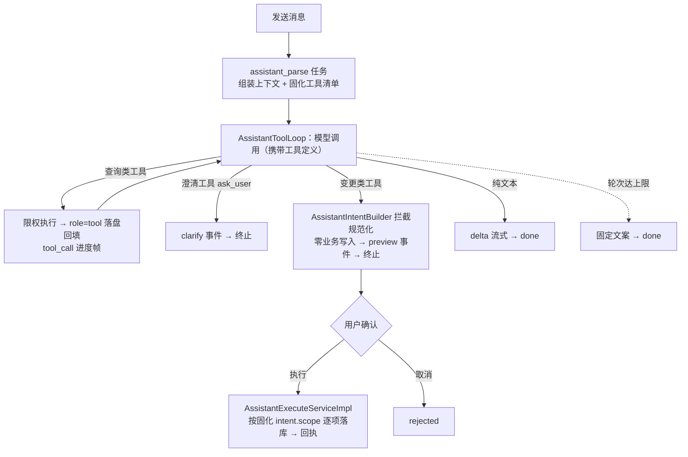

# 软件测试平台——智能助手工具调用重构方案与计划

**文档版本**：V1.0
**日期**：2026-10-16
**状态**：起草中

---

## 1. 引言

### 1.1 编写目的

落实主计划 `docs/06-implementation-plan/02-ai-requirement-development-plan.md` 登记的 WP-6.3（助手机制重构为工具调用）：将已定稿的需求 / 概要 / 详细 / 交互四层文档口径转化为**文件级实施路径、提交拆分、实施顺序与验收门禁**，供编码实施与 PR 审查使用。

### 1.2 范围

- **覆盖**：① 后端工具体系与调用循环（`assistant_parse` 执行语义由提示词分流改为工具调用循环）；② 模型门面 `AiModelClient` 的工具调用扩展（Spring AI 接入，逐跳记账）；③ 消息表工具载荷补列、消息历史过滤与悬空补偿；④ 静态平台指引恢复并入知识检索；⑤ 前端执行请求头改造（删项目头）与查询进度帧；⑥ 旧判别段实现清理与提示词场景存量兼容（2.8）。
- **不含**：会话 / 消息 CRUD、SSE 断线恢复等既有链路的行为变更（仅事件表增 `tool_call` 帧）；确认执行与回执链路（`AssistantExecuteService` 仅按固化 `intent.scope` 取目标项目，其余不动）；助手附图与 vision 能力（独立方案 `docs/06-implementation-plan/04-ai-vision-capability-plan.md` WP-V.3）；新增错误码（本轮零新增）。

### 1.3 基线文档

| 层 | 文档 | 用途 |
| ---- | ---- | ---- |
| 需求 | `docs/01-requirements/07-ai-capability/04-srs-ai-assistant.md` | 功能边界与业务规则（追问选项、查询补全、项目选择会话私有、零切换执行） |
| 概要 | `docs/02-high-level-design/07-ai-capability/02-hld-ai-capability.md` | 4.2 任务确认流、4.7 对话式任务执行（三类能力与待确认态） |
| 详细 | `docs/04-detailed-design/07-ai-capability/04-ai-assistant.md` | **主基线**：工具清单与循环（4.1）、执行校验与作用域（4.2）、intent 结构（4.3）、上下文规则（4.4）、SSE 事件（3.5）、错误码（6）、实施说明（7） |
| 详细 | `docs/04-detailed-design/07-ai-capability/02-ai-infra-overview.md` | 助手表 DDL（2.9）、任务类型 `assistant_parse`（3.6.1）、用量归因（4.3） |
| 交互 | `docs/05-interaction-design/07-ai-capability/05-ai-assistant-ui.md` | 查询进行态、澄清卡来源选项、确认执行口径与状态分支（2.2–2.4） |
| 计划 | `docs/06-implementation-plan/02-ai-requirement-development-plan.md` | WP-6.3 登记、批次三框架与验收门禁 |

### 1.4 定义与缩写

| 术语 | 定义 |
| ---- | ---- |
| 工具 | 详设 4.1 服务端固化注册的 16 个模型可调用能力：查询 / 检索 7、澄清 1（`ask_user`）、变更 8 |
| 跳 | 循环内一次模型调用；单条消息上限 5 跳（详设 4.1） |
| 拦截规范化 | 变更类工具调用被服务端拦截，按字段白名单与引用校验固化为 `intent`，确认前零业务写入（详设 4.1 / 4.2） |
| 会话私有项目 | `context_snapshot` 内 `projectId / projectName`：解析或澄清写入，仅会话内生效，不改全局选择、不进请求头 |
| 悬空补偿 | 任务中断时为缺回填的 `tool_calls` 补「未执行」`role = tool` 消息，保证协议配对（详设 4.1） |

---

## 2. 开发方案

### 2.1 现状分析

- **解析执行器**：`AssistantParseHandler` 现为单跳非流式判别（`chat` 一次输出 JSON 分流 clarify / intent / answer）+ 问答段流式（`streamChat`）；`buildIntent / assemble / sanitized*` 等规范化私有逻辑内聚其中，无工具注册与 `tool_calls` 回传概念。
- **模型门面**：`AiModelClient` 仅 `chat / streamChat` 两形态，`buildOptions` 构建 `OpenAiChatOptions` 时不含任何工具声明；用量逐调用记账（`ai_usage_log`，`task_id = NULL`，scene 二分）已就绪。
- **数据与消息**：`ai_assistant_message` 无 `tool_calls / tool_call_id` 列，`role` 枚举无 `tool`；消息历史接口不需过滤中间消息。
- **提示词上下文**：`AssistantPromptSupport` 静态注入 `caseOptions / reviewOptions / planOptions` 候选清单，与「候选按需查询」的定稿口径冲突。
- **前端**：`getRequestContextScope` 将 execute 划为 `project` 上下文（自动注入 `X-Active-Project`），与「助手接口一律不携带项目头」的定稿口径冲突；SSE 分发无 `tool_call` 事件。
- **可复用遗产**：被移除的旧 function calling 方案（`7a5d6b23`）中 `ai/guide/*.md` 平台指引静态片段与 roles / topic 检索逻辑可原样捞回，供 `search_knowledge` 静态段使用。

### 2.2 总体结构



> 行为定义一律以上表所引详设章节为准，本方案只写实施路径，不重复业务规则。

### 2.3 后端设计

#### 2.3.1 新增文件（`server/src/main/java/.../service/ai/assistant/`）

| 文件 | 职责 |
| ---- | ---- |
| `tool/AssistantTool.java`、`tool/ToolCategory.java`、`tool/AssistantToolDefinition.java`、`tool/AssistantToolContext.java` | 工具接口、分类枚举（`QUERY / CLARIFY / CHANGE`，决定循环行为）、定义 record 与执行上下文（userId / workspaceId / conversationId / attachments / 会话私有项目） |
| `tool/AssistantToolRegistry.java` | 服务端**固化注册 16 个**：9 个执行体注册 + 变更 8 项 definition-only 登记（无执行体，执行即拦截）；清单外调用按 1000018255 拒绝 |
| `tool/QueryProjectsTool`、`QueryDocTreeTool`、`QueryCasesTool`、`QueryReviewsTool`、`QueryPlansTool`、`QueryProgressTool` | 查询类执行体：一律按活跃工作空间限权（与 RAG 同口径）；失败返回 error JSON **不抛异常**（回填模型，详设 4.1） |
| `tool/SearchKnowledgeTool`、`tool/GuideKnowledgeBase` | 知识检索二合一：静态指引段（roles 过滤 + topic 匹配 + 站内 route，Top3）→ RAG 向量段（复用 `VectorSearchService`，TOP_K = 8）；降级口径按详设 4.1 |
| `tool/AskUserTool` | 澄清入参校验（`question` 非空、`options` 2~5 条各 ≤200 字） |
| `tool/AssistantIntentBuilder` | 变更类拦截规范化：**自 `AssistantParseHandler` 迁移** `buildIntent / assemble / sanitizedChanges / sanitizedParams / parseCaseIds`（kind 白名单、字段白名单、`AssistantRefChecker` 引用校验、scope 与 10 分钟过期固化），独立成类便于单测 |
| `AssistantToolLoop.java` | 循环编排（2.3.3） |
| `server/src/main/resources/ai/guide/*.md` | 平台指引静态片段，**从 `7a5d6b23` 原样捞回**（内容不改写） |

#### 2.3.2 修改文件

| 文件 | 改动 |
| ---- | ---- |
| `service/ai/config/AiModelClient.java` | 新增 `chatWithTools(...)`：工具定义经 Spring AI 注册并返回 `toolCalls`（接入点见 2.6）；逐跳复用 `writeUsage` 记账 |
| `service/ai/config/AiChatReply.java` | 扩展或并列 record（`content / toolCalls[] / tokensIn / tokensOut`） |
| `service/ai/task/handler/AssistantParseHandler.java` | 重写为薄壳：校验、上下文与提示词组装 → 调 `AssistantToolLoop` → TaskResult；`DEFAULT_PROMPT` 重写为 agent 指令版（详设 4.1 行为口径） |
| `service/ai/assistant/AssistantPromptSupport.java` | 删除 `caseOptions / reviewOptions / planOptions` 静态清单；`contextText` 增补会话私有项目状态与候选优先级说明 |
| `service/ai/assistant/AssistantServiceImpl.java` | 落盘扩展：assistant 消息持久化 `toolCalls`、新增 `appendToolMessage(toolCallId, content)`；`pageMessages` **过滤 `role = tool`** |
| `model/entity/ai/AiAssistantMessage.java`、`model/dto/response/ai/AiAssistantMessageRespDTO.java` | 补 `toolCalls / toolCallId` 字段（DTO 不外露 tool 消息） |
| `controller/ai/AiAssistantController.java` | 仅 `@Operation.description` 事件清单补 `tool_call`，**签名零变化** |
| `framework/common/ErrorCodeConstants.java` | 1000018256 注释语义收窄为空间维自检（错误码表在详设 6 已同步；**无新增码**） |

#### 2.3.3 循环编排要点（行为定义见详设 4.1，此处仅列实现落点）

- 轮次常量 `MAX_TOOL_LOOPS = 5`，达上限以固定文案落 `done`（正常终止，非错误码）；
- QUERY 串行执行 → `role = tool` 落盘 → 发 `tool_call{toolName, summary}` 帧 → 回填下一跳；
- CLARIFY / CHANGE **先落盘再发事件**（`clarify` / `preview` + `done`）后终止，CHANGE 全程零业务写入；
- 纯文本末跳走 `streamChat` 形态（scene = `assistant_answer`），其余各跳 scene = `assistant_parse`；
- 异常：已流出正文随 `error` 落盘（沿用 `failMessage` 口径）；中断时执行**悬空补偿**；
- 上下文组装：system（角色指令 + 页面上下文 + 会话私有项目）+ 近 20 条消息（含 tool 消息）+ 工具定义；用量每跳一条（`task_id = NULL`）。

#### 2.3.4 数据库变更（C5 迁移说明，随 PR，DDL 见总册 2.9）

```sql
ALTER TABLE ai_assistant_message ADD COLUMN tool_calls   jsonb NULL;
ALTER TABLE ai_assistant_message ADD COLUMN tool_call_id varchar(64) NULL;
-- role 枚举扩展 'tool'；加列不回填、不新增索引（配对查询走既有会话索引）
```

- 同步 `server/src/main/resources/db/schema.sql`；
- `context_snapshot` 内会话私有项目为 jsonb 结构调整，**无 DDL**；
- 存量消息无工具载荷，不受影响，无需数据订正。

### 2.4 前端设计（行为见交互稿 2.2–2.4）

| 文件 | 改动 |
| ---- | ---- |
| `web/src/services/index.ts` | `getRequestContextScope`：execute 路径 `'project'` → `'workspace'`（删项目头），注释同步 |
| `web/src/services/assistantSse.ts` | 事件分发补 `tool_call` 类型（未知事件忽略，向后兼容） |
| `web/src/stores/aiAssistant.ts` | 流式阶段文案状态：`tool_call` 帧 →「正在查询…」，delta / done 清除；轮次超限按普通助手消息渲染 |
| `web/src/components/ai/assistant/*` | 气泡内查询进行态展示（复用 StreamIndicator 样式） |
| 对应 `*.spec.ts` | `tool_call` 分发与进度文案、execute 请求头无 `X-Active-Project` 断言 |

### 2.5 OpenAPI 与契约

- 接口签名零变化，仅 SSE `@Operation` 事件清单增 `tool_call`；
- 契约基线重导出沿用 WP-9.1 统一收口口径（本轮无新增 REST 端点，无前端类型再生前置）。

### 2.6 Spring AI 工具调用接入点（编码首日 spike 先行）

需求：向模型**声明** 16 个工具，但循环控制、执行权、逐跳记账、轮次上限与进度帧全部由 `AssistantToolLoop` 掌握（不使用框架内部自动循环）。C10 约束：经 Spring AI 执行，不自实现 HTTP。

| 方案 | 机制 | 取舍 |
| ---- | ---- | ---- |
| **P1（首选）** | 工具经 `OpenAiChatOptions` / `ToolCallback` 声明；以可替换的 `ToolCallingManager`（或 2.0.x 等价扩展点）**中止框架内部执行循环**，将 `toolCalls` 与响应账单（usage）一并交还调用方 | 记账、帧、上限完全自控；需探明 2.0.x 实际扩展点签名 |
| **P2（回退）** | ToolCallback 全部委托我方 `AssistantToolRegistry`，以受控中止信号截停框架循环，中止信号携带 usage 供 `writeUsage` 记账 | 满足自控需求，但依赖异常传播语义，健壮性弱于 P1 |

- **首日 spike**：以 ≤30 行验证「声明工具 + 中止内部循环 + usage 可取」；两条路均不自实现 HTTP（C10 合规），spike 结论回填本文 5.1 后再铺开实施。

### 2.7 测试策略（C8 ≥ 70%，测试要点基线见详设 7）

| 落点 | 覆盖 |
| ---- | ---- |
| `AssistantToolLoopTest`（新） | 轮次上限与固定文案终止、读工具失败回填不中断、澄清 / 变更先落盘再发事件与终止、悬空补偿配对、用量 scene 归因 |
| `AssistantIntentBuilderTest`（新） | kind 与字段白名单矩阵、越权 / 幻觉引用拒绝（1000018261）、scope 与过期固化、**规范化路径零业务写入** |
| 查询工具与 `GuideKnowledgeBase` 测试（新） | 工作空间限权过滤、指引 roles / topic 检索与 RAG 降级双分支 |
| `AiModelClient` 测试（扩） | `chatWithTools` 工具声明与 `toolCalls` 回传、逐跳记账（成功 / 失败） |
| `AssistantServiceImpl` 测试（扩） | tool 消息落盘与 `pageMessages` 过滤、toolCalls 持久化 |
| execute 测试（扩） | 按固化 `intent.scope` 落库且**无项目维拦截**、空间维自检（1000018256）与归属空间（1000018263）拒绝 |
| 前端 spec | `tool_call` 解析与进度文案、execute 请求头断言 |

### 2.8 旧实现清理与兼容

> **边界**：只清理「新路径上线后成为死代码 / 死配置」的存量；被共用的能力与其他会话已评估保留的口径不动。

#### 2.8.1 代码双路径（层 A：随包删除，不留运行时兜底开关）

| 清理对象 | 处置 | 归属提交 |
| ---- | ---- | ---- |
| `AssistantParseHandler` 判别段全部：`JUDGE_SYSTEM`、JSON 版 `DEFAULT_PROMPT`、`parseJudge`、`judgeVariables`（含三静态清单变量）、`handleClarify / handleIntent / handleAnswer / staticAnswer` | 整体删除——分别由 `AskUserTool`、`AssistantIntentBuilder`、循环末跳替代；handler 收敛为薄壳（校验 + 组装 + 调循环） | 提交 4 |
| `ANSWER_SYSTEM` + `SCENE_ANSWER` 独立渲染链（`render(SCENE_ANSWER, …)` 调用点） | 删除——末跳回答在循环内基于工具结果生成，`assistant_answer` 仅保留为用量归因标签（总册 4.3），不再有模板渲染 | 提交 4 |
| `AssistantPromptSupport` 的 `caseOptions / reviewOptions / planOptions` 及其专用查询 | 删除（查询工具按需自查） | 提交 2 |
| 旧测试：`AssistantParseHandlerTest` 判别分流断言、`AssistantPromptSupportTest` 三清单用例 | 同步重写 / 删除，**不留新旧双份断言** | 随各提交 |
| `RequirementSuggestionParser.parseJsonObject`、`ModelOutputSupport` 中仅判别段专用的方法 | 全仓查引用后删；被需求生成链共用的一律不动 | 提交 4 |

- **原则**：不做「旧路径运行时兜底开关」——双路径意味着分流歧义、两套提示词并存与测试面翻倍；回滚靠 `git revert`，不靠开关。

#### 2.8.2 数据与配置存量（层 B：迁移说明随 PR）

1. **`ai_prompt_template` 的 `assistant_parse` 自定义行（最关键）**：场景提示词按 `scene` 自定义覆盖默认（总册 3.5），DB 中若存有旧 JSON 分流提示词自定义行，升级后会**盖掉新 agent 默认词**，形成「结构进循环、提示词仍教模型吐 JSON」的混用态。处置：**A（推荐）迁移随提交 4 的 PR 重置该场景自定义行回落内置默认**；B 代码检测旧格式特征（含 `"kind": "clarify|intent|answer"`）自动回落；C 上线说明要求管理员手动恢复默认（最弱，不单独采用）。编码时核对种子机制：若种子启动回插，A 之上叠加 B 兜底。
2. **`assistant_answer` 场景**：独立渲染链删除后成死配置——核对 `AiPromptScenes` 枚举与管理端场景列表，若已登记则注销并联动总册 2.5 场景清单；用量归因字符串不动。
3. **存量 running 的 `assistant_parse` 任务**：发布即重启，旧 handler 中断 → 超时清扫置失败，用户重发即按新语义解析；**迁移说明一句话，无数据订正**。
4. **消息存量**：无工具载荷的旧消息按纯文本历史惰性兼容（4 风险表已列），无需处理。

#### 2.8.3 无须清理（层 C）

- 旧 function calling 实现本体（`0bfd62d2` 已连代码与旧分册文档整体移除，唯一残留 `ai/guide/*.md` 为本方案有意捞回）；
- 自实现模型 HTTP（WP-4.6 已全量迁移 Spring AI）；
- 文档措辞：保留的 4 处「意图解析」（US 标题、1000018255 文案、`intent` 字段语义、修改记录历史行）经评估**有意保留**；
- 前端无 FC 遗留，SSE 消费增量兼容（未知事件忽略）。

---

## 3. 开发计划

### 3.1 实施步骤

| 步骤 | 内容 | 端 | 依赖 |
| ---- | ---- | ---- | ---- |
| S0 | Spring AI 接入 spike（2.6），结论回填 5.1 | 后端 | 无 |
| S1 | 消息表补列：schema.sql、实体、DTO、迁移说明 | 后端 | 无 |
| S2 | 工具体系：接口 / 注册表 / 6 查询工具 / `AssistantIntentBuilder` 迁移 | 后端 | 无 |
| S3 | `AiModelClient.chatWithTools` 扩展与逐跳记账 | 后端 | S0 |
| S4 | `AssistantToolLoop` 编排 + `AssistantParseHandler` 重写 + `AssistantPromptSupport` 收敛 + SSE `tool_call` 帧 | 后端 | S1、S2、S3 |
| S5 | 静态指引捞回并入 `SearchKnowledgeTool` | 后端 | S2 |
| S6 | 前端：execute 删项目头、`tool_call` 进度帧与状态、spec | 前端 | S4（事件契约） |

### 3.2 提交拆分（C7，一个提交只做一件事）

| 序 | 提交信息 | 覆盖步骤 |
| ---- | ---- | ---- |
| 1 | `✨ feat(ai): 助手消息表补工具载荷列与实体字段` | S1 |
| 2 | `✨ feat(ai): 助手工具体系与意图规范化迁移` | S2 |
| 3 | `✨ feat(ai): AiModelClient 工具调用扩展与逐跳记账` | S3 |
| 4 | `✨ feat(ai): 助手工具调用循环编排与解析任务重写` | S4 |
| 5 | `✨ feat(ai): 静态平台指引恢复并入知识检索` | S5 |
| 6 | `✨ feat(ai): 前端删执行项目头与查询进度帧` | S6 |

### 3.3 实施顺序与门禁

- **顺序**：S0 → S1 → S2 / S3（可并行）→ S4 → S5 → S6 → 双端联调；挂入主计划批次三，实施位置**排 WP-7.3 之后、WP-9.1 之前**（主计划 3.6）。
- **门禁**：每个提交跑本端脚本至 EXIT=0（`node scripts/validate.mjs --backend` / `--frontend`：C7、测试与覆盖率 C8、无 any C1）；全部完成后双端全量 + 文档脚本（`node scripts/validate.mjs --docs`）。
- **人工验收重点**（交付时向用户逐项确认）：
  1. 缺参追问闭环：无项目 / 多项目场景助手追问并给出 2~5 个快捷选项（场景 6 出现「当前 / 会话」二选一）；
  2. 变更拦截零落库：预览生成前后业务表零写入，取消仅 `rejected`；
  3. 零切换执行：任意导航状态点「确认执行」即落库，请求头无 `X-Active-Project`；
  4. 轮次上限与查询失败降级：固定文案终止、会话可继续；
  5. 断线恢复与消息历史：刷新后终态完整，`role = tool` 中间消息不可见。

---

## 4. 风险与应对

| 风险 | 影响 | 应对 |
| ---- | ---- | ---- |
| Spring AI 2.0.x 扩展点与预期不符（P1 不可用） | 记账 / 轮次自控受制 | S0 spike 先行；回退 P2（中止信号携带 usage），仍不经自实现 HTTP |
| 工具结果膨胀上下文（查询大列表） | token 成本与延迟上升 | 各查询工具结果条数与字段截断上限在工具内硬控（沿用 `abbreviate` 口径） |
| 指引静态内容捞回后与现产品行为不一致 | 回答过时指引 | 捞回后人工通读一遍，仅修正失效路由与措辞，修改记入提交说明 |
| 提示词由判别改 agent 后意图准确率波动 | 澄清 / 变更误分流 | 保留服务端白名单与拦截为最终闸门；验收清单第 1、2 项逐场景人工过 |
| 与并行工作（WP-V.3 附图、会话归属）改同文件 | 合并冲突 | 按提交顺序小步提交；冲突以「后落地者复核先行语义」处理 |
| 存量会话无工具载荷 | 重载 / 续聊异常 | `tool_calls` 为空即按纯文本历史组装，补偿逻辑对旧数据为惰性跳过 |

---

## 5. 计划维护

### 5.1 实施状态

| 步骤 | 状态 | 备注 |
| ---- | ---- | ---- |
| S0 Spring AI 接入 spike | ✅ | **P1 成立**：`OpenAiChatModel.Builder.toolCallingManager(...)` 注入自定义管理器，`executeToolCalls` 抛携 `toolCalls + usage` 的中止信号截停框架内部循环；工具声明经 `toolCallbacks(...)`（`DefaultToolCallingChatOptions$Builder` 继承提供），`ToolDefinition` 仅 `name / description / inputSchema` 三方法、声明回调无执行体；stream 路径双保险（中止异常 + 末块 `toolCalls` 检测）；逐跳 scene 按结果落账（有工具调用 `assistant_parse`，否则 `assistant_answer`）。P2 不启用 |
| S1 消息表补列 | ❌ | |
| S2 工具体系 | ❌ | |
| S3 门面工具扩展 | ❌ | |
| S4 循环编排与任务重写 | ❌ | |
| S5 静态指引并入 | ❌ | |
| S6 前端改造 | ❌ | |
| 层 A 旧判别段与双路径清理 | ❌ | 随 S2 / S4 提交，旧测试同步重写 |
| 层 B 提示词场景存量处置 | ❌ | 迁移随 S4 PR；核对种子回插与 `assistant_answer` 场景枚举 |

- 每步骤收口：状态改 ✅ 并登记对应提交；整包收口同步回填主计划 `02-ai-requirement-development-plan.md` 3.6 的 WP-6.3 状态行，验收结果按主计划 3.4 第 4 条回填。

---

## 修改记录

| 版本 | 日期 | 说明 |
| ---- | ---- | ---- |
| V1.0 | 2026-10-16 | 初始版本：现状分析、总体结构、文件级实施清单（后端 19 新增 / 8 修改、前端 5 处）、Spring AI 接入双方案与 spike、数据库补列迁移、六步骤与六提交拆分、门禁与人工验收重点、风险应对 |
| V1.0 | 2026-10-16 | 新增 2.8 旧实现清理与兼容：层 A 双路径随包删净（判别段、独立渲染链、静态清单、旧测试，归属提交 2 / 4）、层 B 配置存量处置（`assistant_parse` 自定义提示词重置、`assistant_answer` 场景核对、存量任务口径）、层 C 无须清理清单；1.2 范围与 5.1 状态表同步 |
| V1.0 | 2026-10-16 | S0 spike 收口（5.1）：P1 成立——`toolCallingManager` 注入 + `executeToolCalls` 中止信号截停内部循环，`toolCallbacks` 声明工具，stream 双保险与逐跳 scene 落账口径确认，P2 不启用 |
