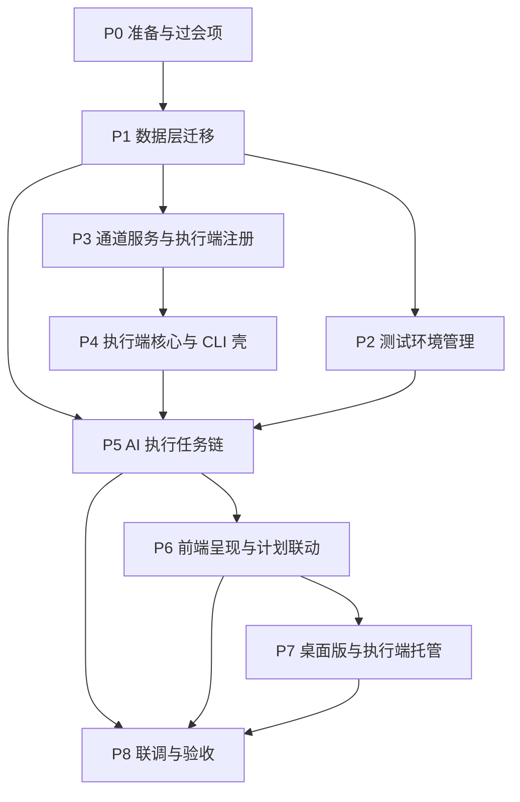

# 软件测试平台——AI UI 执行开发方案与计划

**文档版本**：V1.0
**日期**：2026-11-27
**状态**：起草中

---

## 1. 引言

### 1.1 编写目的

将 AI UI 执行（AI 驱动的 UI 自动化测试执行）能力的文档链（需求、概要、详细、交互、架构）转化为可执行的开发方案与阶段计划：明确总体实施策略、模块依赖与实施顺序、工作包清单、交付批次与验收门禁，作为开发排期、PR 审查与人工验收的共同依据。

### 1.2 范围

本计划覆盖以下交付内容：

1. **测试环境管理**：环境条目 CRUD、入口 URL 与执行参数、测试账号（掩码与占位符）、预置动作两级配置（项目级默认 + 环境级三态：继承 / 自定义覆盖 / 禁用）；
2. **AI 执行后端链路**：`ui_execution` 任务类型接入、发起前置校验（含执行端可用性）、批次执行主循环（组装冻结 → 预置动作 → 用例级循环 → 步进决策 → 判定回写 → 止损）、两个提示词场景；
3. **通道服务与执行端**：执行端实例注册表、WSS 通道服务与分派规则、执行端（Runner）核心与 CLI 壳；
4. **轨迹与统计**：动作轨迹落库与查询、执行记录来源与跳过语义、计划五态统计与环境列改造；
5. **前端双形态**：环境管理页、发起确认弹窗、批次进度与中止、执行详情、计划页联动；
6. **桌面版**：Electron 壳包裹 `web/`（一套代码双形态）、托管执行端子进程（专属实例）与本机执行端面板。

不覆盖：本计划不描述功能行为、表结构、接口报文与页面交互细节，它们分别以需求、详细设计、交互设计文档为准；执行端与桌面壳的协议细节以 `docs/04-detailed-design/09-runner/02-runner-core.md` 为单一事实源。

**权限口径**：本计划覆盖的业务模块仅校验当前用户是否为当前项目成员，不新增 RBAC 权限码、不校验项目角色。

**基线外依赖登记**：桌面版引入 `electron` / `electron-builder`、执行端引入 Playwright——均为过会项（概设 7 节、合并册 6.4），随 WP-0.1 落地登记于 2.5。

### 1.3 基线文档

| 层 | 文档 | 用途 |
| ---- | ---- | ---- |
| 需求 | `docs/01-requirements/03-function-testing/03-srs-ai-ui-testing.md` | 功能行为与验收口径（含执行端归属与分派、客户端形态业务规则） |
| 概要 | `docs/02-high-level-design/03-function-testing/03-hld-ai-ui-testing.md` | 模块划分、双形态客户端层、6.1 术语消歧与分派规则、7 部署视图 |
| 详细 | `docs/04-detailed-design/03-function-testing/09-ai-ui-testing.md` | 合并册：DDL、接口 3.1–3.10、错误码、主循环、执行端注册表与分派、前端与桌面版组件 |
| 详细 | `docs/04-detailed-design/09-runner/01-readme.md`、`docs/04-detailed-design/09-runner/02-runner-core.md` | 执行端通道协议单一事实源（帧、原因码、15 执行原语、CLI 壳与桌面版托管） |
| 详细 | `docs/04-detailed-design/03-function-testing/06-project-workspace-test-plan.md` | 测试计划改造（绑定环境、五态统计、skip 语义） |
| 详细 | `docs/04-detailed-design/07-ai-capability/02-ai-infra-overview.md` | AI 底座（任务框架、`ui_execution` 任务类型与提示词场景登记） |
| 详细 | `docs/04-detailed-design/02-project-module.md` | 10 位错误码号段登记（1000011031–1000011060） |
| 交互 | `docs/05-interaction-design/03-function-testing/07-workspace-ui-ai-execution.md` | 页面设计单一分册（环境页、编辑器、弹窗、批次条、执行详情、计划联动、本机执行端面板） |
| 交互 | `docs/05-interaction-design/03-function-testing/02-workspace-ui-overview.md` | 左侧菜单与执行结果跳过态登记 |
| 架构 | `docs/03-architecture/02-repository-architecture.md` | `runner/`、`desktop/` 顶层目录职责与选型 |

### 1.4 定义与缩写

| 术语 | 定义 |
| ---- | ---- |
| 执行端（Runner） | 在浏览器中执行动作、回传观察的独立进程组件；不决策、不判定、不持有模型凭据（定义唯一处为概设 6.1） |
| 共享实例 / 专属实例 | 执行端实例的两种归属：`cli` 独立部署为共享（任意用户批次可分派、优先）；`desktop-hosted` 桌面版托管为专属（仅本人批次、共享缺失时兜底） |
| 批次 | 一次 AI 执行发起的完整执行过程，对应一个 AI 任务实例 |
| 预置动作 | 确定性动作序列（典型为登录），由执行端直跑、不经模型；两级配置（项目级默认 + 环境级三态：继承 / 自定义覆盖 / 禁用） |
| 步级预算 | 每步骤的动作下发次数上限，计数在服务端；达上限步骤判 blocked |
| 工作包 | 计划的实施单元，编号 WP-*；本文只描述工作包与依赖，不排期、不给人天 |
| 交付批次 | 面向验收与合入的分组，一批对应一个可独立验收的范围 |

## 2. 开发方案

### 2.1 总体实施策略

1. **文档驱动**：实现严格以 1.3 基线文档为唯一依据；发现实现与文档冲突时暂停，先由用户确认以哪边为准，再改文档或改代码，禁止静默偏离。
2. **数据先行、通道先行**：先交付数据库迁移，再落通道服务与执行端注册表，然后是 AI 执行任务链，最后按交互稿做前端与桌面版。
3. **服务端为唯一决策面**：预算计数、分派选择、白名单与枚举校验、判定全部在服务端；执行端只执行与观察，客户端与执行端之间无直连（桌面版托管也不例外）。
4. **后端先行于前端**：接口经 springdoc 暴露 OpenAPI 后，前端按契约并行；API 变更先后端后前端。
5. **凭据最小暴露**：明文仅按当前用例经 `credential.grant` 帧授予，用例切换 / 到期 / 批次结束即清零，不落日志、不进轨迹、不进模型上下文；前端永不接触明文；Runner 只持实例注册凭据（`ownerToken` 短时一次性 / `sharedKey` 部署级可轮换）。
6. **提交粒度**：一个提交只做一件事（C7），前后端变更分属不同提交，严格目录隔离（只改本端目录）；`runner/`、`desktop/` 独立构建链的提交同样纳入各端门禁管理（见 2.5）。

### 2.2 分支与协作

- **分支模型**：`master` ← `develop` ← `feature/*`（总则 `docs/00-spec/30-quality-delivery/02-workflow.md` 第 1 章）；当前工作分支 `feature/ai-ui-testing`，批次收口后向 `develop` 发 PR，不在本地直接合入。
- **提交规范**：`<emoji> <type>(<scope>): <description>`，scope 按业务域（如 `ftenv`、`ft`、`ai`、`runner`、`desktop`）。
- **门禁**：提交前运行本端验证脚本至 EXIT=0（文档端 `node scripts/validate.mjs --docs`，前端 / 后端各自脚本），覆盖率满足 C8；`runner/` 与 `desktop/` 工程落地时同步纳入质量脚本登记（合并册 6.2 口径）。
- **跨端同步**：接口经 OpenAPI 分组同步；执行端帧协议以 Runner 详设 3 为单一事实源，服务端与执行端两侧按 6.3 对接清单互验。

### 2.3 模块依赖与实施顺序

### 2.4 技术实施要点

按模块列出实施要点；细节一律以对应基线文档为准，本文不重复定义。

#### 2.4.1 数据层与迁移

- 四张新表（`ft_environment`、`ft_preset_actions`、`ui_action_log`、`ai_runner_instance`）DDL 见合并册 2.1 / 2.3；`ft_plan_execution_record` 补 `source` 列（默认 `manual`，无回填）；`ft_plan.environment` 列类型由 `varchar(200)` 改 `uuid`（存量置空、本期不回填）；
- 符合 C5（公共四字段、UUID 框架默认策略、无物理外键）与 C9（索引每表 ≤5）；`ai_runner_instance` 为部署级注册表、不做工作空间过滤（合并册 2.3 归属口径）；
- 迁移以 `schema.sql` 初始化基线为口径（合并册 6.2），迁移说明随首个涉及数据库的提交交付。

#### 2.4.2 测试环境管理

- 环境 CRUD、入口 URL 列表、执行参数（viewport / 动作超时 / allow_evaluate / 步级上限）、项目内默认环境唯一；仅校验当前用户是否为当前项目成员，不新增 RBAC 权限码、不校验项目角色；
- 账号密码加密落库，列表与详情掩码回显、永不回明文；「复制环境」为纯前端行为（详情填充新建表单、密码全部留空、走既有创建接口，后端零改动）；
- 预置动作两级配置：项目级单行表 + 环境级三态（继承项目默认 / 自定义覆盖 / 禁用），继承且项目级为空或环境禁用时由 AI 自主完成登录等前置；服务端在 `session.start` 组装时按解析优先级定稿，引用解析与白名单一并完成（合并册 4.5）；
- 数据更新只更新传入字段（C11）；业务异常统一 10 位错误码（C3）。

#### 2.4.3 通道服务与执行端注册

- 服务端监听 `wss://{server}/ws/runner`，长连接注册态：握手阶段经 `Authorization` 头校验 `ownerToken`（`desktop-hosted`）或 `sharedKey`（`cli`），拒绝则不建连；首帧 `register` 仅声明 `mode` / `protocolVersion`，upsert 注册表并回 `register.ack`，注册为部署级行为不校验工作空间上下文；
- 分派规则两级 + 忙闲判定：① 任一在线且空闲的 `cli` 共享实例（心跳最新优先）→ ② 提交人本人在线且空闲的 `desktop-hosted` 实例；皆无在线报 1000011042，有在线但均忙报 1000011045（V1 不排队）；选中后以条件 UPDATE 原子占用并置租约，同一实例同一时刻仅一个进行中批次；
- 发起前置校验（后端强制）：提交时校验「存在在线共享或本人专属实例」，precheck 提供同规则只读快照（`runner{available,preferred,count}`）；
- 心跳 60s 缺失置 `offline` 摘除出分派池；凭据解密、白名单与原语枚举二次校验、`budgetSeq` 预算计数全部服务端完成（合并册 4.1）。

#### 2.4.4 执行端核心与 CLI 壳

- 协议帧、原因码、15 执行原语与观察结构以 Runner 详设 3 为单一事实源；`done` 为服务端语义原语不下发；
- 会话状态与凭据映射仅存内存，按用例 `credential.grant` 授予、用例切换 / 到期 / 批次结束清零；截图携带 `uploadGrant` 授权上传，以对象 key 引用；
- CLI 壳：`runner start --config <path>`，`sharedKey` 注册为共享实例；日志统一脱敏过滤器（密码 / Authorization / 凭据帧显示 `***`）；
- 本地调试 `headless=false` + dev 服务端通道；协议版本不兼容回 `PROTOCOL_VERSION`。

#### 2.4.5 AI 执行任务链

- `ui_execution` 以 AI Task 类型适配器（`TypeAdapter`）接入双平面架构的任务平面（超时 / 失活清扫复用；进度经 `status_change` 事件 + REST 游标轮询呈现，不新增 SSE / WS 端点，AI 底座详设）；执行编排归 AI、写库编排归应用层，执行判定直接写执行记录；
- 主循环：新建独立步进式执行策略（不复用通用 Agent tool-loop，仅复用双平面底座）；发起即冻结结构化用例数据（`ft_plan_node_snapshot` 的 `case / precondition / step / expected` 节点 ID / type / title / parent_id / sort_order，写入 `ai_task.input`，正文在模型调用前拼装，未同步修改不进执行）→ 预置动作直跑（三态解析，失败即 `aborted` 并写 `abort_meta.reason=preset_failed`，不烧预算）→ 用例级循环（前置 / 动作 / 验证 / 判定 / 止损）→ 判定回写执行记录（来源 `source=ai`，skip 语义）；
- 步进决策：组包（读冻结结构拼 markdown 正文 + 轨迹历史 + 最新观察 + 收敛注入）→ 模型调用（处理器直接传 `ui_execution_decision` / `ui_execution_verdict` 两场景，执行行 `promptScene` 沿用 `ui_execution`）→ 解析为动作或步骤完成；每动作写 `status_change` / `detail.kind=ui_progress`，无步骤用例拆解写 `detail.kind=ui_decompose`，均不新增事件类型；动作明细写 `ui_action_log`（唯一事实源，按 `execution_id` 对账），通用轨迹只记摘要；`input.modelId` 提交期校验可用性并写入执行行 `model_id`，作为本批次决策与判定的实际模型（缺省系统默认）；
- 预算：`ui_execution` 适配器声明专用 profile（`maxSteps` 按批次动作上限推导、`maxTokens` / `maxCost` 不低于批次上限），由 `BudgetGuard` 正常签发；步级上限、批次动作数 / token / 成本、批次时长 4h、连续失败停批同时生效、任一先到即终止，终止原因写 `abort_meta`；错误码 1000011031–1000011047（合并册 3.11）；
- 失败 / 中止：动作失败由步进决策重试、换路或止损，不视为任务错误；用户中止、预算熔断、租约到期或会话失活仅对 UI 执行批次写 `ai_task.abort_meta` 过程补充记录（中断阶段、已处理用例、已写判定清单、token 与成本消耗、中断原因），已写数据不回滚、本能力不产生提案——其他 AI 能力维持总册口径；执行判定不属待确认生成物 / 提案，直接生效并可人工改判；V1 批次不做完成 / 停批通知，状态在页面可见；停批 / 终止后可重新发起，默认仅重跑未执行与阻塞用例。

#### 2.4.6 轨迹与计划联动

- 轨迹追加式落 `ui_action_log`（action / action_failed / verdict / note），分页查询供执行详情；批次结束只读；
- 计划改造：`environment` 列类型改 `uuid`、存 `ft_environment.id` 并联表展示 `environmentName`（关联不上显示「已删除环境」）、五态统计（新增 skipped）、手动标记仍四态（服务端双保险拒绝 skip）。

#### 2.4.7 前端双形态与桌面版

- 环境管理页挂功能测试页 `?tab=ft-environments` 子路由（双端可用）；表单化预置动作编辑器用 Element Plus 拼装，无新依赖；
- 发起弹窗、批次条、执行详情、计划联动页面行为以交互分册 07 为唯一依据；发起入口与中止双端一致渲染，执行端可用性以后端校验为准；
- 形态判别全局单例（Electron 全局桥存在即桌面版），显隐为呈现策略、非安全边界；
- 桌面版：`desktop/` 壳工程包裹 `web/` 构建产物，随登录以子进程拉起 Runner 核心并以 `ownerToken` 注册专属实例，渲染进程不直连 Runner；设置区「执行端」面板（在线 / 离线 / 注册中 / 启动失败四态、启停、脱敏日志抽屉）。

### 2.5 环境与依赖管控

| 项 | 要求 |
| ---- | ---- |
| 数据库 | PostgreSQL 14+，沿用既有实例，无新扩展 |
| LLM 供给 | 沿用 AI 底座配置中心接入；执行决策与判定各需一个可用模型 |
| 实时通道 | 新增独立 Runner WSS 端点（`/ws/runner`，独立握手鉴权与连接注册表），不复用文档协作 WS 的 JWT 认证与按用户路由；V1 单节点部署并加启动保护；进度经现有 REST 任务详情 + 轨迹 `afterSeq` 游标轮询（≤2s 可见），UI 执行不消费 WebSocket / SSE 推送 |
| 浏览器运行时 | 执行端宿主机需可安装 Playwright 浏览器；开发环境先验证 CDP 观察链路 |
| 依赖管控 | 尽量不新增外部依赖，确有必要时经团队讨论（总则第 5 节） |
| 新增外部依赖（过会项） | Playwright（执行端浏览器驱动与 CDP 观察），随 WP-0.1 过会后引入，登记于此 |
| 新增外部依赖（过会项） | Electron + electron-builder（`desktop/` 桌面版壳），随 WP-0.1 过会后引入，登记于此 |

## 3. 开发计划

### 3.1 阶段划分

| 阶段 | 名称 | 内容概要 | 前置依赖 |
| ---- | ---- | ---- | ---- |
| P0 | 准备与过会项 | Playwright / Electron 依赖过会、`runner/` `desktop/` 目录立项、LLM 端点确认、设计基线收敛确认 | — |
| P1 | 数据层迁移 | 四新表 + `source` 补列 DDL 与索引迁移 | P0 |
| P2 | 测试环境管理 | 环境与预置动作后端、环境管理前端 | P1 |
| P3 | 通道服务与执行端注册 | 注册表、WSS 通道、分派与发起前置校验 | P1 |
| P4 | 执行端核心与 CLI 壳 | 协议、15 原语、观察、CLI 壳 | P3 |
| P5 | AI 执行任务链 | `ui_execution` 接入、主循环、判定回写、提示词场景 | P2、P3、P4 |
| P6 | 前端呈现与计划联动 | 发起弹窗、批次条、执行详情、计划五态与环境列 | P5 |
| P7 | 桌面版与执行端托管 | Electron 壳、Runner 托管、执行端面板、形态判别 | P6 |
| P8 | 联调与验收 | 分批联调、归属校验、覆盖率校验、判定可信度评测、质量门禁登记、人工验收 | 各批次 |

### 3.2 工作包清单

| 编号 | 工作包 | 阶段 | 端 | 输入文档 | 依赖 | 完成判据 |
| ---- | ---- | ---- | ---- | ---- | ---- | ---- |
| WP-0.1 | 过会项与目录立项（Playwright、Electron，`runner/` `desktop/`） | P0 | 全 | 概设 7、合并册 6.4、架构文档 | — | 依赖决议落地并登记 2.5；`runner/` `desktop/` 骨架与独立构建链就绪 |
| WP-0.2 | 联调环境准备（LLM 端点 + Playwright 浏览器） | P0 | 后端 | AI 底座详设环境章节 | — | 模型连通性测试通过；执行端宿主机可拉起浏览器 |
| WP-0.3 | 设计基线收敛与决策确认（安全边界、预算模型、迁移口径、判定门槛） | P0 | 全 | 合并册全文、Runner 详设、数据库规范 §5 | — | 需求 / 概设 / 详设 / 交互 / 计划五册口径一致，无「可评审」遗留项；迁移与预算方案经评审确认 |
| WP-1.1 | 数据层迁移（四新表 + `source` / `abort_meta` 补列 + 运行中批次唯一索引 + `environment` 列类型改 UUID + 版本化脚本） | P1 | 后端 | 合并册 2.1–2.3、6.2，数据库规范 §5 | WP-0.2、WP-0.3 | 全量基线与版本化迁移一致、空库与存量库两条路径均执行成功，CI 迁移测试通过，C5 / C9 达标，无回填 |
| WP-2.1 | 测试环境管理后端（CRUD / 掩码 / 默认环境 / 预置动作三态） | P2 | 后端 | 合并册 3.1–3.6、4.3–4.5 | WP-1.1 | OpenAPI 暴露，仅校验当前用户是否为当前项目成员（不新增 RBAC 权限码、不校验项目角色），错误码合规，C11 部分更新 |
| WP-2.2 | 测试环境管理前端（环境页、预置动作编辑器、复制环境） | P2 | 前端 | 交互分册 2.1–2.2 | WP-2.1 | 状态分支齐全，C1 无 `any`，复制环境密码全留空 |
| WP-3.1 | 通道服务与执行端注册（独立 WSS 端点、握手鉴权、注册表、容量租约、分派、前置校验） | P3 | 后端 | 合并册 2.3、3.7、4.1，Runner 详设 3.1–3.2 | WP-1.1 | 独立端点与文档协作 WS 隔离；握手阶段凭据校验（首帧不含凭据）/ 心跳续租 / 摘除走通；共享优先与专属兜底分派、原子抢占、`runner_busy` 拒绝生效；precheck `runner` 快照与提交校验一致 |
| WP-4.1 | 执行端核心与 CLI 壳（协议、15 原语、观察、全帧拦截、脱敏日志） | P4 | Runner | Runner 详设 3–6 | WP-3.1 | 对 dev 服务端完成注册 → 会话 → `credential.grant` → 原语执行 → 观察回传全链；全帧导航 / 新标签 / 下载拦截与出口 allowlist 验证通过；日志脱敏验证通过 |
| WP-5.1 | `ui_execution` 任务接入（类型、precheck、发起校验、中止） | P5 | 后端 | 合并册 3.7–3.8、4.1 前置校验段，AI 底座详设 | WP-3.1 | 任务创建校验链完整（总开关 → 项目成员校验 → 模型可用性 → 环境必填 → 执行端可用性与忙闲 → 同计划重复发起拒绝 1000011043，不新增 RBAC 权限码、不校验项目角色）；`modelId` 写入执行行并生效；中止 / 失败写 `abort_meta` 口径生效 |
| WP-5.2 | 独立步进式主循环与决策策略 | P5 | 后端 | 合并册 4.2–4.6，两提示词场景 | WP-5.1、WP-2.1、WP-4.1 | 结构化数据冻结（未同步修改不进执行、模型调用前拼正文）、预置动作三态与失败终止、预算（步级 / 动作数 / token / 成本 / 4h / 连续阻塞）先到者终止、`ui_progress` / `ui_decompose` 事件留痕、动作明细写 `ui_action_log`、证据服务端校验、判定回写 `source=ai` 与 skip 语义全部走通 |
| WP-5.3 | 轨迹接口与计划联动改造（action-logs、五态、环境列） | P5 | 后端 | 合并册 3.9–3.10，测试计划详设改造章节 | WP-5.2 | 轨迹分页查询、五态统计与 `environmentName` 展示口径生效，手动标记双保险拒绝 skip |
| WP-6.1 | 前端发起与批次呈现（弹窗、批次条、执行详情、计划页联动） | P6 | 前端 | 交互分册 2.3–2.6、3–5 | WP-5.1、WP-5.3 | `no_runner` / `runner_busy` / `environment_required` 等分支齐全，REST 轮询进度（含轮询失败保留值）与中止、重新发起走通，C1 无 `any` |
| WP-7.1 | 桌面版壳与执行端托管（`desktop/`、ownerToken、执行端面板、形态判别） | P7 | 全 | 合并册 5.3、6.4，交互分册 2.7，Runner 详设 5 | WP-6.1、WP-4.1 | 一套代码双形态渲染正确；登录即注册专属实例、登出 / 超时下线；执行端面板四态与脱敏日志达标 |
| WP-8.1 | 分批联调与验收 | P8 | 全 | 各批对应文档 | 各批工作包 | 验证脚本 EXIT=0、C8 达标、人工验收通过 |
| WP-8.2 | 判定可信度评测（黄金用例集与门槛） | P8 | 全 | 需求 6.2、概设 9.1 | WP-5.2、WP-8.1 | 黄金集 ≥60 条、全量 ≥3 轮；误通过率 ≤3%、误失败率 ≤5%、阻塞率 ≤20%、可复现率 ≥95%、证据校验通过率 100% 达标并留存对比记录 |
| WP-8.3 | 质量门禁登记（`runner/`、`desktop/` 纳入验证脚本） | P8 | 全 | 总则第 3 节、合并册 6.2 | WP-4.1、WP-7.1 | `runner/` 与 `desktop/` 的 lint / 构建 / 测试纳入 `scripts/validate.mjs`，CI 全量编排通过 |

> 说明：P4 可与 P5 前半（WP-5.1）并行推进（WP-5.1 不依赖执行端可执行，仅 WP-5.2 主循环联调需要 WP-4.1 就绪）；WP-7.1 中形态判别的公共单例（`window.electronBridge` 检测）随 WP-6.1 先行落地，Web 版行为不受 P7 排期影响。

### 3.3 交付批次建议

按依赖关系建议三批交付，每批在 `develop` 收口一次 PR 并保留可发布状态：

| 批次 | 覆盖阶段 | 范围 | 验收重点 |
| ---- | ---- | ---- | ---- |
| 批次一 | P0、P1、P2 | 测试环境管理（双端可用的配置能力，不依赖执行链路） | 设计基线收敛确认、迁移双路径通过、环境 CRUD 与掩码、预置动作三态配置与兜底、复制环境密码留空、默认环境唯一 |
| 批次二 | P3、P4、P5 | 通道服务、执行端核心与 AI 执行后端链路 | 独立 Runner 端点与注册分派、`runner_busy` 拒绝、CLI 壳端到端批次（预置动作 → 步进决策 → 判定回写）、全帧拦截、轨迹落库、多维度预算熔断 |
| 批次三 | P6、P7、P8 | 前端双形态、桌面版托管与验收 | 发起弹窗与 `no_runner` / `runner_busy` 分支、批次进度与中止、重新发起、执行详情轨迹、计划五态、桌面版双形态渲染与执行端面板、黄金集评测达标、质量门禁登记 |

批次间关系：批次二依赖批次一的环境数据（`session.start` 组装取环境配置）；批次三前端按 OpenAPI 契约可与批次二并行开发，端到端联调待批次二收口。

### 3.4 验收门禁

每批收口必须全部满足：

1. 本端验证脚本 EXIT=0（C7 提交格式 + lint / typecheck / 测试 + 覆盖率 C8 + 契约一致性）；
2. 无 `any`（C1）、Controller 无业务逻辑（C2）、异常与错误码合规（C3）、上下文头传递（C4）、迁移与索引合规（C5 / C9）；
3. API 文档随接口变更同步（springdoc），实现与文档冲突已按 2.1 第 1 条处理；
4. 关键路径人工验收，验收结果回填本计划的修改记录说明。

人工验收关键路径（每批至少覆盖）：

- 批次一：环境 CRUD 与密码掩码、预置动作环境级覆盖项目级、复制环境表单填充；
- 批次二：执行端注册与心跳失活摘除、共享优先分派与专属兜底、无可用执行端拒绝发起、CLI 壳完整批次（含失败原因码轨迹与预算熔断）；
- 批次三：发起弹窗执行端提示与 `no_runner` 分支、批次条进度与中止、执行详情轨迹与四值判定、计划五态统计、桌面版专属实例注册与本机执行端面板。

## 4. 风险与应对

| 风险 | 影响 | 应对 |
| ---- | ---- | ---- |
| 浏览器自动化不稳定（元素定位失败、页面渲染差异） | 批次大面积阻塞 | 机械等待 + 原因码失败观察，AI 换路决策；轨迹与截图留痕供人工复核；步级上限止损 |
| 凭据经通道下发 | 泄露面扩大 | 按用例 `credential.grant` 最小化授予、短时令牌、用例切换即清零；帧不落日志、不进轨迹与模型上下文；日志统一脱敏过滤器；共享实例批次间隔离上下文 |
| 共享执行端跨工作空间承载批次 | 数据串扰 | 批次级隔离浏览器上下文、批次间不保留页面 / Cookie / 凭据 / 本地存储；共享实例信任假设登记为部署前提与验收检查项；凭据访问全程审计 |
| AI 决策质量不达预期 | 误判定 / 预算浪费 | 判定纪律「证实才通过、证据不足判阻塞」；证据服务端校验；黄金用例集评测门槛（WP-8.2）；预置动作直跑不经模型；预算多维度熔断 |
| 长批次运行中断线 / 租约到期 | 批次中断、成本沉没 | 心跳 60s 内续租、租约 120s 到期回收；中断即终止并写 `abort_meta`，不跨连接续跑；重新发起默认仅重跑未执行与阻塞用例，历史结果保留 |
| 预算被通用任务预算先截断 | 批次异常终止、口径不一致 | `ui_execution` 专用预算 profile 上限不低于批次上限；通用预算先到视为配置异常并记录 |
| 执行端实例全离线 / 全忙 | 用户无法发起 | 发起前置校验提前拒绝并给出可操作提示（启动桌面版 / 联系运维部署 / 稍后重试）；桌面版托管提供专属兜底；V1 不排队、忙时明确拒绝 |
| Electron 打包体积与双形态回归成本 | 前端交付延后 | 一套代码双形态，显隐差异仅在前端呈现层；桌面版随批次三最后交付，Web 版不受阻塞 |
| 长周期分支偏离 develop | 合入冲突 | 批次收口即发 PR 合入 develop，期间定期同步 |
| 跨端契约漂移（服务端 ↔ 执行端 ↔ 前端） | 联调返工 | 帧协议单一事实源（Runner 详设 3）+ OpenAPI 先行；验收门禁含契约一致性检查 |
| 新增外部依赖 | 违反依赖管控 | Playwright / Electron 均为过会项，过会后引入并登记 2.5 |

## 5. 计划维护

- 阶段、工作包与批次随基线文档变更同步调整，调整走文档流程二并追加修改记录；
- 本文只维护阶段与依赖，不登记人天与日历排期；排期由管理者在本文之外按资源换算；
- 批次实际收口情况（验收结果、遗留项）记入对应修改记录行的说明。

## 修改记录

| 版本 | 日期 | 说明 |
| ---- | ---- | ---- |
| V1.0 | 2026-10-14 | 初始版本：总体实施策略、九阶段依赖、11 个工作包与三批交付建议；登记 Playwright / Electron 过会项 |
| V1.0 | 2026-11-25 | 同步 AI UI 执行开发方案与计划，按 08 编号落地（04 编号已由 AI vision 能力计划占用）；权限统一为沿用既有成员归属与项目角色校验、不新增 RBAC 权限码；失败 / 中止口径对齐双平面 / 提案术语，明确判定不属生成物与 V1 批次不做完成 / 停批通知 |
| V1.0 | 2026-11-26 | 冻结源改为计划用例快照；进度改 REST 轮询 + 轨迹事件；总时长 4h；服务端拒绝重复发起（1000011043）；拆解留痕；过程补充记录仅 UI 执行批次；权限仅校验项目成员 |
| V1.0 | 2026-11-27 | 收敛为可开发基线：分支名改 `feature/ai-ui-testing`；Runner 通道改独立 WSS 端点；凭据改为按用例 `credential.grant` 授予；预算改专用 profile + 多维度先到者终止；`modelId` 真实生效；预置动作三态与失败终止口径；新增 WP-0.3（基线收敛）、WP-8.2（判定评测）、WP-8.3（质量门禁）与迁移双路径验收；风险表补长批次重连 / 跨租户承载 / 预算截断 |
| V1.0 | 2026-11-26 | 明确结构化冻结（模型调用前拼正文）、独立步进式策略、动作明细以 `ui_action_log` 为事实源、Runner 凭据走握手鉴权；修正表名 `ft_plan_execution_record` 与 `environment` 列类型改 UUID（不回填） |
